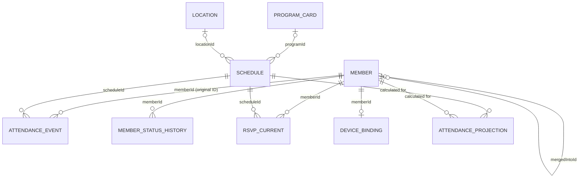

# Architecture Recovery Record

## Purpose

This record separates verified behavior in the current code from decisions agreed for the desired behavior. The PRD describes product requirements; this file records the data-flow risks and why recovery work is needed. Keep it current as findings are verified and decisions change.

The complete phased plan, owner decision gates, and acceptance checks are in [Architecture Recovery Roadmap](plans/10_architecture_recovery_roadmap.md). This record remains the evidence/decision log; the roadmap describes the sequence of work.

## Decisions Agreed With The Owner

- Google Spreadsheet is the official record for operational data such as members, schedules, attendance, and RSVP.
- Browser storage may cache data for display and temporarily hold writes that cannot yet reach the spreadsheet. It is not a second official record.
- A write is not complete until the spreadsheet confirms it. The UI must distinguish saving, confirmed, and failed/pending states.
- A check-in is not official attendance until the spreadsheet confirms it. If the same check-in is retried, it must retain the same unique ID so retries do not create duplicate records.
- Preserve both when the attendance was attempted and when the spreadsheet accepted it.
- An operator may correct an attendance result, but the original attendance record must remain unchanged. Record the correction separately so the original and the correction can both be reviewed.
- A pending write stored only on a device is not visible to operators until it reaches the spreadsheet. Clearing browser data or losing the device before delivery can lose that pending write; the UI must make the pending state visible.
- **Attendance decision confirmed:** Do not queue attendance for later upload when Google Sheets cannot be reached. Do not mark attendance complete unless Sheets confirms the write. Show the user a clear notice that attendance confirmation failed.
- **Check-in retry decision confirmed:** Keep the same unique ID when the user retries the same check-in. If Sheets confirms that ID already exists, report that the attendance was already saved; if it does not exist, save it once and then report success. If Sheets cannot be reached or its response cannot be confirmed, report failure and never claim it was saved.
- **Failure-audit decision confirmed:** When the system can communicate with Sheets, record attendance confirmation failures separately from successful attendance so operators can review them later. A failure record is never counted as attendance. If Sheets cannot be reached, the failure cannot be recorded there; notify the user and do not queue it on the device.
- **RSVP decision confirmed:** Keep only each member's current response; do not preserve a history of RSVP changes. Members may submit, change, or cancel their response until one hour before the currently saved schedule start. At the exact one-hour-before point and afterward, member changes are blocked. The cutoff moves whenever the schedule start changes: moving rehearsal later can reopen member voting if the new cutoff is in the future; moving it earlier closes voting immediately if the new cutoff has already passed. Operators are exempt and may change the current response after the cutoff. Because only the current response is kept, an operator's change overwrites the prior response and does not leave a change-history record.
- **Member duplicate/merge decisions confirmed:** Before creating a member, the server must compare the latest sheet roster. An exact match on normalized name plus full phone number must not create a second row; check and insert must happen inside the same lock-protected operation. Name-only, last-four-only, or incomplete legacy data is ambiguous: do not auto-merge or silently create a member; route it for operator review. A duplicate match alone must not silently bind a device or authenticate the person. Confirmed merges keep historical attendance IDs unchanged, retain the merged member row and its `mergedIntoId` link, and combine history only when displaying the representative member.
- **Atomic member registration and device binding confirmed:** New-member registration and device binding are one lock-protected Apps Script operation that writes a single member row containing both the member data and `boundDeviceId`. Existing-member contact updates and binding likewise update the same row in one request. The browser updates its member cache/profile only after Sheets confirms success; retries reuse the same member ID while the form remains open. A response lost after a server commit is resolved by retrying the same ID/device idempotently or by explicit duplicate review, never by silently binding a different existing ID. Google Sheets and browser storage do not support a shared distributed transaction; Sheets is authoritative, and its combined row write is atomic.
- **Prototype access decision confirmed:** The owner accepts that the Apps Script Web App is accessible to anyone with its link while the project remains a prototype. This is not production approval. Before production use or real member data, server-side authentication/authorization and role-limited data responses are required; track this in Task 76 of `docs/tasks.md`.
- **On-site PIN rotation decision confirmed (2026-10-20):** Only the current choir-wide `activeOnSitePin` is valid after rotation. Schedule-specific and legacy default PINs are invalidated. The server must validate the current PIN when recording a manual-PIN check-in.
- **MVP Simplification & Core Rules Confirmed (2026-10-20):**
  1. **No Legacy Production Data to Preserve:** Because the project is in MVP build stage with no live historical data to migrate, all legacy guessing/fallback adapters (`v2` storage migration, `getMembers()` read-time member fabrication, `memberName` / `scheduleId prefix` / `date` heuristics) were completely removed rather than maintained via compatibility layers.
  2. **1-Person 1-Device Lock Retained (`boundDeviceId`):** Kept as a deliberate core product feature on mobile (`이미 다른 기기에 연동되어 있는 계정입니다`), enforced consistently across both `[기존 명부에서 찾기]` and `[신규 단원 등록]` duplicate prompts. **Superseded temporarily on 2026-10-21 — see "Temporary multi-browser decision" below; the lock is to be restored when members install the app.**
  3. **ProgramCard ➔ Schedule Target Inheritance:** Updating a parent `ProgramCard`'s target audience (`targetAudienceType`, `targetParts`, `targetMemberIds`) prompts to batch-update child `Schedule`s while still allowing per-schedule individual edits.
  4. **Non-Target Member Schedule Visibility (`[🌿 자율 참여 연습]`):** All schedules remain visible on calendar/home views; non-target members see `[🌿 자율 참여 연습]`, are excluded from the denominator (`미참`) if they do not attend, and receive `+1` denominator & `+1` attendance (`guestAttended`) if they voluntarily check in.
  5. **Attendance Rate Formula SSOT (`src/utils/attendanceStats.ts`):**
     - **Excused Absence (`사유결석`):** Included in `totalSessions` denominator and counted under `excused` ("빠진 건 빠진 거니까").
     - **Late (`지각`):** Counted as 100% attendance in `attendanceRate` (`Math.round(((attended + late) / totalSessions) * 100)`), while tracked separately in `late` count and logs.

## Completed Recovery Implementation (2026-10-20)

- **Step 1 — Purified `src/services/sheets.ts` & `google-apps-script.js`:**
  - Removed `v2` localStorage migration and deep-cloned initial fallback data in `loadFromStorage` to prevent shared reference mutation across instances/tests.
  - Removed read-time side-effects in `getMembers()` and `fetchRemoteData()`.
  - Removed all `memberName`, `scheduleId.startsWith`, and `date` fallback guessing in `getRSVPVotes()`, `getLogs()`, `reconcileMemberAttendance()`, `fetchRemoteData()`, and `HomeView.tsx`.
  - Updated `mergeDuplicateMembers()` and `MERGE_MEMBERS` to preserve `RawAttendanceLog.memberId` immutable and resolve merged history via `mergedIntoId`.
  - Updated `deleteMember()` and `DELETE_MEMBER` to protect `MERGED` rows and canonical rows referenced by `mergedIntoId` from physical deletion.
  - Fixed `seedInitialData()` missing `phone` column alignment bug in `google-apps-script.js`, synced `docs/google_apps_script.js`, and deleted obsolete 5-tab `gas/Code.gs`.
- **Step 2 — Unified Single Pure Attendance & Statistics Engine (`src/utils/attendanceStats.ts`):**
  - Implemented `resolveMergedMemberIds`, `reconcileSingleMemberAttendance`, and unified `calculateCumulativeAttendanceWithLifecycle`.
  - Connected all 4 previously divergent attendance calculation sites (`src/services/sheets.ts`, `src/components/MemberPortalModal.tsx`, `src/components/MemberProfileModal.tsx`, `src/components/AdminMatrixGrid.tsx`) to this single engine.
- **Step 3 — Confirmed Sheet Sync, Idempotency & 1-Hour RSVP Cutoff:**
  - Removed the `mode: 'no-cors'` false-positive fallback in `sendToGoogleSheet()`.
  - Added `log.id` idempotency deduplication in both `SheetsService.addCheckInLog()` and GAS `RECORD_ATTENDANCE`.
  - Added lock-protected duplicate check (`id` or active `name + full phone`) in GAS `REGISTER_MEMBER`.
  - Enforced the 1-hour-before-start RSVP cutoff via `isRsvpOpenForSchedule()` in `src/utils/timeWindow.ts`, `src/components/HomeView.tsx`, and `src/components/RSVPModal.tsx`.

## Important Unresolved Risk

- The owner chose not to queue attendance for later upload. When Sheets cannot be reached, the attempt fails and the user must be notified; there is no pending attendance record to recover.
- A separate failure log cannot be written to the spreadsheet while the spreadsheet is unreachable. Which failure categories should be recorded, and the exact sheet/tab/columns and write flow, remain open. Do not change the spreadsheet schema until these are designed and approved.
- Do not describe the overall system as guaranteeing zero data loss. The confirmed rule prevents an unconfirmed attendance attempt from being presented as successful, but it does not make an unreachable spreadsheet available.

## Handoff For Future Agents

- The owner is not a software developer. Use plain Korean for planning conversations and explain technical terms when they are needed.
- Make one consequential product decision at a time. Give a recommendation and its practical tradeoff, then wait for the owner's answer before treating it as agreed.
- Only items explicitly accepted by the owner belong under “Decisions Agreed With The Owner.” Keep proposals, assumptions, and unresolved questions separate.
- Do not start a schema-changing or broad refactoring task based only on this record. First show the relevant current behavior, state the remaining choice plainly, and get approval where required by `AGENTS.md`.
- Preserve the distinction between verified code behavior, owner-approved policy, and unimplemented future work when updating this record.

## Verified Current-Code Findings

- `src/services/sheets.ts` loads operational data from browser storage when `SheetsService` is constructed. `src/App.tsx` requests spreadsheet data afterward, so the first displayed data can come from the local copy.
- `getMembers()` can restore a member from the device profile, change local storage, and send a registration request. A read can therefore change data.
- Many write methods update local state first and start spreadsheet requests in the background. Several callers do not wait for or check the spreadsheet result.
- `sendToGoogleSheet()` treats a `no-cors` request as successful even though the browser cannot read the server's response. Some callers also ignore a returned `{ success: false }` result.
- QR scanning has a visible failure screen for GPS/location rejection, but after location passes it awaits `addCheckInLog()`, which currently returns before Sheets confirms the write. The QR screen can therefore announce attendance success without confirmed spreadsheet storage; the persistence failure is not shown as a separate error.
- If a write reached Sheets but its response was lost, a new scan/retry could create a duplicate attendance row because the GAS `RECORD_ATTENDANCE` handler always appends and does not check whether the same log ID already exists.
- Intended user-facing path after a persistence failure: show a short “출석 실패. 다시 시도” notice; if the same-ID retry is confirmed as already saved or is saved now, show success. If repeated attempts still fail, tell the user to capture the error screen and contact an operator.
- The only general-looking pending set currently tracks some new member registrations. There is no shared pending-write queue for attendance, schedules, or RSVP.
- `mergeDuplicateMembers()` changes existing attendance-log member IDs in local state, and the `MERGE_MEMBERS` handler changes those rows in the spreadsheet. This conflicts with the append-only attendance-record rule.
- `reconcileMemberAttendance()` currently groups historical attendance and RSVP records using matching member names and phone last-four digits, rather than following the explicit `mergedIntoId` link. This can combine unrelated people with matching details or miss a true merge after details change.
- `deleteMember()` and the GAS `DELETE_MEMBER` handler physically remove a member row when it has no attendance or RSVP records. They do not protect a `MERGED` member or its `mergedIntoId`, so an otherwise inactive merged member's link could be deleted.
- `BindingModal` displays the members currently held by `SheetsService`. The existing-member selection mode has a manual “시트 명부 새로고침” button that calls `fetchRemoteData()`; the new-registration submit path does not make a fresh spreadsheet request.
- The new-registration screen checks its currently held member list using matching normalized name and phone last-four digits. `SheetsService.addMember()` and the GAS `REGISTER_MEMBER` handler do not perform a final duplicate check before adding a row; the GAS handler appends the new member row as sent.

## Current Data Flow (Initial Map)

The UI does not read Google Sheets directly. It reads the shared `SheetsService` instance. At startup, that instance loads browser storage; then `App.tsx` requests spreadsheet data and replaces local service data when the response arrives.

| Data | Where screens read it | What a write currently does | How screens refresh |
| --- | --- | --- | --- |
| Members | `getMembers()` in Home, Admin, Binding, and profile screens | Adds or changes the service's in-memory list and browser storage first; spreadsheet requests are often sent in the background. `getMembers()` can also restore and register a member while reading. | Home and Admin use the app's refresh counter. Some dialogs trigger it after actions. |
| Schedules | `getSchedules()` in Home, Admin, and Calendar | Adds or changes local service data first; spreadsheet requests are generally sent without waiting for the server result. | Home and Admin use refresh signals. Calendar reads service data when it renders; there is no shared live-update subscription. |
| Attendance | `getLogs()` and `reconcileAttendance()` in Home and Admin | Check-in is added locally, then sent in the background. Clearing attendance creates a local cancellation log; the server creates its own cancellation log and timestamp. | QR and Admin actions request a screen refresh after the service method returns, which may be before spreadsheet confirmation. |
| RSVP | `getRSVPVotes()` in Home, Calendar, and RSVP-related screens | A new answer replaces the existing local vote; the GAS handler overwrites the existing sheet row and removes duplicate rows. Cancel removes the local vote and asks GAS to delete the sheet row. This matches the agreed current-answer-only policy, but the one-hour cutoff is not implemented. | RSVP dialogs request a refresh after the service method returns, which may be before spreadsheet confirmation. |

This is a first map of the inspected paths, not a complete inventory of every screen. In particular, it does not yet establish exactly when each view becomes stale or which spreadsheet responses are checked by every caller.

## Member-Merge Decision And Remaining Question

- **Agreed:** Prevent duplicate accounts where possible, and provide a deliberate recovery path for duplicates that still occur. Exact normalized name plus full phone number is the duplicate key; a match must be checked against the current sheet roster by the server as part of the lock-protected registration operation.
- **Agreed:** Name-only, phone-last-four-only, or incomplete legacy matches are not proof that two records are the same person. Do not auto-merge or silently create a new member for these ambiguous cases; send them to operator review.
- **Agreed:** The duplicate check must not itself authenticate the user or silently bind their device to the matching account.
- **Agreed:** Keep each historical attendance log's original `memberId` unchanged.
- **Agreed:** Keep the merged member record with `status='MERGED'` and its explicit `mergedIntoId` pointing at the representative member. Never physically delete a merged member row while it is needed to connect historical IDs, even if it has no attendance or RSVP rows.
- **Agreed:** When showing the representative member's history or statistics, follow the explicit merge link and include logs belonging to merged IDs. Do not infer identity from matching names or phone numbers.
- **Still open:** When both the representative and merged account have a current RSVP for the same schedule, decide which response to keep. RSVP history is not retained, so this needs an explicit conflict rule before implementing member merge.
- **Still open:** Define how an existing account is safely verified/bound after an exact duplicate match, and how ambiguous legacy members are presented for operator review.

## Constraints And Open Questions

- Google Sheets communication must remain behind the `src/services/sheets.ts` adapter, as required by `AGENTS.md`.
- Do not change spreadsheet tabs, headers, or required columns without owner approval.
- The exact storage format for retry IDs, spreadsheet-confirmation time, operator corrections, and operator identity is not decided. Agree on it before changing the spreadsheet schema.
- Decide how long pending writes remain on a device, how users are warned, and how they can recover a pending write after changing devices.

## Next Recovery Work

1. Verify the deployed Apps Script version, linked spreadsheet, schema, and access settings; back up data before any operational change.
2. **P0 duplicate recovery:** Use the agreed explicit representative link to merge existing duplicate accounts without changing attendance-log IDs or deleting the link record. Decide how conflicting current RSVP responses are handled first.
3. Define which reachable attendance failures to record and approve the failure-log sheet format before changing spreadsheet schema.
4. Agree on the visible saving, confirmed, and failure-notice states for online-only attendance.
5. Implement and test same-ID check-in retries so an existing row is confirmed instead of appended twice.
6. Continue the read/write map for any remaining screens, then implement the smallest high-risk path first. Do not split the service or alter spreadsheet schema ahead of the required decisions.

## Architecture Recovery Assessment (Baseline)

This is a code-based baseline. The owner supplied the script they identify as currently used; its eight-tab structure and key handlers match the modern root `google-apps-script.js`, not the older five-tab `gas/Code.gs`. The owner also confirmed in Apps Script deployment management that access is granted to anyone with the Web App link. The exact deployed revision and live spreadsheet contents are not independently compared with the supplied source.

### 1. 시스템 개요

- Product shape: a React/Vite browser app, one large `SheetsService` singleton, a Google Apps Script Web App, and Google Spreadsheet tabs.
- Intended direction: spreadsheet stores operational records; the browser presents them and calculates attendance views.
- Current direction in code: browser storage is loaded first, service memory is mutated first for many writes, and Google Sheets is contacted afterward. Therefore the running system is hybrid rather than having one consistently enforced source of truth.
- Deployment status: the owner-provided current script matches the modern eight-tab, lock-protected family. The owner confirmed the deployed Web App allows anyone with its link. `gas/Code.gs` is a five-tab older protocol. `docs/GOOGLE_SHEETS_GUIDE.md` still presents that old file as a valid copy choice and references an initialization function not present in the modern script. The exact deployed revision still needs comparison before changes.

### 2. 현재 도메인 모델

| Entity / concept | Role in the system |
| --- | --- |
| Member | Roster identity, contact details, part/status, device binding, and merge pointer. |
| MemberStatusHistory | Time-ranged membership/part history; stored in its own sheet and also attached to Member objects after loading. |
| Schedule | One rehearsal/event, with time, audience, cancellation/archive state, and optional program/location references. |
| RawAttendanceLog | Check-in or administrator action used as input to attendance calculation. Intended to be append-only, but current merge rewrites it. |
| RSVPVote | Current per-member/per-schedule intention. Current implementation overwrites on change and deletes on cancellation. |
| LocationPreset | Reusable place and geofence definition. |
| ProgramCard | Group/default settings for related schedules. |
| AppConfig | System policy, categories, PIN, QR, defaults, and endpoint configuration. |
| AttendanceReconciliation / CumulativeMemberAttendance | Calculated views, not independent source records. |
| BoundDeviceProfile | Browser-local pointer to a member and device; not the roster itself. |

IDs are stored as strings. Sheets do not enforce foreign-key rules, so references are checked and repaired by application code. Several entities also copy names, parts, dates, or location details as snapshots.

### 3. 현재 데이터 흐름

1. `SheetsService` construction reads versioned `localStorage` keys, falls back to v2 values or `INITIAL_*` mock data, and holds arrays in memory.
2. `App.tsx` starts `fetchRemoteData()` after the first render. It replaces or combines each entity differently, saves the result back to local storage, then increments a refresh counter.
3. Screens call `sheetsService` directly or through hooks. Home/Admin use refresh counters; Calendar and modals read the singleton when they render. There is no common live subscription across all views or devices.
4. Many write methods mutate memory and local storage first, then send a background request. Their promise may resolve before the sheet response is known. Some responses reporting `success: false` are not treated as errors; the `no-cors` fallback cannot confirm what the server stored.
5. A later fetch can replace local values with spreadsheet values, preserve selected local-only records, filter records, or map IDs using names. The result depends on the entity-specific merge path.

| Operation | Current path and notable behavior |
| --- | --- |
| Schedule edit | Admin form → `useScheduleAdmin` → local Schedule update/storage → background GAS request → refresh signal. A failed remote write can leave the current screen showing the local edit until a later fetch. |
| Member change | Admin/Binding → local Member update/add → background or partially awaited GAS request → manual refresh. Registration server handler appends without a final duplicate check. |
| Check-in | QR/GPS validation → local log append → background GAS append → UI success. The UI can announce success before spreadsheet confirmation. |
| Attendance correction/clear | Admin action appends local logs and the server appends spreadsheet rows. Attendance timestamps can refer to a scheduled check-in time, so the projection uses append order—not timestamp order—to determine the latest action. |
| RSVP | Local current answer is replaced or removed → GAS overwrites or deletes the current row → dialog refreshes. History is not kept, as now agreed. |

### 4. 현재 Source of Truth 분석

| Data | Intended official source | What currently acts as truth at runtime |
| --- | --- | --- |
| Member | Google Spreadsheet | Local cache/defaults are visible first; remote roster later replaces them while preserving a special pending-member set. Reads can also restore/register a member. |
| Schedule | Google Spreadsheet | Local array is updated first; a remote fetch later replaces the schedule array. |
| Attendance | Google Spreadsheet append-only log | Local and remote log arrays preserve append order, which determines the latest action in the projection. QR check-in remote sync is still not awaited by the success path; fetch filters some IDs. |
| RSVP | Google Spreadsheet current response | Local upsert/delete occurs first; the sheet is then upserted/deleted. |
| Location / ProgramCard | Google Spreadsheet | Remote values and local-only values are combined; empty remote arrays do not consistently clear local values. |
| Config | Google Spreadsheet | Local defaults and remote partial config are merged; endpoint/config can also be browser-local. |
| Attendance statistics | None; calculated view | Computed in the browser from the service's currently held Member, Schedule, RSVP, and Log arrays. |

Conclusion: the product requirement names Sheets as the authority, but the implementation does not enforce that rule for reads, writes, or UI success states.

### 5. 구조적 문제점

- **Competing copies:** React view state, service memory, `localStorage`, mock defaults, and Sheets can each supply visible values.
- **Different merge rules:** `fetchRemoteData()` replaces schedules/logs, combines some members/locations/cards, merges config, and filters RSVP/log records. “Sync” does not mean one consistent operation.
- **Read changes data:** `getMembers()` can update the bound profile, create a local Member, persist it, and send a registration request.
- **Identity guesses:** RSVP/log loading and attendance reconciliation can use name, phone-last-four, schedule-ID prefixes, or date fallbacks. These heuristics can attach records to the wrong identity or hide them.
- **Append-only violation:** Merge changes existing attendance-log `memberId`, `memberName`, and notes locally and in the modern GAS script.
- **Too many responsibilities:** `SheetsService` owns domain operations, calculations, parsing/migration, browser persistence, network transport, fallback behavior, and test seeding. Many UI components import it directly.
- **Implicit transformations:** Date/time parsing, CSV-like array fields, missing-field defaults, and fallback coordinates are spread through loaders and UI-adjacent service methods.
- **Schema changes during reads:** Modern GAS `doGet()` calls `ensureSheetStructure()`, which creates missing tabs and appends missing headers. A read can therefore alter the spreadsheet schema.
- **Initialization data mismatch:** The modern script declares a `phone` column between `phoneLast4` and `role`, but its default member rows omit an empty value for `phone`. If the modern initialization seeds an empty roster, subsequent values shift into the wrong columns (for example `MEMBER` lands in `phone`, and `ACTIVE` lands in `role`). Existing sheets may shift differently because missing headers are appended. Inspect actual rows before relying on or correcting them.
- **Deployment drift:** The owner-provided script resolves which code family is intended, but the setup guide still points to an incompatible old script. The deployed Web App revision and effective access permissions remain external facts.
- **Security boundary (prototype risk accepted):** The owner confirmed anyone with the live Web App link can access it and accepts this for the prototype. The supplied script returns member rows, attendance logs, and full config, including fields for full phone, device binding, and `adminPin`; its POST handler has no server-side role/PIN authorization. The app also contains the Web App URL in its client-side default configuration, so the link is not a dependable secret. Whether real sensitive values are currently populated is not confirmed. Server-side authorization and least-data responses remain a pre-production requirement (Task 76).
- **Testing boundary:** Vitest covers service logic and mocks `fetch`, but this repository has no Apps Script integration test proving live sheet actions, lock behavior, deployment version, or error responses.

### 6. 기술 부채 평가

| Area | Assessment | Reason |
| --- | --- | --- |
| Maintainability | High debt | One service owns most domains; UI directly depends on it; several GAS copies exist. |
| Extensibility | High debt | New fields require coordinated changes across types, local adapters, Apps Script schemas, and screen refresh behavior. |
| Data consistency | Critical debt | Local-first writes, inconsistent merge policies, weak response handling, and identity rewrites can disagree across devices. |
| Testability | Medium-high debt | Domain calculations have unit tests, but persistence semantics and GAS behavior are not tested end-to-end. |
| Recovery/audit | High debt | Attendance has an event-log concept, but merge mutates it; failures are not reliably reported; offline attendance is now explicitly not queued. |
| Privacy/access control | Accepted prototype risk; critical before production | The owner accepts public-link access for the prototype. Supplied code returns sensitive roster/config fields and accepts writes without server-side role checks; Task 76 must close this before production. |

### 7. 목표 아키텍처

```text
React screens (display + temporary form state)
	↓
Domain use-cases/hooks (member, schedule, attendance, RSVP)
	↓
Domain repositories (clear read/write contracts)
	↓
Single Sheets adapter: src/services/sheets.ts (only network boundary)
	↓
One verified Apps Script deployment (validation, lock, idempotency, response)
	↓
Google Spreadsheet (official operational records)
```

- Sheets is the official source for operational records. Browser storage is a clearly marked display cache, not a competing authority.
- A write is confirmed only by a readable successful response from the verified script. Update the shared view/cache from confirmed data; do not report local mutation as saved.
- Attendance has the owner-approved exception: no offline queue; report failure if Sheets cannot confirm. Same-ID retry is deduplicated at the server.
- Attendance source events remain unchanged. Corrections and reachable failure records are separate event types/records; exact sheet schemas require approval.
- RSVP stores only the current answer, with the agreed one-hour moving cutoff and operator exception. Its merge conflict rule is still open.
- Repository/domain separation must preserve the `services/sheets.ts` single-communication-boundary rule in `AGENTS.md`.
- Verify server-side authentication and returned data scope before treating the public GAS endpoint as safe for member/private data.

### 8. 목표 엔티티 관계도



`ATTENDANCE_PROJECTION` is calculated, not an editable source table. `ATTENDANCE_EVENT` retains its original member ID; the explicit merge link determines which representative's view includes it. `RSVP_CURRENT` is one current response per member and schedule. These names describe logical entities and do not authorize new spreadsheet tabs/columns.

### 9. 마이그레이션 전략

1. **Confirm the live system:** Identify the deployed Apps Script project/version, URL, sheet tabs/headers, and actual access settings. Resolve the conflicting guide and GAS copies before assuming the server behavior.
2. **Protect and inventory data:** Back up the spreadsheet; count rows and inspect IDs, duplicate members, orphan references, missing fields, and date formats. Do not normalize or delete records in place.
3. **Freeze contracts:** Record entity IDs, relationships, read/write outcomes, RSVP cutoff, attendance retry, merge mapping, and failure behavior. Obtain approval for any source-sheet schema changes.
4. **Set one write contract:** Every operation must return confirmed success or a clear failure. Use server locking for check-and-write operations and stable request IDs for retry-safe append actions.
5. **Repair projections, not history:** Keep raw attendance IDs unchanged; make reporting follow explicit merge links. Review legacy name/date/prefix fallbacks and remove only after data has been reconciled and tested.
6. **Separate domain responsibilities:** Extract repository/use-case boundaries gradually while retaining one Sheets network adapter. Add contract tests around each migrated operation.
7. **Migrate screens incrementally:** Move high-risk member, schedule, attendance, and admin flows to confirmed data updates; compare old and new projections before removing compatibility paths.
8. **Retire legacy paths last:** Remove mock fallbacks, v2 migration, and duplicate GAS copies only after production data is backed up, mapped, and verified.

### 10. 리팩토링 우선순위

1. **P0: establish which backend is live and verify privacy/access settings.** The repository contains incompatible Apps Script/setup instructions.
2. **P0: member identity and merge integrity.** Enforce the agreed duplicate rule at the locked server write; preserve merged rows and historical attendance IDs; resolve duplicate RSVP conflicts before merge implementation.
3. **P0: confirmed attendance writes.** Replace false-success paths with readable confirmation, same-ID retry deduplication, simple failure notice, and separate reachable failure records after their schema is approved.
4. **P0: schedule/admin propagation.** Establish one confirmed read snapshot and consistent refresh behavior after edits; verify all affected member-facing views.
5. **P1: RSVP policy.** Enforce the moving one-hour cutoff, administrator exception, current-answer-only storage, and current merge conflict rule.
6. **P1: projection and legacy reconciliation.** Replace ambiguous identity joins with explicit IDs/merge links; validate calendar/statistics against preserved source records.
7. **P2: gradual service/component decomposition.** Only after data contracts and synchronization behavior are stable, split domain responsibilities and large screens.

No spreadsheet schema was changed without approval. As of 2026-10-20, the recovery implementation (Steps 1–4) and full mock/zombie data removal have been applied to the codebase:
- **Zero Fake/Mock Operational Data**: `SheetsService` initializes with empty arrays `[]` instead of `INITIAL_*` mock values, and `google-apps-script.js` `seedInitialData()` only initializes `환경설정` (no fake members, schedules, locations, or program cards). `mockData.ts` is used strictly by isolated unit test runners (`seedTestData()`).
- **100% Google Sheet Authority (`fetchRemoteData`)**: Removed `localOnly` / `localOnlyCards` / `pendingMemberIds` local merge and auto-reupload logic so that deleted or empty tabs in Google Sheets are reflected 1:1 in the web app without zombie resurrection.
- **Step 4 Safe Decomposition**: Extracted pure storage adapter (`src/services/sheetsStorage.ts`) and pure remote payload parsers/serializers (`src/services/sheetsParser.ts`) from `src/services/sheets.ts` while keeping `SheetsService` as the single network/state gateway. Decomposed `src/components/HomeView.tsx` into modular sub-components (`src/components/home/HomeCalendarSection.tsx`, `HomeActiveScheduleCard.tsx`, `HomeRsvpTallySection.tsx`, `HomeUpcomingListSection.tsx`).

### 2026-10-20 Follow-up: Binding, PIN, and Admin Session

- Enforced the existing one-member/one-device rule in the lock-protected `BIND_DEVICE` handler; client binding and unbinding now wait for the server response before changing the local cache.
- Generic member updates no longer overwrite device-binding columns.
- Admin PIN changes and on-site PIN rotations are confirmed by the Apps Script before the browser cache changes. Admin PIN checks read only the PIN from the server rather than downloading the full roster.
- Manual-PIN check-ins validate the current choir-wide PIN on the server before appending the attendance event. Schedule-specific and default fallback PINs are no longer accepted; legacy schedule PIN values remain preserved in existing rows but are ignored and no longer shown in the admin schedule views. New and duplicated schedules no longer generate per-schedule PINs.
- Admin browser sessions expire after 15 minutes without activity. This is a client-side session timeout, not a substitute for server-side authorization; Task 76 remains a production gate.

### 2026-10-21 Follow-up: Future Attendance Reset and Eligibility Investigation

- An attendance-reset log remains append-only and is projected as a cleared attendance correction, not a new attendance or absence event. For a future schedule, the admin matrix displayed the cleared cell as `-` (superseded on 2026-10-21: it now shows the vote state, e.g. `미투표`, see below); after a later attendance action, the new action becomes the projection.
- A targeted read of the current Sheets response confirmed the tested member/schedule data satisfies the existing eligibility rule: the member's joined date precedes the rehearsal, the effective status is `준단원`, the effective part is `베이스`, and the schedule is `PARTS` with `베이스` included.
- The shared device diagnostic then showed that the browser profile ID (`mem_new_1792510319942`) is absent from the current roster, while the intended `ADMIN` member is `mem_new_1792508291001`. `HomeView` had fallen back to a synthetic member using the stale profile's `ADMIN` part, which is not in the target parts; that caused the voluntary-attendance display. After a confirmed remote roster sync, `App.tsx` now clears a profile whose member ID no longer exists and prompts for an explicit rebind. No member is guessed or auto-merged, and no spreadsheet data is changed.

### 2026-10-21 Decision: Temporary multi-browser access (device lock suspended)

- **Confirmed fact (owner report):** The web link is shared through KakaoTalk, so members bind inside KakaoTalk's in-app browser. That browser's `localStorage` is separate from Safari/Chrome on the same phone, so the same person gets a different device UUID and is rejected as "another device" when opening the link in their normal browser. A web app cannot treat the two as one device.
- **Owner decision:** Suspend the 1-person 1-device lock until the web app is installed on members' phones. At that point the lock is to be restored and installed-app users re-bind from the app. This supersedes item 2 of the 2026-10-20 "MVP Simplification & Core Rules".
- **Implemented behavior:**
  - No `boundDeviceId` comparison blocks binding or logs a member out. `App.tsx` still clears a profile whose member ID is missing from the roster.
  - `BIND_EXISTING_MEMBER` identity check: if the roster row has a full phone number it must match the entered full number (leading zeros ignored, because Sheets may store the number as numeric); only legacy rows without a full number fall back to the last four digits.
  - The first bound device stays in `단원명부.boundDeviceId`; later browsers do not overwrite it and cause no sheet write. The column is now a reference value only. The admin `[기기 연동 초기화]` action is unchanged.
  - `출석원천로그` gained a `deviceId` column (owner approved). It is appended to the end of the header row by `ensureSheetStructure` on the next Apps Script call; existing rows stay blank and existing headers are untouched. Check-ins from the member's browser record `deviceId`; admin-entered logs leave it blank. Multi-device or shared-device detection is therefore a later projection over the append-only log; no admin flag UI exists yet.
- **Known residual risk:** While the lock is suspended, the permanent QR photo plus GPS radius, the on-site PIN and full-number verification are the only defenses against proxy check-in. Task 76 (server-side authorization) is unchanged and still a production gate.
- **Restoration note:** The removed rejection branches are in git history (`google-apps-script.js` `BIND_EXISTING_MEMBER` / `BIND_DEVICE` / `REGISTER_AND_BIND_MEMBER`, `sheets.ts` `bindMemberDevice`, `BindingModal.tsx`, `App.tsx` profile-sync effect). The `deviceId` column in the append-only log is to be kept even after the lock returns.

### 2026-10-21 Decision: Admin matrix shows vote state until the rehearsal ends

- **Confirmed fact (owner screenshot):** Members who voted `참석` for a not-yet-held rehearsal appeared as `결석` in the admin matrix, and unvoted/cleared future cells appeared as `-`. Cause: the cell logic only used the `-` branch for future schedules with no attendance log, no manual override and no vote; a vote made `isRecorded` true, so the cell fell through to the default `결석`.
- **Owner decision:** Replace `-` with vote state — `참석 · 투표`, `사유 · 투표`, `불참 · 투표`, `미투표` — and show vote information in the matrix.
- **Implemented rule (`src/utils/matrixCell.ts`, display only; the projection engine, statistics and raw logs are unchanged):**
  - Actual check-ins (`출석`/`지각`/manual recognition) always win.
  - Until the schedule's end time (same-day rehearsals included, via `getCheckInWindowState`), absence is not finalized: the cell shows the vote state. An explicit admin absence override still shows `결석`.
  - After the end time, `결석` is shown with a small `참석투표` / `불참투표` note when the member had voted, so no-shows after an attend vote are visible. Unvoted absences stay plain `결석`.
  - Non-target members show `미참`; a voluntary attend vote before the rehearsal shows `참석 · 자율`.
- **Not changed (needs a separate decision):** The member my-page still prints `결석 (-)` in the check-in time column for past absences, and the cumulative statistics engine still treats today's schedule as past for its own rules.

