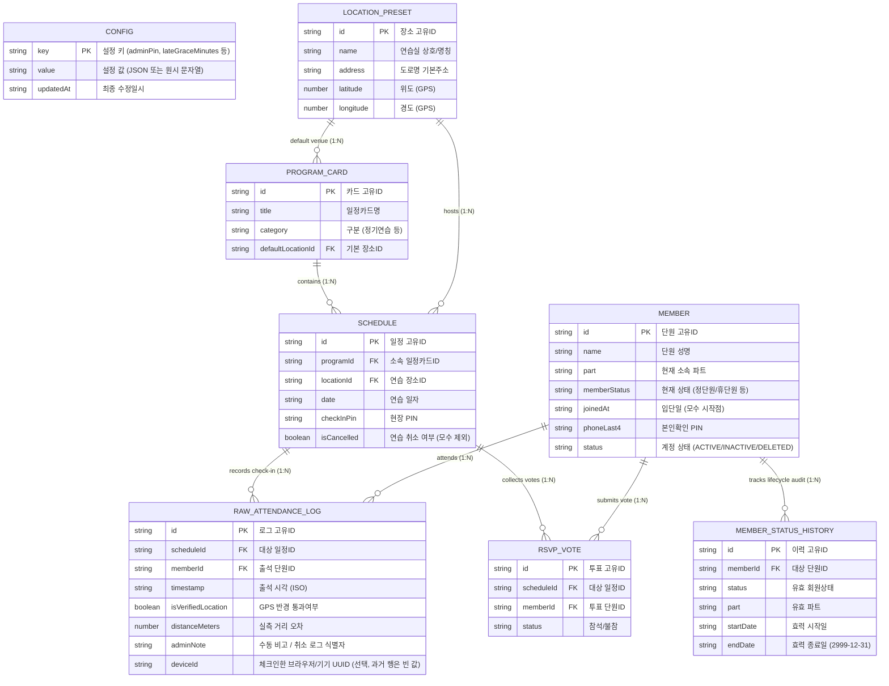
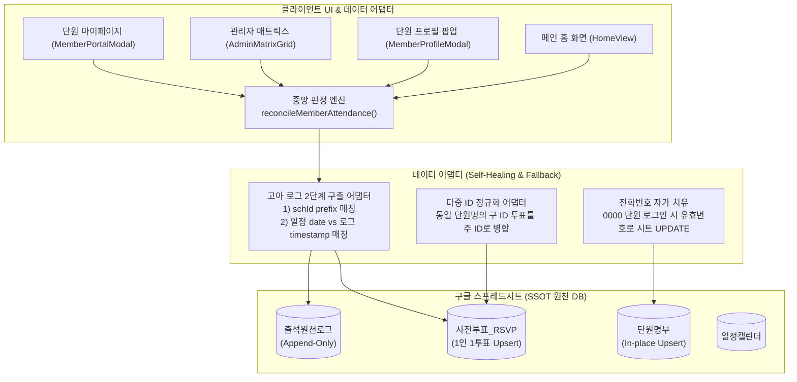

# Moonchoir Rollbook — 마스터 데이터 스키마 & 릴레이션 (DATA_SCHEMA.md)

> **버전**: 1.4.0 (MVP 아키텍처 리커버리 & 단일 순수 출결·통계 엔진 SSOT 확립)  
> **최종 수정일**: 2026-10-20  
> **단일 진실 공급원 (SSOT)**: 본 문서는 프론트엔드 TypeScript 모델, 구글 시트 8대 탭 구조, 구글 앱스 스크립트(GAS), 그리고 단위 테스트 간의 데이터 계약(Contract) 및 연쇄 영향도(Cascade & Dependency)를 정의합니다.  
> **핵심 원칙**: 모든 데이터베이스는 구글 시트에 저장/연동되며, 출석 및 단원 상태 변경 이력은 **시트에 원천 로그(DB 형식)로 영구 보존(Append-Only Event Sourcing)**됩니다.
> **동시성 & 정합성 보장**: 합창단 20~30명 동시 QR 스캔 시 행 덮어쓰기 방지를 위해 **GAS LockService 15초 스크립트 락**이 적용되어 있으며, 모든 읽기/쓰기는 컬럼 순서에 무관한 **헤더 키 기반 동적 매핑**으로 수행됩니다.

---

## 📌 1. 전체 ERD & 데이터 릴레이션 다이어그램



---

## 📌 2. 8대 엔티티 상세 스펙 (무슨 값인지 / 어디로 연결되는지 / 연쇄 수정 관계)

### 0) `SystemConfig` (중앙 환경설정 DB — 신규)
- **구글 시트 탭**: `환경설정`
- **시트 동기화 액션**: `SAVE_CONFIG`
- **역할**: 기존 `localStorage`에 머물러 기기 간 공유되지 않던 지각 유예시간, 관리자 PIN, 동적 파트/상태 분류 체계, A4 인쇄 문구를 시트에서 중앙 관리.

| 필드명 (TS) | 시트 헤더/키 | 무슨 값인가 (의미 & 예시) | 타입 / 기본값 | 어디로 연결되는가 | 비고 |
| :--- | :--- | :--- | :---: | :--- | :--- |
| `lateGraceMinutes` | `lateGraceMinutes` | 지각 판정 유예시간 (분 단위, 예: `10`) | `number` (10) | 출결 판정 엔진 (`reconcileAttendance`) | 지각 기준 시각 판정 |
| `adminPin` | `adminPin` | 마스터 관리자 4자리 PIN (예: `1234`) | `string` ('1234') | 관리자 로그인 게이트 | 분실 시 시트에서 직접 수정 가능 |
| `customParts` | `customParts` | 등록된 파트 목록 (JSON 배열, 예: `["소프라노","알토"...]`) | `string[]` | 파트 드롭다운, 태그 매니저 | 동적 파트 체계 |
| `customMemberStatuses` | `customMemberStatuses` | 회원 구분 목록 (JSON 배열) | `string[]` | 회원구분 드롭다운 | 정단원/준단원/휴단원 등 |
| `customCategories` | `customCategories` | 연습 카테고리 목록 (JSON 배열) | `string[]` | 캘린더 분류 뱃지 | 정기연습/추가연습/연주/녹음 |
| `qrPrintTitle` | `qrPrintTitle` | A4 인쇄용 상단 타이틀 | `string` | 종이 마스터 QR 인쇄 화면 | 현장 배포용 서식 |
| `qrPrintSubtitle` | `qrPrintSubtitle` | A4 인쇄용 부제목 및 장소 | `string` | 종이 마스터 QR 인쇄 화면 | 현장 배포용 서식 |
| `qrPrintNotice` | `qrPrintNotice` | A4 인쇄용 안내 문구 | `string` | 종이 마스터 QR 인쇄 화면 | 현장 배포용 서식 |

---

### 1) `Member` (단원 명부)
- **구글 시트 탭**: `단원명부`
- **시트 동기화 액션**: `REGISTER_MEMBER`, `UPDATE_MEMBER`, `DELETE_MEMBER`
- **역할**: 합창단 단원들의 기본 신원, 현재 상태, 연락처 및 레거시 마지막 브라우저 메타데이터를 관리하는 마스터 명부.

| 필드명 (TS) | 시트 헤더명 | 무슨 값인가 (의미 & 예시) | 타입 / 필수 | 어디로 연결되는가 (관계/FK) | 수정/삭제 시 연쇄 영향 (Cascade & 동기화 룰) |
| :--- | :--- | :--- | :---: | :--- | :--- |
| `id` | `id` | 단원 고유 식별자 (예: `m_1740000000000_a1b2`) | `string` (필수) | **단원 마스터 기본키 (PK)**.<br>• `단원변경로그.memberId`<br>• `출석원천로그.memberId`<br>• `사전투표_RSVP.memberId` | • **수정 불가**: 한 번 발급된 ID는 변경되지 않음.<br>• **삭제 차단 (Soft Delete)**: 출석/투표 이력이 있는 단원은 행을 삭제하지 않고 `status='DELETED'`로 소프트 삭제 처리하여 역대 통계 무결성을 100% 보존. 기록 없는 오등록 단원만 시트 행 물리 삭제. |
| `name` | `name` | 단원 성명 (예: `홍길동`) | `string` (필수) | UI 화면 표시, 검색 키워드, 로그/투표 비정규화 캐시 | • 이름 수정 시 시트 `단원명부` 행 갱신.<br>• 원천로그는 `memberId`로 조인되므로 이름이 바뀌어도 과거 모든 출석 기록의 정합성이 100% 유지됨. |
| `part` | `part` | 현재 소속 파트 (예: `소프라노`, `알토`, `테너`, `베이스`, `선생님`, `객원` 또는 직접 입력값) | `string` (필수) | 파트별 집계 및 `MemberStatusHistory.part`로 복제 기록 | • 파트 변경 시 `단원명부` 파트 열 업데이트.<br>• **동시에 `단원변경로그` 시트에 신규 이력 행이 Append**되고 직전 활성 이력의 `endDate`가 자동으로 마감됨. |
| `phone` | `phone` | 전체 휴대전화번호 (예: `010-1234-5678`) | `string` (선택) | 단원 비상 연락망, 본인 인증 원천 | • 전화번호 수정 시 `phoneLast4`가 자동 재추출되어 시트 `단원명부`에 동기화 반영됨. |
| `phoneLast4` | `phoneLast4` | 전화번호 뒤 4자리 (예: `5678`) | `string` (필수) | 회원 확인 보조 정보 | • `phone` 입력 시 자동 추출.<br>• 기존 회원을 새 브라우저에서 연결할 때 서버는 저장된 전체 전화번호가 있으면 전체 번호를 대조하고, 전체 번호가 없는 레거시 행은 뒤 4자리를 대조함. |
| `role` | `role` | 시스템 권한 (`MEMBER`, `ADMIN`, `GUEST`) | `string` (필수) | 관리자 대시보드 접근 제어 | • `ADMIN`으로 변경 시 관리자 대시보드 메뉴 활성화. |
| `status` | `status` | 계정 활성화 여부 (`ACTIVE`, `INACTIVE`, `MERGED`, `DELETED`) | `string` (필수) | 명부 필터링 및 활동 감사 | • `DELETED`: 소프트 삭제된 단원 (과거 통계용 보존).<br>• `MERGED`: 중복 정리로 대표 계정(`mergedIntoId`)에 통합된 계정 (원천 로그 연결을 위해 물리 삭제 영구 차단).<br>• `INACTIVE`: 휴단/퇴단 등으로 일시 비활성화된 계정. |
| `mergedIntoId` | `mergedIntoId` | 통합된 대표 단원 ID (예: `mem_s01`) | `string` (선택) | **자기참조 외래키 (FK)** $\rightarrow$ `단원명부.id` | • **원천 로그 불변 보존**: 단원 병합(`MERGE_MEMBERS`) 시 과거 `출석원천로그.memberId`를 덮어쓰지 않고, 피병합 단원에 `status='MERGED'` 및 `mergedIntoId=대표ID`만 기록.<br>• 투영 엔진(`resolveMergedMemberIds`)이 이 체인을 따라 대표 단원의 출결·통계를 합산. |
| `joinedAt` | `joinedAt` | 단원 입단 일자 (`YYYY-MM-DD`, 예: `2026-10-16`) | `string` (필수) | **출결 모수(분모) 시작 기준점** | • **출결 통계 연쇄 재계산**: $Schedule.date < joinedAt$ 인 과거 연습일정은 해당 단원의 출결 모수(분모)에서 자동 제외됨 (신입 단원의 결석 왜곡 원천 차단). |
| `memberStatus`| `memberStatus`| 현재 회원상태 (`정단원`, `준단원`, `휴단원`, `객원`, `선생님`, `퇴단원`) | `string` (필수) | 출결 의무 판정 기준 및 `MemberStatusHistory.status` 연동 | • 상태 변경 시 `단원명부` 갱신과 동시에 **`단원변경로그` 시트에 신규 행 Append**.<br>• `휴단원`/`퇴단원` 전환 시 이후 일정의 기본 출결 모수(분모)에서 자동 제외됨. |
| `note` | `note` | 관리자 비고/특이사항 (예: "가을 정기연주회 솔로") | `string` (선택) | 관리자 프로필 상세 모달 | • 수정 시 `단원명부`의 해당 셀만 업데이트. |
| `boundDeviceId`| `boundDeviceId`| 마지막으로 사용한 브라우저의 레거시 식별자 | `string` (선택) | 기존 데이터 호환용 메타데이터 | • 접근 제어나 회원 인증에 사용하지 않음. 새 브라우저에서 같은 회원 ID로 본인 확인해 사용할 수 있으며, 이 값은 마지막 사용 브라우저 정보로만 덮어씀. |
| `boundDeviceAt`| `boundDeviceAt`| 마지막 브라우저 사용 시각 (ISO 8601 타임스탬프) | `string` (선택) | 기존 데이터 호환용 메타데이터 | • 회원 연결이 성공하면 갱신되며, 로그아웃 시 다른 브라우저에 영향을 주지 않도록 서버에서 지우지 않음. |
| `statusHistory`| - (가상 필드) | 기간제 상태/파트 변경 이력 배열 (`MemberStatusHistory[]`) | `Array` (선택) | **구글 시트 `단원변경로그` 전체와 1:N 양방향 연결** | • `fetchRemoteData` 시 시트 `단원변경로그`에서 `memberId`로 필터링되어 각 단원 객체에 자동 조립(Rehydration)됨. |

---

### 2) `MemberStatusHistory` (단원 생애주기 이력 DB — 시트 Append-Only)
- **구글 시트 탭**: `단원변경로그` (신설 감사 로그 DB)
- **시트 동기화 액션**: `ADD_MEMBER_HISTORY`, `UPDATE_MEMBER` 실행 시 자동 적재
- **역할**: 단원의 회원상태(정단원/휴단원/객원 등) 및 파트 이동 이력을 유효 기간(`startDate` ~ `endDate`)과 사유와 함께 구글 시트에 영구 보존.

| 필드명 (TS) | 시트 헤더명 | 무슨 값인가 (의미 & 예시) | 타입 / 필수 | 어디로 연결되는가 (관계/FK) | 수정/삭제 시 연쇄 영향 (Cascade & 동기화 룰) |
| :--- | :--- | :--- | :---: | :--- | :--- |
| `id` | `id` | 이력 고유 식별자 (예: `hist_1740000000000_x9y8`) | `string` (필수) | **이력 기본키 (PK)** | • **불변식**: 한 번 기록된 이력은 절대 임의 삭제/수정되지 않음 (감사 추적 DB). |
| `memberId` | `memberId` | 대상 단원 ID (예: `m_1740000000000_a1b2`) | `string` (필수) | **외래키 (FK)** $\rightarrow$ `단원명부.id` | • 대상 단원이 퇴단/삭제되어도 이력 행은 **영구 보존 (Restrict / No Cascade Delete)**. |
| `name` | `name` | 단원 성명 (예: `홍길동`) | `string` (선택) | 시트 관리자 가독성용 비정규화 컬럼 | • 시트에서 직접 스프레드시트를 열람할 때 단원 이름을 즉시 식별할 수 있도록 편의 제공. |
| `status` | `status` | 해당 기간에 유효했던 회원상태 (`정단원`, `휴단원`, `객원` 등) | `string` (필수) | 과거 시점 출결 모수 판정 엔진 (`isMemberRequiredForSchedule`) | • 특정 날짜 $D$의 연습일정에 대해, $startDate \le D \le endDate$인 행의 `status`를 찾아 해당 일자의 출결 의무(모수 1 vs 0)를 판정. |
| `part` | `part` | 해당 기간에 소속되었던 파트 (`소프라노`, `알토`, `테너`, `베이스` 등) | `string` (필수) | 과거 파트별 출석률 통계 엔진 | • 파트를 이동한 단원이라도 과거 특정 학기/시즌 통계에서는 당시 소속 파트로 정확히 집계됨. |
| `startDate` | `startDate` | 상태 효력 시작일 (`YYYY-MM-DD`, 예: `2026-10-16`) | `string` (필수) | `Schedule.date`와 시계열 구간 비교 | • 시작일이 포함되는 구간의 모든 일정에 해당 상태의 비즈니스 룰이 적용됨. |
| `endDate` | `endDate` | 상태 효력 종료일 (`YYYY-MM-DD`, 영구 적용 시 `2999-12-31`) | `string` (필수) | `Schedule.date`와 시계열 구간 비교 | • 신규 이력이 등록되면 직전 활성 이력의 종료일이 `새_시작일 - 1일`로 자동 마감됨.<br>• `[♾️ 영구 적용]` 선택 시 `2999-12-31`로 설정되어 향후 모든 일정에 기본 적용됨. |
| `reason` | `reason` | 변경 사유 (예: "취업 준비로 인한 가을 학기 휴단") | `string` (선택) | 단원 프로필 상세 타임라인 카드 뷰 | • 관리자가 입력한 사유가 시트 DB에 영구 기록되어 인수인계 및 이력 증빙에 활용. |
| `createdAt` | `createdAt` | 시스템 기록 시점 (ISO 8601 타임스탬프) | `string` (필수) | 감사 타임스탬프 | • 생성 순서 정렬 및 변경 감사(Audit) 기준. |

---

### 3) `ProgramCard` (일정 카드 / 프로젝트 컨테이너)
- **구글 시트 탭**: `일정카드`
- **시트 동기화 액션**: `SAVE_PROGRAM_CARD`, `DELETE_PROGRAM_CARD`
- **역할**: 16주 정기연습, 정기연주회 준비, 워크샵 등 흩어진 일정들을 하나의 학기/프로젝트 묶음(Container)으로 구조화하여 관리.

| 필드명 (TS) | 시트 헤더명 | 무슨 값인가 (의미 & 예시) | 타입 / 필수 | 어디로 연결되는가 (관계/FK) | 수정/삭제 시 연쇄 영향 (Cascade & 동기화 룰) |
| :--- | :--- | :--- | :---: | :--- | :--- |
| `id` | `id` | 카드 고유 식별자 (예: `card_2026_fall`) | `string` (필수) | **일정카드 기본키 (PK)**.<br>• `연습일정.programId`가 이 값을 참조 | • 카드 ID 변경 불가.<br>• 카드 삭제 시 소속 일정들의 `programId`는 유지되거나 사용자 확인 후 일괄 정리. |
| `title` | `title` | 프로그램 명칭 (예: `2026 하반기 정기연습`) | `string` (필수) | 관리자 대시보드 카드 헤더 및 소속 일정 그룹핑 | • 타이틀 수정 시 소속 일정들의 그룹핑 헤더가 즉시 동기화됨. |
| `description`| `description`| 상세 안내 및 목표 곡목 (예: "제12회 정기연주회 모차르트 레퀴엠 대비") | `string` (선택) | 카드 요약 안내문 | • 수정 시 해당 셀만 업데이트. |
| `category` | `category` | 일정 성격 구분 (`정기연습`, `추가연습`, `연주회`, `워크샵`) | `string` (필수) | 캘린더 카테고리 필터링 | • 변경 시 카드 뱃지 색상 및 소속 일정 기본 분류 동기화. |
| `defaultLocationId` | `defaultLocationId` | 기본 연습 장소 ID (예: `loc_secho_1`) | `string` (선택) | **외래키 (FK)** $\rightarrow$ `장소정보.id` | • 기본 장소 수정 시, 카드 내에서 `➕ 추가연습 등록` 시 해당 장소가 기본값으로 자동 입력됨. |
| `defaultStartTime` | `defaultStartTime` | 기본 시작 시간 (`HH:mm`, 예: `19:30`) | `string` (선택) | 신규 회차 일정 생성 기본값 | • 수정 시 향후 추가되는 일정의 시작시간 기본값 변경. |
| `defaultEndTime` | `defaultEndTime` | 기본 종료 시간 (`HH:mm`, 예: `22:00`) | `string` (선택) | 신규 회차 일정 생성 기본값 | • 수정 시 향후 추가되는 일정의 종료시간 기본값 변경. |
| `targetAudienceType`| `targetAudienceType`| 기본 대상자 (`ALL`, `PARTS`, `CUSTOM_MEMBERS`) | `string` (선택) | 신규 회차 일정 생성 기본값 | • 회차 생성 시 기본 대상자 필터로 자동 적용. |
| `targetParts` | `targetParts` | 기본 대상 파트 (예: `소프라노,알토`) | `string[]` (선택)| 신규 회차 생성 기본값 | • 쉼표 구분 CSV 문자열로 저장 및 파싱. |
| `targetMemberIds` | `targetMemberIds` | 기본 선발 단원 ID 목록 | `string[]` (선택)| 신규 회차 생성 기본값 | • 쉼표 구분 CSV 문자열로 저장 및 파싱. |
| `isArchived` | `isArchived` | 아카이브 여부 (`true` / `false`) | `boolean` (필수) | 대시보드 뷰 필터링 | • `true` 전환 시 지난 학기 일정 카드가 목록에서 숨김 처리됨 (단, 출결 데이터는 100% 보존). |
| `createdAt` | `createdAt` | 카드 생성 일시 (KST 타임스탬프) | `string` (필수) | 정렬 기준 | • 카드 생성 순 정렬. |

---

### 4) `Schedule` (개별 연습 일정)
- **구글 시트 탭**: `일정캘린더`
- **시트 동기화 액션**: `CREATE_SCHEDULE`, `UPDATE_SCHEDULE`, `DELETE_SCHEDULE`, `BATCH_UPDATE_SCHEDULES`, `BATCH_DELETE_SCHEDULES`
- **역할**: 출석 체크(QR/PIN) 및 사전 투표(RSVP)가 실제로 발생하는 날짜별 연습 이벤트.

| 필드명 (TS) | 시트 헤더명 | 무슨 값인가 (의미 & 예시) | 타입 / 필수 | 어디로 연결되는가 (관계/FK) | 수정/삭제 시 연쇄 영향 (Cascade & 동기화 룰) |
| :--- | :--- | :--- | :---: | :--- | :--- |
| `id` | `id` | 일정 고유 식별자 (예: `sch_20261022_01`) | `string` (필수) | **일정 기본키 (PK)**.<br>• `출석원천로그.scheduleId`<br>• `사전투표_RSVP.scheduleId` | • **불변식**: 일정 ID는 절대 변경되지 않음.<br>• **삭제 차단 (Cascade Safety)**: 이미 출석 원천로그나 투표가 1건이라도 기록된 일정은 행 물리 삭제가 차단되며 `isCancelled=true`로 소프트 취소 처리되어 출결 통계 모수(분모)에서 안전하게 제외됨. 기록 없는 오등록 일정만 시트 행 물리 삭제. |
| `isCancelled`| `isCancelled`| **연습 일정 취소 여부 (`true`/`false`)** | `boolean` (선택) | 출결 통계 및 캘린더 표시 | • `true` 시 캘린더에 취소선 및 🚫 배지 표시, **모든 단원의 출석률 모수(분모)에서 자동 제외**. |
| `programId` | `programId` | 소속된 상위 일정카드 ID (예: `card_2026_fall`) | `string` (선택) | **외래키 (FK)** $\rightarrow$ `일정카드.id` | • 상위 카드가 `🔁 다음 학기로 복제`될 때, 신규 일정으로 복제되면서 새 카드의 `programId`를 부여받음 (과거 일정과 100% 분리). |
| `title` | `title` | 일정 명칭 (예: `가을 정기연습`, `소프라노 파트연습`) | `string` (필수) | 단원 캘린더, 출석 QR 화면 표시 | • 제목이 바뀌어도 출석 로그는 `scheduleId`로 연결되어 100% 보존. |
| `date` | `date` | 연습 일자 (`YYYY-MM-DD`, 예: `2026-10-22`) | `string` (필수) | 출결 모수 판정($joinedAt$, $statusHistory$)의 기준일 | • **모수 연쇄 재계산**: 날짜가 변경되면 해당 날짜에 유효한 단원들의 출결 자격이 재판정됨. |
| `startTime` | `startTime` | 연습 시작 시각 (`HH:mm`, 예: `19:30`) | `string` (필수) | 출석 QR 오픈 시간 및 지각 기준점 | • 시간 변경 시 QR 활성화 타임윈도우(시작 1시간 전 ~ 종료 후 30분) 및 정시/지각 판정선이 자동 재계산됨. |
| `endTime` | `endTime` | 연습 종료 시각 (`HH:mm`, 예: `22:00`) | `string` (필수) | 출석 QR 마감 시간 | • QR 마감 시각 자동 재계산. |
| `locationName` | `locationName`| 연습 장소명 (예: `드림 보컬 스튜디오`) | `string` (필수) | 사용자 UI 및 캘린더 안내 | • 장소 프리셋 선택 시 자동 반영. |
| `locationId` | `locationId` | 연결된 장소 프리셋 ID (예: `loc_dream_01`) | `string` (선택) | **외래키 (FK)** $\rightarrow$ `장소정보.id` | • **관계형 단일 진실 공급원(SSOT)**: `locationId`가 존재하면 본 일정의 좌표/반경은 `장소정보`의 최신 값을 실시간 참조함. |
| `targetLat` | `latitude` | 장소 위도 (예: `37.498092`) | `number` (선택) | 모바일 네이티브 Geolocation 검증 (`geo.ts`) | • 프리셋 없을 때만 직접 입력 폴백. |
| `targetLon` | `longitude` | 장소 경도 (예: `127.027610`) | `number` (선택) | 모바일 네이티브 Geolocation 검증 (`geo.ts`) | • 프리셋 없을 때만 직접 입력 폴백. |
| `radiusMeters` | `radiusMeters`| 출석 인정 반경 (미터, 기본 `100`) | `number` (선택) | Haversine 공식 거리 오차 허용 한계 | • `locationId` 프리셋의 최신 반경이 실시간 반영됨 (50m ~ 500m). |
| `targetAudienceType` | `targetAudienceType` | 참석 대상 필터 (`ALL`, `PARTS`, `CUSTOM_MEMBERS`) | `string` (선택) | 출결 통계 및 개인 홈 화면 분기 기준 | • `ALL`: 전체 필참<br>• `PARTS`: 특정 파트 한정<br>• `CUSTOM_MEMBERS`: 선발 단원 수동 지정 |
| `targetParts` | `targetParts` | 대상 파트 목록 (예: `소프라노,알토`) | `string[]` (선택) | 시트에는 쉼표 CSV 문자열로 저장, 모델은 `string[]` 변환 | • 파트 한정 연습 시 대상 파트가 아니면 `[🌿 자율 참여 연습]`으로 분기 |
| `targetMemberIds` | `targetMemberIds` | 선발 단원 ID 목록 (예: `mem_s01,mem_a02`) | `string[]` (선택) | 시트에는 쉼표 CSV 문자열로 저장, 모델은 `string[]` 변환 | • 선발 단원 외에는 `[🌿 자율 참여 연습]` 및 개인 연습 참여 투표로 분기 |
| `checkInPin` | `checkInPin` | 당일 현장 4자리 인증 PIN (예: `5027`) | `string` (선택) | QR 카메라 미작동 단원의 키패드 수동 출석 검증 | • 회차별 고유 꼬리표 없이 상설 현장 출석 PIN으로 단순화 |
| `category` | `category` | 일정 구분 (`정기연습`, `추가연습`, `연주` 등) | `string` (필수) | 캘린더 필터 및 통계 반영 여부 | • 수정 시 일정 목록 필터링 반영. |
| `description` | `description` | 상세 설명 (준비물, 곡목 등) | `string` (선택) | 캘린더 상세 팝업 | • 수정 시 해당 셀만 갱신. |
| `isArchived` | `isArchived` | 아카이브 여부 (`true` / `false`) | `boolean` (선택) | 일정 뷰 표시 여부 | • `true` 설정 시 단원 캘린더에서 숨김. |
| `visibility` | `visibility` | 일정 노출 범위 (`ALL` / `TARGETS_ONLY`, 소유자 승인 2026-10-23) | `string` (선택) | 단원 화면(홈·캘린더·내 기록·QR 자동 매칭)의 일정 노출 판정 | • **빈 값·알 수 없는 값은 `ALL`(전체 공개)** 로 읽어 기존 행이 그대로 보임.<br>• `TARGETS_ONLY`는 출결 의무 대상 조건(`targetAudienceType` 등)에 맞는 단원과 관리자에게만 보임. 대상이 아니어도 그 일정에 출석 기록이 있으면 본인에게 보임.<br>• **화면 숨김일 뿐 서버 접근 제어가 아님**: 시트·Apps Script 응답에는 그대로 포함됨(Task 76 참고).<br>• 새 열은 `ensureSheetStructure`가 기존 헤더 뒤에 추가함(기존 열·헤더 불변). |

---

### 5) `RawAttendanceLog` (원천 출석 로그 — 시트 Append-Only DB)
- **구글 시트 탭**: `출석원천로그`
- **시트 동기화 액션**: `RECORD_ATTENDANCE` / `SUBMIT_CHECKIN` (오직 Append-only로만 적재)
- **불변식**: **절대 수정(Update)하거나 임의 삭제(Delete)하지 않음 (Event Sourcing 원천 데이터).**

| 필드명 (TS) | 시트 헤더명 | 무슨 값인가 (의미 & 예시) | 타입 / 필수 | 어디로 연결되는가 (관계/FK) | 수정/삭제 시 연쇄 영향 (Cascade & 동기화 룰) |
| :--- | :--- | :--- | :---: | :--- | :--- |
| `id` | `id` | 로그 고유 식별자 (예: `log_1740000000000_c3d4`) | `string` (필수) | **로그 기본키 (PK)** | • **수정/삭제 불가**: 영구 보존 감사 로그. |
| `scheduleId` | `scheduleId` | 출석한 대상 일정 ID (예: `sch_20261022_01`) | `string` (필수) | **외래키 (FK)** $\rightarrow$ `일정캘린더.id` | • 일정의 시간/장소/제목이 바뀌어도 `scheduleId`는 불변이므로 출석 원천 데이터는 100% 보존됨. |
| `memberId` | `memberId` | 출석한 단원 ID (예: `m_1740000000000_a1b2`) | `string` (필수) | **외래키 (FK)** $\rightarrow$ `단원명부.id` | • 단원이 퇴단/휴단하더라도 과거 출석 기록은 절대 삭제되지 않음. |
| `timestamp` | `timestamp` | 실제 출석 체크 시각 (ISO 8601 타임스탬프) | `string` (필수) | 정시/지각 판정의 불변 원천 데이터 | • 지각 판정 기준 시간(예: 시작 10분 후)이 사후에 변경되더라도 원천 타임스탬프가 보존되어 있어 언제든 정확히 재판정 가능. |
| `memberName` | `memberName` | 출석 당시 단원 성명 (예: `홍길동`) | `string` (선택) | 시트 관리자 가독성용 비정규화 캐시 | • 시트에서 직접 열람 시 편리성 제공. |
| `part` | `part` | 출석 당시 단원 파트 (예: `테너`) | `string` (선택) | 시트 관리자 가독성용 비정규화 캐시 | • 출석 당시 파트 스냅샷. |
| `authMethod` | `authMethod` | 인증 수단 (`QR_WEB_CAM`, `MANUAL_PIN`, `MANUAL_BY_ADMIN`) | `string` (필수) | 인증 수단 감사 및 분석 | • 출석 방법별 이상 징후 분석에 활용. |
| `isVerifiedLocation`| `isVerifiedLocation`| GPS 100m 반경 검증 통과 여부 (`true`/`false`) | `boolean` (필수) | 위치 어뷰징 방지 감사 | • GPS 미인증 상태로 출석된 건은 관리자 대시보드에서 별도 식별 가능. |
| `distanceMeters` | `distanceMeters`| 연습실 중심점과의 실측 오차 거리 (예: `24.5`) | `number` (선택) | GPS 정밀도 분석 | • 장소 반경 튜닝에 참고. |
| `adminNote` | `adminNote` | 관리자 수동 출석 인정 사유 (예: "교통 체증으로 수동 인정") | `string` (선택) | 감사 메모 | • 관리자 수동 개입 시 근거 기록. |
| `deviceId` | `deviceId` | 체크인한 브라우저/기기 UUID (예: `dev_mvgsx2zb_cxjb3rv`) | `string` (선택) | 사후 다중 기기·기기 공유 감지용 | • 2026-10-21 추가. 본인 체크인에만 기록하고 관리자 수동 로그는 빈 값. 과거 행은 빈 값으로 안전하게 로드. 기기 락 복원 후에도 유지. |

---

### 6) `RSVPVote` (사전 투표 DB)
- **구글 시트 탭**: `사전투표_RSVP`
- **시트 동기화 액션**: `SUBMIT_RSVP` (Upsert: 단원별/일정별 1인 1표), `CANCEL_RSVP`
- **역할**: 연습 전 단원들의 참석/불참/지각 여부 및 사유를 수집하여 연습 준비 및 인원 파악에 활용.

| 필드명 (TS) | 시트 헤더명 | 무슨 값인가 (의미 & 예시) | 타입 / 필수 | 어디로 연결되는가 (관계/FK) | 수정/삭제 시 연쇄 영향 (Cascade & 동기화 룰) |
| :--- | :--- | :--- | :---: | :--- | :--- |
| `id` | `id` | 투표 고유 식별자 (예: `vote_sch1_m1`) | `string` (필수) | **투표 기본키 (PK)** | • **1인 1투표 무결성 보장**: 복합 유니크 키 (`scheduleId` + `memberId`) 기반으로 시트 행을 검색하여 기존 행을 덮어씀(In-place Update). 재투표 시 중복 행 생성을 원천 차단함. |
| `scheduleId` | `scheduleId` | 투표 대상 연습일정 ID | `string` (필수) | **외래키 (FK)** $\rightarrow$ `일정캘린더.id` | • 일정이 삭제되면 연관 투표도 함께 정리됨. |
| `memberId` | `memberId` | 투표한 단원 ID | `string` (필수) | **외래키 (FK)** $\rightarrow$ `단원명부.id` | • 단원 프로필 뷰에서 해당 단원의 과거 투표 내역 확인. |
| `status` | `status` | 투표 상태 (`ATTEND`(참석), `ABSENT`(불참)) | `string` (필수) | 연습 당일 파트별 예상 참석 인원 집계 | • 단원이 투표를 수정하면 시트 행이 In-place로 갱신되며 대시보드 예상 인원이 즉시 재계산됨 (중복 행 0건 보장). |
| `reason` | `reason` | 불참/지각 사유 (예: "회사 야근으로 불참합니다") | `string` (선택) | 지휘자 및 파트장 브리핑 | • 관리자 대시보드 명단에 사유 말풍선 표시. |
| `timestamp` | `timestamp` | 마지막 투표 시점 (ISO 타임스탬프) | `string` (필수) | 최신 투표 판별 기준 | • 최신 투표 타임스탬프 갱신. |

---

### 7) `LocationPreset` (연습 장소 정보)
- **구글 시트 탭**: `장소정보`
- **시트 동기화 액션**: `SAVE_LOCATION` / `REGISTER_LOCATION`, `DELETE_LOCATION`
- **역할**: 합창단이 대관하는 연습실, 공연장들의 도로명주소, 상세주소, 오시는 길(입구 위치), GPS 좌표를 영구 관리.

| 필드명 (TS) | 시트 헤더명 | 무슨 값인가 (의미 & 예시) | 타입 / 필수 | 어디로 연결되는가 (관계/FK) | 수정/삭제 시 연쇄 영향 (Cascade & 동기화 룰) |
| :--- | :--- | :--- | :---: | :--- | :--- |
| `id` | `id` | 장소 고유 식별자 (예: `loc_dream_01`) | `string` (필수) | **장소 기본키 (PK)**.<br>• `일정캘린더.locationId`<br>• `일정카드.defaultLocationId` | • 장소 삭제 시 해당 장소를 참조하는 기존 일정의 텍스트 주소는 보존됨 (Set Null / Orphan Safe). |
| `name` | `name` | 연습실 상호/명칭 (예: `드림 보컬 스튜디오`) | `string` (필수) | 장소 선택 드롭다운 및 일정 기본값 | • 명칭 수정 시 드롭다운 목록 표기 즉시 변경. |
| `address` | `address` | 도로명 표준 주소 (카카오 우편번호 검색 결과) | `string` (필수) | 연습실 위치 안내 | • 주소 수정 시 단원들에게 안내되는 주소 텍스트 갱신. |
| `detailAddress`| `detailAddress`| 상세 주소 (동/호수, 예: `지하 1층 대연습실`) | `string` (선택) | 연습실 층/호수 안내 | • 수정 시 해당 셀 업데이트. |
| `entranceNote` | `entranceNote` | 오시는 길 / 입구 위치 안내 (예: `건물 뒤편 주차장 옆 엘리베이터`) | `string` (선택) | 단원 모바일 안내 카드 | • 수정 시 단원 모바일 화면에 즉시 안내. |
| `latitude` | `latitude` | WGS84 위도 (예: `37.498092`) | `number` (필수) | `Schedule.targetLat`의 좌표 공급원 | • 좌표 수정 시 해당 장소를 기본값으로 생성되는 신규 일정의 GPS 좌표가 갱신됨. |
| `longitude` | `longitude` | WGS84 경도 (예: `127.027610`) | `number` (필수) | `Schedule.targetLon`의 좌표 공급원 | • 좌표 수정 시 신규 일정에 반영. |
| `radiusMeters` | `radiusMeters`| 출석 인정 반경 (미터, 기본 `100`) | `number` (필수) | Geofence 허용 오차 한계 | • 수정 시 해당 장소 기반 일정들의 기본 반경으로 적용. |
| `isDefault` | `isDefault` | 주 연습 장소 여부 (`true` / `false`) | `boolean` (선택) | 일정 생성 시 기본 선택 장소 | • 새 일정 등록 시 해당 장소가 1순위로 자동 선택됨. |

---

## 📌 3. 구글 시트 연동 및 로그 DB화 아키텍처 (Logs as Google Sheets DB)

### 1) 8대 구글 시트 탭 매핑표
문콰이어 출석부의 모든 영속 데이터는 구글 시트의 8개 탭에 관계형 데이터베이스(RDBMS) 형식으로 보존됩니다.

| 탭 이름 (Sheet Name) | 주체 엔티티 | 저장 방식 (Storage Pattern) | 인덱스 키 (PK / FK) | 설명 |
| :--- | :--- | :--- | :--- | :--- |
| **`환경설정`** | `SystemConfig` | Key-Value / In-place Upsert | PK: `key` | 지각 유예시간(10분), 관리자 PIN(1234), 동적 분류 체계(파트/상태/카테고리), A4 인쇄 서식을 중앙 관리. |
| **`출석원천로그`** | `RawAttendanceLog` | **Append-Only (물리 삭제 절대 불가)** | PK: `id`<br>FK: `scheduleId`, `memberId` | QR/PIN 출석 시각, GPS 오차거리, GPS 검증 통과여부 및 **관리자 취소 로그**를 불변 이벤트 로그로 시트에 한 줄씩 영구 적재. |
| **`단원변경로그`** | `MemberStatusHistory` | **Append-Only (감사 로그 DB)** | PK: `id`<br>FK: `memberId` | 단원의 상태(휴단/정단원 등)나 파트가 변경될 때마다 효력 기간(`startDate`~`endDate`)과 사유를 누적 기록. 직전 활성 이력은 자동 마감. |
| **`단원명부`** | `Member` | In-place Upsert / Soft Delete | PK: `id` | 단원의 현재 프로필, 입단일, PIN, 최신 상태 관리. 이력이 있는 단원은 삭제 시 `status='DELETED'`로 보존. |
| **`일정캘린더`** | `Schedule` | In-place Upsert / Soft Cancel | PK: `id`<br>FK: `programId`, `locationId` | 개별 연습일정. 이력이 있는 일정은 `isCancelled=true`로 전환하여 통계 모수에서 제외. |
| **`일정카드`** | `ProgramCard` | In-place Upsert / Archive | PK: `id`<br>FK: `defaultLocationId` | 학기별 정기연습 묶음 컨테이너. |
| **`사전투표_RSVP`** | `RSVPVote` | In-place Upsert (1인 1표) | PK: `id`<br>FK: `scheduleId`, `memberId` | 일정별 참석/불참 사전 투표. |
| **`장소정보`** | `LocationPreset` | In-place Upsert | PK: `id` | 연습실 명칭, 도로명/상세주소, 입구 위치, GPS 좌표. |
| **`일정댓글`** | `ScheduleCommentEvent` | **Append-Only (수정·삭제도 행 추가)** | PK: `id`<br>FK: `scheduleId`, `memberId`, `targetId`(원 댓글 `id`) | 일정별 댓글. 헤더: `id, scheduleId, memberId, memberName, part, action(CREATE/EDIT/DELETE), targetId, text, timestamp(서버 시각), deviceId`. 화면의 댓글은 이 로그를 투영한 결과(가장 최근 EDIT, DELETE는 숨김). 같은 `id` 재요청은 중복 저장하지 않으며 EDIT·DELETE는 원 작성자(통합된 단원 포함)만 가능. 글은 `=`로 시작해도 수식이 되지 않도록 일반 텍스트 서식으로 기록. 소유자 승인 2026-10-23, 계획서 14. |

### 2) 원천 로그 분리 (Event Sourcing) 및 출결 원복 아키텍처
1. **불변 원천 데이터 (Ground Truth)**:
   - `출석원천로그`와 `단원변경로그`는 한번 구글 시트에 기록되면 어떤 사용자나 스크립트도 덮어쓰거나 행을 물리 삭제하지 않습니다.
2. **출결 취소 원복 로직 (Append-Only Cancellation)**:
   - 관리자가 출결 매트릭스나 명부에서 잘못 체크된 출석을 "취소/초기화"할 때, 기존 출석 행을 물리 삭제하지 않습니다.
   - 직전 출석 시각보다 1초 뒤인 **취소 로그 (`adminNote: '관리자 출결 취소 (결석 처리)'`)**를 새로 Append 적재합니다.
   - 투영 엔진(`reconcileAttendance`)은 동일 일정/단원에 대해 시계열로 정렬된 로그들을 재생(Replay)하며, 마지막 유효 로그가 취소 로그이면 출석을 무효화하고 원래의 결석/사유결석/미참 상태로 복원합니다.
3. **동적 투영 뷰 (Projection View) 및 단일 순수 수식 엔진 (`src/utils/attendanceStats.ts`)**:
   - "누적 출석률", "지각 횟수", "결석률", "게스트 출석 뱃지"는 시트에 고정된 숫자로 저장되는 것이 아니라, **`출석원천로그` + `단원변경로그` + `입단일(joinedAt)` + `병합체인(mergedIntoId)`을 읽어 `src/utils/attendanceStats.ts`의 단일 순수 함수로 실시간 계산**됩니다.
   - **전 화면 단일 엔진 공유**: 관리자 통계(`AdminStatsTab`), 관리자 매트릭스(`AdminMatrixGrid`), 단원 마이페이지(`MemberPortalModal`), 단원 프로필(`MemberProfileModal`), 홈 화면(`HomeView`) 모두 동일한 `reconcileSingleMemberAttendance` 및 `calculateCumulativeAttendanceWithLifecycle`를 호출합니다.
   - **확정된 수식 규칙**:
     - **사유결석(`excused`)**: 사전투표 불참+사유 기재 후 미출석 시 `사유결석`으로 표기하되, **출석률 분모(`totalSessions`)에 포함** (`빠진 건 빠진 것`).
     - **지각(`late`)**: `lateGraceMinutes` 초과 출석 시 지각 횟수(`late`)는 별도 기록하되, **출석률 계산에서는 100% 출석으로 인정** (`attendanceRate = Math.round(((attended + late) / totalSessions) * 100)`).
     - **비대상/자율 참여(`미참` / `guestAttended`)**: 필참 대상이 아닌 단원이 미출석하면 분모에서 제외(`미참`), 자발적으로 출석하면 분모 `+1` & 출석 `+1`(`guestAttended`)로 산입.
     - **추측 매칭 금지**: 이름(`memberName`), 날짜(`date`), 일정 ID 접미사(`scheduleId.startsWith`) 기반 추측 매칭은 전면 폐기되었으며 오직 정확한 PK(`memberId`, `scheduleId`)와 명시적 `mergedIntoId` 체인만 사용합니다.

---

## 📌 4. 전체 데이터 연쇄 영향도 매트릭스 (Master Cascade & Impact Matrix)

| 부모/주체 이벤트 (Trigger Action) | 수정/영향 대상 엔티티 | 영향받는 자식/연계 엔티티 | 시스템 연쇄 처리 규칙 (Cascade Rule) | 데이터 보호 이유 및 정합성 보장 |
| :--- | :--- | :--- | :--- | :--- |
| **단원 중복 병합 (`MERGE_MEMBERS`)** | `Member` | `RawAttendanceLog`, `RSVPVote` | 1) 피병합 단원을 `status='MERGED'`, `mergedIntoId=canonicalId`로 설정하고 물리 삭제 영구 차단.<br>2) **`출석원천로그.memberId`는 절대 덮어쓰지 않고 원본 보존**.<br>3) 투영 시 `resolveMergedMemberIds`로 합산. | Append-Only 원천 로그 불변성 준수 및 동명이인 오병합 방지. |
| **일정카드 대상자 수정 (`SAVE_PROGRAM_CARD`)** | `ProgramCard` | `Schedule` (`programId` 자식 일정) | 상위 카드의 참석 대상(`targetAudienceType`, `targetParts`, `targetMemberIds`) 변경 시 소속 하위 일정들의 대상자도 일괄 업데이트(확인 팝업) 지원 및 개별 일정 수정 허용. | 카드 묶음 단위 운영 편의성과 회차별 예외 유연성 동시 확보. |
| **단원 입단일(`joinedAt`) 수정** | `Member` | `CumulativeMemberAttendance` (통계 투영) | $Schedule.date < joinedAt$ 인 모든 연습일정을 **해당 단원의 출결 모수(분모)에서 즉시 제외**. | 중도 입단 단원이 이전 연습 결석으로 처리되어 출석률이 왜곡되는 문제 원천 차단. |
| **단원 상태(`memberStatus`) 또는 파트(`part`) 수정** | `Member` | `MemberStatusHistory` (`단원변경로그`) | 1) `단원명부` 현재 값 갱신.<br>2) **`단원변경로그` 시트에 신규 이력 행 자동 Append**.<br>3) 직전 활성 이력의 종료일을 `새_시작일 - 1일`로 자동 마감. | 과거 특정 날짜의 출결 의무와 소속 파트를 영구적으로 역산/추적할 수 있는 감사 로그 보존. |
| **단원 삭제 시도** | `Member` | `RawAttendanceLog`, `RSVPVote` | 1) 출석/투표 이력이 0건인 단원 $\rightarrow$ 시트 행 물리 삭제.<br>2) **이력이 1건이라도 있는 단원 $\rightarrow$ 물리 삭제 차단 (`status='DELETED'` 소프트 삭제)**. | 과거 출석 원천로그의 단원 정보 고아화 방지 및 역대 통계 무결성 100% 보존. |
| **일정 삭제 시도** | `Schedule` | `RawAttendanceLog`, `RSVPVote` | 1) 출석/투표 이력이 0건인 일정 $\rightarrow$ 시트 행 물리 삭제.<br>2) **이력이 1건이라도 있는 일정 $\rightarrow$ 물리 삭제 차단 (`isCancelled=true` 소프트 취소)**. | 원천 로그 고아화 방지 및 캘린더/매트릭스에서 출석률 모수(분모) 안전 제외. |
| **관리자 출결 취소/초기화** | `AdminMatrixGrid` | `RawAttendanceLog` | 기존 로그 행 물리 삭제 금지 $\rightarrow$ **취소 전용 로그 Append 적재**. | Event Sourcing 불변식 준수 및 감사 추적성 보존. |
| **환경설정 변경** | `SystemConfig` | 전역 앱 동작 | `SAVE_CONFIG` 액션을 통해 구글 시트 `환경설정` 탭에 Key-Value로 즉시 동기화. | 여러 관리자 기기 및 단원 앱 간 동일한 룰 공유. |
| **장소 프리셋(`LocationPreset`) 좌표 수정** | `LocationPreset` | `Schedule` | 장소의 위경도/반경이 변경되면, 해당 `locationId`를 참조하는 일정들의 좌표도 자동 동기화. | 연습실 이전 또는 GPS 오차 발생 시 현장 출석 검증의 정확도 유지. |

---

## 📌 5. 비즈니스 룰 및 데이터 정합성 계약 (Data Integrity Rules)

### 1) 출결 모수(분모) 동적 판정 알고리즘
단원 $M$과 연습일정 $S$에 대해:
1. **취소된 연습 검증**:
   $$S.isCancelled = \text{true} \implies \text{전원 모수 제외 (분모 0, '미참' 처리)}$$
2. **입단일 검증**:
   $$S.date < M.joinedAt \implies \text{모수 제외 (해당 없음, 분모 0)}$$
3. **생애주기 이력(`MemberStatusHistory`) 검증**:
   $M$의 이력 중 $H.startDate \le S.date \le H.endDate$를 만족하는 이력 $H$의 상태를 조회:
   - $H.status \in \{\text{'정단원'}, \text{'준단원'}\}$: **필수 출결 대상 (기본 모수 = 1)**
   - $H.status \in \{\text{'휴단원'}, \text{'퇴단원'}, \text{'객원'}, \text{'선생님'}\}$: **기본 모수 제외 (기본 모수 = 0)**
4. **자발적 옵트인(Opt-in) 예외 가산**:
   - 기본 모수가 0인 단원이라도 해당 일정 $S$에 실제 출석 로그(`RawAttendanceLog`)가 존재하는 경우:
     $$\text{모수(분모)} \leftarrow \text{모수} + 1, \quad \text{출석(분자)} \leftarrow \text{출석} + 1$$
   - 출석률 100%를 보존하며, 대시보드에 `[💡 게스트 N회]` 뱃지를 부여하여 기여도를 공정하게 인정.

### 2) 동시성 제어 (Concurrency Control via LockService)
- 합창 연습 현장에서는 20~30명의 단원이 1~2분 사이에 동시에 QR 코드를 스캔합니다.
- 동시 요청으로 인한 스프레드시트 행 덮어쓰기(Race Condition)를 방지하기 위해, 구글 앱스 스크립트(GAS)의 `doPost` 진입점에 `LockService.getScriptLock().waitLock(15000)`를 적용하여 모든 쓰기 작업을 15초 대기 락 하에서 안전하게 순차 처리(Serialized Execution)합니다.

### 3) 구글 시트 헤더 키 기반 동적 매핑
- 프론트엔드와 GAS는 시트 컬럼의 순서(Index)가 아닌 **고유 헤더 키(`id`, `name`, `startDate` 등)**를 기반으로 읽고 씁니다.
- 구글 시트에서 관리자가 열의 위치를 바꾸거나 새로운 비고 열을 삽입하더라도, 기존 시스템 통신은 결코 깨지지 않고 하위 호환성을 유지합니다.

---

## 📌 6. 단위 테스트를 통한 스키마 계약 자동 검증

본 문서에 명시된 7대 엔티티 스펙과 관계 규칙은 [`src/types/schema.test.ts`](file:///Users/grasshop/Desktop/Antigravity/Moonchoir_rollbook/src/types/schema.test.ts) 및 [`src/utils/attendanceStats.test.ts`](file:///Users/grasshop/Desktop/Antigravity/Moonchoir_rollbook/src/utils/attendanceStats.test.ts)를 통해 CI/로컬 빌드 시 결정론적으로 상시 검증됩니다:

```bash
# 스키마 및 데이터 계약 단위 테스트 실행
npm test -- -t "Data Contract & Schema Integrity"
npm test -- -t "Attendance Stats with Member Lifecycle"
```

---

## 📌 7. 향후 확장 기획 스키마 (RFC Draft / 미반영 백로그)

> **상태**: 🟡 기획 보류 & 백로그 (Phase 5 RFC)  
> **사유**: 사용자 요청에 따라 "단원 음악 4대 역량 척도 및 맞춤 코칭 격려 엔진"은 세부 비즈니스 룰(평가 주체, 척도 형식, 단원 공개 여부)이 미정인 상태이므로, **현재 프로덕션 코드 및 구글 시트 마스터 스키마에서 완전 배제**하고 본 섹션에 RFC 초안으로 보존합니다.

### 1) `MemberMusicalProfile` (단원 인적 역량 풀 — RFC Draft)
- **저장 위치 후보**: `단원명부` 시트 내 JSON 컬럼 vs 별도 `단원역량풀` 시트 탭
- **필드 정의 초안**:
  - `pitchAccuracy`: 1~5점 (음감 및 음정 정확도)
  - `breathControl`: 1~5점 (호흡 지속 및 복식 지지력)
  - `sightReading`: 1~5점 (초견 및 악보 리딩 독보력)
  - `expression`: 1~5점 (셈여림 다이내믹 및 프레이징 표현력)
  - `voiceTone`: 문자열 (음색 특징 서술)
  - `mentorNote`: 지휘자/발성코치 개별 코멘트
  - `vocalPainPoints`: 고민 태그 배열 (`#고음피치불안`, `#호흡부족`, `#성대긴장`, `#악보독보어려움`)
  - `recommendedResourceUrl`: 추천 보컬 트레이닝 유튜브 영상/자료 링크

### 2) 향후 구현 시 데이터 무결성 규칙
- **시트 하위 호환성 (Zero Degradation)**: 본 기능이 도입될 때도 기존 `단원명부`의 이전 레코드는 null 안전 폴백(`undefined` 처리)을 적용하여 이전 데이터가 손상되지 않도록 보호합니다.
- **기획 결정 선행 필수 (Pre-requisites)**: [docs/PRD.md Section 5](file:///Users/grasshop/Desktop/Antigravity/Moonchoir_rollbook/docs/PRD.md) 및 [docs/tasks.md Phase 5](file:///Users/grasshop/Desktop/Antigravity/Moonchoir_rollbook/docs/tasks.md)의 3대 미결 질문(평가 척도 형태, 단원 공개 정책, UI 노출 위치)이 확정된 후 스키마를 정식 반영합니다.

---

## 📌 8. 프론트엔드 UI 화면별 데이터 조회처 (Read Source) 및 데이터 흐름 맵

사용자에게 데이터를 렌더링하는 모든 프론트엔드 뷰 컴포넌트가 **어디의 구글 시트 탭/엔티티에서 어떤 서비스 메서드를 통해 값을 불러오는지**의 전체 릴레이션 매핑입니다.

| 화면 / 컴포넌트명 | 주요 노출 데이터 | 참조 구글 시트 탭 | 프론트엔드 로드 메서드 | 조인 / 투영 로직 (Projection & Join) |
| :--- | :--- | :--- | :--- | :--- |
| **`HomeView`**<br>(메인 홈 화면) | • 단원 프로필 (이름, 파트, 권한)<br>• 오늘/다음 연습 일정 카드<br>• 일정 사전투표 상태 (참석/불참)<br>• 현장 QR 출석 여부<br>• 누적 출석률 / 연속 출석 | • `단원명부`<br>• `일정캘린더`<br>• `사전투표_RSVP`<br>• `출석원천로그` | • `sheetsService.getSchedules()`<br>• `sheetsService.getRSVPVotes(schId)`<br>• `sheetsService.getLogs(schId)`<br>• `calculateAttendanceStats()` | • `profile.memberId`로 투표와 로그를 단일 조회.<br>• $S.date \ge today$ 기준 최우선 1개 일정을 추출.<br>• `joinedAt` 이전 일정은 출석률 통계 모수에서 제외. |
| **`CalendarView`**<br>(월간 캘린더) | • 월별 연습일정 목록 & 장소<br>• 회차별 나의 사전투표 상태<br>• 회차별 나의 현장 출석 여부 | • `일정캘린더`<br>• `사전투표_RSVP`<br>• `출석원천로그` | • `sheetsService.getSchedules()`<br>• `sheetsService.getRSVPVotes()`<br>• `sheetsService.getLogs()` | • $S.date$의 연/월별로 일정을 그룹핑.<br>• 각 일정마다 `v.memberId === profile.memberId` 및 `l.memberId === profile.memberId` 매칭. |
| **`MemberPortalModal`**<br>(내 출결 성적표) | • **탭 1**: `[연습명칭 / 연습일 / 투표 상태 / 출결 시간]` 4열 대조 표<br>• **탭 2**: 단원 인적사항, 기기 락 상태, 시트 최신화 동기화 액션 | • `일정캘린더`<br>• `사전투표_RSVP`<br>• `출석원천로그`<br>• `단원명부` | • `sheetsService.getSchedules()`<br>• `sheetsService.getRSVPVotes()`<br>• `sheetsService.getLogs()`<br>• `sheetsService.getMembers()` | • 회차별로 `scheduleId`를 인덱스로 Map을 생성하여 `log`와 `rsvp`를 1행에 바인딩.<br>• `log.timestamp`를 시간(`HH:mm`)으로 파싱하여 출력.<br>• `log` 미존재 시 과거 일정이면 '결석', 미래 일정이면 '대기', 모수 제외면 '모수제외' 처리. |
| **`AdminMatrixGrid`**<br>(관리자 [인적사항&출결]) | • 전체 단원 $\times$ 전체 일정 매트릭스 그리드<br>• 셀별 최종 출결 상태 (출석, 수동인정, 지각, 사유결석, 결석)<br>• 단원별 누적 출석률 및 파트 통계 | • `단원명부`<br>• `일정캘린더`<br>• `사전투표_RSVP`<br>• `출석원천로그` | • `sheetsService.getMembers()`<br>• `sheetsService.getSchedules()`<br>• `sheetsService.reconcileAttendance(scheduleId)` | • **종합 판정 엔진(`reconcileAttendance`)**: 각 일정마다 원천로그(`log`)와 사전투표(`rsvp`)를 대조하여 지각/수동인정/사유결석/결석을 일괄 판정.<br>• 셀 클릭 시 관리자 수동 출석 인정 로그 Append. |
| **`MemberProfileModal`**<br>(관리자 단원 상세 팝업) | • 단원 기본 인적사항 & 연락처<br>• 기간제 생애주기 이력 타임라인<br>• 해당 단원의 전회차 출결 상세 목록 및 출석률 | • `단원명부`<br>• `단원변경로그`<br>• `출석원천로그`<br>• `일정캘린더` | • `sheetsService.getMembers()`<br>• `sheetsService.getMemberHistory()`<br>• `sheetsService.getLogs()`<br>• `sheetsService.getSchedules()` | • `formData.id`와 일치하는 이력(`MemberStatusHistory`)과 출석 로그(`RawAttendanceLog`)를 조인하여 타임라인 카드 렌더링. |
| **`AdminDashboard` (로그 탭)**<br>(출석 감사 로그 열람) | • 시스템 전체 원천 출석 이벤트 로그 테이블 (타임스탬프, 인증수단, GPS 통과여부, 관리자메모) | • `출석원천로그` | • `sheetsService.getLogs()` | • 필터 없이 시트에 적재된 불변 원천 로그 행을 최신순 역정렬하여 1:1 출력. |
| **`MemberHistoryAuditView`**<br>(단원 생애주기 감사) | • 전체 단원의 상태/파트 변경 이력 감사 테이블 (유효 시작일~종료일, 사유, 기록시각) | • `단원변경로그` | • `sheetsService.getMemberHistory()` | • 시트에 누적된 생애주기 이력을 최신순으로 1:1 나열. |

---

## 📌 9. 실시간 정합성 진단 리포트 (현재 확인된 3대 결함 및 GAS 패치 가이드)

### 🚨 결함 1: 로그인 시 기존 단원 전화번호 뒷자리 인증 실패 (이재연 4240 케이스)
* **현상**: 단원 선택 로그인 모달(`BindingModal`)에서 "이재연"을 선택하고 본인 뒷자리 `4240`을 입력했으나 "일치하지 않습니다" 에러 발생.
* **근본 원인 (Ground Truth)**:
  1. 실제 배포된 구글 시트 웹앱 API 응답 분석 결과, `단원명부` 시트에 이재연 단원의 `phoneLast4`가 **`"0000"`으로 저장되어 있음**:
     ```json
     {
       "id": "mem_new_1792138672444",
       "name": "이재연",
       "part": "테너",
       "phoneLast4": "0000"
     }
     ```
  2. 이전 버전에서 기기 바인딩 데이터 복원 시 `phoneLast4`의 기본값(`|| '0000'`)이 주입된 상태에서 구글 시트로 `REGISTER_MEMBER` 전송이 이루어짐.
  3. `BindingModal` 검증부: `inputLast4("4240") !== targetLast4("0000")` 불일치로 차단됨.
* **해결 조치**:
  1. **구글 시트 즉각 조치**: 구글 시트 `단원명부` 탭의 "이재연" 행에서 `phoneLast4` 셀을 `4240` (또는 `phone` 열에 `010-XXXX-4240`)으로 입력/수정.
  2. **클라이언트 방어 코드**: 시트에 `0000`이나 빈 값으로 남아있는 기존 단원에 대해 관리자가 프로필에서 수정하거나, 최초 연동 시 입력된 번호로 자동 갱신할 수 있는 안전 패치 적용.

---

### 🚨 결함 2: 개인 대시보드 출결 브리핑 숫자 미연동
* **현상**: 개인 대시보드의 자연어 출결 브리핑 글("총 N회 중 M회 출석...")의 숫자가 실제와 맞지 않음.
* **근본 원인**:
  1. 테스트 과정에서 이재연 단원의 ID가 2개(`mem_new_1792138672444` vs `mem_new_1792140579232`) 생성되어, 브라우저가 바인딩한 ID와 원천 로그에 기록된 단원 ID가 분리됨.
  2. 단원 생애주기 이력(`MemberStatusHistory`) 기반의 모수 판정과 종합 출결 판정 로직이 완전히 동기화되기 전에 텍스트로 노출되어 혼란을 유발함.
* **해결 조치**:
  - 사용자 요구사항에 따라 개인 대시보드에서 자연어 브리핑 영역을 완전히 제거하고, 단원 명부와 원천 로그의 단일 ID 체계가 안정화될 때까지 불확실한 통계 텍스트는 숨김 처리.

---

### 🚨 결함 3: [개인 대시보드] 로그 출결 상태와 [인적사항 & 출결] 화면 간 불일치
* **현상**: 관리자가 임의로 결석을 출석(수동인정)으로 변경했으나, [인적사항&출결]에는 출석으로 보이고 [개인 대시보드] 로그에는 미반영된 것처럼 보임.
* **시트 전송 여부 확인 결과**:
  - **구글 시트로 정상 전송되었음 (확인 완료)!**  
    실제 시트 API에 `log_manual_1792207768484` (인천 정기연습) 및 `log_manual_1792207773684` (경찰의날 녹음) 2건의 `MANUAL_BY_ADMIN` 로그가 정상 기록되어 있음.
* **불일치 근본 원인**:
  1. **Google Apps Script의 치명적 날짜 포맷팅 버그**:
     - `google-apps-script.js`의 618~624행:
       ```javascript
       if (val instanceof Date) {
         const headerKey = String(headers[j]).toLowerCase();
         if (headerKey.includes('time')) {
           val = Utilities.formatDate(val, 'Asia/Seoul', 'HH:mm'); // ❌ 치명적 버그!
         } else {
           val = Utilities.formatDate(val, 'Asia/Seoul', 'yyyy-MM-dd');
         }
       }
       ```
     - `출석원천로그`의 헤더명이 `timestamp`인데, `headerKey.includes('time')`이 `true`가 되어 **구글 시트의 날짜가 통째로 잘려나가고 `"19:30"`, `"21:00"` 문자열로만 웹앱에서 반환**됨!
     - 프론트엔드 `new Date("19:30")`는 파싱 실패(`Invalid Date`)하여 정상적인 타임스탬프 대조 불가.
  2. **화면별 판정 엔진의 파편화**:
     - `AdminMatrixGrid`는 `sheetsService.reconcileAttendance()`를 사용하여 `MANUAL_BY_ADMIN` 로그를 '수동인정'(출석)으로 투영함.
     - 반면 `MemberPortalModal`은 독자적인 단순 필터링(`allLogs.filter(l => l.memberId === profile.memberId)`)을 사용하고 있었으며, 단원 ID가 불일치하거나 타임스탬프 파싱이 실패하면 출석으로 인식하지 못함.

---

### 🛠️ Google Apps Script 필수 수정 가이드 (`google-apps-script.js`)

구글 스프레드시트의 **[확장 프로그램] > [Apps Script]**에서 아래 부분을 수정해야 구글 시트 원천 데이터가 정상 포맷으로 반환됩니다:

#### 수정 대상 위치: `readSheetData(sheet)` 함수 (라인 618~633 부근)
```javascript
// [수정 전 - 버그 발생 코드]
if (val instanceof Date) {
  const headerKey = String(headers[j]).toLowerCase();
  if (headerKey.includes('time')) {
    val = Utilities.formatDate(val, 'Asia/Seoul', 'HH:mm'); // timestamp의 날짜가 잘림
  } else {
    val = Utilities.formatDate(val, 'Asia/Seoul', 'yyyy-MM-dd');
  }
} else if (typeof val === 'number') {
  const key = String(headers[j]);
  if (key === 'phoneLast4' || key === 'checkInPin') {
    val = String(val).padStart(4, '0');
  } else if (key === 'phone') {
    val = String(val);
  }
}

// [수정 후 - 정상 코드]
if (val instanceof Date) {
  const headerKey = String(headers[j]).toLowerCase();
  // 오직 시작/종료 시간 열만 HH:mm 포맷 적용
  if (headerKey === 'starttime' || headerKey === 'endtime' || headerKey === 'defaultstarttime' || headerKey === 'defaultendtime') {
    val = Utilities.formatDate(val, 'Asia/Seoul', 'HH:mm');
  } else if (headerKey === 'date' || headerKey === 'startdate' || headerKey === 'enddate' || headerKey === 'joinedat') {
    val = Utilities.formatDate(val, 'Asia/Seoul', 'yyyy-MM-dd');
  } else {
    // timestamp, createdAt, boundDeviceAt 등은 온전한 ISO 타임스탬프 보존
    val = Utilities.formatDate(val, 'Asia/Seoul', "yyyy-MM-dd'T'HH:mm:ssXXX");
  }
} else if (typeof val === 'number') {
  const key = String(headers[j]);
  if (key === 'phoneLast4' || key === 'checkInPin') {
    val = String(val).padStart(4, '0');
  } else if (key === 'phone') {
    val = String(val);
  }
}
```
* **수정 후 배포 필수**: Apps Script 코드 창에서 위 내용을 수정한 후, **[배포] > [배포 관리] > [수정(연필 아이콘)] > [새 버전] 선택 후 [배포]**를 완료해야 라이브 웹앱 URL에 반영됩니다.

---

## 📌 10. 데이터 파이프라인 구조 개혁 & 자가 치유(Self-Healing) 아키텍처 (2026-10-17 확립)

데이터 파이프라인의 5대 취약점을 해결하고 데이터 무결성을 보장하기 위해 확립된 3대 구조 개혁의 상세 동작 사양입니다.



### 10.1 단원 식별자(PK) 자가 치유(Self-Healing) 사양
- **대상**: 구글 시트 `단원명부`에서 `phoneLast4`가 `'0000'`이거나 비어있는 레코드.
- **동작 메커니즘**:
  1. 단원이 로그인 창(`BindingModal`)에서 기존 회원을 선택하고 본인의 연락처를 입력.
  2. 대상 단원의 현재 `phoneLast4`가 `'0000'` 또는 비어있을 경우, 불일치 에러로 튕겨내지 않고 **자가 치유 플래그(`isUnsetLast4`)를 발동**.
  3. 서버가 저장된 전체 전화번호가 있으면 전체 번호를 대조하고, 없는 레거시 행에 한해 입력한 번호의 뒷자리를 확인한 뒤 회원 연락처를 갱신.
  4. 시트 확인 성공 후 해당 브라우저에만 회원 프로필을 저장하며, 다른 브라우저와 기기 ID를 공유하거나 비교하지 않음.
- **다중 ID 방지 룰**:
  - 신규 단원 등록 창에서 입력한 이름과 전화번호가 이미 명부에 존재할 경우, 새 `mem_new_...` PK를 발급하지 않고 기존 레코드를 그대로 재사용하여 1인 다중 ID 분리를 원천 차단.

### 10.2 고아 일정 로그(Orphan Log) 2단계 구출 Fallback 어댑터
- **문제**: 관리자의 일정 수정/복제 과정에서 일정 ID가 변경(`sch_20261022` $\rightarrow$ `sch_20261022_klyd`)되면, 과거에 작성된 출석 로그 및 투표 내역의 `scheduleId` 외래키가 어긋나 고아화됨.
- **해결 알고리즘 (`src/services/sheets.ts`)**:
  ```typescript
  // 1단계: 완전 일치 또는 접두사(Prefix) 일치
  const prefix = targetScheduleId.replace(/_[a-z0-9]+$/, '');
  let matched = (l.scheduleId === targetScheduleId || l.scheduleId.startsWith(prefix));

  // 2단계: 1단계 실패 시 일정 날짜와 로그 타임스탬프 날짜 일치 확인
  if (!matched && schedDate) {
    const logDate = l.timestamp ? l.timestamp.slice(0, 10) : '';
    if (logDate && logDate === schedDate) {
      matched = true;
    }
  }
  ```

### 10.3 중앙 출결 판정 엔진(SSOT) 및 최신 액션 우선 채택(Recency Resolution)
- **SSOT 원칙**: 모든 화면(`MemberPortalModal`, `AdminMatrixGrid`, `MemberProfileModal`, `HomeView`)은 반드시 `sheetsService.reconcileAttendance()` 및 `sheetsService.reconcileMemberAttendance()` 단일 함수만을 호출하여 출결을 판정.
- **다중 로그 누적 시 최신 액션 우선 채택 (Recency Resolution)**:
  - 도메인 불변식에 따라 출석 로그는 Append-only로 계속 누적됨 (예: 현장 결석/지각 로그 생성 후 $\rightarrow$ 관리자가 나중에 수동 인정 로그 추가).
  - 배열 검색 시 단순 `find()`가 아닌 역순 최신 로그(`findLast`)를 우선 탐색하여, 관리자의 최신 수동 인정(`MANUAL_BY_ADMIN`)이 과거 상태를 덮어쓰고 최종 출결 상태로 확정됨.
- **모수 제외(`isExempt`) 판정**:
  - 단원의 입단일(`joinedAt`) 이전 일정이거나, 휴단원/퇴단원 기간인 경우 결석으로 집계하지 않고 `isExempt: true`로 판정하여 출결 표에 `모수제외`로 표기.
