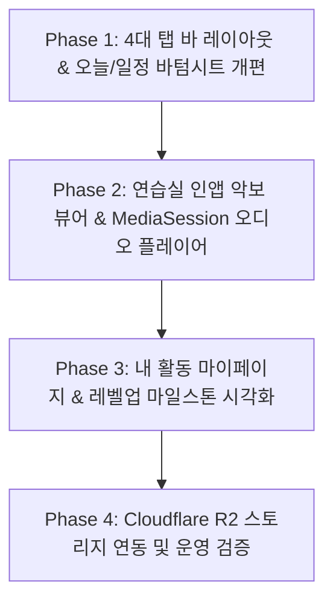

# Moonchoir Rollbook — 단원 UX 개편 및 오디오 스트리밍 엔지니어링 명세서

> 관련 문서: [AGENTS.md](../AGENTS.md) 시스템 헌장 · [기획 배경](./PRODUCT_BACKGROUND.md) 프로젝트 탄생 배경 · [구조 복구 기록](./ARCHITECTURE_RECOVERY.md) 데이터 상태

---

## 1. 개요 및 설계 철학 (Executive Summary)

### 1-1. 배경 및 문제 인식
기존 문콰이어 롤북의 홈 화면은 상단에 거대한 월간 캘린더 그리드가 자리 잡고 있어, 모바일 브라우저(375~430px) 환경에서 심각한 시각적 압박과 긴 버티컬 스크롤을 유발했습니다.
- **현장 단원의 병목**: 연습실에 도착해 즉시 출석(QR/PIN)을 해야 하는데, 당일 연습 카드를 찾기 위해 스크롤을 내려야 함.
- **연습 지원의 부재**: 단원들이 카카오톡 공지방을 뒤적이며 악보와 음원을 찾아 헤매는 비효율 지속.
- **성장 체감의 부재**: 출석 통계가 단순한 수치로만 나열되어 활동 동기(성장, 보상)를 자극하지 못함.

### 1-2. 핵심 설계 원칙 (Core Design Tenets)
1. **극단적 현장 집중 (Zero-Scroll On-site)**: 연습실 문을 열고 앱을 켰을 때, 스크롤 없이 첫 화면에서 3초 만에 출석이 완결되어야 한다.
2. **언슬롭 정제성 (Unslop & Quiet Chrome)**:
   - 모든 라벨과 카드 타이틀에서 **이모지 및 불필요한 장식용 아이콘을 전면 배제**한다.
   - 정갈한 타이포그래피(Pretendard 400/500/600)와 여백(4px 그리드), 차분한 미드나잇 팔레트(`--brand-primary: #282C48`)로 신뢰감을 준다.
   - 모바일 터치 타깃은 무조건 **최소 44px 이상**을 보장한다.
3. **비용 0원 + 고가용성 미디어 파이프라인 (Zero-Cost Streaming)**:
   - Supabase의 대역폭 한계(월 2GB)를 우회하여, **Cloudflare R2(10GB 무료, 데이터 전송료 무제한 0원)** 및 **구글 드라이브**를 결합한 인프라를 구축한다.
   - 브라우저 표준 `MediaSession API`와 메모리 선행 캐싱(Blob)을 통해, 웹앱임에도 불구하고 **화면이 꺼지거나 주머니에 넣어도 끊기지 않는 백그라운드 재생**을 달성한다.

---

## 2. 모바일 정보 구조 (IA) 및 4대 탭 바 체제

화면 최하단에 고정되는 하단 탭 바(Bottom Navigation Bar)는 이모지 없이 차분한 텍스트와 활성 인디케이터 라인으로만 구성됩니다.

```
┌────────────────────────────────────────────────────────┐
│  [헤더]  MOONCHOIR                      (마스터 비상 통로)│
├────────────────────────────────────────────────────────┤
│                                                        │
│                                                        │
│                  활성 탭 메인 뷰 영역                    │
│                                                        │
│                                                        │
├────────────────────────────────────────────────────────┤
│   오늘 (Today)    일정 (Calendar)    연습실 (Studio)    내 활동 (Profile)
│  ━━━━━                                                 │
└────────────────────────────────────────────────────────┘
```

### 탭 1: `오늘` (Today) — 현장 출석 단독 집중 뷰 (기본 진입)
- **캘린더 완전 제거**: 스크롤 제로. 화면 중앙에 **당일 연습 카드 1장**만 노출.
- **주요 구성 요소**:
  - 오늘 일정 타이틀 및 연습 시간 (예: `19:30 ~ 21:40`).
  - 연습 장소: 과도한 강조 배제, 단정한 텍스트 + 카카오맵 길찾기 하이퍼링크.
  - 내 대상 여부 (`테너 파트 필수`, `전원 참여` 등).
  - **초대형 단일 CTA 버튼**:
    - 연습 전: `참석 투표하기` (RSVP)
    - 출석 시간 진입: `QR 찍기 / PIN 출석` (단일 하이라이트)
    - 출석 완료 후: `출석 완료 (19:24 KST)` (차분한 서피스 전환)
  - 오늘 출석 현황 미니 카운트 ("현재 18명 출석 중").
  - 당일 일정이 없을 경우: "가장 가까운 다음 연습 D-Day" 단독 카드 표시.

### 탭 2: `일정` (Calendar) — 월간 캘린더 중심 + 바텀 시트 팝업
- **상단: 월간 캘린더 그리드**:
  - 한눈에 월별 일정을 조망 ("언제 어떤 일정이 있지?").
  - 일정이 있는 날짜 하단에 미니멀한 점(Dot Indicator) 배치.
- **날짜 탭 시 인터랙션 (Bottom Sheet Modal)**:
  - 페이지 전체 리로드나 하단 밀림 없이, **화면 하단에서 스르륵 부드럽게 올라오는 바텀 시트** 호출.
  - 팝업 내용: 일정 타이틀, 시간, 장소 링크, 내 참석 투표(RSVP) 버튼, 세부 메모.
  - 닫기: 아래로 스와이프하거나 배경 터치 시 부드럽게 닫힘.

### 탭 3: `연습실` (Studio) — 인앱 악보 뷰어 & 미디어 플레이어
- **곡 목록 (Piece List)**:
  - 현재 시즌 연습곡 리스트 (곡명, 작곡/편곡자).
  - 파트별(S/A/T/B) 분리는 과감히 제거. **[가이드 음원 / 피아노 MR / 참고 영상]**의 단일 심플 리스트.
- **인앱 뷰어 & 재생 구조**:
  - 상단: 구글 드라이브 악보 PDF 뷰어 (인앱 미리보기 및 확대/축소).
  - 하단 고정: **플로팅 미니 플레이어 바 (Floating Mini-Player)**.
  - 악보를 스크롤해서 보거나 확대해도 하단에서 음악이 멈추지 않고 계속 재생됨.
  - 재생 속도 조절(0.8x 느리게, 1.0x, 1.2x) 및 10초 앞/뒤 탐색 제공.

### 탭 4: `내 활동` (Profile) — 미니멀 마이페이지 & 레벨업
- **상단**: 프로필 정보 (이름, 파트, 등록 연락처, 기기 식별 상태).
- **중앙: 나의 합창 레벨 (Gamification Preview)**:
  - 타인과의 순위 경쟁 배제, "나만의 누적 출석 기록".
  - 예: `꾸준한 테너 Lv.3` (다음 레벨까지 2회 연습 남음 프로그레스 바).
  - 앞으로 채워질 활동 마일스톤 및 훈장 슬롯.
- **하단 메뉴 그룹 (토스/iOS 스타일)**:
  - 내 역대 출결 상세 조회 (출석/지각/공가/결석 원천 로그 이력).
  - 내 연락처 및 프로필 수정.
  - 기기 변경 및 바인딩 관리.
  - *(운영진 권한자만 노출)* **운영진 콘솔 진입**.
  - 로그아웃.

---

## 3. 오디오 스트리밍 아키텍처 및 모바일 웹 극복 방안

### 3-1. 스토리지 아키텍처 비교 및 채택
| 인프라 | 저장 비용 | 대역폭 (트래픽) 비용 | 오디오 탐색 (Seek) | 운영 마찰 |
| :--- | :--- | :--- | :--- | :--- |
| **Supabase Storage** | 1GB 무료 | **월 2GB 초과 시 과금/차단 (위험)** | 보통 | 낮음 |
| **Google Drive** | 개인 용량 | 무료 (단, 다중 동시 접속 시 일시 쿼터 에러) | 1~2초 지연 | 매우 낮음 |
| **Cloudflare R2 (채택)** | **10GB 무료** | **평생 0원 (무제한 무료 Egress)** | **0.05초 즉시 반응 (Byte-Range 완벽)** | 낮음 (S3 호환 링크) |

- **운영 전략**:
  1. 1차 단계: 기존에 쓰던 **구글 드라이브 MP3 링크** 및 **유튜브 영상 링크**를 그대로 수용.
  2. 2차 단계: Cloudflare R2 버킷(`moonchoir-music`)을 개설하여 고음질 64~96kbps AAC 음원을 업로드하고, 0원 무제한 초고속 스트리밍 URL 바인딩.

### 3-2. 모바일 브라우저 백그라운드 재생 극복 4단계

모바일 OS(특히 iOS Safari)가 백그라운드 탭을 강제 종료(Silent Discard)하거나 자바스크립트를 동결시키는 현상을 해결하기 위해 다음 4대 기법을 적용합니다:

```
[ 단원 터치: 재생 시작 ]
        │
        ├──▶ ① navigator.mediaSession 메타데이터 등록
        │      (iOS/Android OS에 '시스템 오디오 플레이어'로 정식 등록)
        │      └─▶ 잠금화면 위젯, 에어팟/블루투스 컨트롤러 활성화
        │
        ├──▶ ② 전체 선행 메모리 캐싱 (Full Pre-buffering via Blob)
        │      (곡 전체 2MB를 브라우저 메모리에 일괄 로드하여 지하철 음영지역 통신 단절 무력화)
        │
        └──▶ ③ 오디오 인스턴스 웜업 & 네이티브 하드웨어 체이닝
               (초기 터치 시 보조 Audio 객체 사전 활성화 ➔ OS 하드웨어 onended 이벤트로 무중단 전환)
```

1. **Web MediaSession API 완벽 구현**:
   - `navigator.mediaSession.metadata`에 곡명, 아티스트('문콰이어'), 앨범 정보 바인딩.
   - `play`, `pause`, `seekto`, `seekbackward`, `seekforward` 액션 핸들러 구현.
   - 결과: 아이폰/갤럭시 화면이 꺼져도 **잠금화면 미디어 위젯, Dynamic Island, 애플워치, 차량 블루투스에서 완벽 제어**.
2. **선행 메모리 캐싱 (Blob Buffering)**:
   - 찔끔찔끔 받는 스트리밍 대신 `fetch(url)`을 통해 곡 전체를 브라우저 `Blob`으로 선행 다운로드.
   - 통신이 일시적으로 끊겨도 무음(Stalled) 상태가 발생하지 않아 iOS가 탭을 죽이지 않음.
3. **하드웨어 레벨 이벤트 체이닝 (`onended`)**:
   - 절전 모드에서 얼어붙는 자바스크립트 타이머 대신, OS 사운드 칩셋이 직접 호출하는 `audio.onended` 네이티브 이벤트를 사용하여 다음 곡으로 부드럽게 전환.
4. **PWA ("홈 화면에 추가") 권장**:
   - 아이폰 사파리 `[홈 화면에 추가]`를 통해 실행 시 주소창이 제거된 독립 웹앱 환경이 되어 OS로부터 더 안정적인 백그라운드 런타임 수명을 확보.

---

## 4. 데이터 스키마 정의 (TypeScript)

### 4-1. 연습곡 및 미디어 트랙 모델 (`src/types/rollbook.ts`)
```typescript
export type MediaType = 'drive_audio' | 'r2_audio' | 'youtube' | 'external_url';

export interface PracticeTrack {
  id: string;
  name: string;          // 예: "전체 합창 가이드", "피아노 반주 MR", "정기연주회 실황 영상"
  type: MediaType;
  url: string;           // R2 링크, Drive 링크, 또는 YouTube URL
  durationSeconds?: number;
}

export interface PracticePiece {
  id: string;
  title: string;         // 곡명 (예: "바람이 불어오는 곳")
  composer?: string;      // 작곡 / 편곡자
  scoreUrl?: string;      // 구글 드라이브 악보 PDF 링크
  tracks: PracticeTrack[];// 가이드 음원, MR, 영상 등 단일 리스트 (파트별 분리 없음)
  season?: string;        // 예: "2026 봄 정기연주회"
  notes?: string;         // 주의사항 메모
  orderIndex?: number;
}
```

### 4-2. 단원 레벨 및 마일스톤 모델
```typescript
export interface MemberLevelMilestone {
  currentLevel: number;       // 예: 3 (꾸준한 테너 Lv.3)
  levelTitle: string;        // "열정적인 테너"
  attendedCount: number;     // 현재 누적 출석 횟수
  nextLevelThreshold: number;// 다음 레벨까지 필요한 출석 횟수 (예: 15회)
  remainingToNextLevel: number;
  unlockedBadgeIds: string[]; // 획득한 배지 ID 목록
}
```

---

## 5. 단계별 개발 로드맵 (Phased Implementation Roadmap)



### Phase 1: 4대 탭 바 레이아웃 & 오늘/일정 바텀시트 개편
1. **`BottomNavBar.tsx` 컴포넌트 신설**:
   - 이모지 일체 배제, 4대 탭(`오늘`, `일정`, `연습실`, `내 활동`) 차분한 텍스트 탭 구성.
   - 모바일 터치 타깃 44px 이상 및 Safe Area (`env(safe-area-inset-bottom)`) 적용.
2. **`HomeView.tsx` 1차 경량화 (`오늘` 탭)**:
   - 거대한 월간 캘린더를 `오늘` 화면에서 완전히 분리.
   - 당일 연습 카드 1장 중심의 제로 스크롤 레이아웃 완성.
3. **`ScheduleCalendarView.tsx` 바텀 시트 구현 (`일정` 탭)**:
   - 월간 달력에서 날짜 클릭 시 부드럽게 올라오는 바텀 시트 모달 컴포넌트 작성.

### Phase 2: 연습실 인앱 악보 뷰어 & MediaSession 오디오 플레이어
1. **`PracticeStudioView.tsx` 화면 구현**:
   - 곡 목록 아코디언/카드 뷰.
   - 구글 드라이브 PDF 악보 뷰어 (인앱 iframe 및 전체화면/다운로드 토글).
2. **`GlobalAudioPlayer.tsx` 백그라운드 스트리밍 엔진 구현**:
   - 하단 고정형 플로팅 미니 플레이어 바 (재생/정지, 10초 앞뒤, 배속 조절).
   - `navigator.mediaSession` 바인딩으로 잠금화면 위젯 및 블루투스 제어 활성화.
   - Blob 선행 버퍼링 및 `onended` 하드웨어 인터럽트 체이닝 적용.

### Phase 3: 내 활동 마이페이지 & 레벨업 마일스톤 시각화
1. **`MemberProfileView.tsx` 개편 (`내 활동` 탭)**:
   - 토스 스타일의 정제된 카드 그룹 UI.
   - 레벨업 프로그레스 바 및 마일스톤 프리뷰.
   - 역대 원천 로그 기반 출결 통계 및 개인정보 수정, 운영진 진입로 연결.

### Phase 4: Cloudflare R2 스토리지 연동 및 운영 검증
1. **Cloudflare R2 버킷 셋업 가이드 작성 및 테스트**:
   - `moonchoir-music` 버킷 생성 및 공개 스트리밍 URL 연결.
2. **단위 테스트 및 빌드 검증**:
   - `npm run typecheck`, `npm run lint`, `npm test` 100% 통과 검증 후 프로덕션 배포.

---

## 6. 결정론적 품질 게이트 (Green Bar Criteria)

본 명세서에 따른 모든 코드 수정은 다음 센서를 무결점으로 통과해야만 머지 및 배포됩니다:
1. `npm run typecheck`: TypeScript 정적 타입 검사 오류 0건.
2. `npm run lint`: Oxlint 코드 컨벤션 위반 0건.
3. `npm test`: 전체 단위 테스트 파일 100% 통과 (기존 52개 파일, 351개 테스트 보존 및 신규 테스트 통과).
4. `npm run build`: Vite 프로덕션 번들링 성공.
