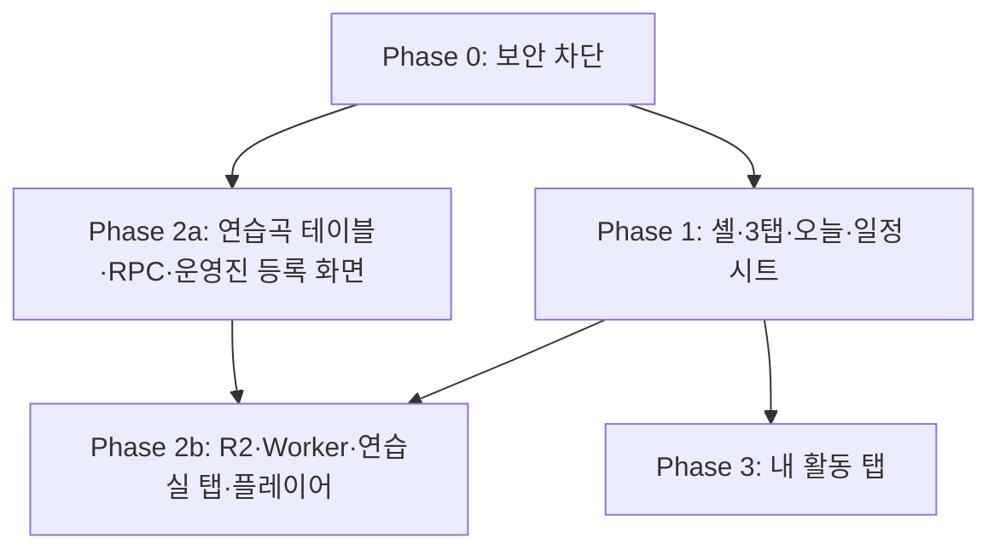

# Moonchoir Rollbook — 단원 UX 개편 및 연습실(오디오) 명세서 v2

> **v3 안내 (2026-11-21):** 홈·연습실·내 활동·업로드는 [v3 명세](MEMBER_UX_V3_SPEC.md)가 이 문서를 대체한다(D2, D6 변경). 다른 부분은 이 문서를 그대로 따른다.

> 관련 문서: [AGENTS.md](../AGENTS.md) 시스템 헌장 · [기획 배경](./PRODUCT_BACKGROUND.md) · [구조 복구 기록](./ARCHITECTURE_RECOVERY.md) · [PRD](./PRD.md)
>
> **v2 (2026-11-20)**: v1(`f9ca1f3`)을 현재 코드와 대조하고, 외부 사실(요금표, WebKit 버그)을 확인해 다시 썼습니다. v1의 사실 오류와 기존 코드 충돌을 바로잡았고, 빠져 있던 데이터 저장소·보안 선행 조건·뒤로 가기·실패 상태를 추가했습니다. 바뀐 이유는 §9에 정리했습니다.
>
> **구현 작업 지시서**: [plans/16_member_ux_studio_implementation_guide.md](plans/16_member_ux_studio_implementation_guide.md) — 티켓 순서, 파일, 테스트, 질문 지점. 구현 에이전트는 이 명세와 지시서를 함께 읽습니다.
>
> 표기: **[확정]** = 소유자 결정 · **[기본값]** = 권장안으로 진행하되 소유자가 바꿀 수 있음 · **[검증 필요]** = 실측이나 실기기 확인 전까지 가정

---

## 0. 결정 기록

| # | 항목 | 결정 | 상태 |
|---|---|---|---|
| D1 | 파트별(S/A/T/B) 음원 | 두지 않음. 곡마다 트랙 목록 하나(가이드 / MR / 참고영상). 음원을 구하기 어렵기 때문 | [확정] |
| D2 | 음원 업로드 | 운영진이 **Cloudflare 대시보드에서 직접** 올림. 앱에는 곡·트랙 정보와 파일 경로만 등록. 앱 안에 업로드 기능 없음 | [확정] |
| D3 | 공개 범위 | 추측하기 어려운 경로의 공개 URL(링크를 아는 사람만). 서명 URL 없음 | [확정] |
| D4 | 음원 저장소 | **Cloudflare R2 + Worker(`*.workers.dev`)**. 도메인 없이 무료. 나중에 도메인이 생기면 R2 커스텀 도메인으로 옮김(앱은 기본 주소 설정만 바꾸면 됨) | [확정] |
| D5 | 연습곡 목록(카탈로그) | Supabase 새 테이블 3개(곡, 곡↔시즌 카드 연결, 트랙). 곡 사용 이력은 **시즌 카드(ProgramCard) 단위**로 남김. 공연별 셋리스트는 나중에 | [확정] (AGENTS ASK FIRST 승인) |
| D6 | 레벨·배지 | **보류.** 내 활동은 프로필과 누적 출결 기록만 보여 줌 | [확정] |
| D7 | 보안 구멍 | 다른 작업보다 먼저 **Phase 0**에서 막음 | [확정] (운영 DB 적용 완료) |
| D12 | 단원 본인 인증(Task 76) | **이번 단계에서 다루지 않음** | [확정] |
| D8 | 저작권 음원 | 드물게 있음. 시판 MR·음반 음원은 R2에 올리지 않고 **외부 링크(유튜브 등)로만** 등록 | [확정] |
| D9 | 업로드 전 인코딩 | 64kbps AAC(.m4a)로 줄여서 올림(파일 크기 약 절반, 재생 시작 빠름) | [기본값] |
| D10 | 기존 구글 드라이브 음원 링크 | 앱 안 플레이어 대상에서 빼고 "외부에서 열기"로만 표시. 자주 쓰는 곡부터 R2로 옮김 | [기본값] |
| D11 | 화면 구조 세부(§2의 Q1~Q14) | 각 항목의 권장안으로 진행 | [기본값] |

---

## 1. 목표와 원칙

### 1-1. 해결할 문제
- **현장 출석 병목**: 홈 상단의 큰 월간 달력 때문에 출석 버튼을 찾으려면 스크롤해야 합니다.
- **연습 자료 분산**: 악보와 음원이 카카오톡 공지방에 흩어져 있습니다.

(v1의 "성장 체감 부재 → 레벨업"은 D6에 따라 이번 범위에서 뺐습니다.)

### 1-2. 원칙
1. **현장 우선**: 앱을 켜면 스크롤 없이 첫 화면에서 출석 버튼이 보여야 합니다. 측정 기준은 §6에 있습니다.
2. **조용한 화면**: 라벨과 제목에 이모지·장식 아이콘을 쓰지 않습니다. Pretendard, 4px 간격 체계, 기존 토큰(`--brand-primary: #282C48`)을 씁니다. 인라인 hex 색상은 쓰지 않습니다(다크 모드 보호). 모든 터치 대상은 44×44px 이상입니다.
3. **기존 자산 재사용**: 새 화면을 처음부터 만들지 않습니다. 이미 있는 컴포넌트를 승격·이름 변경·폐기하는 것으로 진행합니다(§2-6 표). 출결 판정은 계속 `src/utils/attendanceStats.ts` 하나만 씁니다.
4. **확정된 출석 규칙 유지**: 출석은 서버가 확인해야 완료입니다. 기기에 대기열을 두지 않고, 같은 ID로 재시도합니다(ARCHITECTURE_RECOVERY 결정 사항). 화면은 확정된 데이터로만 "완료"를 표시합니다.
5. **과장 금지**: 실측하지 않은 성능·안정성 수치는 쓰지 않습니다. 플랫폼 제약은 [검증 필요]로 표시합니다.

---

## 2. 화면 구조

### 2-1. 셸과 탭
```
┌──────────────────────────────────────────┐
│ AppHeader  MOONCHOIR       (운영진 톱니)   │  ← HomeView 헤더에서 추출, 이스터에그 포함
├──────────────────────────────────────────┤
│                                          │
│            활성 탭 콘텐츠 (main)           │  padding-bottom = --bottom-chrome-h
│                                          │
├──────────────────────────────────────────┤
│ MiniPlayer (재생 중일 때만, Phase 2)        │  ← App 루트에 마운트, 탭 전환에도 유지
├──────────────────────────────────────────┤
│   오늘      일정      연습실*     내 활동    │  BottomNav (*Phase 2에 추가)
└──────────────────────────────────────────┘
```
- **Phase 1은 3탭**(오늘 / 일정 / 내 활동)으로 출시하고, 연습실 탭은 Phase 2에 추가합니다. 빈 탭은 두지 않습니다. [기본값]
- 탭 바는 `<nav aria-label="주요 메뉴">` 안의 버튼들이고, 현재 탭에 `aria-current="page"`를 붙입니다. 텍스트와 활성 표시선만 씁니다.
- `--bottom-chrome-h = 탭바 56px + (재생 중이면 미니플레이어 56px) + env(safe-area-inset-bottom)`. 지금 하단에 고정된 `SyncStatus` 알약(`index.css` `.sync-status-pill`)은 탭 바와 겹치므로 `bottom: calc(var(--bottom-chrome-h) + 8px)`로 옮깁니다.
- **등록 전 사용자**(`profile === null`)에게는 지금처럼 `BindingModal`만 보이고 탭 바는 렌더하지 않습니다. 딥링크로 들어왔다면 등록을 마친 뒤 원래 주소로 돌아갑니다.
- 관리자·최고관리자 화면에는 탭 바가 없습니다.

### 2-2. 내비게이션 (해시 라우팅)
gh-pages는 서버 rewrite가 없어서 해시 방식만 안전합니다. 지금은 URL이나 히스토리를 전혀 쓰지 않아서 안드로이드 뒤로 가기를 누르면 앱이 종료됩니다.

```ts
type MemberTab = 'today' | 'calendar' | 'profile' /* Phase 2: | 'studio' */;
type Overlay =
  | { kind: 'scheduleSheet'; date: string; scheduleId?: string }
  | { kind: 'qr'; scheduleId: string }
  | { kind: 'rsvp'; scheduleId: string };
type Route =
  | { area: 'member'; tab: MemberTab; month?: string; overlay?: Overlay }
  | { area: 'admin' } | { area: 'superAdmin' };
// 순수 함수: parseRoute(hash) / formatRoute(route) / navReducer(route, action) — src/utils/route.ts
```
- **탭 전환**은 히스토리를 쌓지 않습니다(`replaceState`). 다만 오늘이 아닌 탭에서 뒤로 가기를 누르면 오늘로 돌아갑니다.
- **시트·모달**은 히스토리를 쌓습니다(`pushState`). 뒤로 가기는 시트·모달을 닫습니다. QR 모달이 뒤로 가기로 닫힐 때 **카메라 스트림과 위치 추적이 반드시 멈춰야 합니다.**
- 앱을 새로 열면 항상 `#/today`로 갑니다. 딥링크로 들어온 경우만 예외입니다. [기본값]
- 숨김(TARGETS_ONLY) 일정이나 없는 일정 ID로 딥링크하면 "볼 수 없는 일정입니다"를 보여 줍니다. 일정이 존재하는지 짐작할 수 있는 정보는 노출하지 않습니다.
- 로그아웃하거나 기기 바인딩을 바꾸면 `#/today`로 초기화합니다. 관리자 세션이 만료되면 `#/today`로 바꿉니다(replace).

### 2-3. 탭 1 `오늘` — 현장 출석
**구성**: 집중 카드 1장 + 같은 날 일정 전환 컨트롤 + "현재 N명 출석" 한 줄. 달력은 없습니다.

- **하루에 일정이 여러 개인 경우**(예: 파트연습 17:00 + 전체 19:30)는 Task 57에서 이미 구현했고 테스트도 있습니다. v1의 "카드 1장만"으로 줄이면 두 번째 일정의 출석 경로가 사라집니다. 그래서 **집중 카드 1장 + "오늘 일정 1/2" 전환 버튼(44px)**으로 갑니다. 우선순위 규칙(진행 중 > 예정 > 마감, 필참 대상 가산점)은 그대로 쓰고, 순수 함수 `selectTodayFocus()`로 뽑아냅니다.
- **카드 경량화**: 투표 집계 명단, 댓글, 게이지, 긴 설명은 카드에서 빼서 **일정 상세 시트**(일정 탭과 같이 씀)로 옮깁니다. 카드에는 제목, 시간, 장소 + 카카오맵 링크, "필참 / 자율 참여" 텍스트 배지, CTA, "상세 보기"만 남깁니다.
- **장소 링크** `buildKakaoMapLink()`: 좌표가 있으면 `map.kakao.com/link/to/{장소},{위도},{경도}`, 없으면 `link/search/{장소}`, 장소명이 없으면 링크를 만들지 않습니다.
- **오늘 일정이 없을 때**: 다음 일정 카드에 `D-3` 배지를 붙입니다. 일정이 아예 없으면 "예정된 일정이 없습니다"와 일정 탭 링크를 보여 줍니다.
- **오늘 연습이 끝난 뒤**: 다음 일정 카드를 보여 주고, 자정까지 "오늘 출석 완료 19:24" 결과 한 줄을 함께 표시합니다. [기본값]

**CTA 상태** — 순수 함수 `deriveTodayCta()`, 판별 유니언

| 상태 | 조건 | 표시 |
|---|---|---|
| `CANCELLED` | 취소된 일정 | "취소된 일정", 버튼 없음 |
| `RSVP_NEW` / `RSVP_EDIT` | 투표 가능 && 투표 없음 / 있음 | "참석 투표하기" / "투표 수정 · 현재 참석" |
| `CHECKIN_OPEN` | 출석 창 열림 && 미출석 | "QR 찍기 / PIN 출석"(대상), "자율 참여 출석"(비대상) |
| `ATTENDED` / `LATE` / `MANUAL_OK` | 확정 판정 결과 | "출석 완료 19:24" / "출석(지각) 19:52" / "운영진 인정". **버튼이 아니라 상태 표시** |
| `MANUAL_ABSENT` | 운영진 결석 처리 | "운영진 확인: 결석" + 메모 |
| `EXCUSED` | 마감 && 사유결석 | "사유 결석 처리됨" |
| `CLOSED_ABSENT` | 마감 && 대상 && 미출석 | "출석 마감 · 미출석" |
| `CLOSED_EXEMPT` | 마감 && 비대상 | "필참 대상 아님" |
| `OFFLINE` | 창 열림 && 오프라인 | 버튼은 보이되 "인터넷 연결 후 출석할 수 있어요". **대기열에 넣지 않음** |

- 출석을 마친 사람에게 보이던 "다시 출석 체크하기" 버튼은 없앱니다. [기본값]
- CTA는 QR 모달에 **항상 scheduleId를 넘깁니다.** 지금 `App.tsx`에 있는 "오늘 첫 일정으로 대체" 로직은 우선순위를 무시하므로 쓰지 않습니다.
- 투표 마감(시작 60분 전)과 출석 창 열림(시작 60분 전)은 지금 각각 하드코딩된 60입니다. 하나만 바뀌면 투표도 출석도 안 되는 시간대가 생기므로 **공통 상수 하나로 묶고 테스트로 고정**합니다.
- `timeWindow.ts`는 일정 시간을 기기 시간대로 해석하고, 파싱에 실패하면 "열림"으로 처리합니다. 이를 **KST로 해석**하도록 고치고, 파싱 실패는 **닫힘 + "일정 시간 오류, 운영진 문의"**로 바꿉니다. [기본값]

**"현재 N명 출석"**
- 숫자 출처: 확정 판정(`reconcileAttendance`)에서 출석·지각·운영진 인정인 대표 단원 수. 비대상 자율 출석을 포함한 총원만 보여 주고, 명단은 상세 시트에서만 봅니다. [기본값]
- **새 요청을 만들지 않습니다.** 이미 받은 데이터로 계산하고 "18:52 기준" 갱신 시각을 함께 표시합니다. 당일 출석 창이 열린 뒤에만 보여 줍니다.

### 2-4. 탭 2 `일정` — 월간 달력 + 상세 시트
- **달력은 새로 만들지 않습니다.** 홈의 `HomeCalendarSection`을 `MonthCalendarGrid`로 승격해 재사용합니다. 별도 화면인 `CalendarView.tsx`는 **폐기**합니다. 시작 월이 2026-10으로 하드코딩되어 있고, 투표를 이름으로 매칭하고(ID 원칙 위반), 집계 로직을 따로 갖고 있습니다.
- 날짜를 탭하면 **상세 시트**(`ScheduleDetailSheet` + 공통 `ScheduleDetailBody`)가 올라옵니다. 그날 일정이 여러 개면 시간순 목록을 먼저 보여 주고, 1개면 바로 상세를 엽니다.
- 시트 닫기: **닫기 버튼(44px), Esc, 뒤로 가기가 필수**이고, 스와이프는 보조입니다. Pointer Events와 `transform`으로 직접 구현하며 새 라이브러리는 쓰지 않습니다. `prefers-reduced-motion`이면 애니메이션을 끕니다. 시트 안에서는 포커스를 가둡니다.
- 투표가 마감된 일정에서는 투표 버튼 대신 "투표 마감"을 표시합니다. `RSVPModal`의 `alert()`는 화면 안 메시지로 바꿉니다.
- 보던 월과 선택한 날짜는 해시에 저장합니다(`#/calendar?m=2026-11&d=2026-11-20`). 탭을 바꿨다 돌아와도 유지됩니다.
- 달력 점 색상은 카테고리 문자열로 정해지는데, 모르는 카테고리나 직접 입력한 카테고리는 기본 점으로 표시하고 원문을 보존합니다(동적 분류 원칙).
- 달력 아래에 다가오는 일정 3개를 보여 줍니다(`HomeUpcomingListSection` 이동). [기본값]

### 2-5. 탭 3 `내 활동` (Phase 3)
- **새 화면을 만들지 않고 `MemberPortalModal`을 탭으로 전환합니다.** v1이 제안한 `MemberProfileView`라는 이름은 관리자용 `MemberProfileModal`과 헷갈리므로 쓰지 않습니다. `MemberProfileModal`은 그대로 둡니다.
- 보여 주는 것: 이름·파트(읽기 전용), "회차별 출결 기록"(확정 판정 결과), 누적 출석률, 화면 설정(다크 / 표시 모드), 앱 설치 카드, 동기화, "이 브라우저에 저장된 단원 바꾸기", 로그아웃.
- **보여 주지 않는 것**:
  - 레벨 카드(D6). 지금 포털에 이모지와 함께 보이는 카드도 이번 전환 때 뺍니다. `getGamifiedAttendanceLevel` 함수와 테스트는 나중을 위해 남겨 둡니다.
  - "연락처 수정". 단원이 직접 수정하는 경로가 없고, 전화번호는 중복·병합 판정 키입니다. 읽기 전용으로 보여 주고 "운영진에게 수정 요청"으로 안내합니다. [기본값]
  - "기기 식별 상태". 1인 1기기 잠금은 2026-10-21에 중지되었으므로 "등록 완료(Lock)" 같은 문구는 사실이 아닙니다.
- "원천 로그 이력"이라는 v1 표현은 틀렸습니다. 표에 보이는 것은 판정 결과입니다. 이름을 **"회차별 출결 기록"**으로 바꿉니다.
- **보관 일정 문제**: 지금 통계 함수는 보관(archive) 처리된 일정을 아예 빼 버려서, 지난 학기를 보관하면 내 활동 기록에서도 사라집니다. 기록 화면에서만 보관 일정을 포함하도록 옵션 인자를 추가합니다. 통계 화면 동작은 그대로 둡니다. [기본값]
- 운영진 메뉴는 role·memberStatus로 판정하는 `isStaffMember()`를 통과한 사람에게만 보입니다. 지금은 `'이재현'`과 `'2440'`이 두 컴포넌트에 하드코딩되어 있는데 이를 제거합니다. 헤더 톱니(PIN으로 보호)는 유지합니다. [기본값]
- 병합된 단원은 반드시 대표 ID로 바꾼 뒤 계산합니다(`resolveMergedMemberIds`).

### 2-6. 기존 자산 처리표

| 새 위치 | 기존 자산 | 처리 |
|---|---|---|
| `AppShell` (App.tsx) | `currentView` 분기 | `route` 상태로 교체. 모달은 그대로 루트에 둠 |
| `AppHeader` | `HomeView` 헤더(로고, 이스터에그, 톱니) | 추출 + `useMasterEntryGesture` 훅 분리 |
| `BottomNav` | 없음 | 신규 |
| `TodayTab` | `HomeView`, `HomeActiveScheduleCard` | 이름 변경 + 경량화(달력·리스트 토글 제거) |
| `ScheduleDetailSheet` / `ScheduleDetailBody` | 카드 정보부, `HomeRsvpTallySection`, `ScheduleComments` | 조립해서 재사용 |
| `CalendarTab` / `MonthCalendarGrid` | `HomeCalendarSection` | 승격 |
| — | `CalendarView.tsx` | **폐기** |
| `ProfileTab` | `MemberPortalModal` | 모달에서 탭으로 전환(레벨 카드 제거) |
| 그대로 | `MemberProfileModal`(관리자), `QRScannerModal`, `RSVPModal`, `BindingModal`, `AdminPinModal` | 히스토리 연동만 추가 |
| `StudioTab` / `GlobalAudioPlayer` (Phase 2) | 없음 | 신규. 플레이어는 App 루트에 마운트 |

---

## 3. 연습실과 오디오

### 3-1. 구성 요소별 역할
v1은 "R2에 저장"만 적어 두었는데, 실제로는 네 가지가 필요합니다.

| 역할 | 담당 | 비고 |
|---|---|---|
| 음원 파일 보관 | **Cloudflare R2** 버킷 `moonchoir-music` | 무료: 저장 10GB, 읽기 1,000만 건/월, 전송량 무료 |
| 파일을 인터넷에 내보내기 | **Cloudflare Worker** (`moonchoir-media.<계정>.workers.dev`) | 무료: 하루 10만 요청. `r2.dev` 기본 주소는 Cloudflare가 처리량을 제한하는 개발용이라 쓰지 않음 |
| 곡·트랙 목록 | **Supabase 테이블**(§4) | 앱이 읽는 것은 이 목록뿐 |
| 악보 PDF | 구글 드라이브 링크(지금처럼) | "링크가 있는 모든 사용자" 공유 |
| 참고 영상 | 유튜브 링크 | 앱 안 플레이어 대상 아님(아래 3-3) |

**저장 용량 계산**: 트랙은 단원 수만큼 늘어나지 않습니다. 시즌당 20트랙 × 2~4MB = 40~80MB이므로 10GB면 충분합니다.

**전송량**: 연주회 직전에 60명 × 20트랙 × 5회 재생해도 R2는 0원입니다. Worker 요청은 재생 1회당 수 건이고 하루 10만 건 한도 안에 듭니다. [검증 필요: 파일럿 1주 후 실제 요청 수 확인]

**Supabase Storage를 쓰지 않는 이유**: 무료 전송량(비캐시 5GB + 캐시 5GB/월, v1의 "2GB"는 틀린 값)은 DB·출석 요청과 같이 쓰는 조직 단위 한도입니다. 연주회 직전 달에 넘으면 **출석 체크까지 제한될 수 있습니다.** 음원 트래픽을 출석과 떼어 놓는 것이 목적입니다.

### 3-2. Worker 명세
작은 스크립트 하나지만 새로 관리할 코드입니다. 소스는 저장소의 `workers/media/index.js`에 두어 리뷰를 받습니다. 배포는 **Cloudflare 대시보드 편집기에 붙여 넣는 방식**으로 해서 `wrangler` 설치를 피합니다(AGENTS: 무거운 npm 설치 사전 승인).

- `GET`·`HEAD`만 허용하고, 나머지 메서드는 405를 돌려줍니다.
- 경로는 R2 객체 키와 정확히 일치해야 합니다. **목록 조회 기능은 없습니다**(정확한 키를 모르면 404).
- `Range` 요청을 지원합니다(R2 바인딩의 `range` 옵션 → 206 + `Content-Range`, `Accept-Ranges: bytes`). 탐색(seek)에 필요합니다.
- CORS는 앱 출처(gh-pages 주소, 개발용 localhost)만 허용합니다. `Content-Range`, `Content-Length`, `ETag`를 노출 헤더로 둡니다.
- `Cache-Control: public, max-age=604800, immutable`. 파일을 교체할 때는 같은 키로 덮어쓰지 않고 새 키로 올립니다.
- R2 접근은 Worker 바인딩으로만 합니다. **API 키나 시크릿은 앱에도 저장소에도 두지 않습니다.**
- [검증 필요] 무료 Worker의 CPU 한도(요청당 10ms) 안에서 스트리밍이 끝나는지. 데이터를 넘기는 동안의 대기는 CPU 시간에 들지 않으므로 충분할 것으로 보지만 실측합니다.

**도메인이 생기면**: R2 버킷에 커스텀 도메인을 연결하고 Worker를 내리면 됩니다. 앱에서는 설정값 `mediaPublicBaseUrl` 하나만 바꾸면 되고 트랙 데이터는 그대로입니다(§4-1의 `storage_key`).

### 3-3. 출처별 재생 방식
순수 함수 `resolveTrackPlayback()`(`src/utils/practiceMedia.ts`)이 판정합니다.

| 출처 | 앱 안 재생 | 화면 꺼져도 재생 | 미리 받기 | 이유 |
|---|---|---|---|---|
| `r2` (Worker 경유) | `<audio>` | 가능 | 선택 옵션 | CORS를 우리가 통제함 |
| `drive` | **외부에서 열기** | — | 불가 | 브라우저에서 내용을 읽을 수 없고(CORS 없음), Safari 재생 실패 보고, 조회가 몰리면 24시간 차단 |
| `youtube` | 외부에서 열기(또는 임베드) | **불가** | 불가 | YouTube 정책상 백그라운드 재생과 오디오 추출 금지 |
| `external_url`·모르는 값 | 외부에서 열기 | — | 불가 | 원문 그대로 보존 |
| https가 아님·빈 값 | 표시만, 재생 불가 | — | — | 보안(`javascript:` 등 차단) |

### 3-4. 플레이어 설계 (`GlobalAudioPlayer`)
- **`<audio>` 요소 하나를 App 루트에 마운트**합니다. 탭을 바꿔도 사라지지 않습니다. 큐 상태는 React context로 관리합니다.
- 기본은 **스트리밍**(`preload="metadata"`)입니다. "미리 받기"는 설정 옵션으로만 두고 R2 출처에만 허용합니다. 다 쓴 Blob URL은 해제합니다.
- **다음 곡으로 넘어갈 때도 같은 요소의 src만 바꿉니다.** v1의 "보조 Audio 객체로 전환"은 iOS에서 잠금화면 컨트롤이 끊길 수 있어 쓰지 않습니다. 연습 용도에 맞게 **한 곡 반복을 기본으로 켜고, 자동 다음 곡은 기본으로 끕니다.**
- Web Audio API는 쓰지 않습니다(iOS 홈 화면 앱에서 동작하지 않는 버그, WebKit 291892).
- MediaSession: 곡명, 아티스트 "문콰이어"를 등록하고, `play`·`pause`·`seekbackward`·`seekforward`·`seekto` 핸들러와 `setPositionState`(배속 반영)를 둡니다. 지원하지 않는 브라우저에서는 조용히 건너뜁니다.
- 배속은 0.8 / 1.0 / 1.2, `preservesPitch = true`(음정 유지). 10초 앞/뒤 이동.
- **QR 스캐너를 열면 재생을 일시정지**하고, 닫아도 자동으로 다시 재생하지 않습니다(카메라와 오디오 충돌 방지).
- 오류 처리: 재생이 거부되거나 멈추면 "탭하여 다시 재생"을 보여 줍니다. iOS에서는 "Safari에서 열기" 안내를 같이 보여 줍니다(아래 참고).
- 미니 플레이어 컨트롤은 모두 44px 이상이고 Safe Area를 지킵니다.
- 서비스 워커에 오디오 캐싱을 넣지 않습니다(Range 요청이 깨짐). 지금 `public/sw.js`는 아무 처리도 하지 않으니 그대로 둡니다.

**iOS 홈 화면 앱(PWA) 주의** — v1의 "홈 화면에 추가하면 더 안정적"은 **반대**입니다.
- 홈 화면 앱에서는 포그라운드를 벗어나면 오디오가 멈추는 버그가 2019년부터 열려 있습니다(WebKit 198277).
- iOS 26에서는 홈 화면 앱을 닫았다 다시 열면 무음이 되는 회귀가 있고, 아직 고쳐지지 않았습니다(WebKit 295518).
- 대응: 연습실 탭이 홈 화면 앱 모드(`display-mode: standalone`)로 열린 iOS 기기에서는 "음원은 Safari에서 들으면 화면이 꺼져도 끊기지 않아요" 안내와 Safari로 여는 링크를 보여 줍니다. [기본값] 실기기 결과에 따라 조정합니다.

### 3-5. 연습실 화면 (`StudioTab`)
- 보관되지 않은 시즌 카드별로 곡을 묶어서 보여 줍니다(곡명, 작곡·편곡). 어떤 시즌에도 연결되지 않은 곡은 단원에게 숨기고 관리자 화면에서만 보여 줍니다. [기본값]
- 곡을 열면 악보 링크(드라이브 미리보기는 새 창으로 열기가 기본이고, 앱 안 iframe은 확대·축소가 불편하므로 선택 사항)와 트랙 목록을 보여 줍니다. 파트 필터는 없습니다(D1).
- 트랙 버튼은 출처에 따라 "재생" 또는 "외부에서 열기"로 표시됩니다(3-3).
- GAS 백엔드 모드에서는 연습실을 "준비 중"으로 표시하고 네트워크 요청을 보내지 않습니다.

### 3-6. 운영 절차 (운영진용)
1. 파일을 64kbps AAC(.m4a)로 변환합니다(D9).
2. Cloudflare 대시보드 → R2 → `moonchoir-music`에 올립니다. 경로 규칙: `{시즌}/{무작위 8자}-{곡}-{종류}.m4a` (예: `2026-spring/k3f9x2qa-baram-guide.m4a`).
3. 앱 운영진 콘솔 → 연습곡에서 트랙을 추가하고 **경로(객체 키)만 붙여 넣습니다.** 저장하기 전에 재생 방식 미리보기("앱 안 재생 가능" / "외부 링크" / "https 아님: 저장 불가")를 확인합니다.
4. 시판 MR·음반 음원은 올리지 않고 유튜브 링크로 등록합니다(D8).
5. 잘못 올린 트랙은 삭제하지 않고 보관 처리합니다.

---

## 4. 데이터

### 4-1. Supabase 테이블 (D5, 마이그레이션 초안)
기존 테이블은 건드리지 않습니다. 삭제 대신 보관(`archived_at`)하고, 행 삭제를 막는 트리거를 둡니다.

```sql
-- supabase/migrations/2026112xxxxxxx_practice_catalog.sql (초안)
create table practice_pieces (
  id text primary key,                 -- 'piece_...' (기존 관례: 클라이언트 생성 text id)
  title text not null,
  composer text default '',
  arranger text default '',
  score_url text default '',
  notes text default '',
  archived_at timestamptz,
  created_at timestamptz default now(),
  updated_at timestamptz default now()
);

-- 곡 ↔ 시즌 카드 (N:M). 한 곡이 여러 시즌에 다시 쓰여도 이력이 남는다.
create table practice_program_pieces (
  program_id text not null references program_cards(id) on delete restrict,
  piece_id   text not null references practice_pieces(id) on delete restrict,
  order_index integer not null default 0,
  archived_at timestamptz,
  created_at timestamptz default now(),
  primary key (program_id, piece_id)
);

create table practice_tracks (
  id text primary key,
  piece_id text not null references practice_pieces(id) on delete restrict,
  label text not null,                 -- "전체 합창 가이드"
  kind text default '',                -- '가이드' | 'MR' | '참고영상' | 직접입력 — 원문 보존
  source_type text default '',         -- 'r2' | 'drive' | 'youtube' | 'external_url' | 모르는 값 보존
  url text default '',                 -- 외부 링크 전체 URL
  storage_key text default '',         -- R2 객체 키 → mediaPublicBaseUrl과 합쳐서 해석
  mime_type text default '',
  duration_seconds integer check (duration_seconds is null or duration_seconds >= 0),
  order_index integer not null default 0,
  archived_at timestamptz,
  created_at timestamptz default now(),
  updated_at timestamptz default now()
);
```
- RLS를 켜고 정책은 두지 않습니다. 읽기·쓰기는 모두 SECURITY DEFINER RPC로만 합니다.
- 쓰기 RPC는 **Phase 0의 관리자 토큰을 검사**하고, URL은 `https://`만 받습니다.
- 정렬은 항상 `order_index → created_at → id` 순서입니다.
- **기존 RPC 영향**: FK 때문에 `fn_delete_program_card`(지금은 실제 삭제)가 연습곡이 연결된 카드에서 SQL 오류를 냅니다. 이 경우 "연습곡이 연결된 카드는 삭제 대신 보관하세요"를 돌려주도록 같은 마이그레이션에서 고칩니다. [기본값]

### 4-2. RPC

| RPC | 액션 | 설명 |
|---|---|---|
| `fn_get_practice_catalog(p_include_archived)` | `GET_PRACTICE_CATALOG` | 곡·트랙·연결 전체. 단원은 false, 관리자는 true |
| `fn_save_practice_piece` | `SAVE_PRACTICE_PIECE` | upsert |
| `fn_set_practice_piece_archived` | `SET_PRACTICE_PIECE_ARCHIVED` | 보관/복원(삭제 RPC는 만들지 않음) |
| `fn_save_practice_track` | `SAVE_PRACTICE_TRACK` | https 검사, 모르는 source 값 보존 |
| `fn_set_practice_track_archived` | `SET_PRACTICE_TRACK_ARCHIVED` | |
| `fn_set_program_pieces` | `SET_PROGRAM_PIECES` | 시즌의 곡 연결·해제·순서를 한 트랜잭션에서 처리 |
| `fn_reorder_practice_tracks` | `REORDER_PRACTICE_TRACKS` | 한 트랜잭션. 목록이 현재 트랙과 다르면 실패 |

### 4-3. 서비스 계층 (단일 어댑터 규칙 유지)
- 백엔드 인터페이스(`RemoteBackend`, v1이 `BackendAdapter`라고 쓴 것)는 바꾸지 않습니다. `SupabaseBackend`의 액션 매핑에 위 7개를 추가합니다.
- 초기 스냅샷에는 넣지 않습니다. **연습실 탭을 열 때만** 불러오고, 표시용 캐시(`STORAGE_KEYS.PRACTICE_CATALOG`)를 둡니다.
- `SheetsService`에 `getPracticeCatalog`, `refreshPracticeCatalog`, `savePracticePiece`, `setPracticePieceArchived`, `savePracticeTrack`, `setPracticeTrackArchived`, `setProgramPieces`, `reorderPracticeTracks`를 추가합니다. 쓰기는 **서버가 확인한 뒤에만** 로컬에 반영하고, 실패하면 알리며, 대기열은 두지 않습니다.
- `sheetsParser.ts`의 `parsePracticeCatalog()`: camelCase와 snake_case를 모두 받습니다. 빠진 필드에는 기본값을 넣고, `kind`·`source` 원문을 보존하며, **행을 걸러내지 않습니다.**
- `AppConfig`에 optional 필드 `mediaPublicBaseUrl`(Worker 주소, 시크릿 아님)과 `practiceTrackKinds`(기본값 `['가이드','MR','참고영상']`)를 추가합니다. `app_config`는 key-value 구조라 테이블을 바꿀 필요가 없습니다.

### 4-4. TypeScript (v1 §4 대체)
```typescript
export type PracticeTrackKind = '가이드' | 'MR' | '참고영상' | (string & {});
export type PracticeMediaSource = 'r2' | 'drive' | 'youtube' | 'external_url' | (string & {});

export interface PracticePiece {
  id: string; title: string; composer?: string; arranger?: string;
  scoreUrl?: string; notes?: string;
  isArchived: boolean; archivedAt?: string; createdAt: string; updatedAt: string;
}
export interface PracticeTrack {
  id: string; pieceId: string; label: string;
  kind: PracticeTrackKind; source: PracticeMediaSource;
  url?: string; storageKey?: string; mimeType?: string; durationSeconds?: number;
  orderIndex: number; isArchived: boolean; createdAt: string; updatedAt: string;
}
export interface PracticeProgramPiece {   // v1의 자유 텍스트 season 대체
  programId: string; pieceId: string; orderIndex: number; isArchived: boolean;
}
export interface PracticeCatalog {
  pieces: PracticePiece[]; tracks: PracticeTrack[]; programPieces: PracticeProgramPiece[];
}
export type TrackPlaybackMode = 'audio' | 'external_link' | 'unavailable';
export interface TrackPlayback {
  mode: TrackPlaybackMode; src?: string;
  canPrefetch: boolean; supportsBackground: boolean; reason?: string;
}
```
v1의 `MediaType`은 "어디에 있는지"와 "무엇인지"를 한 타입에 섞은 닫힌 유니언이었습니다. 이를 `kind`(용도)와 `source`(출처) 두 축으로 나누고 둘 다 열린 문자열로 바꿨습니다. `MemberLevelMilestone`은 D6에 따라 삭제했습니다.

### 4-5. 백업
- 지금 코드에는 **Supabase → 구글 시트 백업 경로가 없습니다.** 문서상 "시트 = 콜드 백업"은 이관 시점에 멈춰 있을 가능성이 높습니다. 연습곡 목록만의 문제가 아니므로 별도 작업으로 확인합니다.
- 연습곡 목록은 계획된 주간 내보내기에 포함시킵니다. 음원 파일 원본은 운영진이 로컬이나 드라이브에 따로 보관합니다.

---

## 5. 단계별 로드맵


각 Phase는 AGENTS 레시피(types → services → ui → verify)를 따르고, **Phase마다** Green Bar(§7)를 통과해야 끝납니다.

### Phase 0 — 보안 차단 (D7, 선행 조건)
지금은 앱 번들에 들어 있는 공개 anon 키만으로 다음이 가능합니다.

| # | 문제 | 위치 | 조치 |
|---|---|---|---|
| S1 | 관리자·최고관리자·현장 PIN을 그대로 조회 | `fn_get_admin_secrets` (`supabase/migrations/20261120000000_super_admin.sql:34-57, 87`) | anon 실행 권한 회수. 관리자 토큰을 요구하도록 변경 |
| S2 | PIN을 포함한 설정 덮어쓰기 | `fn_save_config` (같은 파일 59-89) | 관리자 토큰 필수 |
| S3 | 출석 원천 로그를 포함한 **전체 테이블 삭제**(`truncate`는 삭제 방지 트리거도 우회) | `fn_import_sheets_snapshot` (`20261119000002_migration_function.sql:31-40, 269`) | 실행 권한 회수(이관 완료됨) |
| S4 | 관리자 쓰기 RPC 전반(일정 삭제, 단원 병합 등)을 누구나 호출 | 기존 쓰기 RPC들 | 관리자 토큰 검사 적용 |
| S5 | PIN 값이 문서에 평문으로 있음 | `docs/plans/1120_admin.md` 등 | 문서에서 제거하고 **모든 PIN 교체**(이미 노출된 것으로 간주) |

- **관리자 토큰**(SQL만으로 가능): `admin_sessions(token_hash, tier, expires_at)` 테이블을 둡니다. PIN 확인에 성공하면 서버가 무작위 토큰을 발급하고 해시만 저장합니다. 쓰기 RPC는 시작할 때 `fn_assert_admin(token)`을 호출합니다. 클라이언트는 기존 관리자 세션 저장소에 토큰을 보관합니다. Task 76(운영 전 인증)의 1단계입니다.
- 수용 기준: anon 키로 S1~S4를 호출하면 거부됩니다(SQL 검증 스크립트). 관리자 화면의 기존 기능은 회귀하지 않습니다.

**진행 상태 (2026-11-21): 운영 DB 적용 완료(사용자 확인), 화면 배포 대기**
- `supabase/migrations/20261121000000_security_hardening.sql`: S1~S4 차단, 관리자 세션 토큰, PIN 실패 시도 제한(15분 동안 운영진 20회, 최고 관리자 10회, 현장 PIN 60회). 이와 함께 다음도 막았습니다.
  - 토큰 없는 `MANUAL_BY_ADMIN` 출석 기록
  - 투표 마감 우회(`isAdmin` 플래그)
  - 자가 가입 시 `role` 지정
  - 6자리 미만 관리자 PIN 로그인
- 클라이언트: 서버가 실패하면 `1004`·`1234`·`2315`·`2325`를 관리자 PIN으로 받아 주던 로컬 우회 코드를 삭제했습니다. 서버가 발급한 토큰이 있어야 관리자 화면이 유지되고, 화면에 기본 PIN 값을 지어내지 않습니다.
- S5: 문서의 PIN 값을 지웠습니다. 다만 git 이력에는 남아 있으므로 **PIN 교체가 실제 조치**입니다(`docs/DEPLOYMENT.md` §0).
- 검증:
  - 로컬 PostgreSQL 16에 기존 마이그레이션과 보안 강화 마이그레이션을 차례로 적용한 뒤 anon으로 공격 시나리오를 실행했습니다. 모두 거부되었고 정상 관리자 흐름은 동작했습니다.
  - 마이그레이션을 반복 실행해도 안전합니다.
  - `supabase/tests/security_hardening_check.sql`은 읽기 전용이라 운영 DB에서도 실행할 수 있습니다.
- **남은 위험** (Task 76: 단원 본인 확인이 없는 구조라서 생기는 문제):
  - anon이 전체 전화번호를 읽을 수 있습니다(`members`, `members_public`, 스냅샷).
  - 다른 단원 이름으로 QR 출석을 넣을 수 있습니다.
  - 다른 단원의 투표를 취소하거나 댓글을 지울 수 있습니다.
  - PIN 시도 제한은 PIN 종류별 전체 한도라서, 공격자가 일부러 틀려 15분간 관리자 로그인을 막을 수 있습니다(무차별 대입 차단을 우선한 선택).

### Phase 1 — 셸, 3탭, 오늘, 일정 시트
1. `AppShell`, `AppHeader`, `BottomNav`, 해시 라우팅(`route.ts`), 하단 고정 요소 높이 변수, SyncStatus 위치 이동.
2. `TodayTab`: `selectTodayFocus`, `deriveTodayCta`, 카카오맵 링크, 출석 인원 한 줄, 전환 컨트롤.
3. `ScheduleDetailSheet`와 `CalendarTab`(`MonthCalendarGrid` 승격), `CalendarView.tsx` 폐기.
4. `timeWindow` KST 수정, 투표·출석 공통 60분 상수, QR에 scheduleId 명시.
5. **백그라운드 새로고침 비용 점검**: Supabase 모드에서 화면이 보이는 동안 **30초마다 전체 스냅샷을 다시 받는 동작**이 있습니다. 실시간 구독이 연결되어 있으면 간격을 늘리는 방안을 같이 결정합니다. 탭 전환만으로 새 요청이 생기지 않게 합니다.
6. 홈에서 달력을 빼는 것은 Task 16 / 계획서 04 결정을 되돌리는 것이므로 그 사유를 ARCHITECTURE_RECOVERY에 기록합니다. [기본값]

### Phase 2a — 연습곡 데이터와 운영진 등록 화면
1. §4-1 마이그레이션 + `fn_delete_program_card` 보완.
2. §4-2 RPC(관리자 토큰 검사 포함), §4-3 어댑터·파서, `practiceMedia.ts`.
3. 운영진 콘솔 "연습곡" 화면:
   - 곡 목록: 활성/보관 필터, 보관·복원(삭제 버튼 없음).
   - 시즌 카드별 곡 연결과 순서(위/아래 버튼 44px).
   - 트랙 편집: 라벨, 종류(목록 + 직접 입력), 출처, 경로 또는 URL, 순서, 보관.
   - 붙여 넣는 즉시 재생 방식 미리보기.

### Phase 2b — R2, Worker, 연습실, 플레이어
1. R2 버킷 생성, Worker 배포(§3-2), 앱 설정 `mediaPublicBaseUrl` 입력. 운영 절차 문서(§3-6)를 `docs/user-guide/`에 작성.
2. **배포 전 실측**: `curl -I -H "Range: bytes=0-1023"`로 206 응답 확인, 앱 출처에서 CORS 헤더 확인, 목록 조회가 불가능한지 확인.
3. `StudioTab`, `GlobalAudioPlayer`(App 루트), `MiniPlayer`, iOS 홈 화면 앱 안내.
4. **실기기 테스트**(§6-3)를 통과해야 단원에게 공개합니다.

### Phase 3 — 내 활동
1. `MemberPortalModal` → `ProfileTab` 전환, `buildMemberScheduleRecords()` 추출.
2. 레벨 카드 제거, 운영진 판정 하드코딩 제거(`isStaffMember`), 보관 일정 포함 옵션.

### 이후 (이번 범위 아님)
레벨·배지(D6, PRD 평가 체계 결정 이후), 공연별 셋리스트, Supabase → 시트 주간 백업, 도메인 구입 시 R2 커스텀 도메인 전환.

---

## 6. 수용 기준

### 6-1. Phase 1
1. **CTA 무스크롤**: 375×548(Safari 툴바 표시), 375×667, 360×740, 390×844 화면에서 `RSVP_NEW`·`CHECKIN_OPEN`·`ATTENDED` 상태일 때 CTA 하단이 `화면 높이 − --bottom-chrome-h` 안에 들어와야 합니다. 조건: 제목 2줄, 장소 1줄, 전환 컨트롤 포함. 지금은 E2E 도구가 없으므로 수동 캡처 체크리스트로 확인합니다. Playwright 도입은 별도 승인 사항입니다. [기본값: 보류]
2. 오늘 탭에서 QR 카메라까지 **1탭**. 캐시 데이터로 CTA가 1초 안에 표시되어야 합니다(네트워크를 기다리지 않음).
3. 새로 만들거나 고친 모든 터치 대상이 44×44px 이상. 캐러셀의 32px 버튼과 `onClick`이 달린 `<span>`은 없앱니다.
4. 새로 만들거나 고친 컴포넌트 렌더 텍스트에 이모지 0건(단위 테스트), 인라인 hex 0건(grep).
5. 뒤로 가기 시퀀스 테스트: 오늘 → 일정 → 시트 → 뒤로 → 뒤로 = 오늘. QR 모달에서 뒤로 가기를 누르면 카메라 트랙의 `stop()`이 호출되어야 합니다.
6. 탭 전환으로 생기는 원격 읽기는 20초에 1회 이하.
7. 기존 `HomeView.test.tsx` 시나리오(다중 일정, 마감 숨김, 관리자 결석, 과거 대체 금지, 현장 출석 집계)를 `TodayTab` 테스트로 옮겨 모두 통과.

### 6-2. Phase 2
1. 탭을 5번 바꿔도 같은 `<audio>` 요소가 유지됩니다(렌더 테스트).
2. YouTube·Drive 트랙은 플레이어 큐에 들어가지 않습니다.
3. https가 아닌 URL은 저장할 때 RPC가 거부하고, 이미 저장된 값은 재생할 때 `unavailable`로 표시됩니다.
4. 연습실 화면에 파트 필터가 없습니다.

### 6-3. 실기기 테스트 (Phase 2b 공개 조건)
대상: iPhone(iOS 18, 26) × {Safari, 홈 화면 앱}, Android(Chrome, 삼성 인터넷) × {브라우저, 설치 앱}
1. 재생 → 화면 잠금 → 3분 유지. 잠금화면에서 곡명, 재생/정지, ±10초, 탐색 바
2. 재생 중 카카오톡으로 전환했다가 복귀
3. 곡 끝: 한 곡 반복 / 다음 곡(같은 요소 src 교체)이 백그라운드에서 동작
4. 홈 화면 앱 완전 종료 → 재실행 → 재생(iOS 26 무음 버그 재현 여부)
5. 재생 중 QR 스캐너 열기 → 닫기 → 오디오 상태
6. 블루투스·에어팟 버튼, 이어폰 분리 시 일시정지
7. 전화·알람 인터럽트 후 복귀
8. 0.8x / 1.2x에서 음정 유지
9. iOS 무음 스위치 ON 상태에서 재생 여부
10. 비행기 모드 30초(스트리밍 vs 미리 받기)
11. Worker 주소에서 탐색 즉시성
12. 탭 전환 중 재생 유지
13. 파일럿 1주 후 Worker 요청 수와 R2 읽기 수 확인

### 6-4. Phase 3
1. 내 활동의 누적 숫자가 같은 입력에서 관리자 통계·매트릭스와 일치합니다(교차 화면 계약 테스트).
2. 레벨, 칭호, 진행 바, 배지 렌더 0건.
3. 운영진 판정에 이름·전화번호 하드코딩 0건.
4. 보관한 과거 일정의 출결이 기록 화면에서 사라지지 않습니다.
5. 기존 포털 기능(화면 설정, 앱 설치, 동기화, 바인딩 변경, 로그아웃) 회귀 0건.

---

## 7. 품질 게이트 (Phase마다)
1. `npm run typecheck` 오류 0건
2. `npm run lint` 위반 0건
3. `npm test` **기존 테스트 전부 + 신규 테스트 통과**(고정 개수가 아니라 회귀 0건이 기준)
4. `npm run build` 성공
5. Phase 0·2a: SQL 검증 스크립트(권한 거부, 삭제 거부, 트랜잭션 원자성, https 검사)

### 7-1. Phase별 신규 단위 테스트 대상

| Phase | 순수 함수 / 대상 | 핵심 케이스 |
|---|---|---|
| 1 | `selectTodayFocus`, `getSchedulePriorityScore` | 오늘 1개 / 여러 개 / 모두 마감 → 다음 / 없음 / 취소·보관 제외 / 자정 넘김 / 선택값 보정 |
| 1 | `deriveTodayCta` | §2-3 표의 모든 상태, 정확히 60분 전 경계 |
| 1 | `getCheckInWindowState` (KST) | 기기 시간대를 UTC·PST로 바꿔도 결과 동일, 파싱 실패 = 닫힘 |
| 1 | `parseRoute` / `formatRoute` / `navReducer` | 왕복 변환, 잘못된 해시 → 오늘, 뒤로 가기 시퀀스, 등록 전 보류 |
| 1 | `buildKakaoMapLink`, `computeDDay`, `countCheckedIn`, `groupSchedulesByDate`, `getCategoryDotKind` | 좌표 유무 / KST 자정·월말 / 병합 ID 중복 제거 / 모르는 카테고리 원문 보존 |
| 2a | `parsePracticeCatalog` | camel·snake 혼합, 기본값, 모르는 값 보존, 보관 행 유지, id 없는 행 보존, 잘못된 입력 → 빈 목록 |
| 2a | `resolveTrackUrl`, `resolveTrackPlayback` | 키 + 기본 주소 합성(한글 인코딩), 출처별 모드, `javascript:`·`http:`·빈 값 → unavailable |
| 2a | `buildStudioView` | 보관 제외, 결정론적 정렬, 두 시즌에 걸친 곡 |
| 2a | `SupabaseBackend` 매핑, `SheetsService` | 7개 액션 매핑, GAS 모드에서 요청 0건, 서버 확인 전 로컬 미변경 |
| 3 | `buildMemberScheduleRecords`, `isStaffMember` | 미래 = 대기, 수동 인정, 병합 ID, 보관 일정 포함 옵션 |

---

## 8. 남은 위험

| 위험 | 대응 |
|---|---|
| Worker 코드를 우리가 관리해야 함 | 30줄 규모로 유지. 소스는 저장소에서 리뷰. 도메인이 생기면 제거 가능 |
| 링크가 외부로 공유되면 누구나 재생 가능(D3) | 무작위 경로, 목록 조회 불가. 저작권 음원은 올리지 않음(D8). 카탈로그 RPC가 anon으로 읽히므로 "링크를 아는 사람"은 사실상 "앱을 열 수 있는 사람 전원" |
| iOS 홈 화면 앱 오디오 버그 | Safari 안내(§3-4), 실기기 테스트로 확인 |
| Phase 0 전까지 운영진 기능이 서버에서 보호되지 않음 | Phase 0을 모든 Phase보다 먼저 진행 |
| 구글 시트 백업이 멈춰 있을 가능성 | 별도 작업으로 확인(§4-5) |

---

## 9. v1 대비 주요 변경

| v1 | 문제 | v2 |
|---|---|---|
| Supabase 대역폭 월 2GB | 사실 아님(5GB + 캐시 5GB, 조직 공유) | 수치 정정. 출석과 트래픽을 분리하려고 R2 선택 |
| R2 "버킷 개설 후 URL 바인딩" | `r2.dev`는 운영용이 아님. 커스텀 도메인은 도메인 이전 필요. 목록 DB 없음 | R2 + Worker + Supabase 카탈로그(§3-1) |
| 전체 Blob 선행 다운로드로 iOS 종료 방지 | 근거 없음. Drive에서는 동작 불가 | 스트리밍 기본, 미리 받기는 R2만 선택 옵션 |
| 보조 Audio 객체 + "하드웨어 `onended`" | `onended`는 일반 JS 이벤트. 요소를 바꾸면 iOS 잠금화면 컨트롤이 끊길 위험 | 단일 요소 + src 교체, 한 곡 반복 기본 |
| PWA 설치 권장 | iOS 홈 화면 앱 오디오 버그(198277, 295518) | iOS 홈 화면 앱에서는 Safari 안내 |
| YouTube를 같은 목록에서 재생 | 정책상 백그라운드 재생 금지 | 외부 링크 전용 |
| 오늘 탭 카드 1장만 | 하루 여러 일정 출석 경로 상실(Task 57 회귀) | 집중 카드 + 전환 컨트롤 |
| `ScheduleCalendarView`, `MemberProfileView` 신설 | 기존 컴포넌트와 중복, 통계 로직 분기 위험 | 기존 컴포넌트 승격·전환, `CalendarView` 폐기 |
| 연락처 수정, 기기 식별 상태 메뉴 | 쓰기 경로 없음 / 기기 잠금 중지됨 | 읽기 전용, 문구 정정 |
| 레벨·배지 | 규칙 미정, 배지는 영속 저장 필요 | 보류(D6) |
| `season` 자유 텍스트, 닫힌 `MediaType` | 시즌 오타 분기, 동적 분류 원칙 위반 | 시즌 카드 연결 테이블, `kind`·`source` 열린 문자열 |
| 데이터 저장 위치·등록 경로 없음 | Phase 2 착수 불가 | §4 전체 |
| 보안 언급 없음 | anon 키로 PIN 조회·변경·전체 삭제 가능 | Phase 0 |
| 뒤로 가기, 실패 상태, 접근성 없음 | 안드로이드 뒤로 가기 = 앱 종료 | §2-2, CTA 상태표, 시트 포커스·reduced-motion |
| 테스트를 Phase 4에 몰아 둠, "351개 테스트" 고정 | AGENTS는 매 단계 통과 요구 | Phase별 Green Bar, 회귀 0건 기준 |
