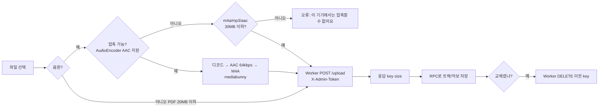

# 단원 앱 v3 명세 — 홈 · 연습실 · 내 활동 · 운영진 연습곡

> 상태: **확정본 (2026-11-21 사용자 합의, 2026-11-22 흐름 검토 반영).** 남은 사용자 결정은 없다.
> 구현 순서와 규칙: [v3 개발 지시서](plans/17_v3_implementation_guide.md)
> 시안: Design 아티팩트 "문콰이어 단원 앱 v3 시안" (보드 이름은 각 절에 표기)
> 이전 명세: [MEMBER_UX_AUDIO_SPEC.md (v2)](MEMBER_UX_AUDIO_SPEC.md). **이 문서와 다르면 이 문서를 따른다.** v2에서 바뀌지 않은 부분(Phase 0 보안, Worker 읽기 경로, 해시 라우팅 원칙)은 v2를 그대로 따른다.

---

## 0. 결정 기록

### 0-1. 확정

| # | 결정 | v2 대비 |
|---|---|---|
| V1 | 단원 탭은 **홈 / 연습실 / 내 활동** 3개. 홈은 v2의 `오늘`+`일정`을 합친다 | 변경 |
| V2 | 홈 달력은 **주간 / 월간** 토글. 마지막 선택을 기기에 기억 | 신규 |
| V3 | 화면에 설명용 부제·도움말 문장을 넣지 않는다. 기능 요소(제목, 숫자, 버튼, 상태)만 둔다 | 신규 |
| V4 | 키 컬러 3색: 네이비(행동) · 라벤더(성장) · 살구(칭찬). §6 | 신규 |
| V5 | 연습실은 **공연 → 곡 → 자료(악보·음원·영상)** 계층. 상단 공연 드롭다운(전체 곡 / 공연별 / 공연 미정) | 변경 |
| V6 | **단원 연습실은 읽기 전용.** 곡·자료·공연 연결·업로드는 운영진 콘솔 "연습곡" 탭에서만 | 변경 |
| V7 | 유튜브는 앱 안 임베드 재생 + 영상 아래 **"유튜브 앱으로 열기" 아이콘 버튼**. 음원 추출 안 함. **유튜브 재생 목록(`&list=`) 기능 없음** | 변경 |
| V8 | 플레이어: 음악 앱과 같은 미니 바(아래로 밀어 닫기) + 전체 화면. 5초 뒤로/앞으로, 한 곡 반복, 속도 슬라이더(0.5~2.0) | 변경 |
| V9 | 음원·악보 PDF를 **운영진 콘솔에서 앱 안 업로드**(R2, Worker 경유). 음원은 업로드 전 기기에서 압축. 시트를 닫아도 업로드 계속 | v2 D2 대체 |
| V10 | 이전 버전 파일은 남기지 않는다. 파일을 교체하면 이전 R2 객체를 지운다 | 신규 |
| V11 | 레벨(누적 출석, 내려가지 않음), 경력 문장, 열정 온도, 칭찬 스티커 24개를 **내 활동**에 둔다. 본인 화면에만 보인다 | v2 D6 대체 |
| V12 | 투표(RSVP) 변경 이력을 **추가 전용 로그**로 쌓는다 | 신규 |
| V13 | 연습실 재생 기록을 **세션 요약** 단위로 쌓는다. 보관 기한 없음. 단원을 지우면 함께 지운다 | 신규 |
| V14 | 출석 기록 화면의 상태 카드(출석/지각/사유 결석/결석)는 **필터 토글** | 신규 |
| V15 | 정시 기준: 체크인 시각의 **분이 시작 시각의 분 이하**. 19:30 시작이면 19:30:59까지 정시 | 신규 |
| V16 | 스티커 이미지는 **Microsoft Fluent Emoji 3D(MIT)**. 24장만 저장소에 포함하고 라이선스 고지를 둔다 | 신규 |
| V17 | 스티커 이름의 운영진 편집 기능은 **보류** | 신규 |
| V19 | **음원 압축 라이브러리 `mediabunny`(MPL-2.0) 설치 승인**(2026-11-22). 운영진 화면에서만 동적 import | 신규 |
| V20 | **악보 앱 안 보기 `pdfjs-dist`(Apache-2.0) 설치 승인**(2026-11-22). 악보 화면에서만 동적 import | 신규 |
| V21 | 악보는 **PDF만** 받는다(사진·이미지 파일 받지 않음) | 신규 |
| V22 | **곡·트랙·공연 삭제 기능을 둔다**(2026-11-22 사용자 요청). 보관은 "잠시 숨기기", 삭제는 "잘못 만든 것을 완전히 지우기". 삭제하면 R2 파일도 지운다. 재생 기록이 있는 곡·트랙은 삭제할 수 없고 보관만 된다 | 변경 (V10·§4-2의 "삭제 없음" 대체) |
| V23 | **여러 파일 한 번에 올리기**(2026-11-23). 음원은 파일마다 트랙 1개, 악보는 1개만. 저장 공간은 1GB 미만이면 MB로 표시 | 신규 |
| V24 | **새 화면은 다른 관리자 탭과 같은 폭·여백**을 쓴다. 휴대폰(390px)·PC(1280px) 캡처로 확인한다 | 신규 |
| V25 | **플레이어 v2**(2026-11-23, 시안 `Player`·`PlayerQueue`·`PlayerVideo`·`PlayerMini`). ① 음악 앱 느낌의 디자인(우리 3색) ② **공연 전체 재생**: 공연이 곧 재생 목록이고, 곡마다 **트랙 순서 맨 위 음원이 대표**. 관리자가 재생 목록을 따로 만들지 않는다. 공연별로 다른 대표 음원 지정은 보류 ③ 반복 3단계(끔 → 목록 반복 → 한 곡 반복) ④ **유튜브를 플레이어 커버 자리에서 재생**. 플레이어를 내리면 멈추고, 처음 2번만 안내 한 줄. 재생 목록에는 유튜브를 넣지 않는다 | 변경 (V7·V8 보완) |
| V26 | **스태프(선생님·지휘·반주)의 내 활동**(2026-11-23): 레벨 대신 `[이름] 선생님` 칭호 카드, 출석률 링·열정 온도 숨김, 칭찬 스티커는 꾸준함·무대 묶음 중 필참 기준이 없는 8개만. §5-7 | 신규 |
| V27 | **배포 이전 기록은 점수·스티커에 넣지 않는다**(2026-11-23). 투표 이력과 재생 기록은 v3-C 배포일부터 센다. 투표 백필 행은 "3시간 안에 바꿈" 판정의 이전 상태로만 쓴다 | 신규 |
| V28 | **v3 전체(A·B·C)를 한 번에 배포**한다(2026-11-23). 지각 판정 수정도 이때 들어간다 | 신규 |
| V18 | **"공연"은 새 테이블 `performances`로 따로 둔다**(2026-11-22). 시즌 카드(`program_cards`)는 연습 일정용으로 그대로 둔다. 연습곡은 공연에 연결하고, 공연과 일정은 연결하지 않는다. 정기연습 일정을 공연 기간에 자동으로 바꾸는 "덮어쓰기"는 하지 않는다 | 신규 (v2 D5의 곡↔시즌 카드 연결을 대체) |

### 0-2. 사용자 결정 대기

없음. 예전 Q1(압축)·Q2(악보 보기)는 V19·V20으로 승인됐다.

### 0-3. 알려진 한계 (사용자에게 보고됨)

- **"본인만 보기"는 화면 수준이다.** 단원 본인 인증(Task 76)이 이번 범위 밖이라, 출석·투표 원천 데이터는 지금도 앱이 전원분을 내려받는다. 열정 온도와 스티커는 운영진 화면과 다른 단원 화면에 **그리지 않는** 것으로 보장한다.
- **업로드는 앱(탭)이 열려 있는 동안에만 진행된다.** 탭을 닫으면 멈추고, 다시 열면 멈춘 항목을 알려 준다. 같은 파일을 다시 고르면 다시 올린다.
- 유튜브 임베드는 화면이 켜져 있을 때만 재생되고, 광고가 나올 수 있다(프리미엄 로그인이 임베드에 적용되지 않는 기기가 있음).

---

## 1. 공통 원칙

1. **원천 로그는 추가만 한다.** 출석 로그(`attendance_logs`), 투표 이력(`rsvp_events`), 재생 기록(`practice_listen_sessions`)은 수정하거나 지우지 않는다. 단, 단원 삭제 시 재생 기록 연쇄 삭제는 V13에 따른 예외다.
2. **화면 숫자는 모두 투영 값이다.** 레벨, 온도, 스티커, 출석률은 원천 로그에서 매번 계산한다. 계산 결과를 DB에 저장하지 않는다.
3. **출결 판정은 기존 단일 엔진을 쓴다.** `src/utils/attendanceStats.ts`의 `reconcileSingleMemberAttendance`, `calculateCumulativeAttendanceWithLifecycle`, `resolveMergedMemberIds`. 새로 판정 로직을 만들지 않는다. 병합된 단원(`merged_into_id`)의 기록은 별칭 집합으로 합산한다.
4. **시간은 KST 헬퍼로만 다룬다**(`src/utils/date.ts`의 `getKSTDateString`, `getKSTClock`, `parseKSTDate`, `addDaysKST`). `toISOString().slice(0,10)`이나 `new Date('YYYY-MM-DD')` 직접 비교는 쓰지 않는다.
5. **설정값은 하드코딩하지 않는다.** 파트, 일정 구분, 트랙 종류는 설정이나 데이터의 원문을 그대로 쓴다. 공연 여부는 `AppConfig.performanceCategories`(신규, 선택 필드, 기본값 `['연주']`)로 판단한다.
6. **터치 타깃 44px 이상.** 아이콘 버튼은 아이콘이 작아도 클릭 영역은 44×44.
7. **문구는 이 명세에 적힌 것만 쓴다.** 새 안내 문장을 지어내지 않는다(V3). 필요하면 멈추고 묻는다.

---

## 2. 홈 (시안: `Main`, `HomeMonth`)

### 2-1. 구조 (위에서 아래로)

1. **헤더:** 로고 "MOONCHOIR", 오른쪽에 운영진 진입(기존 동작 유지).
2. **상단 카드** (둘 중 하나):
   - **오늘 카드:** 오늘 나에게 해당하는 일정이 있을 때. 일정 이름, 시간, 장소 + 길찾기, "QR 찍기 / PIN 출석" 버튼, 현재 출석 인원과 기준 시각. 기존 `TodayTab`의 출석 동작과 CTA 규칙(`src/utils/todayCta.ts`)을 그대로 쓴다.
   - **다음 일정 카드:** 오늘 일정이 없을 때. "다음 연습 · D-n", 일정 이름·날짜·시간·장소, 참석/불참 버튼(기존 RSVP 흐름). 투표 전이면 "아직 투표하지 않았어요" 한 줄(상태 표시이므로 V3 예외).
3. **달력:** 연월 표시 + 이전/다음, **주간 | 월간** 세그먼트.
   - 주간: 일~토 7칸, 일정 있는 날 점. 기본값.
   - 월간: 기존 `MonthCalendarGrid`.
   - 날짜를 누르면 기존 일정 상세 시트가 열린다(`#/calendar` 계열 동작 재사용).
4. **다가오는 일정** 목록(최대 5개).

### 2-2. 라우팅

- `MemberTab` = `'home' | 'studio' | 'profile'`.
- **옛 주소 호환:** `#/today`, `#/calendar`, `#/calendar?...`는 모두 `home`으로 해석한다. 쿼리(`m`, `d`, `sheet`, `sid`, `qr`)는 그대로 지원해 기존 공유 링크와 QR 오버레이가 깨지지 않게 한다.
- 주간/월간 선택은 기기에 기억(§9 저장 키). 읽기 실패 시 주간.

---

## 3. 연습실 — 단원 (시안: `Studio`, `StudioMenu`, `StudioPiece`, `StudioScore`)

### 3-1. 곡 목록

- **상단:** 제목 "연습실", 검색창(placeholder "곡 이름·작곡가 검색"), 그 아래 **공연 드롭다운 버튼** 하나. 칩이나 태그 버튼을 줄지어 두지 않는다. 오른쪽에 다른 버튼을 두지 않는다.
- **드롭다운 메뉴:** 레이어(팝오버)로 겹쳐 뜬다. 레이아웃은 밀리지 않는다. 바깥을 누르거나 Esc를 누르면 닫힌다. 키보드 포커스를 가두고, 닫으면 버튼으로 돌려준다.
  - 순서: `전체 곡` / 구분선 / 다가오는 공연(날짜 오름차순, 날짜 미정은 맨 뒤) / `공연 미정` / 구분선 / 지난 공연(날짜 내림차순).
  - **지난 공연은 숨기지 않는다.** 날짜가 지나면 자동으로 아래쪽으로 내려갈 뿐, 같은 모양으로 보이고 고를 수 있다(2026-11-22).
  - 항목마다 날짜(`12월 14일` 형식, 없으면 생략)와 곡 수.
  - 곡이 하나도 연결되지 않은 공연은 메뉴에 넣지 않는다. 곡 수는 **보관되지 않은 연결 + 보관되지 않은 곡**만 센다.
  - "공연 미정"은 해당 곡이 0개면 숨긴다.
- **"공연"의 정의 (V18):** `performances` 테이블의 행 중 보관되지 않았고(`archived_at is null`) 보관되지 않은 연결 곡이 1개 이상인 것. 시즌 카드는 연습실에 나오지 않는다.
- **공연 날짜:** `performances.performance_date`(`YYYY-MM-DD`, 비어 있으면 날짜 미정). 일정에서 계산하지 않는다.
  - 날짜가 오늘(KST) 이후이거나 미정이면 "다가오는 공연", 오늘 이전이면 "지난 공연"이다.
- **목록 정렬:**
  - 전체 곡: `created_at` 내림차순.
  - 공연: `practice_performance_pieces.order_index` 오름차순. 각 행 왼쪽에 1부터 번호(라벤더 색).
  - 공연 미정: 보관되지 않은 **공연 연결**(`practice_performance_pieces`)이 하나도 없는 곡. 연결된 공연이 보관됐어도 연결 자체가 살아 있으면 미정이 아니다(그 곡은 "전체 곡"에서 보인다). 기존 시즌 카드 연결(`practice_program_pieces`)은 보지 않는다. `created_at` 내림차순.
- **검색:** 곡 이름, 작곡가, 편곡자, 연결된 공연 이름으로 찾는다. 대소문자와 공백을 무시한다. 검색 중에도 드롭다운 범위는 유지된다.
- **행:** 곡 이름, 작곡가(·편곡), 자료 태그(`악보` / `음원 n` / `영상 n`), 새 음원 표시(7일 이내 추가된 트랙이 있으면 "새 음원").
- **선택 기억:** 마지막 범위를 기기에 기억한다. 기억한 공연이 없어졌으면 "전체 곡".
- **보관된 곡·트랙**은 단원에게 보이지 않는다.
- **"전체 재생" 버튼(V25):** 범위가 공연일 때만, 공연 드롭다운 버튼과 같은 줄 오른쪽에 둔다.
  - 모양: `--brand-primary` 바탕 흰 글자 알약 버튼, 높이 44px, ▶ 아이콘 + "전체 재생".
  - 재생 목록(§3-3-1)이 비어 있으면(대표 음원이 있는 곡이 0개) 버튼을 두지 않는다.
  - 누르면 재생 목록 첫 곡부터 재생하고 반복을 "끔"으로 바꾼 뒤 전체 화면 플레이어를 연다.
  - "전체 곡"·"공연 미정" 범위에서는 버튼이 없다.

### 3-2. 곡 상세

- **헤더:** ‹ 연습실. 업로드 상태 표시를 두지 않는다(V6).
- **제목 영역:** 곡 이름, "작곡가 · 공연 이름"(공연이 여러 개면 다가오는 공연 1개).
- **악보 카드:** "악보 보기" + `n쪽 · m월 d일 수정본`(쪽수는 알 수 있을 때만). 누르면 §3-4.
- **음원 카드:** 트랙 목록. 재생 중인 트랙은 강조하고 일시정지 아이콘을 보인다. 행 = 재생 버튼, 이름, `종류 · 길이`.
- **참고 영상 카드:**
  - 유튜브 임베드(앱 안 재생, 16:9보다 낮은 미리보기 높이 허용).
  - **바로 아래 줄**에 영상 제목(왼쪽)과 **유튜브 로고 + ↗ 버튼**(오른쪽, 최소 44px, 연회색 바탕)을 둔다.
  - 버튼에는 화면 글자가 없고 `aria-label="유튜브 앱으로 열기"`만 있다. 링크는 등록된 URL 원문을 연다(`target="_blank" rel="noopener noreferrer"`). `&list=` 같은 파라미터를 붙이지 않는다.
  - 안내 문장, 툴팁, 첫 실행 안내는 금지다.
- **두지 않는 것:** "+ 악보 / + 음원 / + 링크", "+ 곡 추가", 업로드 진행 표시.

### 3-3. 플레이어 (V25, 시안: `Player`, `PlayerQueue`, `PlayerVideo`, `PlayerMini`)

#### 3-3-1. 재생 목록 (큐)

플레이어는 항상 하나의 재생 목록을 가진다. 출처는 두 가지다.

| 출처 | 언제 | 목록 내용 | 헤더 표시(작은 글자 / 굵은 글자) | 시작 반복 상태 |
|---|---|---|---|---|
| 곡 | 곡 상세나 플레이어의 "이 곡의 음원"에서 음원을 누름 | 그 곡의 재생 가능한 음원(트랙 순서대로) | `곡` / 곡 이름 | 한 곡 반복 |
| 공연 | 연습실 "전체 재생" | 공연 순서대로 각 곡의 **대표 음원** 1개씩 | `공연` / 공연 이름 | 끔 |

- **대표 음원:** 곡의 트랙 중 보관되지 않았고 앱에서 재생 가능한(`filterPlayableAudioTracks`) 음원을 `orderIndex` 오름차순으로 놓았을 때 **맨 앞**. 유튜브·외부 링크는 대표가 될 수 없다. 대표가 없는 곡은 공연 재생 목록에서 빠진다.
- 대표 음원 계산은 새 순수 함수 `getRepresentativeTrack(pieceId, tracks, config)` 하나로만 한다. 단원 재생 목록과 운영진 "대표" 표시(§4-2)가 같은 함수를 쓴다.
- 공연 곡 순서와 대상 곡은 §3-1 공연 목록과 같은 규칙(보관되지 않은 연결 + 보관되지 않은 곡, `order_index` 오름차순)이다.
- 공연 재생 중에 다른 곡의 음원을 곡 상세에서 누르면 재생 목록이 그 곡 출처로 바뀐다(공연 재생 목록은 사라진다).
- 데이터가 갱신돼 재생 중인 트랙이 없어지면 그 트랙은 끝까지 재생하고, 다음 항목은 새 목록 기준으로 정한다.

#### 3-3-2. 미니 바

- 단원 화면의 모든 탭에서 하단 탭 위에 고정. 운영진·최고관리자 화면에서는 숨기되 재생은 유지한다.
- 구성: 커버(라벤더 사각 + 음표, 영상이면 어두운 사각 + 영상 아이콘), 트랙 이름 / 곡 이름(탭하면 전체 화면), 재생·일시정지, **다음**, **× 닫기**(44px, `aria-label="플레이어 닫기"`), 맨 아래 2px 진행선.
- **다음**은 재생 목록의 다음 항목. 없으면 비활성.
- 아래로 밀거나 ×를 누르면 정지하고 닫힌다. Media Session 핸들러도 해제한다.

#### 3-3-3. 전체 화면 — 음원 (시안 `Player`)

- **배경:** 위에서 아래로 그라데이션 `--player-gradient-top` → `--player-gradient-mid` → `--player-surface-full`(§6).
- **위쪽:** 손잡이, 접기(⌄), 가운데 출처 두 줄(§3-3-1 헤더 표시, 긴 이름은 말줄임), 악보 보기 버튼.
- **커버:** 정사각형, 화면 폭 − 48px(최대 340px), 모서리 16px, 라벤더 그라데이션 + 큰 음표, 깊은 그림자. 공연 재생이면 왼쪽 아래에 `번호 · 곡 이름`(공연 순서 번호).
- **제목:** 트랙 이름(24px, 굵게, 한 줄 말줄임), 그 아래 `곡 이름 · 작곡가`.
- **재생바:** 흰색 진행 + 동그란 손잡이(14px). 왼쪽 경과, 오른쪽 남은 시간(`-2:36`). 드래그로 이동.
- **조작 1줄:** 이전 / 5초 뒤로 / 재생·일시정지(68px 흰 원, 아이콘 남색) / 5초 앞으로 / 다음.
- **조작 2줄:** 반복(왼쪽) / 속도 알약 버튼(가운데, `0.8x`) / 재생 목록 버튼(오른쪽).
- **"이 곡의 음원" 카드:** 반투명 흰 바탕(8%) 둥근 카드. 지금 곡의 모든 트랙(음원 + 유튜브), 트랙 순서대로. 재생 중인 행은 라벤더 글자 + 막대 아이콘. 유튜브 행은 어두운 사각 + 영상 아이콘, 둘째 줄 "영상". 음원 행 둘째 줄은 길이.
- 아래로 밀거나 ⌄를 누르면 미니 바로 돌아간다. 뒤로 가기도 같다(오버레이 라우트 규칙).

| 조작 | 동작 |
|---|---|
| 5초 뒤로/앞으로 | `currentTime`을 ±5초, 0과 `duration` 사이로 자름. 길게 누르기 기능 없음 |
| 이전 | 재생 위치가 3초를 넘었으면 처음으로. 3초 이하면 이전 항목. 첫 항목이면 처음으로 |
| 다음 | 다음 항목. 마지막이면 "목록 반복"일 때 첫 항목, 아니면 비활성 |
| 반복 | 누를 때마다 **끔 → 목록 반복 → 한 곡 반복 → 끔**. 켜짐 상태는 라벤더 아이콘 + 아래 점, 한 곡 반복은 아이콘 안에 "1". 화면 글자 없음, `aria-label`은 "반복: 끔" / "반복: 목록 전체" / "반복: 한 곡" |
| 트랙이 끝났을 때 | 끔: 다음 항목 재생, 마지막이면 정지. 목록 반복: 다음 항목, 마지막이면 첫 항목. 한 곡 반복: 같은 트랙 처음부터 |
| 속도 | 버튼을 누르면 속도 시트. 재생 목록이 넘어가도 속도는 유지 |
| 재생 목록 버튼 | 재생 목록 시트(§3-3-4) |
| 잠금 화면 | Media Session `seekbackward`/`seekforward` 5초, `play`/`pause`, `previoustrack`/`nexttrack`(목록이 2개 이상일 때만). 플레이어를 닫거나 로그아웃하면 핸들러를 해제 |

- **속도 시트:**
  - 큰 숫자 표시(`1.00x`), `<input type="range">` 0.5~2.0, 0.05 단위.
  - 1.0 ± 0.03 안에 놓으면 1.0으로 붙는다.
  - 양옆에 −0.05 / +0.05 버튼(44px).
  - 아래에 프리셋 0.75 / 1.0 / 1.25 / 1.5.
  - 마지막 값은 기기에 기억한다(실패 시 1.0).
  - 음 높이 유지는 브라우저 기본값을 따르며 토글을 만들지 않는다.
  - **원형 다이얼을 쓰지 않는다**(밀어 닫기 제스처와 충돌).

#### 3-3-4. 재생 목록 시트 (시안 `PlayerQueue`)

- 아래에서 올라오는 시트(전체 화면 플레이어 위, 높이 약 72%). 바깥 누르기·아래로 밀기·뒤로 가기로 닫힌다.
- 머리: "재생 목록"(20px 굵게), 그 아래 `출처 이름 · n곡`. 오른쪽에 반복 상태 알약(반복이 켜져 있을 때만, 누르면 반복 버튼과 같은 순환).
- 행: 번호(재생 중이면 막대 아이콘), 커버 44px, 곡 이름(공연 출처) 또는 트랙 이름(곡 출처), 둘째 줄은 트랙 이름(공연 출처) 또는 길이(곡 출처). 이미 지나간 항목은 흐리게.
- 행을 누르면 그 항목을 처음부터 재생한다. 시트는 열린 채로 둔다.
- 순서 바꾸기·삭제·추가는 없다(V25, 사용자 재생 목록 보류).

#### 3-3-5. 전체 화면 — 유튜브 (시안 `PlayerVideo`, `PlayerMini`)

- **시작:** 플레이어 "이 곡의 음원" 카드에서 유튜브 행을 누른다. 앱 음원은 일시정지하고, 커버 자리에 16:9 영상이 나온다(폭은 화면 폭 − 32px).
  - 곡 상세 화면의 영상 카드(§3-2)는 지금처럼 그 자리 임베드로 재생한다. 플레이어로 옮기지 않는다.
- **유튜브 IFrame API**(`https://www.youtube.com/iframe_api`)를 **플레이어에서 영상을 처음 틀 때만** 동적으로 불러온다. 첫 화면에서 불러오지 않는다.
  - `playerVars`: `playsinline: 1`, `rel: 0`, `controls: 1`(유튜브 자체 전체 화면 버튼 유지), `origin: location.origin`.
  - iframe에 `referrerPolicy="strict-origin-when-cross-origin"`(§3-2와 같은 이유).
- **조작 연결:**
  - 재생·일시정지 → `playVideo`/`pauseVideo`, 5초 뒤로/앞으로 → `seekTo(현재 ± 5, true)`.
  - 재생바는 `getCurrentTime`/`getDuration`을 0.5초마다 읽어 갱신, 드래그는 `seekTo`.
  - 속도: `getAvailablePlaybackRates()` 중 시트에서 고른 값과 **가장 가까운 값**으로 `setPlaybackRate`. 기기에 기억한 음원 속도는 바꾸지 않는다.
  - 이전·다음·반복 버튼은 비활성(영상은 재생 목록에 없다).
- **제목 줄:** 영상 제목, 그 아래 `곡 이름 · 작곡가`, 오른쪽에 **유튜브 로고 + ↗ 버튼**(§3-2와 같은 버튼, 반투명 흰 바탕).
- **"이 곡의 음원" 카드**에서 음원 행을 누르면 영상을 멈추고(`stopVideo`) 그 음원을 곡 출처로 재생한다. 커버가 다시 나온다.
- **플레이어를 내리면(⌄, 아래로 밀기, 뒤로 가기):** 현재 위치(`getCurrentTime`)를 저장하고 영상 플레이어를 **없앤다**(`destroy`). 화면에 보이지 않는 영상의 소리만 재생하지 않는다(유튜브 약관). 숨겨 둔 iframe을 남기지 않는다.
  - 다시 열면 같은 영상을 저장한 위치부터 새로 만든다(`playerVars.start`는 정수 초, 또는 `onReady`에서 `seekTo(저장 위치, true)`).
  - 미니 바: 어두운 커버 + 영상 아이콘, 영상 제목 / 곡 이름, ▶ 버튼(`aria-label="플레이어에서 이어 보기"`). ▶나 제목을 누르면 전체 화면을 열고 이어서 재생한다. 다음 버튼은 비활성.
  - **안내 한 줄(토스트):** "영상은 플레이어를 열어야 재생돼요". 미니 바 위에 3초 보였다가 사라진다. 버튼 없음. **기기당 처음 2번만** 보인다(§9 `YT_MINIMIZE_HINT_COUNT`). V3의 예외로 허용하는 문장은 이것 하나다.
- **잠금 화면·화면 끔:** 영상은 계속 재생되지 않는다. 영상 재생 중에는 Media Session 핸들러를 걸지 않는다.
- **유튜브 재생 감지(§3-2 영상 카드):** 곡 상세 임베드에서 유튜브가 재생되면 앱 플레이어를 일시정지하는 기존 동작(`enablejsapi=1&origin=…`, `message` 이벤트에서 상태 1)은 그대로 둔다.
- **재생 기록(v3-C):** 유튜브 재생은 기록하지 않는다.

### 3-4. 악보 보기

- `score_storage_key`가 있으면 `{mediaPublicBaseUrl}/{key}`, 없으면 기존 `score_url`(구글 드라이브 등).
- **앱 안 전체 화면 보기**(V20, 시안 `StudioScore`)로 연다. 오버레이 라우트(뒤로 가기 = 닫기).
  - 헤더: ‹, 곡 이름, 오른쪽에 −/+ 확대 버튼. 본문: 쪽을 세로로 이어 표시한다(가로 폭 맞춤). 하단: ‹ n / m › 쪽 이동, 그 아래 미니 바 유지.
  - **두 손가락 확대·축소를 지원한다**(사용자 확정, 2026-11-22). 배율 1~3배. 확대하면 가로·세로로 끌어서 이동한다. 두 번 탭하면 1배와 2배를 오간다. −/+ 버튼은 같은 배율을 0.5씩 바꾼다.
  - **악보 위에 필기·그리기 기능은 없다.** 보기 전용이다.
  - **구현은 `pdfjs-dist`에 포함된 공식 뷰어 부품 `PDFViewer`(`pdfjs-dist/web/pdf_viewer.mjs`, Firefox PDF 보기와 같은 엔진)를 쓴다**(2026-11-22 리뷰어 결정). 쪽 배치, 화면 근처만 그리기, 메모리 해제, 확대 후 선명하게 다시 그리기를 직접 만들지 않는다. 추가 패키지 없음.
  - `pdfjs-dist`는 이 화면에 들어갈 때만 `import()`로 불러온다. 워커 파일은 Vite의 `?url` import로 지정한다. 첫 화면 번들에 들어가면 안 된다(빌드 결과로 확인).
  - 쪽은 화면에 보이는 것과 다음 1쪽만 그린다(메모리 절약).
  - 불러오기에 실패하면(형식 오류, 네트워크, 다른 사이트 PDF의 접근 제한) "악보를 열 수 없어요" 한 줄과 "새 탭에서 열기" 버튼을 보여 준다.
  - 구글 드라이브 등 외부 `score_url`은 앱 안에서 그리지 못하는 경우가 많으므로 **처음부터 새 탭으로 연다.** 앱 안 보기는 `score_storage_key`가 있는 악보에만 쓴다.

---

## 4. 연습실 — 운영진 콘솔 "연습곡" 탭 (시안: `AdminPieces`, `AdminPieceEdit`, `AdminProgramOrder`, `AdminUpload`)

기존 `src/components/admin/AdminPracticeTab.tsx`를 고친다. 새 탭을 만들지 않는다.

### 4-1. 곡 목록

- **헤더:** ‹, "연습곡", 오른쪽에 업로드 상태 칩(진행 중일 때만, "올리는 중 n").
- **본문:** 검색창(placeholder "곡 이름·작곡가·공연"), 공연 드롭다운(§3-1과 같은 컴포넌트), 오른쪽 "보관함" 토글.
- **곡 행:** 단원 화면과 같고, 공연 미정 곡에는 살구색 "공연 미정" 태그를 붙인다.
- **추가 버튼:** 오른쪽 아래 떠 있는 "+ 곡" 버튼. 누르면 곡 편집 화면과 **같은 화면**을 빈 상태로 연다(제목 "곡 추가"). 새 곡에서도 악보·음원·영상·공연을 추가할 수 있고, 이것들은 "저장 대기"로 보이다가 "저장"을 누르면 곡 생성 → 링크 저장 → 파일 업로드 순서로 처리한다.
- **하위 탭:** "곡" / "공연" 두 개. 기존 `PROGRAMS`(시즌 카드별 곡 연결) 화면은 "공연" 화면(§4-3)으로 **바꾼다.** 시즌 카드와 곡을 잇는 UI는 더 두지 않는다.

### 4-2. 곡 편집

| 영역 | 내용 |
|---|---|
| 기본 정보 | 곡 이름(필수), 작곡, 편곡. **화면 아래 고정 "저장" 버튼으로 저장**(자동 저장 없음, 2026-11-22 변경). 실패하면 버튼 위 빨간 한 줄. 저장 안 한 변경이 있으면 닫을 때 "저장하지 않고 닫을까요?" 확인 |
| 공연 | 연결된 공연 행(이름, 날짜 · n번째, × 빼기). "+ 공연에 넣기"는 보관되지 않은 공연 목록 시트를 열고(다가오는 공연 먼저), 고른 공연의 맨 뒤에 붙인다. 시트 맨 아래 "+ 새 공연"으로 바로 만들 수 있다 |
| 악보 | PDF 1개. 행 = 파일명, 크기·날짜, "교체". 없으면 "+ 악보 올리기". 기존 `score_url`만 있는 곡은 "외부 링크" 행으로 보이고 "교체"로 업로드 가능 |
| 음원 | 트랙 행 = 아이콘, 이름, `종류 · 길이 · 크기`, ↑(위로), ⋯(아래로 / 이름 바꾸기 / 종류 바꾸기 / 파일 교체 / 보관). 업로드 중인 행은 진행 막대와 "압축 중 n%" 또는 "올리는 중 n%" |
| 영상 | 유튜브 행 = 로고, 제목, URL 일부, ⋯(수정 / 보관). "+ 유튜브 링크" |

- **유튜브 URL 검증:** `https`이고 호스트가 `youtube.com`, `www.youtube.com`, `m.youtube.com`, `music.youtube.com`, `youtu.be` 중 하나여야 한다. 아니면 저장 버튼을 비활성화한다.
- **보관과 삭제 (V22):**
  - **곡:** 편집 화면 맨 아래에 "보관"(보관된 곡은 "복원")과 빨간 "삭제"를 둔다.
  - **트랙:** ⋯ 메뉴에 "보관"과 "삭제"를 둔다.
  - **영상:** ⋯ 메뉴에 "보관"과 "삭제"를 둔다.
  - **삭제 확인 창:** 문구는 "'{이름}'을(를) 삭제할까요?" + "파일도 함께 지워지고 되돌릴 수 없어요." 버튼은 "취소" / 빨간 "삭제". 삭제 중에는 버튼을 막는다.
  - **삭제 순서:** ① 삭제 RPC(§7-7)가 DB 행을 지우고 지운 파일 키 목록을 돌려준다. ② 앱이 Worker DELETE로 각 키를 지운다. ③ 목록을 다시 불러온다.
    - ②가 일부 실패해도 DB는 이미 지워졌으므로 실패를 화면에 띄우지 않고 `console.warn`만 남긴다(R2에 고아 파일이 남는 것은 허용).
  - **재생 기록이 있는 곡·트랙**(v3-C의 `practice_listen_sessions`에 행이 있음)은 RPC가 거부한다. 화면에는 "재생 기록이 있어 삭제할 수 없어요. 보관해 주세요." 한 줄을 보여 준다.
  - 파일 교체 시 이전 R2 객체를 지우는 규칙(V10)은 그대로다.

- **"대표" 표시(V25):** 트랙 목록에서 `getRepresentativeTrack`이 고른 음원 행의 이름 옆에 작은 "대표" 표시(라벤더 연한 바탕 `--brand-lavender-tint`, 글자 `--brand-lavender-text`, 12px). 트랙 순서를 바꾸면 바로 따라 바뀐다. 표시를 누르는 기능은 없다. 대표가 없으면(음원 0개) 아무 표시도 없다.

### 4-3. 공연 (V18)

**공연 목록**
- 다가오는 공연(날짜 오름차순, 미정은 맨 뒤) → 구분선 → 지난 공연(날짜 내림차순) 순서. 지난 공연도 같은 모양으로 보이고 편집할 수 있다.
- 행 = 이름, `12월 14일 · 장소`(있는 것만), `곡 n`(보관된 곡 제외). "보관함" 토글로 보관된 공연을 본다.
- 오른쪽 아래 "+ 공연" 버튼.

**공연 만들기·편집 시트**
- 입력: 이름(필수, 100자 이하), 공연 날짜(`<input type="date">`, 비워 두면 미정), 장소(선택, 100자 이하).
- 아래 고정 "저장" 버튼. 저장 안 한 변경이 있으면 닫을 때 §4-2와 같은 확인 창.
- 기존 공연이면 시트 하단에 "보관"(보관된 공연이면 "복원")과 빨간 "삭제"를 둔다. 끝난 공연은 보관하지 않아도 자동으로 "지난 공연"으로 내려간다. **삭제**는 공연과 그 곡 연결만 지운다(곡 자체는 남아 "공연 미정"이 될 수 있다). 확인 창 문구는 §4-2와 같다.

**공연 곡 순서** (목록에서 공연을 누르면)
- 헤더: 공연 이름 · 날짜, 오른쪽 "편집"(위 시트 열기).
- 행 = 번호, 곡 이름, 작곡가, ↑, ↓, ×(빼기). 맨 위의 ↑과 맨 아래의 ↓는 비활성.
- "+ 곡 넣기"는 곡 선택 시트를 연다(검색 가능, 이미 들어 있는 곡과 보관된 곡은 제외).
- 저장은 `fn_set_performance_pieces`로 전체 순서를 보낸다. 연속 탭은 300ms 디바운스.

**이번에 하지 않는 것:** 출연진 명단, 공연과 일정(리허설) 연결, 일정 덮어쓰기.

### 4-4. 음원 올리기 시트

- **받는 파일:** wav, aiff, flac, m4a, mp3, aac. 원본은 300MB 이하(기기 메모리 보호). 악보 시트는 PDF만, 20MB 이하(V21).
- **구성:** 파일 카드(파일명, `원본 크기 → 약 예상 크기`(예상 = 길이 × 64kbps), "다른 파일"), 이름(기본값 = 확장자 뺀 파일명), 종류(설정의 `practiceTrackKinds` 버튼 + "직접"), 저장 공간 `사용량 / 10GB`, "올리기".
- **닫기:** "올리기"를 누른 뒤에는 시트를 닫아도 업로드가 계속된다. 진행 상태는 곡 편집 화면의 해당 트랙 행과 헤더 칩에 보인다.
- **용량:** 사용량이 9.5GB를 넘으면 "올리기"를 비활성화한다.
- **저장 공간 표시(V23):** `formatStorageUsage(bytes)` 하나로만 만든다.
  - 함수는 사용량 부분만 돌려주고, 화면이 뒤에 ` / 10GB`를 붙인다. 0바이트는 `0MB`.
  - 1GB(1024³바이트) 미만이면 MB, 소수점 1자리: `10.4MB / 10GB`.
  - 0바이트 초과 0.1MB 미만이면 `0.1MB`로 올려 표시한다(올렸는데 0으로 보이지 않게).
  - 1GB 이상이면 GB, 소수점 2자리: `1.25GB / 10GB`.
  - 조회 실패 시 기존대로 "확인할 수 없음".
- **여러 파일(V23, 음원 시트만):**
  - 파일 선택에 `multiple`을 켠다. 한 번에 최대 20개. 21개 이상 고르면 앞의 20개만 받고 "20개까지 올릴 수 있어요" 한 줄을 보여 준다.
  - 받지 않는 형식·300MB 초과 파일은 목록에 빨간 "제외"로 표시하고 나머지만 올린다.
  - 2개 이상 고르면 시트가 **목록 모드**로 바뀐다.
    - 파일마다 한 행: 이름 입력란(기본값 = 확장자 뺀 파일명), 원본 크기, 행 삭제(×, 44px).
    - 종류는 시트에 한 번만 고르고 모든 파일에 같이 적용한다. 개별 종류는 올린 뒤 트랙 편집에서 바꾼다.
    - 버튼은 "n개 올리기".
  - 올리기를 누르면 파일마다 **기존 단일 업로드와 같은 경로**로 큐에 넣는다(`uploadQueue.enqueue` n번). 큐는 지금처럼 한 번에 하나씩 처리한다(압축이 기기 메모리를 많이 쓰므로 동시 처리 금지).
  - 트랙 순서는 고른 파일 순서대로 뒤에 붙인다.
  - 1개만 고르면 지금 화면 그대로다.
  - **교체(기존 트랙의 "파일 교체")와 악보 시트는 1개만** 받는다(`multiple` 없음).

### 4-4b. 화면 폭·비율 (V24)

- 운영진 "연습곡" 탭(곡 목록·공연 목록·공연별 순서)은 **다른 운영진 탭(출석·일정 등)과 같은 바깥 폭과 좌우 여백**을 쓴다. 화면 가운데에 좁은 기둥처럼 몰리면 안 된다.
- 목록 행의 제목은 한 줄, 넘치면 말줄임(`…`). 오른쪽 숫자·상태(예: "곡 3", "지난 공연")는 줄바꿈 없이 행 오른쪽 끝에 붙는다.
- 시트·모달(곡 편집, 공연 편집, 업로드)은 휴대폰에서 화면 폭 전체, PC에서는 최대 560px로 가운데에 둔다.
- 단원 화면(홈·연습실·곡 상세·플레이어·악보)은 휴대폰 폭이 기준이다. PC에서는 기존 단원 화면과 같은 최대 폭 안에 둔다.

### 4-5. 업로드 파이프라인

- **업로드 큐:** `src/services/media/uploadQueue.ts`에 모듈 싱글턴 하나를 둔다. 상태는 `queued → compressing(%) → uploading(%) → saving → done | failed`.
  - 큐는 React 컴포넌트 수명과 무관하다. 시트를 닫거나 탭을 이동해도 계속된다.
  - 동시 실행은 1개다.
  - 업로드 진행률은 `XMLHttpRequest.upload.onprogress`로 얻는다(`fetch`는 업로드 진행률이 없음).
- **이탈 보호:** 진행 중인 작업이 있으면 `beforeunload` 경고를 건다. 진행 중 작업의 메타데이터(곡 id, 이름, 종류, 파일명, 상태)를 기기에 저장한다. 다음 실행 때 미완료 항목이 있으면 연습곡 탭 상단에 "멈춘 업로드 n개" 한 줄을 띄우고 펼치면 목록을 보여 준다. 다시 하려면 파일을 다시 고른다.
- **압축 규격:** AAC-LC, 64kbps, 44.1kHz, 원본이 모노면 모노 / 아니면 스테레오. 컨테이너는 M4A(`audio/mp4`).
  - 길이(초)는 디코드 결과로 계산해 트랙 `duration_seconds`에 저장한다.
  - 판단 순서: `AudioEncoder.isConfigSupported({codec:'mp4a.40.2', ...})`가 false거나 `AudioEncoder`가 없으면 압축 불가 경로로 간다.
  - 구현: `mediabunny`(V19)로 디코드·인코딩·M4A 포장을 한다. `src/services/media/audioCompress.ts` 안에서만 `import()`로 불러온다. 운영진 화면 밖 번들에 들어가면 안 된다.
  - 압축 결과가 원본보다 크면(이미 작은 m4a 등) 원본을 그대로 올린다(m4a/mp3/aac일 때).
  - 압축 중 진행률은 처리한 길이 / 전체 길이.
- **보안:** 관리자 토큰은 `getActiveAdminToken()`으로만 읽는다. 토큰을 URL 쿼리에 넣지 않는다(헤더만). 401을 받으면 기존 `ADMIN_AUTH_REQUIRED` 흐름(토큰 삭제 + PIN 재입력)을 탄다.

---

### 4-6. 관리자 설정에 추가할 칸 (2026-11-22 흐름 검토)

지금은 설정 화면에 아래 값을 넣을 곳이 없어 업로드와 공연 구분을 켤 방법이 없다.

| 설정 | 화면 | 입력 | 검증 |
|---|---|---|---|
| `mediaPublicBaseUrl` (파일 저장소 주소) | **최고관리자** 설정 | 한 줄 입력 | `https://`로 시작, 끝의 `/` 제거. 형식만 검사한다 |
| `practiceTrackKinds` (트랙 종류) | 관리자 설정 | 목록 추가·삭제·순서 | 빈 값·중복 거부, 1~10개. 기본값 `['가이드','MR','참고영상']` |
| `performanceCategories` (공연으로 셀 일정 구분) | 관리자 설정 | 기존 일정 구분 목록에서 여러 개 선택 + 직접 입력 | 1개 이상. 기본값 `['연주']` |

- 저장은 기존 `fn_save_config`(관리자 토큰 필요)를 그대로 쓴다. 이 함수는 키-값을 문자열로 저장하므로, 배열은 JSON 문자열로 보내고 설정 파서가 배열로 되돌린다. 기존 설정 파서가 배열 값을 어떻게 읽는지 먼저 확인한다(R1).
- `mediaPublicBaseUrl`을 최고관리자만 바꾸는 것은 화면 수준 제한이다(서버는 관리자 토큰이면 저장을 허용한다).

## 5. 내 활동 (시안: `Profile`, `ProfileLevel`, `ProfileTemp`, `ProfileRecords`, `Stickers`)

### 5-1. 메인 구성 (위에서 아래로)

1. 프로필 줄: 아바타(라벤더 원 + 이름 첫 글자), 이름, `파트 · n일째`.
2. 2칸: **레벨 카드**(라벤더로 꽉 채움: "내 레벨", `Lv.n`, 레벨 이름, 진행 막대) | **출석률 링**(네이비 도넛 + %, "출석률"). 각각 누르면 레벨 계보 시트 / 출석 기록 시트.
3. 3칸 숫자(연한 라벤더 바탕): `n일` 함께한 날 · `n시간` 연습 · `n번` 공연.
4. **열정 온도 카드**(연한 살구 바탕): 불꽃 아이콘, "열정 온도", `38.2°C`, 오른쪽 이번 주 변화 알약(`+0.4`). 누르면 내역 시트.
5. **칭찬 스티커** 미리보기: "칭찬 스티커", `획득 / 24`, 최근 획득 3개 + 다음 잠긴 1개. 누르면 스티커 보드.

> 한 화면에서 **꽉 찬 색 카드는 레벨 카드 1개뿐**이다. 나머지는 연한 바탕이나 흰 카드로 둔다.

### 5-2. 숫자 정의

| 항목 | 정의 |
|---|---|
| 함께한 날 | `members.joined_at`(text)부터 오늘까지 KST 일수 + 1. `joined_at`이 비었거나 `YYYY-MM-DD`로 읽히지 않거나 오늘보다 뒤면 첫 출석 로그 날짜, 그것도 없으면 0일(프로필 줄은 `파트`만) |
| 연습 시간 | 상태가 출석·수동인정·지각인 일정의 (`end_time` − `start_time`) 합. 시간 단위 내림. `end_time`이 비었거나 형식이 틀리거나 시작보다 이르면 그 일정은 0분(자정을 넘는 일정은 없다고 본다) |
| 공연 | 구분이 `performanceCategories`에 들어 있고 상태가 출석·수동인정·지각인 **일정** 수. `performances` 테이블과는 무관하다(V18: 공연과 일정은 연결하지 않음) |
| 출석률 | 기존 엔진은 기간 옵션이 없으므로, **날짜가 `addDaysKST(오늘, -90)` 이상이고 오늘 이하인 일정만 걸러서** 엔진에 넘긴 결과의 `attendanceRate`. 그 기간의 모수(`totalSessions`)가 0이면 엔진이 100을 돌려주므로 **링에 "—"를 표시**하고 %를 그리지 않는다. 링 아래 표기 없음 |
| 누적 출석 | 기존 엔진 `attended + late`(전체 기간). 레벨 계산에 쓴다 |

### 5-3. 레벨

| Lv | 누적 출석 | 이름 |
|---|---|---|
| 1 | 0~9 | 새내기 {파트} |
| 2 | 10~19 | 첫걸음 {파트} |
| 3 | 20~29 | 꾸준한 {파트} |
| 4 | 30~59 | 든든한 {파트} |
| 5 | 60~99 | 기둥 {파트} |
| 6 | 100~ | 문콰이어의 목소리 |

- `{파트}`는 `member.part` 원문이다. 비어 있으면 "단원".
- 진행 막대 = (누적 − 현재 단계 하한) / (다음 하한 − 현재 하한). Lv.6은 가득 찬 막대.
- 레벨은 내려가지 않는다. 누적 출석은 원천 로그가 지워지지 않는 한 줄지 않기 때문이다. 운영진이 출결을 정정해 줄어들면 그대로 반영한다.
- **계보 시트:** 현재 단계 요약(라벤더 연한 바탕, `Lv.n까지 m회`)과 6단계 목록. 지난 단계는 "달성", 현재는 "지금", 미래는 점선 원.

### 5-4. 출석 기록 시트 (V14)

- **상단 4칸 토글:** 출석 / 지각 / 사유 결석 / 결석. 한 번에 하나만 켜지고, 다시 누르면 전체로 돌아간다. 켜진 칸은 살구 테두리와 연한 살구 바탕.
- **분류:** 기존 엔진의 `finalStatus`로 나눈다.
  - 출석 = `출석` + `수동인정`
  - 지각 = `지각`
  - 사유 결석 = `사유결석`
  - 결석 = `결석`
  - `미참`과 그 밖의 값은 카드 숫자에서 빼고, 전체 목록에서는 원문 그대로 보인다.
- **기간 칩:** 최근 3개월 / 올해 / 전체. 이 시트 안의 보조 필터라 칩을 허용한다. 카드 숫자는 기간 기준이다.
- **행:** 날짜(`11/14 토`), 일정 이름, 보조 줄, 상태 칩, 체크인 시각.
  - 보조 줄: 지각 행은 `시작 HH:MM`, 그 외는 투표 상태(`투표 참석` / `투표 불참 · 사유` / `미투표`).
- **빈 결과:** "이 기간에는 없어요" 한 줄.

### 5-5. 열정 온도

**원칙**

- 투영 값이다. 순수 함수 `src/utils/passionTemperature.ts`에서 계산하고, 결과에 항목별 이유를 담아 돌려준다.
- 같은 입력이면 항상 같은 값이 나온다(시간 의존은 `referenceDate` 인자로만 받는다).

**계산 창**

- 대상 일정: 기존 엔진의 모수와 같다. 필참이면서 오늘 이전인 일정과, 비필참이지만 체크인한 일정. 취소·보관·`미참`은 제외한다.
- 시작 시각이 늦은 순으로 **최근 12개**를 쓴다.
- 공연 항목만 최근 365일 기준이다.

**정시 판정 (V15)**

- 정시: `getKSTClock(checkInTime)`의 분 ≤ 시작 시각의 분, 그리고 상태가 출석 또는 수동인정.
- 일찍: 분 ≤ 시작 − 10.
- 정시 연속: 최근 일정부터 거꾸로 세어 정시가 몇 번 이어지는지 센다. `사유결석`은 건너뛴다(끊지 않음). 지각·결석·정시 아닌 출석을 만나면 멈춘다.
- **참고:** 지각 상태 자체는 기존 설정 `lateGraceMinutes`(기본 10분)를 그대로 쓴다. 그래서 시작 후 1~10분 사이에 온 사람은 "출석"이지만 정시 보너스는 없다.

| 묶음 | 항목 | 점수 | 상한·비고 |
|---|---|---|---|
| 출석 | 정시 1회 | +0.10 | — |
| | 일찍 1회 (정시에 더해) | +0.05 | — |
| | 정시 연속 5회 이상 / 10회 이상 | +0.30 / +0.60 | 둘 중 하나만 |
| | 지각 | 0 | 내역에 "지각 n회 · 0"으로 표시 |
| | 사유결석 | 0 | — |
| | 결석 | −0.40 | 노쇼면 아래 항목으로 대체 |
| 약속 | 24시간 전까지 투표 | +0.05 | 최대 +0.60 |
| | 약속 지킴률 ≥ 90% / 75~90% | +0.30 / +0.10 | 둘 중 하나만 |
| | 노쇼 (시작 시점 마지막 투표가 참석인데 결석) | −0.50 | 결석 −0.40을 대체. 중복 감점 없음 |
| | 시작 3시간 안에 참석 → 불참 변경 | −0.10 | — |
| 공연 | 공연 출석 1회 | +0.20 | 최대 +0.60 |

- **최종값:** `36.5 + 합계`. 34.0~42.0으로 자르고 소수 첫째 자리까지 반올림한다.
- **이번 주 변화:** `referenceDate`를 7일 전으로 놓고 계산한 값과의 차이.
- **약속 묶음 데이터:** `rsvp_events`에서 `action <> 'backfill'`인 행만 쓴다(V27).
  - 예외: "시작 3시간 안에 참석 → 불참 변경" 판정에서 **변경 전 상태**를 찾을 때는 백필 행도 본다(배포 전에 참석으로 투표하고 배포 뒤 불참으로 바꾼 경우를 놓치지 않기 위해). 백필 행 자체는 점수를 만들지 않는다.
  - 해당 이벤트가 하나도 없는 일정은 약속 계산에서 뺀다(분모 포함).
  - 약속 묶음 대상 일정이 0개면 내역에서 약속 묶음을 숨긴다.
- **약속 지킴률:** 시작 시점 마지막 투표가 참석이고 결과가 출석·수동인정·지각이거나, 마지막 투표가 불참이고 결과가 사유결석·결석인 경우를 지킴으로 센다. 지킴 수를 투표가 있던 일정 수로 나눈다.
- **내역 시트:**
  - 큰 숫자는 연한 살구 카드에 `38.2°C`와 `최근 n회`.
  - 묶음(출석 / 약속 / 공연)별로 0이 아닌 항목만 보여 준다. 지각만 0이어도 표시한다.
  - 문구 형식은 `일찍 도착 3회 +0.15`.
  - 항목을 누르면 출석 기록 시트를 **"선택한 일정만" 모드**로 연다. 상단 4칸 토글 위에 `{항목 이름} ×` 칩 하나를 두고, ×를 누르면 일반 모드로 돌아간다. 이 모드에서는 기간 칩이 "전체"로 고정된다.
  - 기록이 하나도 없으면(신입) 큰 숫자 `36.5°C` 아래에 "아직 기록이 없어요" 한 줄만 보여 준다.

### 5-6. 칭찬 스티커 (V16)

**규칙**

- 투영 값이다. 순수 함수 `src/utils/praiseStickers.ts`가 각 스티커의 `{ id, earned, earnedOn?, progress? }`를 돌려준다.
- 획득일은 조건을 처음 만족한 날이다.
  - 연습실 묶음: first-play = `listen.firstAt`, listen-1h/5h/20h = `daily`를 날짜순으로 더해 기준을 처음 넘은 날, explorer-10 = `perPiece`의 `reached60At`을 정렬해 10번째 날짜.
  - 약속 묶음은 `rsvpEvents`, 나머지는 출석 기록에서 구한다.
  - 모든 날짜는 KST로 표시한다.
- **새로 얻은 스티커 표시 (2026-11-22):** 따로 팝업을 띄우지 않는다.
  - 스티커 보드에서 아직 본 적 없는 획득 스티커의 칸 오른쪽 위에 살구색 "신규" 표시를 붙인다(`--brand-apricot` 바탕, 흰 글자, 11px).
  - 내 활동의 스티커 미리보기 제목 옆에도 `신규 n`을 붙인다.
  - 스티커 보드를 **닫을 때** 지금 획득한 id 전체를 "본 목록"(§9 `SEEN_STICKERS`)에 저장한다. 다음에 열면 "신규"가 사라진다.
  - 저장소를 읽지 못하면 "신규" 표시를 하지 않는다. 처음 쓰는 기기에서 이미 얻은 스티커가 전부 "신규"로 뜨지 않도록, 본 목록이 한 번도 저장되지 않은 상태에서는 표시하지 않고 그 자리에서 현재 획득 목록을 저장한다.
- 잠긴 스티커는 같은 이미지에 흑백과 투명도 0.4를 적용하고, 이름은 보인다.
- 결석·지각 횟수 자체로 주는 스티커는 없다.
- **백필 행(V27):** 약속 묶음 스티커(첫 투표, 빠른 답장, 약속 지킴, 빠짐없는 응답)는 `action <> 'backfill'`인 투표 이벤트만 센다. 배포 직후에는 모두 미획득이 정상이다.

| 묶음 (프레임) | id | 이름 | 조건 | 이미지 |
|---|---|---|---|---|
| 꾸준함 (원, 라벤더 연한 바탕) | first-step | 첫걸음 | 누적 출석 1 | footprints |
| | att-10 | 열 번째 노래 | 누적 출석 10 · 동 | musical_note |
| | att-50 | 반백 | 누적 출석 50 · 은 | musical_notes |
| | att-100 | 백 번의 화음 | 누적 출석 100 · 금 | hundred_points |
| | full-month | 한 달 개근 | 어떤 달의 필참 일정이 2개 이상이고, 그 일정이 모두 출석·수동인정·지각·사유결석이며 그중 1개 이상 출석 | spiral_calendar |
| | anniv-1y | 1주년 | 함께한 날 ≥ 366 | birthday_cake |
| 시간 약속 (둥근 사각, 살구 연한 바탕) | ontime-5 | 정시 5연속 | 정시 연속 5 (어느 시점이든) · 동 | alarm_clock |
| | ontime-10 | 정시 10연속 | 정시 연속 10 · 은 | stopwatch |
| | early-5 | 일찍 온 사람 | 일찍 누적 5 · 동 | sunrise |
| | early-20 | 얼리버드 | 일찍 누적 20 · 금 | bird |
| | back-on-time | 다시 정시로 | 지각 바로 다음부터 정시 3연속 | seedling |
| 약속 (마름모, 네이비 연한 바탕) | first-vote | 첫 투표 | 투표 이벤트 1 | ballot_box_with_ballot |
| | quick-10 | 빠른 답장 | 24시간 전 투표 누적 10 | high_voltage |
| | kept-10 | 약속 지킴 | 약속 지킴 10연속 | handshake |
| | all-voted-month | 빠짐없는 응답 | 어떤 달의 필참 일정(2개 이상) 모두에 시작 전 투표 | check_mark_button |
| 연습실 (육각, 라벤더 연한 바탕) | first-play | 첫 재생 | 재생 기록 1 | headphone |
| | listen-1h | 연습 1시간 | 누적 재생 3,600초 · 동 | microphone |
| | listen-5h | 연습 5시간 | 누적 18,000초 · 은 | studio_microphone |
| | listen-20h | 연습 20시간 | 누적 72,000초 · 금 | fire |
| | explorer-10 | 10곡 탐험가 | 곡별 누적 60초 이상인 곡 10개 | compass |
| 무대 (별꽃, 금 연한 바탕 `#FFF4D6`) | first-stage | 첫 무대 | 공연 출석 1 | performing_arts |
| | stage-3 | 공연 3회 | 공연 출석 3 · 동 | sparkles |
| | stage-10 | 공연 10회 | 공연 출석 10 · 금 | trophy |
| | stage-ready | 무대 준비 완료 | 어떤 공연 일정 직전 28일 안의 필참 일정(2개 이상)이 모두 출석·수동인정·지각 | glowing_star |

- **단계 테두리:** 동 `#C98A5A` / 은 `#A9AFBF` / 금 `#E2B33C`. 획득한 스티커에만 그린다.
- **이미지:** `public/stickers/{이미지}.png`(Fluent 3D, 256px 원본). 같은 폴더에 `LICENSE-fluentui-emoji.txt`(MIT 원문, Microsoft 저작권 표기)를 둔다. 원본은 `microsoft/fluentui-emoji`의 `assets/<이름>/3D/<이름>_3d.png`이고, Handshake는 `Default/3D/handshake_3d_default.png`다.
- **스티커 보드:** ‹, "칭찬 스티커", `획득 / 24` 알약. 묶음별 4칸 격자, 칸 높이 100px 이상.

### 5-7. 스태프 (V26)

- **판정:** 새 순수 함수 `isActivityStaff(member, config)`. 아래 중 하나면 스태프다.
  - `memberStatus`가 `선생님`
  - `part`에 `선생님`·`지휘`·`반주` 중 하나가 들어 있음. 이 문자열 목록은 이미 `AdminScheduleForm.tsx`·`AdminProgramCardForm.tsx`에 같은 필터로 있으므로 **공용 상수 하나로 뽑아 세 곳이 함께 쓴다.** 그 필터에 있는 `객원`은 스태프가 아니다(객원은 노래하는 사람이라 단원 기준을 쓴다).
  - **`isStaffMember`(운영진 메뉴용)는 쓰지 않는다.** 그 함수는 노래하는 운영진도 포함하기 때문이다.
- **화면(위에서 아래로):**
  1. 프로필 줄: 단원과 같음(`파트 · n일째`).
  2. **칭호 카드**(한 줄 전체, 라벤더로 꽉 채움, 꽉 찬 카드는 이것 하나): 큰 글자 `{이름} 선생님`, 아래 `함께한 지 n년 m개월`(1년 미만이면 `n개월`, 1개월 미만이면 `n일`). 진행 막대·Lv·누르기 동작 없음.
  3. 3칸 숫자: 단원과 같음.
  4. 칭찬 스티커 미리보기: `획득 / 8`.
  5. 출석 기록 시트: 칭호 카드 아래에 "출석 기록" 행(흰 카드, 44px 이상, ›)을 두고 누르면 단원과 같은 시트를 연다.
- **숨김:** 출석률 링, 레벨 카드·계보 시트, 열정 온도 카드·내역 시트. 계산 함수도 부르지 않는다.
- **스태프 스티커 8개:** first-step, att-10, att-50, att-100, anniv-1y, first-stage, stage-3, stage-10. `full-month`·`stage-ready`는 필참 일정 기준이라 빼고, 시간 약속·약속·연습실 묶음도 보드에 그리지 않는다.
- 상태가 바뀌면(예: 정단원 → 선생님) 다음 화면부터 바로 그 기준을 쓴다. 원천 기록은 그대로다.

---

## 6. 디자인 토큰 (V4)

`src/index.css`의 `:root`와 다크 모드 블록 양쪽에 추가한다. 기존 토큰은 그대로 둔다. **`--color-*` 이름은 만들지 않는다.**

| 토큰 | 라이트 | 다크 | 용도 |
|---|---|---|---|
| `--brand-primary` (기존) | `#282C48` | (기존 값) | 행동: 버튼, 활성 탭, 출석률 링 |
| `--brand-lavender` | `#7C74C9` | `#9B94E0` | 성장: 레벨 카드, 진행 막대, 번호, 커버 |
| `--brand-lavender-tint` | `#EFEDFA` | `rgba(155,148,224,0.16)` | 성장 연한 바탕 |
| `--brand-lavender-text` | `#4A448A` | `#C9C4F2` | 연한 바탕 위 글자 |
| `--brand-apricot` | `#E8864F` | `#F0A070` | 칭찬: 아이콘 원, 선택 테두리 |
| `--brand-apricot-tint` | `#FDF0E7` | `rgba(240,160,112,0.16)` | 칭찬 연한 바탕 |
| `--brand-apricot-text` | `#B24A15` | `#F5B48C` | 온도 숫자 등 글자. `#E8864F`는 흰 바탕 대비가 부족해 글자에 쓰지 않는다 |
| `--sticker-bronze` / `--sticker-silver` / `--sticker-gold` | `#C98A5A` / `#A9AFBF` / `#E2B33C` | 같음 | 스티커 테두리 |
| `--sticker-stage-tint` | `#FFF4D6` | `rgba(226,179,60,0.16)` | 무대 스티커 바탕 |
| `--player-surface` | `#2E3352` | `#2E3352` | 미니 바 |
| `--player-surface-full` | `#23273F` | `#1A1D2E` | 전체 화면 플레이어(그라데이션 맨 아래) |
| `--player-gradient-top` | `#6A63B5` | `#4E4893` | 전체 화면 플레이어 그라데이션 맨 위(V25) |
| `--player-gradient-mid` | `#3D3F70` | `#2B2D52` | 전체 화면 플레이어 그라데이션 가운데(V25) |
| `--player-accent` | `#B7B0F0` | `#B7B0F0` | 어두운 플레이어 위의 켜짐·재생 중 표시(V25) |

- 컴포넌트 안에 hex 색을 직접 쓰지 않는다. 기존 가드 테스트 `src/styles/cssVariables.test.ts`가 새 토큰도 정의돼 있는지 검사하게 한다.
- 글꼴은 기존 Pretendard를 그대로 쓴다. 시안의 Noto Sans KR은 시안용이다.

---

## 7. 데이터 (Supabase)

마이그레이션은 PR 묶음에 맞춰 나눈다(지시서 §1-2). v3-A: `20261123000000_v3_media.sql`(§7-3, `fn_authorize_media_upload`, `fn_get_media_usage`, 기존 카탈로그 함수 3개 수정)과 `20261123010000_v3_performances.sql`(§7-6). v3-C: `20261124000000_v3_activity.sql`(§7-1, §7-2, `fn_log_listen_session`, `fn_get_member_activity`). 검증 스크립트도 각각 `supabase/tests/v3_media_check.sql`, `supabase/tests/v3_activity_check.sql`. **운영 적용은 리뷰어가 한다.** 공연 마이그레이션의 검증 스크립트는 `supabase/tests/v3_performances_check.sql`.

### 7-1. `rsvp_events` (추가 전용, V12)

| 열 | 타입 | 제약 |
|---|---|---|
| `seq` | `bigint generated always as identity` | PK |
| `schedule_id` | `text` | not null |
| `member_id` | `text` | not null |
| `action` | `text` | not null, check in (`'insert'`,`'update'`,`'delete'`,`'backfill'`) |
| `status` | `text` | not null. delete면 OLD.status |
| `prev_status` | `text` | null 허용 |
| `occurred_at` | `timestamptz` | not null default `now()` |

- **채우는 방법:** `rsvp_votes`에 `AFTER INSERT OR UPDATE OR DELETE FOR EACH ROW` 트리거(`trg_rsvp_votes_log`)를 건다.
  - update는 `status`가 바뀔 때만 기록한다.
  - 클라이언트와 RPC는 고치지 않는다(모든 경로가 자동 기록됨).
- **백필:** 마이그레이션 안에서 기존 `rsvp_votes` 각 행을 `action='backfill'`로 1회 넣는다.
  - `occurred_at`은 `timestamp`를 `timestamptz`로 바꿀 수 있으면 그 값, 안 되면 `received_at`.
  - 다시 실행해도 중복되지 않게 `not exists`로 막는다.
- **보호:** RLS 켜고 직접 정책은 없다. update/delete를 막는 트리거를 건다. **`prevent_row_deletion`은 재사용하지 않는다**(V22에서 카탈로그 삭제용 우회 장치가 생겼으므로). `rsvp_events` 전용 차단 함수를 새로 만든다.
- 인덱스: `(member_id, schedule_id, occurred_at)`.

### 7-2. `practice_listen_sessions` (V13)

| 열 | 타입 | 제약 |
|---|---|---|
| `chunk_id` | `text` | PK (클라이언트 생성 UUID) |
| `member_id` | `text` | not null, `references members(id) on delete cascade` |
| `piece_id` | `text` | not null, `references practice_pieces(id) on delete restrict` |
| `track_id` | `text` | not null, `references practice_tracks(id) on delete restrict` |
| `started_at` | `timestamptz` | not null |
| `listened_seconds` | `integer` | not null, check 1~120 |
| `received_at` | `timestamptz` | not null default `now()` |

- 인덱스: `(member_id, received_at)`.
- **보호:** RLS 켜고 직접 정책 없음. update 차단 트리거(delete는 cascade 때문에 막지 않는다).

### 7-3. 기존 테이블 열 추가 (모두 기본값이 있어 하위 호환)

| 테이블 | 열 | 타입 |
|---|---|---|
| `practice_pieces` | `score_storage_key` | `text not null default ''` |
| `practice_pieces` | `score_size_bytes` | `bigint` (null 허용, ≥ 0) |
| `practice_tracks` | `size_bytes` | `bigint` (null 허용, ≥ 0) |

### 7-4. RPC

| 함수 | 권한 | 내용 |
|---|---|---|
| `fn_log_listen_session(p_payload jsonb)` | anon | 입력 `chunkId, memberId, pieceId, trackId, startedAt, listenedSeconds`. 검증: 회원·트랙 존재, 트랙이 곡에 속함, `listenedSeconds` 1~120으로 자름. 같은 회원의 당일(KST) 합계가 21,600초를 넘으면 무시. `on conflict (chunk_id) do nothing`. 반환 `{ok:true}` |
| `fn_get_member_activity(p_member_ids text[])` | anon | **병합 회원 별칭 집합**을 받는다(클라이언트가 `resolveMergedMemberIds`로 만든 배열, 1~20개, 넘으면 `INVALID_INPUT`). 반환 `{ rsvpEvents: [...그 id들의 것, 최근 400개, occurred_at 오름차순], listen: { totalSeconds, firstAt, daily: [{date: 'YYYY-MM-DD'(KST), seconds}], perPiece: [{pieceId, seconds, reached60At}] } }`. `reached60At`은 그 곡 누적이 60초에 처음 닿은 묶음의 `received_at`(못 닿았으면 null). 원본 재생 행 목록은 반환하지 않는다 |
| `fn_authorize_media_upload(p_token text)` | anon | `return fn_check_admin_token(p_token, 'admin')`. Worker 전용 |
| `fn_get_media_usage(p_token text)` | anon | 관리자 토큰 검사 후 `practice_tracks.size_bytes` 합 + `practice_pieces.score_size_bytes` 합(보관 포함). 토큰이 틀리면 기존 관리자 RPC와 같은 오류 형식 |
| `fn_save_practice_piece` | (기존) | `scoreStorageKey`, `scoreSizeBytes`를 받는다. **최신 정의(`20261122000000_practice_catalog.sql` 211행~)를 복사해서 해당 줄만 고친다** |
| `fn_save_practice_track` | (기존) | `sizeBytes`를 받는다. **최신 정의는 `20261122010000_review_followups.sql` 124행~** |
| `fn_get_practice_catalog(boolean, text)` | (기존) | 새 열 3개를 응답에 넣는다(`scoreStorageKey`, `scoreSizeBytes`, `sizeBytes`). **최신 정의는 `20261122010000_review_followups.sql` 295행~** |

- **회원 삭제 연동:** 기존 회원 삭제 함수가 "출석·투표 기록이 있으면 소프트 삭제"하는 규칙은 그대로 둔다. 재생 기록은 그 판단에 넣지 않는다. 물리 삭제될 때만 cascade로 지워진다.

### 7-6. 공연 (V18) — `20261123010000_v3_performances.sql`

**`performances`**

| 열 | 타입 | 제약 |
|---|---|---|
| `id` | `text` | PK (`perf_` + 무작위 12자, 서버 생성) |
| `title` | `text` | not null, 1~100자 |
| `performance_date` | `text` | not null default `''`. 비었거나 `YYYY-MM-DD`(check 정규식) |
| `venue` | `text` | not null default `''`, 100자 이하 |
| `archived_at` | `timestamptz` | null 허용 |
| `created_at` / `updated_at` | `timestamptz` | not null default `now()`. `updated_at`은 기존 `set_updated_at` 트리거 재사용 |

**`practice_performance_pieces`**

| 열 | 타입 | 제약 |
|---|---|---|
| `performance_id` | `text` | not null, `references performances(id) on delete restrict` |
| `piece_id` | `text` | not null, `references practice_pieces(id) on delete restrict` |
| `order_index` | `integer` | not null default 0 |
| `archived_at` | `timestamptz` | null 허용 |
| `created_at` | `timestamptz` | not null default `now()` |
| PK | `(performance_id, piece_id)` | |

- 두 테이블 모두 RLS를 켜고 직접 정책은 없다. `revoke all ... from public, anon, authenticated`. 물리 삭제는 기존 `prevent_row_deletion` 트리거로 막는다(`practice_program_pieces`와 같은 방식).
- **기존 `practice_program_pieces`와 `fn_set_program_pieces`는 지우지도 고치지도 않는다.** UI에서만 쓰지 않는다. 운영 데이터 1건(시즌 카드 연결)은 공연으로 옮기지 않는다. 그 카드는 정기연습 카드이기 때문이다. 해당 곡은 "공연 미정"으로 보인다.

**RPC** (모두 `security definer`, `set search_path = public, extensions`, anon·authenticated에 execute)

| 함수 | 내용 |
|---|---|
| `fn_save_performance(p_payload jsonb)` | 관리자 토큰 검사(`p_payload->>'adminToken'`, 기존 카탈로그 RPC와 같은 방식). 입력 `id?`, `title`, `performanceDate`, `venue`. 제목이 비었거나 100자 초과, 날짜 형식 오류, 장소 100자 초과는 `{success:false, message}`. id가 없으면 서버가 만든다. upsert 후 `{success:true, id}` |
| `fn_set_performance_archived(p_payload jsonb)` | 토큰 검사. 입력 `performanceId`, `archived`(boolean). 없는 id는 실패 메시지 |
| `fn_set_performance_pieces(p_payload jsonb)` | 토큰 검사. 입력 `performanceId`, `pieceIds`(문자열 배열). **기존 `fn_set_program_pieces`(`20261122000000_practice_catalog.sql` 414행~)를 복사해서** 테이블·열·메시지만 바꾼다. 추가로 ① 중복 id가 있으면 `{success:false, message:'중복된 곡이 있습니다.'}` ② 200개 초과 거부 ③ 보관된 공연이면 거부 |
| `fn_get_practice_catalog(boolean, text)` | 응답에 `performances`(보관 포함 여부는 기존 `p_include_archived` 규칙을 따름)와 `performancePieces` 배열을 추가한다. 기존 `programPieces`는 그대로 둔다(하위 호환). **최신 정의는 `20261123000000_v3_media.sql` 248행~** |

### 7-7. 삭제 (V22) — `20261123020000_v3_delete.sql` (v3-A)

- **삭제 방지 트리거 우회 장치:** 기존 `prevent_row_deletion()`(카탈로그 테이블 5개 전용: `practice_pieces`, `practice_tracks`, `practice_program_pieces`, `performances`, `practice_performance_pieces`)을 고친다.
  - `current_setting('moonchoir.allow_catalog_delete', true) = 'on'`일 때만 삭제를 통과시키고, 아니면 지금처럼 예외를 낸다.
  - 이 설정은 아래 삭제 RPC 안에서만 `set_config('moonchoir.allow_catalog_delete', 'on', true)`(트랜잭션 한정)로 켠다.
  - **최신 정의(`20261122000000_practice_catalog.sql` 67행~)를 복사해서 조건 한 줄만 추가한다.**
- **RPC** (모두 관리자 토큰 검사, `security definer`, anon·authenticated에 execute)

| 함수 | 입력 | 동작 | 반환 |
|---|---|---|---|
| `fn_delete_practice_piece(p_payload jsonb)` | `pieceId` | 재생 기록이 있으면 거부(`practice_listen_sessions`가 있을 때만 확인: `to_regclass('public.practice_listen_sessions') is not null`). 공연 연결 → 시즌 카드 연결 → 트랙 → 곡 순서로 삭제 | `{success, storageKeys: [트랙 storage_key들 + score_storage_key, 빈 값 제외]}` |
| `fn_delete_practice_track(p_payload jsonb)` | `trackId` | 재생 기록이 있으면 거부. 트랙 삭제 | `{success, storageKeys: [storage_key](빈 값이면 [])}` |
| `fn_delete_performance(p_payload jsonb)` | `performanceId` | 공연의 곡 연결 → 공연 삭제(곡은 남김) | `{success}` |

- 없는 id는 `{success:false, message}`. 거부 문구는 "재생 기록이 있어 삭제할 수 없어요. 보관해 주세요."
- **v3-C 주의:** `practice_listen_sessions`의 `piece_id`, `track_id` 외래 키는 `on delete restrict` 그대로 둔다. 위 RPC가 먼저 확인하므로 정상 경로에서는 걸리지 않는다.

### 7-5. 클라이언트 계약

- `src/types/rollbook.ts`:
  - `PracticePiece`에 `scoreStorageKey?`, `scoreSizeBytes?`, `PracticeTrack`에 `sizeBytes?`를 추가한다.
  - `RsvpEvent`, `MemberActivity` 타입을 추가한다.
  - `AppConfig`에 `performanceCategories?: string[]`를 추가한다.
  - `Performance { id; title; performanceDate: string; venue: string; isArchived: boolean; createdAt; updatedAt }`, `PracticePerformancePiece { performanceId; pieceId; orderIndex; isArchived }`를 추가한다. `PracticeCatalog`에 `performances: Performance[]`, `performancePieces: PracticePerformancePiece[]`를 추가하고, 파서는 없으면 `[]`로 채운다.
- 파서(`sheetsParser.ts` 또는 카탈로그 파서): 새 필드가 없으면 기본값을 넣는다(하위 호환).
- **서비스 경로 규칙:**
  - 모든 새 호출은 `services/sheets.ts`의 메서드 → `backend` 어댑터를 거친다.
  - Supabase 백엔드에서는 `src/services/backend/supabaseBackend.ts`의 `mapActionToRpc`에 매핑을 추가한다.
  - Sheets 백엔드에서는 기능 없음을 명시적으로 돌려준다(`{ ok:false, reason:'UNSUPPORTED_BACKEND' }`). 화면은 이때 해당 영역을 숨긴다.
  - 예외: 업로드 자체는 Worker로 가므로 `src/services/media/workerClient.ts` 한 곳에서만 부른다.

---

## 8. Worker 업로드 (V9, V10)

`workers/media/index.js`를 고친다. 읽기(GET/HEAD) 동작과 테스트는 그대로 유지한다.

| 요청 | 동작 |
|---|---|
| `POST /upload?kind=audio\|score` | 헤더 `X-Admin-Token`, `Content-Type`, `Content-Length` 필수. 인증은 Supabase RPC `fn_authorize_media_upload`를 `env.SUPABASE_URL`, `env.SUPABASE_ANON_KEY`로 호출해 `true`일 때만 통과(아니면 401) |
| | 형식: audio = `audio/mp4`, `audio/x-m4a`, `audio/mpeg`, `audio/aac` / score = `application/pdf`. 그 외 415 |
| | 크기: audio ≤ 30MB, score ≤ 20MB. 초과 413. `Content-Length`가 없으면 411 |
| | 키: `{YYYY}/{kind}/{16자 소문자 영숫자}.{m4a\|mp3\|aac\|pdf}`. `crypto.getRandomValues` 사용. 클라이언트가 키를 정하지 않는다 |
| | `env.MEDIA_BUCKET.put(key, request.body, { httpMetadata: { contentType } })` 후 `201 {"key","size"}` |
| `DELETE /object/{key}` | 같은 인증. 키가 정규식 `^\d{4}/(audio\|score)/[a-z0-9]{16}\.(m4a\|mp3\|aac\|pdf)$`에 맞을 때만 삭제(아니면 400). 204 |
| CORS | 허용 메서드에 `POST, DELETE`, 허용 헤더에 `X-Admin-Token, Content-Type` 추가. 허용 출처 목록은 기존 그대로 |

- `SUPABASE_URL`, `SUPABASE_ANON_KEY`는 공개 값이지만 저장소에 커밋하지 않고 Cloudflare 대시보드 변수로 넣는다(README에 절차 기록). 관리자 토큰은 로그에 남기지 않는다.
- 테스트(`workers/media/index.test.js`)에 추가할 경우:
  - 인증 실패 401
  - 형식 415, 크기 413, 길이 없음 411
  - 키 형식
  - DELETE 정규식 거부
  - CORS 사전 요청에 POST 포함

---

## 9. 기기 저장 키

`src/services/sheetsStorage.ts`에 `PREFERENCE_KEYS`를 새로 만든다. 데이터 캐시 키(`STORAGE_KEYS`)와 섞지 않는다. 그래야 비상 캐시 초기화가 선호값을 지우지 않는다.

| 키 이름 | 값 | 실패 시 |
|---|---|---|
| `HOME_CALENDAR_VIEW` → `moonchoir_pref_home_view_v1` | `'week' \| 'month'` | `'week'` |
| `STUDIO_SCOPE` → `moonchoir_pref_studio_scope_v1` | `'all' \| 'unassigned' \| performanceId` | `'all'` |
| `PLAYBACK_RATE` → `moonchoir_pref_playback_rate_v1` | 0.5~2.0 숫자 | `1` |
| `SEEN_STICKERS` → `moonchoir_pref_seen_stickers_v1` | id 배열 | 알림 생략 |
| `UPLOAD_JOBS` → `moonchoir_pref_upload_jobs_v1` | 미완료 업로드 메타데이터 | 알림 생략 |
| `YT_MINIMIZE_HINT_COUNT` → `moonchoir_pref_yt_minimize_hint_v1` | 0~2 정수 | 2(안내 생략) |

- 읽기와 쓰기는 모두 `try/catch`로 감싼 헬퍼(`readPreference` / `writePreference`) 하나로만 한다.
- 값이 형식에 맞지 않으면 실패 시 값을 쓴다.

---

## 10. 수용 기준

### 홈

1. 옛 주소 `#/today`, `#/calendar?m=2026-11&d=2026-11-24&sheet=1`이 홈으로 열리고, 일정 상세 시트도 열린다.
2. 주간/월간을 바꾸고 새로고침하면 유지된다. 저장소를 막아도 주간으로 정상 표시된다.
3. 오늘 일정이 있으면 오늘 카드, 없으면 다음 일정 카드가 보인다.

### 연습실

4. 곡이 연결되지 않은 공연과 보관된 공연은 드롭다운에 없다. 시즌 카드(정기연습 등)는 드롭다운에 나오지 않는다. 공연 미정 곡이 0개면 "공연 미정"이 없다.
5. 공연을 고르면 `practice_performance_pieces.order_index` 순으로 번호가 매겨진다. 운영진이 순서를 바꾸면 다음 데이터 갱신 때 반영된다.
6. 드롭다운을 열어도 아래 목록의 위치가 바뀌지 않는다(레이어).
7. 곡 상세에 편집·업로드 요소가 없다.
8. 유튜브 버튼은 영상 바로 아래 줄에 있고, 화면 글자가 없다.

### 플레이어

9. 5초 뒤로를 0:03에서 누르면 0:00이 된다. 끝 3초 전에서 5초 앞으로를 누르면 끝이 된다.
10. 곡 출처에서 반복이 꺼져 있으면 트랙 끝에서 그 곡의 다음 음원으로 넘어가고, 마지막 음원 끝에서 정지한다(V25).
11. 속도 1.02에 놓으면 1.00이 된다. 0.5와 2.0에서 ∓ 버튼이 비활성화된다.
12. 미니 바를 아래로 밀면 정지하고 사라진다. 잠금 화면 조작이 해제된다.

### 운영진

13. 시트를 닫은 뒤에도 업로드가 끝까지 진행되고, 트랙이 목록에 생긴다.
14. 업로드 중 새로고침하면 경고가 뜨고, 다시 열면 "멈춘 업로드 1개"가 보인다.
15. 파일을 교체하면 새 키로 저장된 뒤 이전 키로 DELETE가 1회 호출된다.
16. 9.5GB를 넘으면 "올리기"가 비활성화된다.

### 내 활동

17. 꽉 찬 색 카드는 레벨 카드 하나다.
18. 출석 기록에서 "지각"을 누르면 지각 행만 보이고 행마다 시작 시각이 보인다. 다시 누르면 전체가 보인다.
19. 온도: 지각만 12회면 36.5. 노쇼 1회는 −0.5(−0.9 아님). 사유결석이 끼어도 정시 연속이 유지된다. 19:30 시작에 19:30:59 체크인은 정시, 19:31:00은 정시 아님.
20. 스티커 24개가 모두 이미지와 함께 보이고, 잠긴 것은 흑백이다.

### 데이터

21. `rsvp_votes`에 insert / update(상태 변경) / delete를 하면 `rsvp_events`에 각각 1행이 생긴다. 상태가 같은 update는 0행이다.
22. `rsvp_events`, `practice_listen_sessions`에 대한 update가 막힌다.
23. 같은 `chunk_id`를 두 번 보내도 1행만 남는다.
24. 마이그레이션을 두 번 실행해도 오류가 나지 않고 백필이 중복되지 않는다.

### 흐름 검토 추가 (2026-11-22)

27. 지난 공연이 드롭다운과 운영진 공연 목록에서 사라지지 않고 아래쪽에 있다.
28. 출석 기록 0회인 신입의 출석률 링은 "—"다. 3개월 이전 결석은 출석률에 영향을 주지 않는다.
29. 스티커를 새로 얻은 뒤 보드를 열면 "신규"가 보이고, 닫았다 다시 열면 사라진다.
30. 유튜브 영상을 재생하면 앱 음원이 일시정지된다.
31. 악보(PDF)를 앱 안에서 열고, 미니 바로 음원을 조작할 수 있다. 첫 화면 번들에 `pdfjs-dist`·`mediabunny`가 없다.
32. 최고관리자 설정에서 파일 저장소 주소를 넣으면 업로드 버튼이 켜진다.

### 사용자 테스트 반영 (2026-11-23)

33. 저장 공간 10.4MB가 `10.4MB / 10GB`로 보인다. 0.0으로 보이지 않는다.
34. 음원 파일 3개를 한 번에 고르면 트랙 3개가 고른 순서대로 생기고, 이름은 각 파일명이다. 큐는 하나씩 처리한다.
36. 공연(곡 4개, 그중 1곡은 영상만 있음)에서 "전체 재생"을 누르면 재생 목록에 3곡이 공연 순서로 들어가고, 각 곡의 트랙 순서 맨 위 음원이 재생된다. 운영진이 맨 위 음원을 바꾸면 다음 데이터 갱신 뒤 재생 목록과 "대표" 표시가 함께 바뀐다.
37. 반복 버튼을 누를 때마다 끔 → 목록 반복 → 한 곡 반복 → 끔. 목록 반복에서 마지막 곡이 끝나면 첫 곡이 재생된다.
38. 재생 위치 5초에서 "이전"을 누르면 같은 곡 처음, 2초에서 누르면 이전 곡.
39. 플레이어에서 유튜브 행을 누르면 커버 자리에서 영상이 재생되고 앱 음원은 멈춘다. 플레이어를 내리면 영상이 멈추고, 처음 2번만 안내 한 줄이 보인다. 미니 바 ▶로 다시 열면 이어서 재생된다.
40. 첫 화면 번들에 유튜브 IFrame API 스크립트 요청이 없다(플레이어에서 영상을 처음 틀 때 1회).
41. `memberStatus = 선생님`인 회원의 내 활동에는 `{이름} 선생님` 카드와 스티커 `n / 8`이 보이고, 출석률 링·레벨·열정 온도가 없다. 파트가 `반주`인 정단원도 같다. 노래하는 운영진(role ADMIN, 파트 알토)은 단원 화면이다.
42. v3-C 배포 직후 모든 회원의 약속 묶음 스티커가 미획득이고 온도에 약속 묶음이 보이지 않는다(백필만 있음).
35. 390px와 1280px에서 운영진 연습곡·공연·공연별 순서 화면의 폭이 다른 운영진 탭과 같다. 긴 제목은 말줄임되고 "곡 n"이 줄바꿈되지 않는다.

### 공통

25. 다크 모드에서 새 화면의 모든 글자와 배경이 토큰으로 바뀐다(정의되지 않은 변수 0개, 가드 테스트 통과).
26. 새로 만든 모든 버튼의 클릭 영역이 44px 이상이다.

---

## 11. 운영 전환 순서 (리뷰어·사용자 담당, 개발 에이전트는 하지 않음)

순서를 바꾸면 운영진 화면에서 "없는 기능" 오류가 난다.

1. PR 머지: #14 → … → #20 → #27(v3-A) 순서. 이후 v3-B, v3-C도 같은 방식.
2. **DB 변경 적용(리뷰어):** `20261123000000_v3_media.sql`, `20261123010000_v3_performances.sql`을 운영에 적용하고 검증 스크립트로 확인. v3-C는 `20261124000000_v3_activity.sql`.
3. **Worker 배포(사용자, 리뷰어 안내):** Cloudflare 대시보드에 `SUPABASE_URL`, `SUPABASE_ANON_KEY` 변수를 넣고 새 Worker 코드를 배포.
4. **파일 저장소 주소 입력(사용자):** 최고관리자 설정 → `mediaPublicBaseUrl`.
5. **앱 배포:** `npm run deploy`.
6. **실기기 확인:** 아이폰 홈 화면 앱과 안드로이드 크롬에서 업로드(압축 포함), 악보 보기, 음원 재생·잠금 화면 조작, 유튜브 재생.
7. 로컬 테스트 중 운영 DB에 만든 시험용 곡·공연은 보관 처리한다(삭제 금지).

