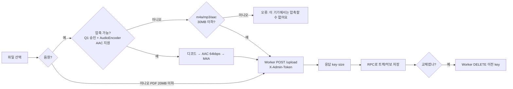

# 단원 앱 v3 명세 — 홈 · 연습실 · 내 활동 · 운영진 연습곡

> 상태: **확정본 (2026-11-21 사용자 합의).** 남은 결정은 §0-2에만 있다.
> 구현 순서와 규칙: [v3 개발 지시서](plans/17_v3_implementation_guide.md)
> 시안: Design 아티팩트 "문콰이어 단원 앱 v3 시안" (보드 이름은 각 절에 표기)
> 이전 명세: [MEMBER_UX_AUDIO_SPEC.md (v2)](MEMBER_UX_AUDIO_SPEC.md). **이 문서와 다르면 이 문서를 따른다.** v2에서 바뀌지 않은 부분(Phase 0 보안, Worker 읽기 경로, 해시 라우팅 원칙)은 v2를 그대로 따른다.

---

## 0. 결정 기록

### 0-1. 확정

| # | 결정 | v2 대비 |
|---|---|---|
| V1 | 단원 탭은 **홈 / 연습실 / 내 활동** 3개. 홈은 v2의 `오늘`+`일정`을 합친다 | 변경 |
| V2 | 홈 달력은 **주간 / 월간** 토글. 마지막 선택을 기기에 기억 | 신규 |
| V3 | 화면에 설명용 부제·도움말 문장을 넣지 않는다. 기능 요소(제목, 숫자, 버튼, 상태)만 둔다 | 신규 |
| V4 | 키 컬러 3색: 네이비(행동) · 라벤더(성장) · 살구(칭찬). §6 | 신규 |
| V5 | 연습실은 **공연 → 곡 → 자료(악보·음원·영상)** 계층. 상단 공연 드롭다운(전체 곡 / 공연별 / 공연 미정) | 변경 |
| V6 | **단원 연습실은 읽기 전용.** 곡·자료·공연 연결·업로드는 운영진 콘솔 "연습곡" 탭에서만 | 변경 |
| V7 | 유튜브는 앱 안 임베드 재생 + 영상 아래 **"유튜브 앱으로 열기" 아이콘 버튼**. 음원 추출 안 함. **재생 목록 기능 없음** | 변경 |
| V8 | 플레이어: 음악 앱과 같은 미니 바(아래로 밀어 닫기) + 전체 화면. 5초 뒤로/앞으로, 한 곡 반복, 속도 슬라이더(0.5~2.0) | 변경 |
| V9 | 음원·악보 PDF를 **운영진 콘솔에서 앱 안 업로드**(R2, Worker 경유). 음원은 업로드 전 기기에서 압축. 시트를 닫아도 업로드 계속 | v2 D2 대체 |
| V10 | 이전 버전 파일은 남기지 않는다. 파일을 교체하면 이전 R2 객체를 지운다 | 신규 |
| V11 | 레벨(누적 출석, 내려가지 않음), 경력 문장, 열정 온도, 칭찬 스티커 24개를 **내 활동**에 둔다. 본인 화면에만 보인다 | v2 D6 대체 |
| V12 | 투표(RSVP) 변경 이력을 **추가 전용 로그**로 쌓는다 | 신규 |
| V13 | 연습실 재생 기록을 **세션 요약** 단위로 쌓는다. 보관 기한 없음. 단원을 지우면 함께 지운다 | 신규 |
| V14 | 출석 기록 화면의 상태 카드(출석/지각/사유 결석/결석)는 **필터 토글** | 신규 |
| V15 | 정시 기준: 체크인 시각의 **분이 시작 시각의 분 이하**. 19:30 시작이면 19:30:59까지 정시 | 신규 |
| V16 | 스티커 이미지는 **Microsoft Fluent Emoji 3D(MIT)**. 24장만 저장소에 포함하고 라이선스 고지를 둔다 | 신규 |
| V17 | 스티커 이름의 운영진 편집 기능은 **보류** | 신규 |

### 0-2. 사용자 결정 대기 (해당 티켓은 답이 올 때까지 착수 금지)

| # | 질문 | 막히는 티켓 | 결정 전 기본 동작 |
|---|---|---|---|
| Q1 | 음원 압축용 경량 라이브러리(`mediabunny`, MP4/M4A 포장용) 설치 승인 | V3-09의 압축 부분 | 압축 없이 **원본 업로드만**(m4a/mp3/aac, 30MB 이하) |
| Q2 | 악보 앱 안 미리보기용 `pdfjs-dist` 설치 승인(운영 화면에서 지연 로딩) | V3-06 | 악보는 **새 탭에서 열기**(브라우저 기본 PDF 뷰어) |

### 0-3. 알려진 한계 (사용자에게 보고됨)

- **"본인만 보기"는 화면 수준이다.** 단원 본인 인증(Task 76)이 이번 범위 밖이라, 출석·투표 원천 데이터는 지금도 앱이 전원분을 내려받는다. 열정 온도와 스티커는 운영진 화면과 다른 단원 화면에 **그리지 않는** 것으로 보장한다.
- **업로드는 앱(탭)이 열려 있는 동안에만 진행된다.** 탭을 닫으면 멈추고, 다시 열면 멈춘 항목을 알려 준다. 같은 파일을 다시 고르면 다시 올린다.
- 유튜브 임베드는 화면이 켜져 있을 때만 재생되고, 광고가 나올 수 있다(프리미엄 로그인이 임베드에 적용되지 않는 기기가 있음).

---

## 1. 공통 원칙

1. **원천 로그는 추가만 한다.** 출석 로그(`attendance_logs`), 투표 이력(`rsvp_events`), 재생 기록(`practice_listen_sessions`)은 수정하거나 지우지 않는다. 단, 단원 삭제 시 재생 기록 연쇄 삭제는 V13에 따른 예외다.
2. **화면 숫자는 모두 투영 값이다.** 레벨, 온도, 스티커, 출석률은 원천 로그에서 매번 계산한다. 계산 결과를 DB에 저장하지 않는다.
3. **출결 판정은 기존 단일 엔진을 쓴다.** `src/utils/attendanceStats.ts`의 `reconcileSingleMemberAttendance`, `calculateCumulativeAttendanceWithLifecycle`, `resolveMergedMemberIds`. 새로 판정 로직을 만들지 않는다. 병합된 단원(`merged_into_id`)의 기록은 별칭 집합으로 합산한다.
4. **시간은 KST 헬퍼로만 다룬다**(`src/utils/date.ts`의 `getKSTDateString`, `getKSTClock`, `parseKSTDate`, `addDaysKST`). `toISOString().slice(0,10)`이나 `new Date('YYYY-MM-DD')` 직접 비교는 쓰지 않는다.
5. **설정값은 하드코딩하지 않는다.** 파트, 일정 구분, 트랙 종류는 설정이나 데이터의 원문을 그대로 쓴다. 공연 여부는 `AppConfig.performanceCategories`(신규, 선택 필드, 기본값 `['연주']`)로 판단한다.
6. **터치 타깃 44px 이상.** 아이콘 버튼은 아이콘이 작아도 클릭 영역은 44×44.
7. **문구는 이 명세에 적힌 것만 쓴다.** 새 안내 문장을 지어내지 않는다(V3). 필요하면 멈추고 묻는다.

---

## 2. 홈 (시안: `Main`, `HomeMonth`)

### 2-1. 구조 (위에서 아래로)

1. **헤더:** 로고 "MOONCHOIR", 오른쪽에 운영진 진입(기존 동작 유지).
2. **상단 카드** (둘 중 하나):
   - **오늘 카드:** 오늘 나에게 해당하는 일정이 있을 때. 일정 이름, 시간, 장소 + 길찾기, "QR 찍기 / PIN 출석" 버튼, 현재 출석 인원과 기준 시각. 기존 `TodayTab`의 출석 동작과 CTA 규칙(`src/utils/todayCta.ts`)을 그대로 쓴다.
   - **다음 일정 카드:** 오늘 일정이 없을 때. "다음 연습 · D-n", 일정 이름·날짜·시간·장소, 참석/불참 버튼(기존 RSVP 흐름). 투표 전이면 "아직 투표하지 않았어요" 한 줄(상태 표시이므로 V3 예외).
3. **달력:** 연월 표시 + 이전/다음, **주간 | 월간** 세그먼트.
   - 주간: 일~토 7칸, 일정 있는 날 점. 기본값.
   - 월간: 기존 `MonthCalendarGrid`.
   - 날짜를 누르면 기존 일정 상세 시트가 열린다(`#/calendar` 계열 동작 재사용).
4. **다가오는 일정** 목록(최대 5개).

### 2-2. 라우팅

- `MemberTab` = `'home' | 'studio' | 'profile'`.
- **옛 주소 호환:** `#/today`, `#/calendar`, `#/calendar?...`는 모두 `home`으로 해석한다. 쿼리(`m`, `d`, `sheet`, `sid`, `qr`)는 그대로 지원해 기존 공유 링크와 QR 오버레이가 깨지지 않게 한다.
- 주간/월간 선택은 기기에 기억(§9 저장 키). 읽기 실패 시 주간.

---

## 3. 연습실 — 단원 (시안: `Studio`, `StudioMenu`, `StudioPiece`, `StudioScore`)

### 3-1. 곡 목록

- **상단:** 제목 "연습실", 검색창(placeholder "곡 이름·작곡가 검색"), 그 아래 **공연 드롭다운 버튼** 하나. 칩이나 태그 버튼을 줄지어 두지 않는다. 오른쪽에 다른 버튼을 두지 않는다.
- **드롭다운 메뉴:** 레이어(팝오버)로 겹쳐 뜬다. 레이아웃은 밀리지 않는다. 바깥을 누르거나 Esc를 누르면 닫힌다. 키보드 포커스를 가두고, 닫으면 버튼으로 돌려준다.
  - 순서: `전체 곡` / 구분선 / 다가오는 공연(날짜 오름차순, 날짜 미정은 맨 뒤) / `공연 미정` / 구분선 / 지난 공연(흐리게, 날짜 내림차순).
  - 항목마다 날짜(`12월 14일` 형식, 없으면 생략)와 곡 수.
  - 곡이 하나도 연결되지 않은 공연은 메뉴에 넣지 않는다.
  - "공연 미정"은 해당 곡이 0개면 숨긴다.
- **"공연"의 정의:** `program_cards`(시즌 카드) 중 `is_archived = false`이면서 연결된 곡이 있는 것.
- **공연 날짜:** 그 카드의 `program_id`를 가진 일정 중 취소·보관되지 않은 것만 본다.
  - 구분이 `performanceCategories`에 들어 있는 일정이 있으면 그중 가장 늦은 날짜를 쓴다.
  - 없으면 일정 전체 중 가장 늦은 날짜를 쓴다.
  - 일정이 하나도 없으면 날짜 미정이다.
  - 날짜가 오늘 이후이거나 미정이면 "다가오는 공연", 오늘 이전이면 "지난 공연"이다.
- **목록 정렬:**
  - 전체 곡: `created_at` 내림차순.
  - 공연: `practice_program_pieces.order_index` 오름차순. 각 행 왼쪽에 1부터 번호(라벤더 색).
  - 공연 미정: 보관되지 않은 연결이 하나도 없는 곡. `created_at` 내림차순.
- **검색:** 곡 이름, 작곡가, 편곡자, 연결된 공연 이름으로 찾는다. 대소문자와 공백을 무시한다. 검색 중에도 드롭다운 범위는 유지된다.
- **행:** 곡 이름, 작곡가(·편곡), 자료 태그(`악보` / `음원 n` / `영상 n`), 새 음원 표시(7일 이내 추가된 트랙이 있으면 "새 음원").
- **선택 기억:** 마지막 범위를 기기에 기억한다. 기억한 공연이 없어졌으면 "전체 곡".
- **보관된 곡·트랙**은 단원에게 보이지 않는다.

### 3-2. 곡 상세

- **헤더:** ‹ 연습실. 업로드 상태 표시를 두지 않는다(V6).
- **제목 영역:** 곡 이름, "작곡가 · 공연 이름"(공연이 여러 개면 다가오는 공연 1개).
- **악보 카드:** "악보 보기" + `n쪽 · m월 d일 수정본`(쪽수는 알 수 있을 때만). 누르면 §3-4.
- **음원 카드:** 트랙 목록. 재생 중인 트랙은 강조하고 일시정지 아이콘을 보인다. 행 = 재생 버튼, 이름, `종류 · 길이`.
- **참고 영상 카드:**
  - 유튜브 임베드(앱 안 재생, 16:9보다 낮은 미리보기 높이 허용).
  - **바로 아래 줄**에 영상 제목(왼쪽)과 **유튜브 로고 + ↗ 버튼**(오른쪽, 최소 44px, 연회색 바탕)을 둔다.
  - 버튼에는 화면 글자가 없고 `aria-label="유튜브 앱으로 열기"`만 있다. 링크는 등록된 URL 원문을 연다(`target="_blank" rel="noopener noreferrer"`). `&list=` 같은 파라미터를 붙이지 않는다.
  - 안내 문장, 툴팁, 첫 실행 안내는 금지다.
- **두지 않는 것:** "+ 악보 / + 음원 / + 링크", "+ 곡 추가", 업로드 진행 표시.

### 3-3. 플레이어 (시안: `Player`, 각 화면 하단 미니 바)

- **미니 바:** 하단 탭 위에 고정. 커버(라벤더 사각 + 음표), 트랙 이름 / 곡 이름(탭하면 전체 화면), 일시정지, 다음 트랙, 맨 아래 2px 진행선. **아래로 밀면 정지하고 닫힌다.**
- **전체 화면:**
  - 위쪽: 손잡이, 접기(⌄), 악보 보기 버튼.
  - 가운데: 큰 커버, 트랙 이름, 곡 이름.
  - 재생바: 경과 시간과 남은 시간. 드래그로 이동.
  - 조작 버튼: 한 곡 반복 / 5초 뒤로 / 재생·일시정지 / 5초 앞으로 / 속도.
  - 아래: 이 곡의 다른 트랙 목록.
  - 아래로 밀거나 ⌄를 누르면 미니 바로 돌아간다. 뒤로 가기도 같다(오버레이 라우트 규칙).

| 조작 | 동작 |
|---|---|
| 5초 뒤로/앞으로 | `currentTime`을 ±5초, 0과 `duration` 사이로 자름. 길게 누르기 기능 없음 |
| 한 곡 반복 | 켜짐/꺼짐. 꺼져 있으면 트랙 끝에서 정지(다음 트랙 자동 재생 없음) |
| 속도 | 버튼을 누르면 속도 시트 |
| 잠금 화면 | Media Session `seekbackward`/`seekforward` 5초, `play`/`pause`. 플레이어를 닫거나 로그아웃하면 핸들러를 해제 |

- **속도 시트:**
  - 큰 숫자 표시(`1.00x`), `<input type="range">` 0.5~2.0, 0.05 단위.
  - 1.0 ± 0.03 안에 놓으면 1.0으로 붙는다.
  - 양옆에 −0.05 / +0.05 버튼(44px).
  - 아래에 프리셋 0.75 / 1.0 / 1.25 / 1.5.
  - 마지막 값은 기기에 기억한다(실패 시 1.0).
  - 음 높이 유지는 브라우저 기본값을 따르며 토글을 만들지 않는다.
  - **원형 다이얼을 쓰지 않는다**(밀어 닫기 제스처와 충돌).
- 유튜브는 이 플레이어를 쓰지 않는다.

### 3-4. 악보 보기

- `score_storage_key`가 있으면 `{mediaPublicBaseUrl}/{key}`, 없으면 기존 `score_url`(구글 드라이브 등).
- **Q2 결정 전:** 새 탭에서 연다.
- **Q2 승인 시:** 앱 안 전체 화면 보기(시안 `StudioScore`)로 연다. 핀치 확대, 쪽 넘김 ‹ n / m ›, 하단 미니 바 유지. `pdfjs-dist`는 이 화면에 들어갈 때만 동적 import 한다.

---

## 4. 연습실 — 운영진 콘솔 "연습곡" 탭 (시안: `AdminPieces`, `AdminPieceEdit`, `AdminProgramOrder`, `AdminUpload`)

기존 `src/components/admin/AdminPracticeTab.tsx`를 고친다. 새 탭을 만들지 않는다.

### 4-1. 곡 목록

- **헤더:** ‹, "연습곡", 오른쪽에 업로드 상태 칩(진행 중일 때만, "올리는 중 n").
- **본문:** 검색창(placeholder "곡 이름·작곡가·공연"), 공연 드롭다운(§3-1과 같은 컴포넌트), 오른쪽 "보관함" 토글.
- **곡 행:** 단원 화면과 같고, 공연 미정 곡에는 살구색 "공연 미정" 태그를 붙인다.
- **추가 버튼:** 오른쪽 아래 떠 있는 "+ 곡" 버튼. 누르면 곡 편집 화면과 **같은 화면**을 빈 상태로 연다(제목 "곡 추가"). 새 곡에서도 악보·음원·영상·공연을 추가할 수 있고, 이것들은 "저장 대기"로 보이다가 "저장"을 누르면 곡 생성 → 링크 저장 → 파일 업로드 순서로 처리한다.
- **기존 하위 탭:** `PIECES` / `PROGRAMS`는 "곡" / "공연별 순서"로 이름만 바꾸고 유지한다.

### 4-2. 곡 편집

| 영역 | 내용 |
|---|---|
| 기본 정보 | 곡 이름(필수), 작곡, 편곡. **화면 아래 고정 "저장" 버튼으로 저장**(자동 저장 없음, 2026-11-22 변경). 실패하면 버튼 위 빨간 한 줄. 저장 안 한 변경이 있으면 닫을 때 "저장하지 않고 닫을까요?" 확인 |
| 공연 | 연결된 공연 행(이름, 날짜 · n번째, × 빼기). "+ 공연에 넣기"는 공연 선택 시트를 열고, 고른 공연의 맨 뒤에 붙인다 |
| 악보 | PDF 1개. 행 = 파일명, 크기·날짜, "교체". 없으면 "+ 악보 올리기". 기존 `score_url`만 있는 곡은 "외부 링크" 행으로 보이고 "교체"로 업로드 가능 |
| 음원 | 트랙 행 = 아이콘, 이름, `종류 · 길이 · 크기`, ↑(위로), ⋯(아래로 / 이름 바꾸기 / 종류 바꾸기 / 파일 교체 / 보관). 업로드 중인 행은 진행 막대와 "압축 중 n%" 또는 "올리는 중 n%" |
| 영상 | 유튜브 행 = 로고, 제목, URL 일부, ⋯(수정 / 보관). "+ 유튜브 링크" |

- **유튜브 URL 검증:** `https`이고 호스트가 `youtube.com`, `www.youtube.com`, `m.youtube.com`, `music.youtube.com`, `youtu.be` 중 하나여야 한다. 아니면 저장 버튼을 비활성화한다.
- **삭제 버튼은 없다.** 보관만 있다(기존 원칙). 파일 교체 시에만 이전 R2 객체를 지운다(V10).

### 4-3. 공연별 순서

- 상단 공연 드롭다운("이름 · 날짜").
- 행 = 번호, 곡 이름, 작곡가, ↑, ↓, ×(빼기). 맨 위의 ↑과 맨 아래의 ↓는 비활성.
- "+ 곡 넣기"는 곡 선택 시트(검색 가능, 이미 들어 있는 곡은 제외)를 연다.
- 저장은 기존 `fn_set_program_pieces`로 전체 순서를 보낸다. 연속 탭은 300ms 디바운스한다.

### 4-4. 음원 올리기 시트

- **구성:** 파일 카드(파일명, `원본 크기 → 약 예상 크기`, "다른 파일"), 이름(기본값 = 확장자 뺀 파일명), 종류(설정의 `practiceTrackKinds` 버튼 + "직접"), 저장 공간 `사용량 / 10GB`, "올리기".
- **닫기:** "올리기"를 누른 뒤에는 시트를 닫아도 업로드가 계속된다. 진행 상태는 곡 편집 화면의 해당 트랙 행과 헤더 칩에 보인다.
- **용량:** 사용량이 9.5GB를 넘으면 "올리기"를 비활성화한다.

### 4-5. 업로드 파이프라인

- **업로드 큐:** `src/services/media/uploadQueue.ts`에 모듈 싱글턴 하나를 둔다. 상태는 `queued → compressing(%) → uploading(%) → saving → done | failed`.
  - 큐는 React 컴포넌트 수명과 무관하다. 시트를 닫거나 탭을 이동해도 계속된다.
  - 동시 실행은 1개다.
  - 업로드 진행률은 `XMLHttpRequest.upload.onprogress`로 얻는다(`fetch`는 업로드 진행률이 없음).
- **이탈 보호:** 진행 중인 작업이 있으면 `beforeunload` 경고를 건다. 진행 중 작업의 메타데이터(곡 id, 이름, 종류, 파일명, 상태)를 기기에 저장한다. 다음 실행 때 미완료 항목이 있으면 연습곡 탭 상단에 "멈춘 업로드 n개" 한 줄을 띄우고 펼치면 목록을 보여 준다. 다시 하려면 파일을 다시 고른다.
- **압축 규격:** AAC-LC, 64kbps, 44.1kHz, 원본이 모노면 모노 / 아니면 스테레오. 컨테이너는 M4A(`audio/mp4`).
  - 길이(초)는 디코드 결과로 계산해 트랙 `duration_seconds`에 저장한다.
  - 판단 순서: `AudioEncoder.isConfigSupported({codec:'mp4a.40.2', ...})`가 false거나 `AudioEncoder`가 없으면 압축 불가 경로로 간다.
- **보안:** 관리자 토큰은 `getActiveAdminToken()`으로만 읽는다. 토큰을 URL 쿼리에 넣지 않는다(헤더만). 401을 받으면 기존 `ADMIN_AUTH_REQUIRED` 흐름(토큰 삭제 + PIN 재입력)을 탄다.

---

## 5. 내 활동 (시안: `Profile`, `ProfileLevel`, `ProfileTemp`, `ProfileRecords`, `Stickers`)

### 5-1. 메인 구성 (위에서 아래로)

1. 프로필 줄: 아바타(라벤더 원 + 이름 첫 글자), 이름, `파트 · n일째`.
2. 2칸: **레벨 카드**(라벤더로 꽉 채움: "내 레벨", `Lv.n`, 레벨 이름, 진행 막대) | **출석률 링**(네이비 도넛 + %, "출석률"). 각각 누르면 레벨 계보 시트 / 출석 기록 시트.
3. 3칸 숫자(연한 라벤더 바탕): `n일` 함께한 날 · `n시간` 연습 · `n번` 공연.
4. **열정 온도 카드**(연한 살구 바탕): 불꽃 아이콘, "열정 온도", `38.2°C`, 오른쪽 이번 주 변화 알약(`+0.4`). 누르면 내역 시트.
5. **칭찬 스티커** 미리보기: "칭찬 스티커", `획득 / 24`, 최근 획득 3개 + 다음 잠긴 1개. 누르면 스티커 보드.

> 한 화면에서 **꽉 찬 색 카드는 레벨 카드 1개뿐**이다. 나머지는 연한 바탕이나 흰 카드로 둔다.

### 5-2. 숫자 정의

| 항목 | 정의 |
|---|---|
| 함께한 날 | `members.joined_at`(없으면 첫 출석 로그 날짜)부터 오늘까지 KST 일수 + 1 |
| 연습 시간 | 상태가 출석·수동인정·지각인 일정의 (`end_time` − `start_time`) 합. 시간 단위 내림 |
| 공연 | 구분이 `performanceCategories`에 들어 있고 상태가 출석·수동인정·지각인 일정 수 |
| 출석률 | 기존 엔진 `attendanceRate`(최근 3개월 범위). 링 아래 표기 없음 |
| 누적 출석 | 기존 엔진 `attended + late`(전체 기간). 레벨 계산에 쓴다 |

### 5-3. 레벨

| Lv | 누적 출석 | 이름 |
|---|---|---|
| 1 | 0~9 | 새내기 {파트} |
| 2 | 10~19 | 첫걸음 {파트} |
| 3 | 20~29 | 꾸준한 {파트} |
| 4 | 30~59 | 든든한 {파트} |
| 5 | 60~99 | 기둥 {파트} |
| 6 | 100~ | 문콰이어의 목소리 |

- `{파트}`는 `member.part` 원문이다. 비어 있으면 "단원".
- 진행 막대 = (누적 − 현재 단계 하한) / (다음 하한 − 현재 하한). Lv.6은 가득 찬 막대.
- 레벨은 내려가지 않는다. 누적 출석은 원천 로그가 지워지지 않는 한 줄지 않기 때문이다. 운영진이 출결을 정정해 줄어들면 그대로 반영한다.
- **계보 시트:** 현재 단계 요약(라벤더 연한 바탕, `Lv.n까지 m회`)과 6단계 목록. 지난 단계는 "달성", 현재는 "지금", 미래는 점선 원.

### 5-4. 출석 기록 시트 (V14)

- **상단 4칸 토글:** 출석 / 지각 / 사유 결석 / 결석. 한 번에 하나만 켜지고, 다시 누르면 전체로 돌아간다. 켜진 칸은 살구 테두리와 연한 살구 바탕.
- **분류:** 기존 엔진의 `finalStatus`로 나눈다.
  - 출석 = `출석` + `수동인정`
  - 지각 = `지각`
  - 사유 결석 = `사유결석`
  - 결석 = `결석`
  - `미참`과 그 밖의 값은 카드 숫자에서 빼고, 전체 목록에서는 원문 그대로 보인다.
- **기간 칩:** 최근 3개월 / 올해 / 전체. 이 시트 안의 보조 필터라 칩을 허용한다. 카드 숫자는 기간 기준이다.
- **행:** 날짜(`11/14 토`), 일정 이름, 보조 줄, 상태 칩, 체크인 시각.
  - 보조 줄: 지각 행은 `시작 HH:MM`, 그 외는 투표 상태(`투표 참석` / `투표 불참 · 사유` / `미투표`).
- **빈 결과:** "이 기간에는 없어요" 한 줄.

### 5-5. 열정 온도

**원칙**

- 투영 값이다. 순수 함수 `src/utils/passionTemperature.ts`에서 계산하고, 결과에 항목별 이유를 담아 돌려준다.
- 같은 입력이면 항상 같은 값이 나온다(시간 의존은 `referenceDate` 인자로만 받는다).

**계산 창**

- 대상 일정: 기존 엔진의 모수와 같다. 필참이면서 오늘 이전인 일정과, 비필참이지만 체크인한 일정. 취소·보관·`미참`은 제외한다.
- 시작 시각이 늦은 순으로 **최근 12개**를 쓴다.
- 공연 항목만 최근 365일 기준이다.

**정시 판정 (V15)**

- 정시: `getKSTClock(checkInTime)`의 분 ≤ 시작 시각의 분, 그리고 상태가 출석 또는 수동인정.
- 일찍: 분 ≤ 시작 − 10.
- 정시 연속: 최근 일정부터 거꾸로 세어 정시가 몇 번 이어지는지 센다. `사유결석`은 건너뛴다(끊지 않음). 지각·결석·정시 아닌 출석을 만나면 멈춘다.
- **참고:** 지각 상태 자체는 기존 설정 `lateGraceMinutes`(기본 10분)를 그대로 쓴다. 그래서 시작 후 1~10분 사이에 온 사람은 "출석"이지만 정시 보너스는 없다.

| 묶음 | 항목 | 점수 | 상한·비고 |
|---|---|---|---|
| 출석 | 정시 1회 | +0.10 | — |
| | 일찍 1회 (정시에 더해) | +0.05 | — |
| | 정시 연속 5회 이상 / 10회 이상 | +0.30 / +0.60 | 둘 중 하나만 |
| | 지각 | 0 | 내역에 "지각 n회 · 0"으로 표시 |
| | 사유결석 | 0 | — |
| | 결석 | −0.40 | 노쇼면 아래 항목으로 대체 |
| 약속 | 24시간 전까지 투표 | +0.05 | 최대 +0.60 |
| | 약속 지킴률 ≥ 90% / 75~90% | +0.30 / +0.10 | 둘 중 하나만 |
| | 노쇼 (시작 시점 마지막 투표가 참석인데 결석) | −0.50 | 결석 −0.40을 대체. 중복 감점 없음 |
| | 시작 3시간 안에 참석 → 불참 변경 | −0.10 | — |
| 공연 | 공연 출석 1회 | +0.20 | 최대 +0.60 |

- **최종값:** `36.5 + 합계`. 34.0~42.0으로 자르고 소수 첫째 자리까지 반올림한다.
- **이번 주 변화:** `referenceDate`를 7일 전으로 놓고 계산한 값과의 차이.
- **약속 묶음 데이터:** `rsvp_events`에서 `action <> 'backfill'`인 행만 쓴다.
  - 해당 이벤트가 하나도 없는 일정은 약속 계산에서 뺀다(분모 포함).
  - 약속 묶음 대상 일정이 0개면 내역에서 약속 묶음을 숨긴다.
- **약속 지킴률:** 시작 시점 마지막 투표가 참석이고 결과가 출석·수동인정·지각이거나, 마지막 투표가 불참이고 결과가 사유결석·결석인 경우를 지킴으로 센다. 지킴 수를 투표가 있던 일정 수로 나눈다.
- **내역 시트:**
  - 큰 숫자는 연한 살구 카드에 `38.2°C`와 `최근 n회`.
  - 묶음(출석 / 약속 / 공연)별로 0이 아닌 항목만 보여 준다. 지각만 0이어도 표시한다.
  - 문구 형식은 `일찍 도착 3회 +0.15`.
  - 항목을 누르면 해당 일정만 걸러진 출석 기록 시트를 연다.

### 5-6. 칭찬 스티커 (V16)

**규칙**

- 투영 값이다. 순수 함수 `src/utils/praiseStickers.ts`가 각 스티커의 `{ id, earned, earnedOn?, progress? }`를 돌려준다.
- 획득일은 조건을 처음 만족한 날이다.
- 새로 얻은 스티커 알림(한 번)은 "본 스티커 id 목록"을 기기에 저장해 판단한다(§9). 저장이 실패하면 알림을 띄우지 않는다.
- 잠긴 스티커는 같은 이미지에 흑백과 투명도 0.4를 적용하고, 이름은 보인다.
- 결석·지각 횟수 자체로 주는 스티커는 없다.

| 묶음 (프레임) | id | 이름 | 조건 | 이미지 |
|---|---|---|---|---|
| 꾸준함 (원, 라벤더 연한 바탕) | first-step | 첫걸음 | 누적 출석 1 | footprints |
| | att-10 | 열 번째 노래 | 누적 출석 10 · 동 | musical_note |
| | att-50 | 반백 | 누적 출석 50 · 은 | musical_notes |
| | att-100 | 백 번의 화음 | 누적 출석 100 · 금 | hundred_points |
| | full-month | 한 달 개근 | 어떤 달의 필참 일정이 2개 이상이고, 그 일정이 모두 출석·수동인정·지각·사유결석이며 그중 1개 이상 출석 | spiral_calendar |
| | anniv-1y | 1주년 | 함께한 날 ≥ 366 | birthday_cake |
| 시간 약속 (둥근 사각, 살구 연한 바탕) | ontime-5 | 정시 5연속 | 정시 연속 5 (어느 시점이든) · 동 | alarm_clock |
| | ontime-10 | 정시 10연속 | 정시 연속 10 · 은 | stopwatch |
| | early-5 | 일찍 온 사람 | 일찍 누적 5 · 동 | sunrise |
| | early-20 | 얼리버드 | 일찍 누적 20 · 금 | bird |
| | back-on-time | 다시 정시로 | 지각 바로 다음부터 정시 3연속 | seedling |
| 약속 (마름모, 네이비 연한 바탕) | first-vote | 첫 투표 | 투표 이벤트 1 | ballot_box_with_ballot |
| | quick-10 | 빠른 답장 | 24시간 전 투표 누적 10 | high_voltage |
| | kept-10 | 약속 지킴 | 약속 지킴 10연속 | handshake |
| | all-voted-month | 빠짐없는 응답 | 어떤 달의 필참 일정(2개 이상) 모두에 시작 전 투표 | check_mark_button |
| 연습실 (육각, 라벤더 연한 바탕) | first-play | 첫 재생 | 재생 기록 1 | headphone |
| | listen-1h | 연습 1시간 | 누적 재생 3,600초 · 동 | microphone |
| | listen-5h | 연습 5시간 | 누적 18,000초 · 은 | studio_microphone |
| | listen-20h | 연습 20시간 | 누적 72,000초 · 금 | fire |
| | explorer-10 | 10곡 탐험가 | 곡별 누적 60초 이상인 곡 10개 | compass |
| 무대 (별꽃, 금 연한 바탕 `#FFF4D6`) | first-stage | 첫 무대 | 공연 출석 1 | performing_arts |
| | stage-3 | 공연 3회 | 공연 출석 3 · 동 | sparkles |
| | stage-10 | 공연 10회 | 공연 출석 10 · 금 | trophy |
| | stage-ready | 무대 준비 완료 | 어떤 공연 일정 직전 28일 안의 필참 일정(2개 이상)이 모두 출석·수동인정·지각 | glowing_star |

- **단계 테두리:** 동 `#C98A5A` / 은 `#A9AFBF` / 금 `#E2B33C`. 획득한 스티커에만 그린다.
- **이미지:** `public/stickers/{이미지}.png`(Fluent 3D, 256px 원본). 같은 폴더에 `LICENSE-fluentui-emoji.txt`(MIT 원문, Microsoft 저작권 표기)를 둔다. 원본은 `microsoft/fluentui-emoji`의 `assets/<이름>/3D/<이름>_3d.png`이고, Handshake는 `Default/3D/handshake_3d_default.png`다.
- **스티커 보드:** ‹, "칭찬 스티커", `획득 / 24` 알약. 묶음별 4칸 격자, 칸 높이 100px 이상.

---

## 6. 디자인 토큰 (V4)

`src/index.css`의 `:root`와 다크 모드 블록 양쪽에 추가한다. 기존 토큰은 그대로 둔다. **`--color-*` 이름은 만들지 않는다.**

| 토큰 | 라이트 | 다크 | 용도 |
|---|---|---|---|
| `--brand-primary` (기존) | `#282C48` | (기존 값) | 행동: 버튼, 활성 탭, 출석률 링 |
| `--brand-lavender` | `#7C74C9` | `#9B94E0` | 성장: 레벨 카드, 진행 막대, 번호, 커버 |
| `--brand-lavender-tint` | `#EFEDFA` | `rgba(155,148,224,0.16)` | 성장 연한 바탕 |
| `--brand-lavender-text` | `#4A448A` | `#C9C4F2` | 연한 바탕 위 글자 |
| `--brand-apricot` | `#E8864F` | `#F0A070` | 칭찬: 아이콘 원, 선택 테두리 |
| `--brand-apricot-tint` | `#FDF0E7` | `rgba(240,160,112,0.16)` | 칭찬 연한 바탕 |
| `--brand-apricot-text` | `#B24A15` | `#F5B48C` | 온도 숫자 등 글자. `#E8864F`는 흰 바탕 대비가 부족해 글자에 쓰지 않는다 |
| `--sticker-bronze` / `--sticker-silver` / `--sticker-gold` | `#C98A5A` / `#A9AFBF` / `#E2B33C` | 같음 | 스티커 테두리 |
| `--sticker-stage-tint` | `#FFF4D6` | `rgba(226,179,60,0.16)` | 무대 스티커 바탕 |
| `--player-surface` | `#2E3352` | `#2E3352` | 미니 바 |
| `--player-surface-full` | `#23273F` | `#1A1D2E` | 전체 화면 플레이어 |

- 컴포넌트 안에 hex 색을 직접 쓰지 않는다. 기존 가드 테스트 `src/styles/cssVariables.test.ts`가 새 토큰도 정의돼 있는지 검사하게 한다.
- 글꼴은 기존 Pretendard를 그대로 쓴다. 시안의 Noto Sans KR은 시안용이다.

---

## 7. 데이터 (Supabase)

마이그레이션은 PR 묶음에 맞춰 2개로 나눈다(지시서 §1-2): `20261123000000_v3_media.sql`(§7-3, `fn_authorize_media_upload`, `fn_get_media_usage`, 기존 카탈로그 함수 3개 수정)과 `20261124000000_v3_activity.sql`(§7-1, §7-2, `fn_log_listen_session`, `fn_get_member_activity`). 검증 스크립트도 각각 `supabase/tests/v3_media_check.sql`, `supabase/tests/v3_activity_check.sql`. **운영 적용은 리뷰어가 한다.**

### 7-1. `rsvp_events` (추가 전용, V12)

| 열 | 타입 | 제약 |
|---|---|---|
| `seq` | `bigint generated always as identity` | PK |
| `schedule_id` | `text` | not null |
| `member_id` | `text` | not null |
| `action` | `text` | not null, check in (`'insert'`,`'update'`,`'delete'`,`'backfill'`) |
| `status` | `text` | not null. delete면 OLD.status |
| `prev_status` | `text` | null 허용 |
| `occurred_at` | `timestamptz` | not null default `now()` |

- **채우는 방법:** `rsvp_votes`에 `AFTER INSERT OR UPDATE OR DELETE FOR EACH ROW` 트리거(`trg_rsvp_votes_log`)를 건다.
  - update는 `status`가 바뀔 때만 기록한다.
  - 클라이언트와 RPC는 고치지 않는다(모든 경로가 자동 기록됨).
- **백필:** 마이그레이션 안에서 기존 `rsvp_votes` 각 행을 `action='backfill'`로 1회 넣는다.
  - `occurred_at`은 `timestamp`를 `timestamptz`로 바꿀 수 있으면 그 값, 안 되면 `received_at`.
  - 다시 실행해도 중복되지 않게 `not exists`로 막는다.
- **보호:** RLS 켜고 직접 정책은 없다. update/delete를 막는 트리거를 건다(기존 `prevent_row_deletion` 재사용 + update 차단 함수 신규).
- 인덱스: `(member_id, schedule_id, occurred_at)`.

### 7-2. `practice_listen_sessions` (V13)

| 열 | 타입 | 제약 |
|---|---|---|
| `chunk_id` | `text` | PK (클라이언트 생성 UUID) |
| `member_id` | `text` | not null, `references members(id) on delete cascade` |
| `piece_id` | `text` | not null, `references practice_pieces(id) on delete restrict` |
| `track_id` | `text` | not null, `references practice_tracks(id) on delete restrict` |
| `started_at` | `timestamptz` | not null |
| `listened_seconds` | `integer` | not null, check 1~120 |
| `received_at` | `timestamptz` | not null default `now()` |

- 인덱스: `(member_id, received_at)`.
- **보호:** RLS 켜고 직접 정책 없음. update 차단 트리거(delete는 cascade 때문에 막지 않는다).

### 7-3. 기존 테이블 열 추가 (모두 기본값이 있어 하위 호환)

| 테이블 | 열 | 타입 |
|---|---|---|
| `practice_pieces` | `score_storage_key` | `text not null default ''` |
| `practice_pieces` | `score_size_bytes` | `bigint` (null 허용, ≥ 0) |
| `practice_tracks` | `size_bytes` | `bigint` (null 허용, ≥ 0) |

### 7-4. RPC

| 함수 | 권한 | 내용 |
|---|---|---|
| `fn_log_listen_session(p_payload jsonb)` | anon | 입력 `chunkId, memberId, pieceId, trackId, startedAt, listenedSeconds`. 검증: 회원·트랙 존재, 트랙이 곡에 속함, `listenedSeconds` 1~120으로 자름. 같은 회원의 당일(KST) 합계가 21,600초를 넘으면 무시. `on conflict (chunk_id) do nothing`. 반환 `{ok:true}` |
| `fn_get_member_activity(p_member_id text)` | anon | 반환 `{ rsvpEvents: [...본인 것, 최근 400개], listen: { totalSeconds, perPiece: [{pieceId, seconds}], firstAt } }`. 원본 재생 행 목록은 반환하지 않는다 |
| `fn_authorize_media_upload(p_token text)` | anon | `return fn_check_admin_token(p_token, 'admin')`. Worker 전용 |
| `fn_get_media_usage(p_token text)` | anon | 관리자 토큰 검사 후 `practice_tracks.size_bytes` 합 + `practice_pieces.score_size_bytes` 합(보관 포함). 토큰이 틀리면 기존 관리자 RPC와 같은 오류 형식 |
| `fn_save_practice_piece` | (기존) | `scoreStorageKey`, `scoreSizeBytes`를 받는다. **최신 정의(`20261122000000_practice_catalog.sql` 211행~)를 복사해서 해당 줄만 고친다** |
| `fn_save_practice_track` | (기존) | `sizeBytes`를 받는다. **최신 정의는 `20261122010000_review_followups.sql` 124행~** |
| `fn_get_practice_catalog(boolean, text)` | (기존) | 새 열 3개를 응답에 넣는다(`scoreStorageKey`, `scoreSizeBytes`, `sizeBytes`). **최신 정의는 `20261122010000_review_followups.sql` 295행~** |

- **회원 삭제 연동:** 기존 회원 삭제 함수가 "출석·투표 기록이 있으면 소프트 삭제"하는 규칙은 그대로 둔다. 재생 기록은 그 판단에 넣지 않는다. 물리 삭제될 때만 cascade로 지워진다.

### 7-5. 클라이언트 계약

- `src/types/rollbook.ts`:
  - `PracticePiece`에 `scoreStorageKey?`, `scoreSizeBytes?`, `PracticeTrack`에 `sizeBytes?`를 추가한다.
  - `RsvpEvent`, `MemberActivity` 타입을 추가한다.
  - `AppConfig`에 `performanceCategories?: string[]`를 추가한다.
- 파서(`sheetsParser.ts` 또는 카탈로그 파서): 새 필드가 없으면 기본값을 넣는다(하위 호환).
- **서비스 경로 규칙:**
  - 모든 새 호출은 `services/sheets.ts`의 메서드 → `backend` 어댑터를 거친다.
  - Supabase 백엔드에서는 `src/services/backend/supabaseBackend.ts`의 `mapActionToRpc`에 매핑을 추가한다.
  - Sheets 백엔드에서는 기능 없음을 명시적으로 돌려준다(`{ ok:false, reason:'UNSUPPORTED_BACKEND' }`). 화면은 이때 해당 영역을 숨긴다.
  - 예외: 업로드 자체는 Worker로 가므로 `src/services/media/workerClient.ts` 한 곳에서만 부른다.

---

## 8. Worker 업로드 (V9, V10)

`workers/media/index.js`를 고친다. 읽기(GET/HEAD) 동작과 테스트는 그대로 유지한다.

| 요청 | 동작 |
|---|---|
| `POST /upload?kind=audio\|score` | 헤더 `X-Admin-Token`, `Content-Type`, `Content-Length` 필수. 인증은 Supabase RPC `fn_authorize_media_upload`를 `env.SUPABASE_URL`, `env.SUPABASE_ANON_KEY`로 호출해 `true`일 때만 통과(아니면 401) |
| | 형식: audio = `audio/mp4`, `audio/x-m4a`, `audio/mpeg`, `audio/aac` / score = `application/pdf`. 그 외 415 |
| | 크기: audio ≤ 30MB, score ≤ 20MB. 초과 413. `Content-Length`가 없으면 411 |
| | 키: `{YYYY}/{kind}/{16자 소문자 영숫자}.{m4a\|mp3\|aac\|pdf}`. `crypto.getRandomValues` 사용. 클라이언트가 키를 정하지 않는다 |
| | `env.MEDIA_BUCKET.put(key, request.body, { httpMetadata: { contentType } })` 후 `201 {"key","size"}` |
| `DELETE /object/{key}` | 같은 인증. 키가 정규식 `^\d{4}/(audio\|score)/[a-z0-9]{16}\.(m4a\|mp3\|aac\|pdf)$`에 맞을 때만 삭제(아니면 400). 204 |
| CORS | 허용 메서드에 `POST, DELETE`, 허용 헤더에 `X-Admin-Token, Content-Type` 추가. 허용 출처 목록은 기존 그대로 |

- `SUPABASE_URL`, `SUPABASE_ANON_KEY`는 공개 값이지만 저장소에 커밋하지 않고 Cloudflare 대시보드 변수로 넣는다(README에 절차 기록). 관리자 토큰은 로그에 남기지 않는다.
- 테스트(`workers/media/index.test.js`)에 추가할 경우:
  - 인증 실패 401
  - 형식 415, 크기 413, 길이 없음 411
  - 키 형식
  - DELETE 정규식 거부
  - CORS 사전 요청에 POST 포함

---

## 9. 기기 저장 키

`src/services/sheetsStorage.ts`에 `PREFERENCE_KEYS`를 새로 만든다. 데이터 캐시 키(`STORAGE_KEYS`)와 섞지 않는다. 그래야 비상 캐시 초기화가 선호값을 지우지 않는다.

| 키 이름 | 값 | 실패 시 |
|---|---|---|
| `HOME_CALENDAR_VIEW` → `moonchoir_pref_home_view_v1` | `'week' \| 'month'` | `'week'` |
| `STUDIO_SCOPE` → `moonchoir_pref_studio_scope_v1` | `'all' \| 'unassigned' \| programId` | `'all'` |
| `PLAYBACK_RATE` → `moonchoir_pref_playback_rate_v1` | 0.5~2.0 숫자 | `1` |
| `SEEN_STICKERS` → `moonchoir_pref_seen_stickers_v1` | id 배열 | 알림 생략 |
| `UPLOAD_JOBS` → `moonchoir_pref_upload_jobs_v1` | 미완료 업로드 메타데이터 | 알림 생략 |

- 읽기와 쓰기는 모두 `try/catch`로 감싼 헬퍼(`readPreference` / `writePreference`) 하나로만 한다.
- 값이 형식에 맞지 않으면 실패 시 값을 쓴다.

---

## 10. 수용 기준

### 홈

1. 옛 주소 `#/today`, `#/calendar?m=2026-11&d=2026-11-24&sheet=1`이 홈으로 열리고, 일정 상세 시트도 열린다.
2. 주간/월간을 바꾸고 새로고침하면 유지된다. 저장소를 막아도 주간으로 정상 표시된다.
3. 오늘 일정이 있으면 오늘 카드, 없으면 다음 일정 카드가 보인다.

### 연습실

4. 곡이 연결되지 않은 공연은 드롭다운에 없다. 공연 미정 곡이 0개면 "공연 미정"이 없다.
5. 공연을 고르면 `order_index` 순으로 번호가 매겨진다. 운영진이 순서를 바꾸면 다음 데이터 갱신 때 반영된다.
6. 드롭다운을 열어도 아래 목록의 위치가 바뀌지 않는다(레이어).
7. 곡 상세에 편집·업로드 요소가 없다.
8. 유튜브 버튼은 영상 바로 아래 줄에 있고, 화면 글자가 없다.

### 플레이어

9. 5초 뒤로를 0:03에서 누르면 0:00이 된다. 끝 3초 전에서 5초 앞으로를 누르면 끝이 된다.
10. 반복이 꺼져 있으면 트랙 끝에서 정지한다.
11. 속도 1.02에 놓으면 1.00이 된다. 0.5와 2.0에서 ∓ 버튼이 비활성화된다.
12. 미니 바를 아래로 밀면 정지하고 사라진다. 잠금 화면 조작이 해제된다.

### 운영진

13. 시트를 닫은 뒤에도 업로드가 끝까지 진행되고, 트랙이 목록에 생긴다.
14. 업로드 중 새로고침하면 경고가 뜨고, 다시 열면 "멈춘 업로드 1개"가 보인다.
15. 파일을 교체하면 새 키로 저장된 뒤 이전 키로 DELETE가 1회 호출된다.
16. 9.5GB를 넘으면 "올리기"가 비활성화된다.

### 내 활동

17. 꽉 찬 색 카드는 레벨 카드 하나다.
18. 출석 기록에서 "지각"을 누르면 지각 행만 보이고 행마다 시작 시각이 보인다. 다시 누르면 전체가 보인다.
19. 온도: 지각만 12회면 36.5. 노쇼 1회는 −0.5(−0.9 아님). 사유결석이 끼어도 정시 연속이 유지된다. 19:30 시작에 19:30:59 체크인은 정시, 19:31:00은 정시 아님.
20. 스티커 24개가 모두 이미지와 함께 보이고, 잠긴 것은 흑백이다.

### 데이터

21. `rsvp_votes`에 insert / update(상태 변경) / delete를 하면 `rsvp_events`에 각각 1행이 생긴다. 상태가 같은 update는 0행이다.
22. `rsvp_events`, `practice_listen_sessions`에 대한 update가 막힌다.
23. 같은 `chunk_id`를 두 번 보내도 1행만 남는다.
24. 마이그레이션을 두 번 실행해도 오류가 나지 않고 백필이 중복되지 않는다.

### 공통

25. 다크 모드에서 새 화면의 모든 글자와 배경이 토큰으로 바뀐다(정의되지 않은 변수 0개, 가드 테스트 통과).
26. 새로 만든 모든 버튼의 클릭 영역이 44px 이상이다.
