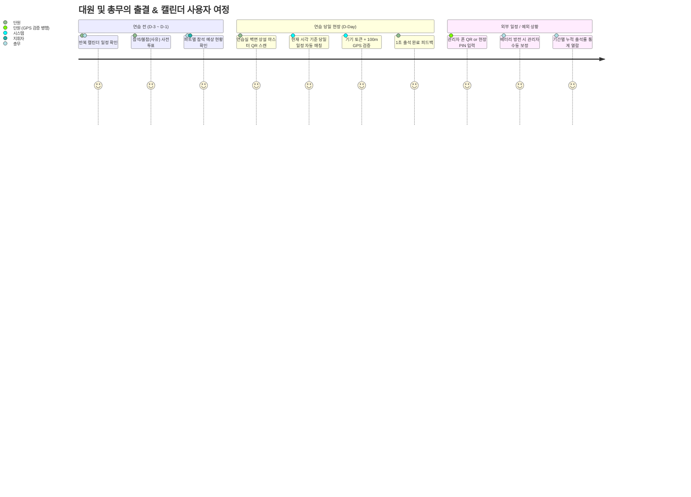

# [PRD] Moonchoir Rollbook (문콰이어 스마트 출석부 & 캘린더 스케줄러)

> **Document Status**: Approved (Updated via /grill-me Alignment)  
> **Target Release**: v2.0 (토스 모바일 네이티브 & 전문 어드민 센터)  
> **Core Principle**: "원천 데이터의 무결성(Append-Only Event Sourcing), 상설 마스터 QR 및 현장 제로-프릭션 출결, 그리고 캘린더 스케줄러의 완전한 융합"  
> **Specification Standard**: GitHub Spec Kit & prd-architect SDD (Spec-Driven Development)

---

## 1. Problem Definition & Scope Boundaries

### 1.1 The Burning Problem (해결하려는 진짜 문제)
- **현장 마찰 및 매주 QR 교체의 번거로움**: 매주 연습마다 새 QR을 뽑아 붙이는 번거로움 없이, 연습실 벽에 영구적으로 부착해 두고 쓸 수 있는 **상설 마스터 QR**이 필요함.
- **장소 변경 및 지하 연습실 GPS 오차 대응**: 정기 연습실 외 외부 대관 연습 시 관리자가 폰으로 QR을 띄우거나 **당일 일회성 PIN**을 발급하여 체크인하되, 대리 출석을 막기 위해 장소별 위치 검증이 연동되어야 함.
- **반복 일정 등록의 부재**: 매주 목요일 정기 연습을 매번 수동으로 하나씩 등록하는 것은 비효율적이며, 네이버/애플 캘린더처럼 유연한 **반복 규칙(매주 목요일, 사용자 지정 간격/요일)** 엔진이 필요함.
- **회차별 단편 통계를 넘어선 기간별 누적 통계**: 하루하루의 출결뿐만 아니라, 최근 1개월/3개월/분기 동안 **누가 몇 회 중 몇 회 출석했는지(누적 출석률, 개근/결석 주의)**를 한눈에 볼 수 있어야 함.

### 1.2 Core Value Proposition (핵심 가치 제안)
- **"벽에 한 번 붙여두는 상설 마스터 QR ➔ 스캔 즉시 당일 일정 자동 매칭 & 100m 위치 검증 ➔ 네이버/애플 스타일 반복 캘린더 전개 ➔ 기간 누적 및 토스식 대원별 출결 대시보드"**

### 1.3 Goals & Success Metrics (KPI)
- **현장 출석 소요 시간**: 대원 1인당 2초 미만 (스캔 즉시 위치/기기 확인 후 완료).
- **데이터 유실률**: 0% (오프라인/네트워크 지연 시에도 브라우저 임시 큐를 통한 전송 보장).
- **대리/부정 출석 차단율**: 100% (타인 폰으로 대리 체크 불가 + 연습실 반경 100m 외부 시도 원천 식별).
- **총무 수작업 취합 시간**: 연습당 평균 20분 ➔ 0분 (실시간 자동 집계).

---

## 2. Multi-Persona Perspectives & User Journey



---

## 3. Functional Requirements & Acceptance Criteria (Gherkin)

### F1. 기기 1회 바인딩 및 본인 식별
* **F1.1 첫 방문 식별**: 대원 이름 + 파트 + 전화번호 뒷자리 4자리 입력으로 브라우저에 영구 바인딩.
* **F1.2 신규/객원 현장 등록**: 명부에 없는 신규 대원이나 객원도 현장에서 파트 선택 후 즉시 등록.
* **F1.3 기기 바인딩 초기화**: 대원이 스마트폰을 교체하거나 초기화했을 때, 관리자 어드민에서 해당 대원의 바인딩을 원클릭 리셋 지원.
* **F1.4 단원 전용 마이페이지 2탭 구조 (일정별 출결/투표 대조 표 + 기기 연동 관리)**:
  - 일반 단원이 헤더의 본인 프로필 버튼을 눌렀을 때 열리는 전용 포털(`MemberPortalModal`).
  - **탭 1 (출결 & 투표 로그 표)**: `[연습명칭 / 연습일 / 투표 상태 / 출결 시간]` 4열 대조 표를 통해 한눈에 자신의 사전 투표 내역과 현장 출석 인정 여부 열람.
  - **탭 2 (개인 대시보드 & 기기 관리)**: 단원 기본 인적사항 확인, `[🚪 기기 연동 해제 (로그아웃)]`, `[🔄 시트 동기화]` 액션 지원.
  - 데이터 불일치를 유발하던 자연어 출결 브리핑 글은 완전히 배제하여 간결성과 명확성 확보.
* **F1.5 전화번호 뒷자리 자가 치유(Self-healing) 및 단원 식별자(PK) 무결성**:
  - 구글 시트에 `phoneLast4 = '0000'` 또는 빈 값으로 고착된 단원이 로그인 시도시, 입력한 유효한 4자리(예: 4240)로 구글 시트와 로컬 명부를 자동 갱신(`UPDATE_MEMBER`)하여 자가 치유.
  - 이름과 번호가 이미 등록된 단원인 경우 새로운 `mem_new_...` ID를 발급하지 않고 기존 단원 레코드를 재사용하여 1인 다중 ID 생성 원천 차단.

### F2. 상설 마스터 QR & 위치기반 출결 체크인
* **F2.1 영구 상설 마스터 QR**:
  - 연습실 벽면에 부착하는 영구 마스터 QR 코드 제공.
  - 단원이 스캔 시 클라이언트/서버가 현재 시각을 기준으로 당일 진행 중인 연습 일정을 자동 감지하여 출석 로그 생성.
  - 보안 위협이나 정기 교체 필요 시 관리자가 [QR 리프레시하기] 버튼으로 새로운 마스터 키로 즉시 갱신 가능.
* **F2.2 네이버 QR코드 스타일 인쇄 커스텀**:
  - 인쇄용 타이틀("문콰이어 정기연습 출석 QR"), 안내 문구, 로고 등을 관리자가 직접 편집하고 A4 규격으로 인쇄.
* **F2.3 장소 변경 및 임시 출결 (현장 PIN 발급)**:
  - 외부 대관이나 장소 변경 시, 관리자 폰 화면에 QR을 직접 띄우거나 **당일 일회성 4자리 PIN**을 발급하여 공유.
  - 단원이 PIN을 입력하더라도 **현재 스마트폰 GPS가 해당 장소 반경(n미터) 내에 위치해야만 정상 출석 인정** (원격 부정출석 방지).
* **F2.4 GPS 지오펜싱 검증**:
  - 브라우저 Native Geolocation API와 하버사인(Haversine) 공식을 통해 연습실 좌표 반경(기본 100m) 내 위치 검증.
* **F2.5 엄격한 기본키(PK) 매칭 및 출석 멱등성 보장 (Strict PK & Idempotency)**:
  - 과거 임시방편이었던 일정 ID 접미사(`scheduleId.startsWith`) 및 날짜(`YYYY-MM-DD`) 추측 매칭, 단원 이름(`memberName`) 기반 추측 매칭을 전면 금지한다 (동명이인 출결 오염 및 동일 날짜 다중 일정 혼선 원천 차단).
  - 모든 출석 원천 로그와 사전 투표는 오직 정확한 `scheduleId`와 `memberId`(및 명시적 병합 체인 `mergedIntoId`)로만 매칭한다.
  - 현장 체크인 재시도 시 동일한 `log.id`를 유지하며, 서버(`RECORD_ATTENDANCE`)에서 이미 존재하는 `id`면 중복 행을 추가하지 않고 멱등(Idempotent) 성공을 반환한다.

### F3. 캘린더 스케줄러 & 4대 다채널 반복 일정 생성 엔진
* **F3.1 4대 다채널 일정 생성 엔진**:
  - `단일 일정 (1회)`: 기준 날짜 1건 등록.
  - `주기 반복 (매 N일/주/월/년)`:
    - 매주: 요일(`월`~`일`) 복수 선택 가능.
    - 매달: 일자(`1`~`31일`) 복수 선택 가능 (말일 자동 클램핑).
    - 매년: 특정 월/일 복수 선택 가능.
  - `요일 지정 (특정 요일 N주간)`: 지정 요일을 기준으로 N주간 연속 전개.
  - `달력 직접 픽`: 미니 달력 그리드에서 원하는 날짜들을 클릭하여 비정기 일정 복수 선택 일괄 등록.
* **F3.2 일정 카드 묶음 (ProgramCard) 인라인 관리 (Split-View) & 안전 복제**:
  - 팝업 모달을 배제하고 관리자 우측 패널에서 카드 명칭, 기본 일정구분, 기본 장소, 기본 시각, 기본 참석 대상자를 실시간 인라인 편집.
  - `🔁 복제` 클릭 시 소속 일정과 신규 ProgramCard(`[복제]`)를 자동 분리 생성하여 기존 카드 오염 원천 방지.
* **F3.3 감각적인 둥근 터치 피커 (RoundDatePicker & RoundTimePicker)**:
  - OS 기본 직사각형 스크롤러를 완전 배제하고 문콰이어 감성 무드에 맞춘 커스텀 팝오버 도입.
  - `RoundDatePicker`: 둥근 팝오버 달력(오늘/목요일 퀵 칩, 월 이동 탐색).
  - `RoundTimePicker`: 알약형 트리거 버튼, 합창단 전용 퀵 프리셋 6종, 오전/오후 토글, 12시간/5분 스쿼클 터치 그리드.
* **F3.4 연습실 장소 프리셋 연동**:
  - 자주 가는 연습실(예: 문콰이어 제1연습실, 서초 연습실, 세종문화회관 체임버홀 등)을 선택하면 지정된 위도, 경도, 지오펜싱 허용 반경(m)이 일정에 자동 바인딩.
* **F3.5 넉넉한 상세 설명 & 연습 곡목 모던 텍스트창**:
  - 포커스 링과 글자 수 카운터(실시간 반영)가 내장된 모던 텍스트에어리어로 곡목 및 준비사항 시원하게 작성.

### F4. 사전 참석 투표 (RSVP)
* **F4.1 사전 투표**: 각 일정별 [참석 / 불참(사유 작성)] 투표. 서비스는 변경 이력을 보관하지 않고 현재 응답만 보관한다.
* **F4.2 투표 변경 마감**: 단원은 현재 저장된 연습 시작 시각의 1시간 전까지만 참석/불참 응답을 변경하거나 취소할 수 있다. 마감 시각과 같거나 그 이후에는 변경할 수 없다. 연습 시작 시각이 바뀌면 마감 시각도 함께 이동한다. 연습이 늦춰져 마감 시각이 미래가 되면 단원 투표를 다시 허용하고, 연습이 앞당겨져 새 마감 시각이 이미 지났으면 즉시 닫는다. 운영진은 마감 이후에도 예외적으로 현재 응답을 수정할 수 있다. RSVP 변경 이력은 보관하지 않으므로 운영진 수정도 기존 현재 응답을 덮어쓴다.
* **F4.3 실시간 투표 현황 바**: 참석/불참/미응답 인원 프로그레스 바 및 사유 리스트 실시간 노출.

### F5. 관리자 어드민 센터 (토스 모바일 네이티브 스타일)
* **F5.1 기간 누적 종합 통계 & 다차원 비교 분석 대시보드**:
  - **기간 필터**: `[최근 1개월, 최근 3개월, 상반기, 올해 전체, 직접 지정]`.
  - **파트 및 회원상태 다차원 필터**: 파트별(소프라노/알토/테너/베이스), 회원상태별(정단원/준단원/휴단원 등) 필터 칩 지원.
  - **이름 검색 및 체크박스 복수 선택 비교**:
    - 검색창으로 특정 단원 필터링 및 체크박스(다중 선택)를 통해 원하는 n명(예: 홍길동, 김철수, 이영희)만 묶어서 나란히 비교 통계 산출.
  - **대원별 누적 출결 성적표**: 총 회차 중 출석 회수(출석률 %), 지각, 사유결석, 무단결석, `[개근 후보]`, `[결석 주의]` 뱃지.
  - **회차별 상세 뷰**:
    - 특정 연습 회차 선택 시 당일 출결 명단, 체크인 시각(19:22), 거리(22m), 토스식 필터 칩(`전체/출석/지각/사유결석/결석`), 수동 출석 인정 버튼.
* **F5.2 4대 전문 어드민 패널**:
  - ① **출결 정책 & 연습실 장소 프리셋**: 지각 유예 시간(분), 연습 장소별 이름/위경도/반경 등록·수정·삭제.
  - ② **단원 명부 관리 (Members CRUD & 확장 속성)**:
    - **입단일(`joinedAt`)**, **회원 상태(`memberStatus`: 정단원 / 준단원 / 휴단원 / 퇴단원 / 선생님 / 객원)**, **비고(`note`: 특이사항)** 관리.
    - 파트 변경, 활동/비활동 전환, 스마트폰 교체 대원을 위한 기기 바인딩 초기화.
  - ③ **구글 시트 연동 헬스체크 & 백업**: Web App URL 연결 진단 핑, 시트 실시간 양방향 동기화, CSV/JSON 내보내기.
  - ④ **보안 마스터 PIN 변경**: 관리자 비밀번호 변경 기능.
* **F5.3 중앙 순수 출결·통계 판정 엔진(`src/utils/attendanceStats.ts`) 단일 진실 공급원(SSOT)**:
  - 관리자 통계 탭(`AdminStatsTab`), 출결 매트릭스(`AdminMatrixGrid`), 단원 마이페이지(`MemberPortalModal`), 단원 프로필 모달(`MemberProfileModal`), 메인 홈(`HomeView`) 등 모든 화면이 `src/utils/attendanceStats.ts`의 순수 함수(`reconcileSingleMemberAttendance`, `calculateCumulativeAttendanceWithLifecycle`, `resolveMergedMemberIds`) 하나만 공유하여 결정론적으로 판정한다.
  - **최신 액션 우선 채택 (Recency Resolution)**: Append-only 로그 특성상 한 단원이 동일 일정에 여러 개의 로그(QR 체크인, 지각, 관리자 수동인정, 관리자 출결 취소)를 가질 때, 가장 최신 타임스탬프의 액션을 최종 상태로 채택한다.
  - **확정된 출석률 및 모수(분모) 산정 기준**:
    1. **사유결석 (`excused`)**: 사전 투표에서 불참(`ABSENT`)과 사유를 제출하고 미출석한 경우 `사유결석`으로 분류하되, **출석률 분모(`totalSessions`)에는 포함**한다 ("빠진 건 빠진 거니까").
    2. **지각 (`late`)**: 설정된 지각 유예시간(`lateGraceMinutes`)을 초과해 체크인한 경우 로그 및 횟수로는 `지각`으로 별도 집계하되, **출석률 계산에서는 100% 출석으로 인정**한다 (`attendanceRate = Math.round(((attended + late) / totalSessions) * 100)`).
    3. **비대상자 / 자율 참여 (`[🌿 자율 참여 연습]`)**: 내가 필참 대상이 아닌 일정도 캘린더/홈에 투명하게 노출되며 `[🌿 자율 참여 연습]` 배지가 표시된다. 미출석 시 분모(`totalSessions`)에서 제외(`미참`)되며, 자발적으로 출석 체크한 경우에만 분모 `+1` 및 출석 `+1`(`guestAttended`)로 반영한다.
    4. **취소된 일정 (`isCancelled = true`)**: 원천 로그는 보존하되 모든 단원의 출석률 분모에서 제외(`미참`)한다.

### F6. 관계형 데이터(SSOT), 카카오맵 장소 검색 및 실전 UX 체계 (Phase 4.8)
* **F6.1 카카오맵 키워드/장소 검색 & 엄격한 지오코딩 가드**:
  - 카카오맵 JavaScript SDK(`1465ed6063afca1d3ea91711cbdeb84a`)를 통한 장소명/건물명 키워드 검색(`Places`) 및 도로명 주소 지오코더(`Geocoder`).
  - 지오코딩 실패 시 절대로 서울 명동 기본값을 유지하지 않고, 저장을 차단하며 명확한 안내 모달 출력.
  - `[📍 내 현재 위치로 설정]` 브라우저 GPS 원터치 좌표 획득 지원.
* **F6.2 장소 프리셋 관계형 외래키(`locationId`) 단일 진실 공급원**:
  - 일정이 `locationId`를 통해 장소 프리셋을 동적 참조. 프리셋의 주소/반경 수정 시 기존 모든 일정의 출석 판정선이 일괄 자동 동기화.
  - 장소 선택 UI를 단일 드롭다운 + `[+ 새 장소 등록]` 단일 버튼으로 일원화.
* **F6.3 Master-Detail 일정 관리 원클릭 인라인 바인딩 & 간결한 [저장]**:
  - 좌측 일정 카드/목록 행 클릭 즉시 우측 폼에 인라인 바인딩 및 활성 링(Active Ring) 표시.
  - 제출 버튼 문구를 직관적이고 간결한 `[저장]`으로 개편.
* **F6.4 단원 명부 불변 식별자(PK) 보존 & 선발 단원 릴레이션**:
  - 시스템 임의 자동 병합(Auto-merge) 완전 배제, `Member.id` 불변 보존 및 기기 바인딩 무결성 유지.
  - 신규 계정 저장 직전에 Google Apps Script가 시트의 최신 명부를 확인한다. 이름과 전체 전화번호가 모두 일치하면 새 행을 만들지 않고 기존 계정 사용 안내를 반환한다. 이 확인과 등록은 하나의 잠금 처리 안에서 수행해 동시에 등록해도 중복되지 않게 한다.
  - 이름만 같거나 전화번호 뒷자리만 같은 경우, 또는 기존 전화번호가 없거나 불완전한 경우에는 자동 병합하거나 중복이 아니라고 단정하지 않는다. 새 계정을 자동 생성하지 말고 운영진 확인으로 안내한다.
  - 가입 화면의 중복 확인은 빠른 안내용이며 최종 판정은 시트 저장 쪽에서 한다. 중복 판정만으로 기존 계정에 자동 로그인하거나 기기를 연결하지 않는다.
  - 이미 만들어진 중복 계정은 운영진이 명시적으로 대표 계정을 선택해 정리할 수 있어야 한다. 이름이나 전화번호 뒷자리 일치만으로 자동 병합하지 않는다.
  - 회원 병합 시 과거 출석 원천 기록의 `memberId`를 바꾸지 않는다. 병합된 회원은 `status='MERGED'`와 `mergedIntoId` 연결을 유지하고 실제 삭제하지 않는다. 대표 회원의 출석·통계를 볼 때 명시된 병합 연결을 따라 과거 ID의 기록을 함께 조회한다.
  - 이름/전화번호 중복 의심 계정 발견 시 관리자 수동 검토 알림 배너 표시.
  - 선발 단원 지정 시 `이름 (파트 · 뒷자리4자리)`로 명확히 노출하여 선택 무결성 보장.
  - 회원 병합 시 과거 출석 원천 기록의 `memberId`를 바꾸지 않는다. 병합된 회원은 `status='MERGED'`와 `mergedIntoId` 연결을 유지하고 실제 삭제하지 않는다. 대표 회원의 출석·통계를 볼 때 명시된 병합 연결을 따라 과거 ID의 기록을 함께 조회하며, 이름이나 전화번호 일치만으로 자동 연결하지 않는다.
* **F6.5 따뜻한 자율 연습 워딩 & 담백한 미응답자 토글 명단**:
  - 비대상 단원 화면에서 '출석 통계 모수 제외' 등 난해한 용어 전면 배제.
  - `[🌿 자율 참여 연습]` 배지 및 "공식 필참 일정이 아닙니다. 참관이나 개인 연습으로 자유롭게 참여하실 수 있습니다." 안내.
  - `참석 N명 · 불참 N명 · 미응답 N명 ▼` 담백한 회색 모노톤 토글 명단으로 미응답 단원 즉시 확인.
* **F6.6 상설 현장 출석 PIN 단순화**:
  - 과거 일정 명칭 꼬리표 없이 `🔑 당일 현장 출석 PIN: [ 5027 ] [🔄 PIN 재발급]` 단일 체계로 간결화.

### F7. 데이터 무결성, Event Sourcing 원복 & 동시성 보호 (Phase 4.9)
* **F7.1 Append-Only Event Sourcing 출결 취소 원복**:
  - 관리자가 출석을 취소/초기화할 때 기존 원천 로그를 절대 물리 삭제하지 않음.
  - 직전 출석 시각보다 1초 뒤인 **취소 전용 로그 (`adminNote='관리자 출결 취소 (결석 처리)'`)**를 새로 Append 적재하여 감사 추적성 보존 및 안전한 결석/사유결석/미참 원복 보장.
* **F7.2 단원 소프트 삭제 (`status='DELETED'`)**:
  - 출석/투표 이력이 있는 단원은 삭제 시 행을 지우지 않고 `status='DELETED'`로 소프트 삭제 처리하여 역대 통계 무결성 100% 보존.
  - 활동 이력이 없는 오등록 단원만 시트 행 물리 삭제 허용.
* **F7.3 일정 소프트 취소 (`isCancelled=true`)**:
  - 출석/투표 이력이 있는 일정은 삭제 시 물리 삭제를 차단하고 `isCancelled=true`로 전환하여 캘린더에 🚫 취소 배지 표시 및 **출석률 통계 모수(분모)에서 자동 제외**.
  - 활동 이력이 없는 오등록 일정만 시트 행 물리 삭제 허용.
* **F7.4 구글 시트 8번째 탭 (`환경설정`) 중앙 관리**:
  - 로컬스토리지에 격리되어 있던 지각 유예시간(10분), 관리자 PIN(1234), 동적 파트/상태 분류 체계, A4 인쇄 서식을 시트 `환경설정` 탭에서 실시간 양방향 관리.
* **F7.5 합창 현장 동시 스캔 동시성 보호 (GAS `LockService`)**:
  - 20~30명 동시 스캔 시 스프레드시트 행 덮어쓰기 방지를 위해 `LockService.getScriptLock().waitLock(15000)` 15초 스크립트 락 적용.
* **F7.6 열 순서 독립 헤더 키 기반 동적 매핑**:
  - `rows[i][0]` 하드코딩을 전면 제거하고 헤더 이름 기반 맵 매핑으로 구글 시트 컬럼 변경/추가 시에도 하위 호환성 영구 보장.
* **F7.7 스프레드시트 저장 확인 및 오프라인 전송 대기**:
  - 회원, 일정, 출석, RSVP 등 운영 데이터의 공식 기록은 Google Spreadsheet로 한다. 브라우저 저장은 화면 표시용 캐시와 아직 시트에 전달되지 않은 기록의 임시 대기 용도로만 사용한다.
  - 시트가 저장을 확인하기 전에는 작업을 완료로 표시하지 않는다. 출석 시도는 예외로, 시트 연결 실패 시 기기에 대기시키지 않고 실패를 안내한다. 다른 종류의 기록을 전송 대기시킬지는 각 기능의 승인된 규칙을 따른다.
  - 재전송으로 같은 기록이 중복 생성되지 않도록 각 작업에 고유 ID를 유지한다. 재시도 시 시트가 같은 ID의 기록을 찾으면 이미 저장된 것으로 확인해 성공 응답하고, 없으면 한 번 저장한다. 시트 응답을 받을 수 없으면 저장 여부를 알 수 없으므로 성공으로 표시하지 않는다.
  - 출석을 시도한 시각과 시트에 전달·확인된 시각은 구분한다. 세부 시트 열과 응답 형식은 구현 전에 별도로 설계하고, 시트 원천 스키마 변경은 사전 승인받는다.
  - 기기에만 대기 중인 기록은 운영진 화면에서 아직 확인할 수 없으며, 해당 기기의 브라우저 데이터가 삭제되거나 기기를 잃으면 시트 전달 전 기록을 잃을 수 있음을 안내한다.
* **F7.8 출석 정정의 감사 기록 보존**:
  - 운영진은 출석 결과를 정정할 수 있지만, 기존 출석 원천 기록을 수정하거나 삭제하지 않는다. 원래 기록을 보존하고 정정 내용, 사유, 처리 시각 및 처리한 운영진을 별도 기록으로 추가한다.
  - 정정 기록도 시트 저장이 확인된 뒤 공식 반영한다. 운영진 식별 방법과 시트 저장 형식은 구현 전에 확정한다.
* **F7.9 출석 확인 실패 기록**:
  - 시트와 통신할 수 있는 상태에서 발생한 출석 확인 실패는 정식 출석과 분리된 실패 기록으로 남겨 운영진이 나중에 확인할 수 있도록 한다. 실패 기록은 출석으로 집계하지 않는다.
  - 시트와 통신 자체가 끊긴 경우에는 실패 기록도 시트에 저장할 수 없다. 이 경우 출석을 완료 처리하지 않고 사용자에게 실패 사실을 알린다. 오프라인 실패를 기기에 임시 저장해 나중에 전송하지 않는다.
  - 실패 기록의 시트 탭·열과 기록할 실패 종류는 별도 설계 후 승인받는다. 이 요구사항만으로 시트 스키마를 변경하지 않는다.

---

## 4. Technical Architecture & Data Contracts

### 4.1 System Topology
```
[대원 스마트폰 브라우저]
  ├── 웹 내부 카메라 (QR 스캔) & 일회성 PIN 입력
  ├── 지오로케이션 (GPS ➔ src/utils/geo.ts)
  └── 로컬 임시 저장 (로그인 정보, 화면 캐시, 시트 전송 전 대기 기록)
       │
  ▼ (시트 저장 확인 응답을 받기 전까지 완료 처리하지 않음)
[Google Apps Script Web App (REST Endpoint with LockService 15s Lock)]
       │
       ▼
[Google Spreadsheet (8대 SSOT 탭)]
  ├── 단원명부 (Member: id, name, part, phoneLast4, role, status, joinedAt, memberStatus, note)
  ├── 일정캘린더 (Schedule: id, title, date, locationId, latitude, longitude, radiusMeters, isCancelled)
  ├── 출석원천로그 (RawAttendanceLog: id, scheduleId, memberId, timestamp, distanceMeters, isVerifiedLocation, adminNote)
  ├── 사전투표_RSVP (RSVPVote: scheduleId, memberId, status, reason, timestamp)
  ├── 단원변경로그 (MemberStatusHistory: id, memberId, status, part, startDate, endDate, reason)
  ├── 일정카드 (ProgramCard: id, title, category, defaultLocationId, isArchived)
  ├── 장소정보 (LocationPreset: id, name, address, latitude, longitude, radiusMeters)
  └── 환경설정 (SystemConfig: key, value, updatedAt - 지각유예, PIN, 동적태그, 인쇄서식)
```

> 브라우저 임시 저장은 스프레드시트를 대신하는 공식 저장소가 아니다. 연결이 끊긴 동안의 기록은 전송 대기 상태로 표시하며, 시트의 저장 확인 후에만 공식 기록으로 취급한다.

### 4.2 Data Models Updates
1. **`Member` (확장 스키마)**:
   `id | name | part | phoneLast4 | role | createdAt | status (ACTIVE/INACTIVE/MERGED/DELETED) | joinedAt (YYYY-MM-DD) | memberStatus (정단원/준단원/휴단원/퇴단원/선생님/객원) | note`
2. **`LocationPreset`**:
   `id | name | address | latitude | longitude | radiusMeters | isDefault`
3. **`RecurrenceRule`**:
   `frequency (NONE/DAILY/WEEKLY/MONTHLY) | interval (1, 2..) | byDays (['THU', 'SAT']) | endDate`
4. **`Schedule`**:
   `id | programId | title | date | startTime | endTime | locationName | locationId | latitude | longitude | radiusMeters | targetAudienceType | checkInPin | category | description | isCancelled | isArchived`
5. **`RawAttendanceLog`**:
   `id | scheduleId | memberId | memberName | part | timestamp | authMethod | isVerifiedLocation | distanceMeters | adminNote`
6. **`SystemConfig`**:
   `lateGraceMinutes | adminPin | customParts | customMemberStatuses | customCategories | qrPrintTitle | qrPrintSubtitle | qrPrintNotice`
   기존 필드 + `locationId | checkInPin (외부 연습용 4자리)`
5. **`Config`**:
   기존 필드 + `masterQrToken (상설 마스터 키)`

---

## 5. Future Roadmap & RFC: 단원 음악 역량 풀 & 맞춤형 코칭/멘토링 엔진

> **사용자 비전**: "장기적인 관점에선 단원 관리 풀로 사용해볼 생각이야. 인적관리처럼 데이터화 할 수 있는 요소들(출석률, 음감, 피치, 호흡, 악보 리딩 능력, 악상 표현력)을 데이터화하고, 그에 맞춘 메시지 '오랜만에 오셨네요! 목 상하지 않게 발성부터 차근차근!' 이런 느낌을 출석처리 과정에서 보여주거나, 고민이 많아 보이는 지점이 있으면 그 고민을 해결해줄 수 있는 조언이나 영상자료를 추천해주려고 해."

### 5.1 기획 목표 & 가치 제안
1. **단순 출석부를 넘어선 '합창단 인재 육성 & 케어 플랫폼'**:
   - 출석률 숫자 집계에 머무르지 않고, 단원의 성악적 역량과 발성 발달 과정을 장기적으로 기록·관리하는 인적 역량 풀 구축.
2. **출석 체크와 연계된 긍정적 연습 경험 (Empathetic Rehearsal Check-In)**:
   - 출석 스캔 즉시 단원의 상태(오랜만의 복귀, 파트별 발성 포인트, 지휘자 개별 코멘트)에 맞춘 따뜻한 격려 카드를 띄워 오늘 연습에 대한 몰입과 긍정적 에너지를 부여.
3. **고민 해결 큐레이션 (Personalized Vocal Resources)**:
   - 고음 피치 불안, 호흡 부족, 시창 독보 어려움 등 단원들이 자주 겪는 보컬 마찰을 해결할 수 있는 맞춤형 연습 영상, 팁, 악보 링크 추천.

### 5.2 데이터 모델 후보 (Draft Contract)
- **`MemberMusicalProfile` (단원 음악 역량 및 코칭 프로필)**:
  - `pitchAccuracy`: 1~5점 (음감 및 음정 정확도)
  - `breathControl`: 1~5점 (호흡 지속 및 복식 지지력)
  - `sightReading`: 1~5점 (초견 및 악보 리딩 독보력)
  - `expression`: 1~5점 (셈여림 다이내믹 및 프레이징 표현력)
  - `voiceTone`: 서술형 (음색 특징, 예: "맑고 서정적인 리릭 소프라노, 고음 시 연구개 확장 필요")
  - `mentorNote`: 지휘자/발성코치의 개별 코멘트 및 이번 달 집중 연습 포인트
  - `vocalPainPoints`: 고민 태그 배열 (`#고음피치`, `#호흡짧음`, `#성대긴장`, `#독보느림`)
  - `recommendedResourceUrl`: 맞춤형 유튜브 발성 강의 영상, 연습 자료 링크 URL

### 5.3 기획 검토 과제 (Open Design Questions)
1. **평가 지표의 형태**: 정량적 5점 척도 vs 레벨형(입문/성장/숙련) vs 정성적 키워드 태그형 중 합창단 운영에 가장 적합한 방식 선정.
2. **단원 공개 여부**: 단원 본인에게 본인의 평가 점수를 공개할 것인가(자기계발 동기부여), 아니면 지휘자/파트장만 열람하는 비밀 멘토링 노트로 둘 것인가?
3. **메시지 전달 채널**: 출석 완료 직후 축하 팝업 화면 vs 단원 전용 출결 포털(`MemberPortalModal`) 내 '나의 보컬 코칭 노트' 탭.


