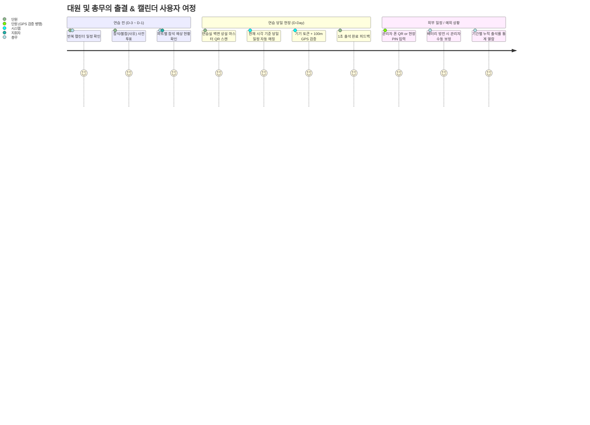

# [PRD] Moonchoir Rollbook (문콰이어 스마트 출석부 & 캘린더 스케줄러)

> **Document Status**: Approved (Updated via /grill-me Alignment)  
> **Target Release**: v2.0 (토스 모바일 네이티브 & 전문 어드민 센터)  
> **Core Principle**: "원천 데이터의 무결성(Append-Only Event Sourcing), 상설 마스터 QR 및 현장 제로-프릭션 출결, 그리고 캘린더 스케줄러의 완전한 융합"  
> **Specification Standard**: GitHub Spec Kit & prd-architect SDD (Spec-Driven Development)

---

## 1. Problem Definition & Scope Boundaries

### 1.1 The Burning Problem (해결하려는 진짜 문제)
- **현장 마찰 및 매주 QR 교체의 번거로움**: 매주 연습마다 새 QR을 뽑아 붙이는 번거로움 없이, 연습실 벽에 영구적으로 부착해 두고 쓸 수 있는 **상설 마스터 QR**이 필요함.
- **장소 변경 및 지하 연습실 GPS 오차 대응**: 정기 연습실 외 외부 대관 연습 시 관리자가 폰으로 QR을 띄우거나 **당일 일회성 PIN**을 발급하여 체크인하되, 대리 출석을 막기 위해 장소별 위치 검증이 연동되어야 함.
- **반복 일정 등록의 부재**: 매주 목요일 정기 연습을 매번 수동으로 하나씩 등록하는 것은 비효율적이며, 네이버/애플 캘린더처럼 유연한 **반복 규칙(매주 목요일, 사용자 지정 간격/요일)** 엔진이 필요함.
- **회차별 단편 통계를 넘어선 기간별 누적 통계**: 하루하루의 출결뿐만 아니라, 최근 1개월/3개월/분기 동안 **누가 몇 회 중 몇 회 출석했는지(누적 출석률, 개근/결석 주의)**를 한눈에 볼 수 있어야 함.

### 1.2 Core Value Proposition (핵심 가치 제안)
- **"벽에 한 번 붙여두는 상설 마스터 QR ➔ 스캔 즉시 당일 일정 자동 매칭 & 100m 위치 검증 ➔ 네이버/애플 스타일 반복 캘린더 전개 ➔ 기간 누적 및 토스식 대원별 출결 대시보드"**

### 1.3 Goals & Success Metrics (KPI)
- **현장 출석 소요 시간**: 대원 1인당 2초 미만 (스캔 즉시 위치/기기 확인 후 완료).
- **데이터 유실률**: 0% (오프라인/네트워크 지연 시에도 브라우저 임시 큐를 통한 전송 보장).
- **대리/부정 출석 차단율**: 100% (타인 폰으로 대리 체크 불가 + 연습실 반경 100m 외부 시도 원천 식별).
- **총무 수작업 취합 시간**: 연습당 평균 20분 ➔ 0분 (실시간 자동 집계).

---

## 2. Multi-Persona Perspectives & User Journey



---

## 3. Functional Requirements & Acceptance Criteria (Gherkin)

### F1. 기기 1회 바인딩 및 본인 식별
* **F1.1 첫 방문 식별**: 대원 이름 + 파트 + 전화번호 뒷자리 4자리 입력으로 브라우저에 영구 바인딩.
* **F1.2 신규/객원 현장 등록**: 명부에 없는 신규 대원이나 객원도 현장에서 파트 선택 후 즉시 등록.
* **F1.3 기기 바인딩 초기화**: 대원이 스마트폰을 교체하거나 초기화했을 때, 관리자 어드민에서 해당 대원의 바인딩을 원클릭 리셋 지원.

### F2. 상설 마스터 QR & 위치기반 출결 체크인
* **F2.1 영구 상설 마스터 QR**:
  - 연습실 벽면에 부착하는 영구 마스터 QR 코드 제공.
  - 단원이 스캔 시 클라이언트/서버가 현재 시각을 기준으로 당일 진행 중인 연습 일정을 자동 감지하여 출석 로그 생성.
  - 보안 위협이나 정기 교체 필요 시 관리자가 [QR 리프레시하기] 버튼으로 새로운 마스터 키로 즉시 갱신 가능.
* **F2.2 네이버 QR코드 스타일 인쇄 커스텀**:
  - 인쇄용 타이틀("문콰이어 정기연습 출석 QR"), 안내 문구, 로고 등을 관리자가 직접 편집하고 A4 규격으로 인쇄.
* **F2.3 장소 변경 및 임시 출결 (현장 PIN 발급)**:
  - 외부 대관이나 장소 변경 시, 관리자 폰 화면에 QR을 직접 띄우거나 **당일 일회성 4자리 PIN**을 발급하여 공유.
  - 단원이 PIN을 입력하더라도 **현재 스마트폰 GPS가 해당 장소 반경(n미터) 내에 위치해야만 정상 출석 인정** (원격 부정출석 방지).
* **F2.4 GPS 지오펜싱 검증**:
  - 브라우저 Native Geolocation API와 하버사인(Haversine) 공식을 통해 연습실 좌표 반경(기본 100m) 내 위치 검증.

### F3. 캘린더 스케줄러 & 반복 일정 생성 엔진
* **F3.1 네이버/애플 캘린더 스타일 반복 UI**:
  - 반복 주기 선택: `[반복 없음, 매일, 매주, 평일, 매월, 매년, 사용자 지정]`.
  - 사용자 지정: 반복 간격 `n주` 및 요일 `[월, 화, 수, 목, 금, 토, 일]` 다중 선택.
  - 종료 기준: `n회 반복 후 종료` 또는 `특정 날짜까지` (기본 3~6개월 자동 전개).
* **F3.2 연습실 장소 프리셋 연동**:
  - 자주 가는 연습실(예: 문콰이어 제1연습실, 서초 연습실, 세종문화회관 체임버홀 등)을 선택하면 지정된 위도, 경도, 지오펜싱 허용 반경(m)이 일정에 자동 바인딩.
* **F3.3 넉넉한 상세 설명 & 연습 곡목 텍스트**:
  - 연습 곡목, 파트별 준비사항, 공지사항을 줄바꿈과 함께 시원하게 입력하고 열람할 수 있는 텍스트에어리어.

### F4. 사전 참석 투표 (RSVP)
* **F4.1 사전 투표**: 각 일정별 [참석 / 불참(사유 작성)] 투표.
* **F4.2 실시간 투표 현황 바**: 참석/불참/미응답 인원 프로그레스 바 및 사유 리스트 실시간 노출.

### F5. 관리자 어드민 센터 (토스 모바일 네이티브 스타일)
* **F5.1 기간 누적 종합 통계 & 다차원 비교 분석 대시보드**:
  - **기간 필터**: `[최근 1개월, 최근 3개월, 상반기, 올해 전체, 직접 지정]`.
  - **파트 및 회원상태 다차원 필터**: 파트별(소프라노/알토/테너/베이스), 회원상태별(정단원/준단원/휴단원 등) 필터 칩 지원.
  - **이름 검색 및 체크박스 복수 선택 비교**:
    - 검색창으로 특정 단원 필터링 및 체크박스(다중 선택)를 통해 원하는 n명(예: 홍길동, 김철수, 이영희)만 묶어서 나란히 비교 통계 산출.
  - **대원별 누적 출결 성적표**: 총 회차 중 출석 회수(출석률 %), 지각, 사유결석, 무단결석, `[개근 후보]`, `[결석 주의]` 뱃지.
  - **회차별 상세 뷰**:
    - 특정 연습 회차 선택 시 당일 출결 명단, 체크인 시각(19:22), 거리(22m), 토스식 필터 칩(`전체/출석/지각/사유결석/결석`), 수동 출석 인정 버튼.
* **F5.2 4대 전문 어드민 패널**:
  - ① **출결 정책 & 연습실 장소 프리셋**: 지각 유예 시간(분), 연습 장소별 이름/위경도/반경 등록·수정·삭제.
  - ② **단원 명부 관리 (Members CRUD & 확장 속성)**:
    - **입단일(`joinedAt`)**, **회원 상태(`memberStatus`: 정단원 / 준단원 / 휴단원 / 퇴단원 / 선생님 / 객원)**, **비고(`note`: 특이사항)** 관리.
    - 파트 변경, 활동/비활동 전환, 스마트폰 교체 대원을 위한 기기 바인딩 초기화.
  - ③ **구글 시트 연동 헬스체크 & 백업**: Web App URL 연결 진단 핑, 시트 실시간 양방향 동기화, CSV/JSON 내보내기.
  - ④ **보안 마스터 PIN 변경**: 관리자 비밀번호 변경 기능.

---

## 4. Technical Architecture & Data Contracts

### 4.1 System Topology
```
[대원 스마트폰 브라우저]
  ├── 웹 내부 카메라 (QR 스캔) & 일회성 PIN 입력
  ├── 지오로케이션 (GPS ➔ src/utils/geo.ts)
  └── 로컬 캐시 (LocalStorage: 토큰, 오프라인 큐, 목업 DB)
       │
       ▼ (fetch POST / GET with redirect: follow)
[Google Apps Script Web App (REST Endpoint)]
       │
       ▼
[Google Spreadsheet (SSOT)]
  ├── Members (대원 마스터 명부: id, name, part, phoneLast4, role, createdAt, status, joinedAt, memberStatus, note)
  ├── Schedules (캘린더 일정 & 반복 규칙 RRULE: locationId, checkInPin)
  ├── Locations (연습실 장소 프리셋 & 위경도 좌표)
  ├── RSVP_Votes (사전 참석 투표 로그)
  ├── Attendance_Logs (원천 타임스탬프 출결 로그 - Append-Only)
  └── Config (상설 마스터 QR 토큰, 지각 유예 분, 관리자 PIN)
```

### 4.2 Data Models Updates
1. **`Member` (확장 스키마)**:
   `id | name | part | phoneLast4 | role | createdAt | status | joinedAt (YYYY-MM-DD) | memberStatus (정단원/준단원/휴단원/퇴단원/선생님/객원) | note`
2. **`LocationPreset`**:
   `id | name | address | latitude | longitude | radiusMeters | isDefault`
3. **`RecurrenceRule`**:
   `frequency (NONE/DAILY/WEEKLY/MONTHLY) | interval (1, 2..) | byDays (['THU', 'SAT']) | endDate`
4. **`Schedule`**:
   기존 필드 + `locationId | checkInPin (외부 연습용 4자리)`
5. **`Config`**:
   기존 필드 + `masterQrToken (상설 마스터 키)`

