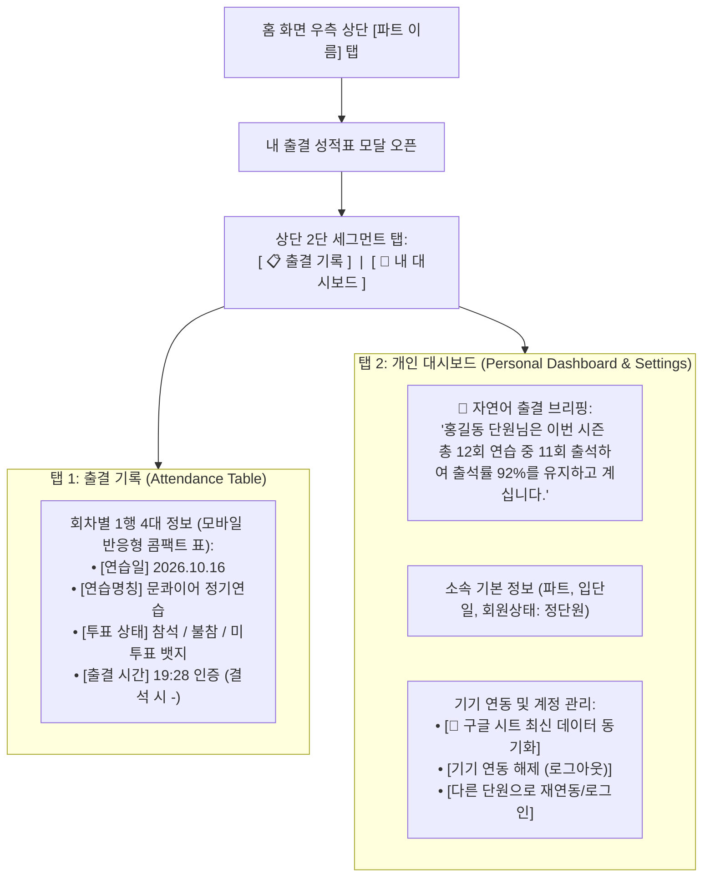

# Plan 05: 내 출결 성적표 2탭 구조 개편 (출결 기록 표 + 개인 대시보드)

> **상태**: 📋 기획 업데이트 완료 (User Feedback 반영)  
> **핵심 방향**:  
> 1. **탭 1: 출결 기록**: 한눈에 대조하는 4대 컬럼 `[연습명칭 / 연습일 / 투표 상태 / 출결 시간]` 간단 표/리스트  
> 2. **탭 2: 개인 대시보드**: 글로 풀어서 설명해주는 내 출결 브리핑 + 기기 연동 해제 및 로그인/동기화 관리

---

## 1. 2탭 아키텍처 및 화면 설계

---

## 2. 세부 탭별 명세 (Detailed Specifications)

### 탭 1: 출결 기록 (간단 표 형태 로그)
- **목적**: 연습 현장이나 출결 마감 시, 내 투표와 실제 출석 인정 내역을 1초 만에 확인.
- **표시 컬럼**:
  1. **연습일**: `YYYY.MM.DD` (또는 `MM.DD (요일)`)
  2. **연습명칭**: 카테고리 뱃지(`정기연습`, `추가연습` 등) + 일정 제목
  3. **투표 상태**:
     - `참석` (초록 라벨)
     - `불참` (주황 라벨, 사유가 있을 시 클릭/호버로 확인)
     - `미투표` (연한 회색 라벨)
  4. **출결 시간**:
     - 출석 완료: `19:28` (초록 텍스트)
     - 결석 처리: `-` (빨간/회색 텍스트)
     - 다가오는 일정: `대기`
     - 입단일 이전/휴단: `모수 제외`
- **모바일 뷰 최적화 (Mobile-Friendly Responsive Table)**:
  - 360px 이하 스마트폰 화면에서 4열 가로 표가 찌그러지는 현상을 방지하기 위해:
    - 상단 라인: `[날짜] [연습명칭]`
    - 하단 라인: `투표: [참석]  ➔  인증: [19:28]`
    형태의 2줄 콤팩트 카드형 표(Flex Table)로 깔끔하게 렌더링.

---

### 탭 2: 개인 대시보드 (자연어 브리핑 & 계정 관리)
- **목적**: 내 출결 성적의 전체적인 맥락을 이해하고, 기기 연동/로그인 상태를 관리.
- **구성 요소**:
  1. **📝 친절한 자연어 출결 브리핑 카드**:
     - *"홍길동 단원님은 2026 하반기 정기연습 총 12회 중 11회 출석하셨습니다."*
     - *"현재 출석률은 92%이며, 정단원 자격 요건(80% 이상)을 안정적으로 달성 중입니다."*
     - *"최근 결석: 1회 (2026.10.02 가을 휴가)"*
  2. **소속 요약 프로필**:
     - 소속 파트: `소프라노`
     - 회원 구분: `정단원`
     - 최초 입단일: `2026.03.01` (활동 N개월 차)
  3. **계정 & 기기 바인딩 관리 (하단)**:
     - 현재 연동 기기: `본 스마트폰 등록 완료 (Lock)`
     - `[🔄 구글 시트 최신 데이터 동기화]`
     - `[기기 연동 해제 (로그아웃)]`
     - `[다른 단원 계정으로 재연동]`

---

## 3. 구현 단계 (Execution Steps)

1. **컴포넌트 리팩토링 (`src/components/MemberPortalModal.tsx`)**:
   - 상단 탭: `[ 📋 출결 기록 ]` vs `[ 👤 내 대시보드 ]` 세그먼트 탭 구현.
   - 탭 1: `allSchedules`와 `myVotes`, `myLogs`를 결합하여 `[연습일 / 연습명칭 / 투표상태 / 출결시간]` 렌더링.
   - 탭 2: 자연어 통계 브리핑 생성 함수(`generateBriefingText`) 작성 및 계정 연동 버튼 배치.
2. **CSS 모던 스타일링 (`src/index.css`)**:
   - 모바일 최적화 표 스타일 (`.scorecard-table`, `.scorecard-row`, `.scorecard-briefing-card`).
3. **단위 테스트 업데이트 (`MemberPortalModal.test.tsx`)**:
   - 탭 1의 4대 컬럼 렌더링 검증.
   - 탭 2의 자연어 브리핑 및 기기 해제 버튼 렌더링 검증.
4. **검증 및 실서버 배포**:
   - `npm run typecheck`, `npm run lint`, `npm test`, `npm run deploy`.
