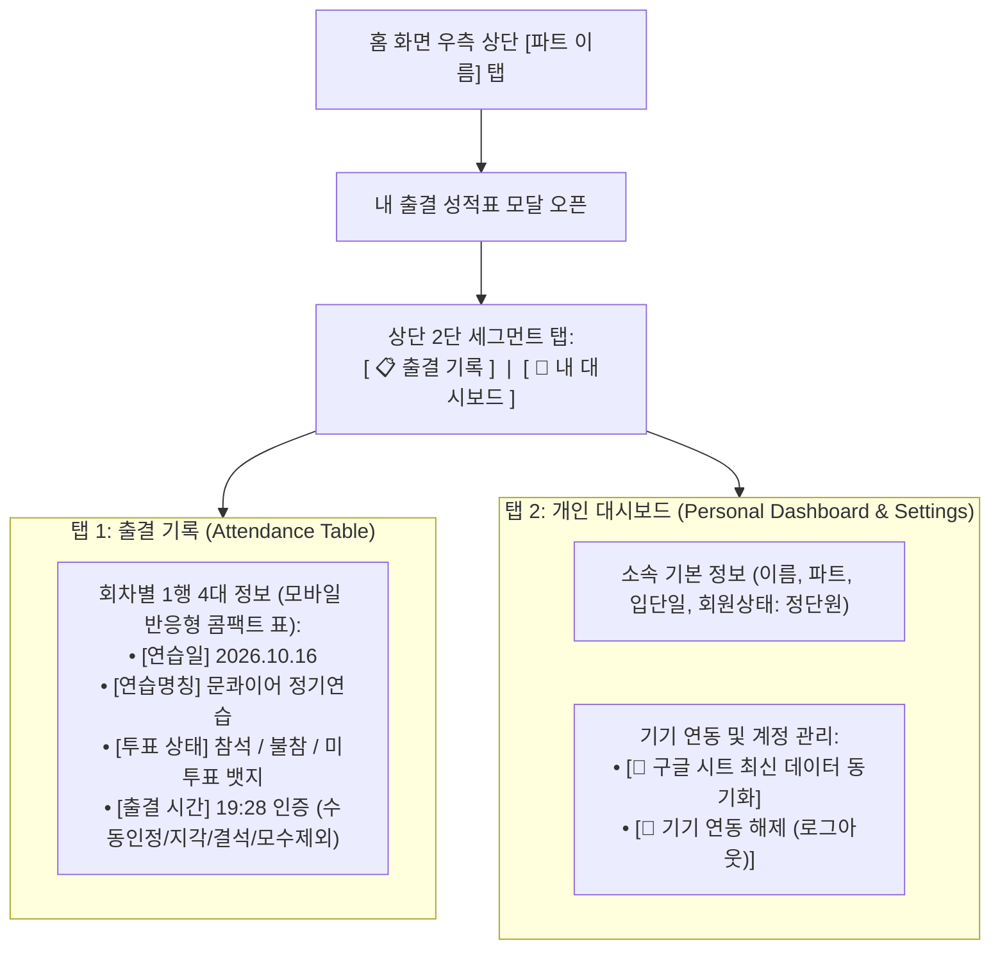

# Plan 05: 내 출결 성적표 2탭 구조 개편 (출결 기록 표 + 개인 대시보드)

> **상태**: ✅ 구현 및 배포 완료 (`src/components/MemberPortalModal.tsx`)  
> **핵심 방향**:  
> 1. **탭 1: 출결 기록**: 한눈에 대조하는 4대 컬럼 `[연습명칭 / 연습일 / 투표 상태 / 출결 시간]` 대조 표 (중앙 판정 엔진 `reconcileMemberAttendance` SSOT 연동)  
> 2. **탭 2: 개인 대시보드**: 단원 인적사항 + 기기 연동 관리(연동 해제 및 시트 최신화 동기화)  
> 3. **출결 브리핑 제거**: 데이터 파이프라인 안정화 및 혼란 방지를 위해 자연어 통계 브리핑은 완전 배제

---

## 1. 2탭 아키텍처 및 화면 설계

---

## 2. 세부 탭별 명세 (Detailed Specifications)

### 탭 1: 출결 기록 (간단 표 형태 로그)
- **목적**: 연습 현장이나 출결 마감 시, 내 투표와 실제 출석 인정 내역을 1초 만에 확인.
- **판정 엔진**: 독자 필터링을 폐기하고 중앙 출결 판정 엔진(`sheetsService.reconcileMemberAttendance`)을 단일 진실 공급원(SSOT)으로 사용.
- **표시 컬럼**:
  1. **연습일**: `YYYY.MM.DD`
  2. **연습명칭**: 카테고리 뱃지(`정기연습`, `추가연습` 등) + 일정 제목
  3. **투표 상태**:
     - `참석` (초록 라벨)
     - `불참` (주황 라벨, 사유가 있을 시 클릭/호버로 확인)
     - `미응답` (연한 회색 라벨)
  4. **출결 시간**:
     - 정상 출석: `19:28` (파란색 시간 + 뱃지)
     - 관리자 수동 인정: `19:28` (파란색 시간 + 수동인정 뱃지)
     - 지각 인정: `20:05` (주황색 시간 + 지각 뱃지)
     - 사유 결석: `사유결석` (주황색 라벨)
     - 무단 결석: `결석` (빨간색 라벨)
     - 미래 일정: `대기` (회색 라벨)
     - 입단일 이전/휴단: `모수 제외` (연한 보라 라벨)

---

### 탭 2: 개인 대시보드 (인적사항 & 계정 관리)
- **자연어 브리핑 배제 사유**:
  - 사용자 피드백에 따라 단원 간 데이터 구조 및 ID 체계가 완전히 정착되기 전까지 불일치와 오해를 부르는 자연어 텍스트 브리핑("총 N회 중 M회 출석...")은 완전히 제거.
- **구성 요소**:
  1. **소속 요약 프로필**:
     - 소속 파트: `테너`
     - 회원 구분: `정단원`
     - 입단일: `2026.03.01`
  2. **계정 & 기기 바인딩 관리 (하단)**:
     - 현재 연동 기기: `본 스마트폰 등록 완료 (Lock)`
     - `[🔄 구글 시트 최신 데이터 동기화]`: 구글 시트 원격 데이터 즉시 재조회
     - `[🚪 기기 연동 해제 (로그아웃)]`: 로컬 바인딩 파기 및 최초 로그인 화면 복귀

---

## 3. 검증 결과
- `MemberPortalModal.test.tsx` 단위 테스트 통과
- `npm run typecheck`, `npm run lint`, `npm test` 100% 통과
