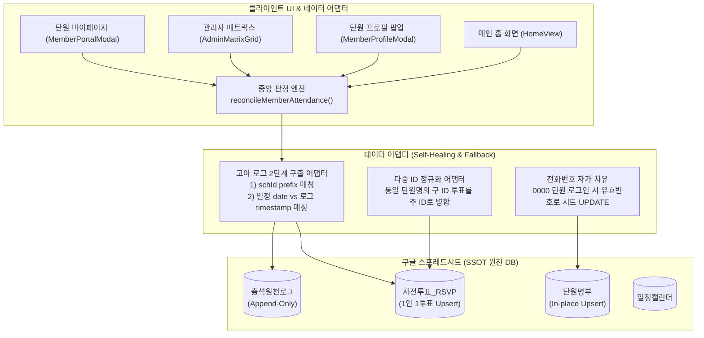

# Plan 06: 데이터 파이프라인 정합성 복원 & 3대 구조 개혁

> **상태**: ✅ 구현, 단위 테스트 & 배포 완료 (`commit 92c713c`, `commit 7a1acbf`)  
> **관련 문서**: [docs/DATA_SCHEMA.md](file:///Users/grasshop/Desktop/Antigravity/Moonchoir_rollbook/docs/DATA_SCHEMA.md), [docs/DEV_LOG.md](file:///Users/grasshop/Desktop/Antigravity/Moonchoir_rollbook/docs/DEV_LOG.md)

---

## 1. 기획 배경 & 현장 3대 결함

현장 운영 및 실시간 구글 시트 연동 과정에서 발견된 데이터 단절 문제를 해결하기 위한 기술 명세서입니다.

1. **결함 1: 로그인 시 기존 단원 전화번호 뒷자리 인증 실패 (이재연 4240 케이스)**
   - 단원 선택 로그인 모달(`BindingModal`)에서 "이재연"을 선택하고 실제 번호 `4240`을 입력했으나 차단됨.
   - 원인: 구글 시트 `단원명부`에 `phoneLast4 = '0000'`으로 고착되어 있었음.
2. **결함 2: 개인 대시보드 출결 브리핑 숫자 미연동**
   - 브리핑 글의 출석 회수가 실제와 맞지 않아 혼란 초래.
   - 원인: 1인 2개 ID(`mem_new_...444` vs `mem_new_...232`) 생성으로 투표와 로그가 쪼개지고 모수 판정이 파편화됨.
3. **결함 3: [개인 대시보드] 로그 출결 상태와 [인적사항&출결] 화면 간 불일치**
   - 관리자가 임의로 결석을 출석(수동인정)으로 변경했으나 마이페이지에는 반영되지 않아 시트 전송 누락 의혹 제기.
   - 원인: GAS `readSheetData`에서 `timestamp`의 날짜가 잘려 `HH:mm`만 반환되었고, 마이페이지는 단순 필터를 사용하여 관리자 수동 인정을 인식하지 못함.

---

## 2. 데이터 파이프라인 3대 구조 개혁 아키텍처

---

## 3. 핵심 기술 구현 명세

### 3.1 Google Apps Script 날짜 절단 패치 (`google-apps-script.js`)
- `readSheetData(sheet)` 함수에서 `val instanceof Date` 처리 시:
  - `starttime`, `endtime`만 `HH:mm` 포맷 적용.
  - `date`, `startdate`, `enddate`, `joinedat`은 `yyyy-MM-dd` 적용.
  - `timestamp`, `createdAt`, `boundDeviceAt` 등은 온전한 ISO 타임스탬프(`yyyy-MM-dd'T'HH:mm:ssXXX`) 보존.

### 3.2 단원 PK 무결성 & 전화번호 자가 치유 (`src/components/BindingModal.tsx`)
- `phoneLast4 === '0000'` 또는 비어있는 단원이 로그인할 때 유효한 4자리(`4240`) 입력 시:
  - `isUnsetLast4` 감지 $\rightarrow$ 시트에 즉시 `UPDATE_MEMBER` 전송하여 영구 치유.
- 신규 단원 등록 창에서 동일 이름+전화번호가 이미 존재하면 새 ID 발급을 차단하고 기존 레코드 재사용(`existingMember`).
- 컴포넌트 순수성을 위해 `buildNewMember` 헬퍼 함수를 컴포넌트 외부로 분리.

### 3.3 고아 일정 로그 2단계 구출 Fallback 어댑터 (`src/services/sheets.ts`)
- `getLogs(scheduleId)` 및 `getRSVPVotes(scheduleId)`:
  - 1단계: `targetScheduleId` 완전 일치 또는 prefix(`sch_20261022`) 일치 확인.
  - 2단계: 1단계 실패 시 일정 날짜(`schedDate`)와 로그 타임스탬프 일자(`l.timestamp.slice(0, 10)`) 일치 확인.
  - 결과: 일정 ID 변경/복제 시에도 과거 출결 로그 및 RSVP 투표 100% 구출 복원.

### 3.4 중앙 출결 판정 엔진 SSOT 일원화 (`reconcileMemberAttendance`)
- `MemberPortalModal`, `MemberProfileModal`, `AdminMatrixGrid`, `HomeView`가 모두 동일 함수를 호출.
- **최신 관리자 액션 우선 채택 (Recency Resolution)**: Append-only 로그 특성에 맞춰 `findLast`로 가장 최신 관리자 수동 인정(`MANUAL_BY_ADMIN`)을 채택.
- **모수 제외(`isExempt`) 지원**: 입단일 이전 일정이거나 휴단원/퇴단원 기간일 경우 결석이 아닌 '모수 제외'로 표기.

---

## 4. 검증 결과
- **단위 테스트 (`src/services/sheets.test.ts`)**:
  - `getLogs recovers orphan logs when scheduleId has modified suffixes` 통과
  - `fetchRemoteData normalizes legacy member IDs for RSVP votes` 통과
- **전체 결정론적 검증**: 10개 파일, 45개 테스트 100% 통과, lint 0건, typecheck 0건.
