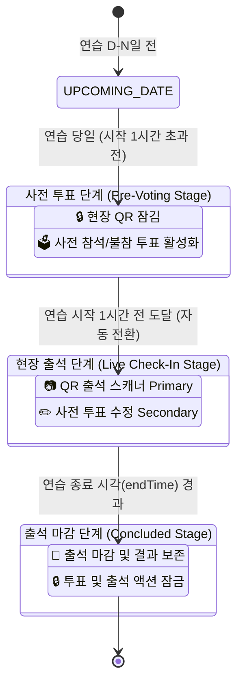

# Plan 07-B: 실시간 시간 윈도우 기반 실전 테스트 시나리오 및 프로토콜

> **상태**: 🚀 구축 완료 및 검증 통과 (Task 50)  
> **관련 문서**: [docs/tasks.md](file:///Users/grasshop/Desktop/Antigravity/Moonchoir_rollbook/docs/tasks.md), [AGENTS.md](file:///Users/grasshop/Desktop/Antigravity/Moonchoir_rollbook/AGENTS.md), [src/utils/timeWindow.ts](file:///Users/grasshop/Desktop/Antigravity/Moonchoir_rollbook/src/utils/timeWindow.ts)

---

## 1. 개요 및 전환 배경

기존 개발 단계에서는 특정 시간대에 구애받지 않고 QR 출석 화면을 확인하기 위해 홈 화면에 가상 바이패스 버튼(`[테스트 오픈]`)이 노출되어 있었습니다.  
그러나 실전 운영 단계에서는 다음과 같은 문제가 발생할 수 있습니다:
1. **사용자 혼선**: 실제 단원이 "테스트 오픈" 버튼을 눌러 비정상 시간대에 출석을 시도하거나 UI 상태를 왜곡시킬 위험.
2. **시간 전이 미검증**: 연습 시작 1시간 전 자동으로 사전 투표가 QR 스캐너로 전환되는 실시간 시계 루프 미비.
3. **종료 일정 잔여 액션**: 이미 끝난 과거 연습 일정에 대해 "사전 투표하기" 버튼이 계속 남아있는 UI 부자연스러움.

이에 따라 인위적인 바이패스 버튼을 완전히 제거하고, **실제 서비스 시간 윈도우(연습 시작 1시간 전 ~ 종료 시각)와 10초 반응형 시계 루프**에 기반한 실전 상태 머신 및 검증 프로토콜을 정식 확립하였습니다.

---

## 2. 3단계 시간 윈도우 상태 머신 (State Machine)



### 상태별 UI 행동 계약

| 단계 | 상태 코드 | 시간 조건 | 홈 화면 메인 액션 | 보조 정보 카드 |
| :--- | :--- | :--- | :--- | :--- |
| **1-A** | `UPCOMING_DATE` | 연습일 이전 날짜 | `[🗳️ 사전 참석/불참 투표하기]` (Primary) | `🔒 연습 당일 {오픈시각} 오픈` |
| **1-B** | `TODAY_BEFORE_WINDOW` | 연습 당일 ~ 시작 1시간 전 | `[🗳️ 사전 참석/불참 투표하기]` (Primary) | `🔒 오늘 {오픈시각} (연습 1시간 전) 오픈 예정` |
| **2** | `WINDOW_OPEN` | 연습 시작 1시간 전 ~ 종료 시각 | `[📷 QR 출석 체크]` (Primary) | `[✏️ 사전 투표 수정]` (Secondary) |
| **3** | `WINDOW_CLOSED` | 연습 종료 시각 이후 | 🏁 출석 마감 카드 (투표/QR 버튼 잠금) | 출석 완료 시각 및 상태 안내 |

---

## 3. 실시간 반응형 시계 엔진 (`HomeView.tsx`)

단원이 브라우저 새로고침을 누르지 않아도, 연습실 로비에서 대기 중 시각이 도달하면 화면이 즉시 실시간 전환됩니다.

```tsx
// 10초 주기로 현재 시각(currentNow)을 갱신하여 윈도우 임계치 통과 시 자동 리렌더링
const [currentNow, setCurrentNow] = useState(() => new Date());

useEffect(() => {
  const timer = setInterval(() => {
    setCurrentNow(new Date());
  }, 10000); // 10s tick for smooth, real-time window transition
  return () => clearInterval(timer);
}, []);
```

---

## 4. 관리자 및 테스터용 실전 현장 테스트 시나리오

관리자가 현장에서 기능 동작을 점검할 때 사용하는 3대 표준 프로토콜입니다.

### 시나리오 A: 10분 뒤 긴급 연습 생성 테스트 (즉시 QR 활성화)
1. **목적**: 현재 시각 기준 즉시 QR 출석이 열리는지 검증.
2. **절차**:
   - 관리자 대시보드 $\rightarrow$ `일정 관리` 진입.
   - 연습 일자: **오늘 날짜**.
   - 시작 시각: **현재 시각 + 10분** (예: 현재 17:30 $\rightarrow$ 시작 17:40).
   - 종료 시각: **현재 시각 + 1시간 40분** (예: 19:10).
   - `[저장]` 클릭.
3. **기대 결과**:
   - 시작 시각 10분 전은 이미 `연습 시작 1시간 전` 범위 이내이므로, 홈 화면 진입 즉시 **`[📷 QR 출석 체크]` 버튼이 메인으로 활성화**됨.

### 시나리오 B: 1시간 10분 뒤 일정 생성 테스트 (경계값 자동 전환)
1. **목적**: 대기 중 시각이 경과하여 사전 투표 상태에서 QR 스캐너로 자동 전이되는지 검증.
2. **절차**:
   - 시작 시각을 **현재 시각 + 1시간 2분**으로 설정.
   - 홈 화면에서 `오늘 {오픈시각} 오픈 예정 (연습 시작 1시간 전)` 잠금 카드와 `[🗳️ 사전 투표하기]` 확인.
   - 2분간 대기.
3. **기대 결과**:
   - 정확히 1시간 전 도달 시 10초 이내에 새로고침 없이 **`[📷 QR 출석 체크]` 버튼으로 자동 교체**됨.

### 시나리오 C: 연습 종료 시각 경과 테스트 (마감 처리)
1. **목적**: 종료 시각 경과 후 과거 일정 오염 방지 및 마감 카드 노출 검증.
2. **절차**:
   - 종료 시각을 **현재 시각 - 5분**으로 설정.
3. **기대 결과**:
   - 홈 화면에 `🏁 출석 마감 ({날짜} 일정 종료)` 카드가 표시되며, 불필요한 사전 투표 버튼이 노출되지 않음.

---

## 5. 단위 테스트 검증 내역 (`timeWindow.test.ts`)

- `reports UPCOMING_DATE when current date is days before rehearsal`: 통과
- `reports TODAY_BEFORE_WINDOW when current time is on rehearsal day but earlier than 1 hour before start`: 통과
- `reports WINDOW_OPEN when current time is within 1 hour before start and until endTime`: 통과
- `reports WINDOW_CLOSED when current time is past rehearsal end time`: 통과
- `supports custom openBeforeMinutes options and test bypass mode`: 통과
- `verifies real-time 3-stage state progression: [사전투표] -> [QR 활성화] -> [출석 마감]`: 통과
- `correctly handles cross-midnight schedules`: 통과
