# Plan 07: 게이미피케이션 출석부, 시트 중심 식별자, 일정카드 대상자 & 2열 인라인 관리

> **상태**: 📋 세부 설계 완료 (기획 회의 합의안)  
> **관련 문서**: [docs/tasks.md](file:///Users/grasshop/Desktop/Antigravity/Moonchoir_rollbook/docs/tasks.md), [docs/DATA_SCHEMA.md](file:///Users/grasshop/Desktop/Antigravity/Moonchoir_rollbook/docs/DATA_SCHEMA.md), [docs/DEV_LOG.md](file:///Users/grasshop/Desktop/Antigravity/Moonchoir_rollbook/docs/DEV_LOG.md)

---

## 1. 개요 및 핵심 설계 원칙

본 문서는 현장 운영에서 발생한 데이터 왜곡(미래 일정 결석 처리, 1인 다중 ID 분리, 카드 시트 저장 누락)을 근본적으로 해소하고, 단원에게는 즐거운 성장의 경험을, 총무에게는 군더더기 없는 통제력을 제공하기 위한 종합 세부 설계서입니다.

```mermaid
graph TD
    subgraph MemberExperience ["단원 경험 (Member Portal)"]
        M1["복잡한 비율(%) 통계 완전 제거"]
        M2["🎉 누적 참여 횟수 (총 N회 출석)"]
        M3["성장 레벨 뱃지 (새싹 ➔ 성실 ➔ 빛나는 ➔ 개근 마스터)"]
        M4["[ 📋 내 출결 기록 표 ] (투표/출석 시간 4열 대조)"]
        M1 --> M2 --> M3 --> M4
    end

    subgraph SheetFirstIdentity ["구글 시트 중심 투명 식별자 (Admin Control)"]
        S1["스마트폰은 외계어 ID 대신 [이름, 전화번호 뒤4자리]만 기억"]
        S2["앱 구동 시 시트 '단원명부' 행과 실시간 매핑"]
        S3["관리자 화면: 중복 단원 감지 뱃지 & 행동로그 대조 확인형 안전 통합"]
        S1 --> S2 --> S3
    end

    subgraph ProgramCards ["일정 카드 & 대상자 분리 (Audience Selector)"]
        C1["'일정카드' 탭 구글 시트 저장(SAVE_PROGRAM_CARD) 정식 연결"]
        C2["카드 단위 참여 대상 지정 (전체 / 특정 파트 / 선발 단원 12명)"]
        C3["비대상 단원은 자동 '모수 제외' (데이터 오염 원천 방지)"]
        C1 --> C2 --> C3
    end

    subgraph AdminScheduleUI ["대시보드 일정 관리 2열 인라인 UX"]
        A1["수정 팝업 제거 ➔ 좌측 목록 클릭 시 우측 상주 폼에 인라인 바인딩"]
        A2["과거 일정 자동 보관 [지난 일정 보기] & 오늘 기준 [복제]"]
        A3["4대 일정 추가 (단일 / N일·주·월 / 요일 선택 / 캘린더 날짜 복수 픽)"]
        A1 --> A2 --> A3
    end
```



---

## 2. 세부 명세 1: 단원 마이페이지 (게이미피케이션 & 4열 대조 표)

### 2.1 상단 요약 카드 (비율 계산기 완전 폐기)
- **폐기 사유**:
  - 미래 일정을 결석으로 치거나, 비출연 일정을 분모에 넣는 등 수학적 왜곡과 단원에게 주는 죄책감("출석률 25%...")을 원천 제거.
- **새로운 UI 명세**:
  ```
  ┌─────────────────────────────────────────────────────────────┐
  │  이재연 단원                                  테너 · 정단원 │
  ├─────────────────────────────────────────────────────────────┤
  │  🎵 이번 시즌 함께한 연습: 총 8회 출석                       │
  │  🥉 성실한 테너 (다음 뱃지 '빛나는 테너 🥈'까지 2회 남음!)   │
  │  [■■■■■■■■□□] 8 / 10회                                     │
  └─────────────────────────────────────────────────────────────┘
  ```
- **합창단 친화적 레벨 뱃지 체계**:
  - **1~3회**: `새싹 {파트} 🌱`
  - **4~7회**: `성실한 {파트} 🥉`
  - **8~11회**: `빛나는 {파트} 🥈`
  - **12회 이상**: `개근 마스터 🌟` (또는 `합창단 명예의 전당 🥇`)

### 2.2 하단 출결 기록 표
- 4대 핵심 컬럼: `[연습명칭 / 연습일 / 투표 상태 / 출결 시간]`.
- 나에게 배정되지 않은 일정(예: 내가 선발되지 않은 녹음)은 표에 아예 노출되지 않거나 `비대상`으로 깔끔하게 처리.

---

## 3. 세부 명세 2: 구글 시트 중심 (Sheet-First) 투명 식별자 구조

### 3.1 스마트폰 로컬 바인딩 단순화
- 스마트폰 브라우저는 외계어 난수 ID(`mem_new_...`)를 고집하지 않고, **`[name: '이재연', phoneLast4: '4240']`**만 본인 기기 인증값으로 보관.
- 앱 기동 시 시트 `단원명부`에서 이름과 번호가 일치하는 행의 최신 ID를 실시간으로 가져와 사용.
- **효과**: 총무가 시트에서 오타를 고치거나 행을 정리하면 앱도 코더 개입 없이 새로고침 즉시 동기화.

### 3.2 1인 1기기 락(Device Locking) 보안 유지
- 구글 시트 `단원명부`의 `boundDeviceId` 컬럼을 통한 대리 출석 방지는 그대로 철통 유지.
- 기기 변경/분실 시 총무가 시트에서 `boundDeviceId` 셀 하나만 지워주면 새 폰에서 바로 바인딩 가능.

### 3.3 관리자 확인형 중복 통합 (Admin Confirmation Modal)
- 기계적 자동 통합 금지.
- 관리자 어드민 명부에 `⚠️ 중복 등록 단원 감지 (이재연 - 4240)` 배너 노출.
- `[이력 대조 및 통합]` 클릭 시:
  - 회차별 반응(계정 A 수동인정 vs 계정 B 참석투표)을 보여주고, 최신 행동로그를 유지하면서 원천로그의 외래키를 안전하게 하나의 ID로 이관. (시트 행 임의 삭제 없음).

---

## 4. 세부 명세 3: 일정 카드(컨테이너) 시트 저장 연동 & 대상자 지정

### 4.1 누락된 시트 저장 파이프라인 정식 연결
- `src/services/sheets.ts`에 `saveProgramCard` 및 `deleteProgramCard` 추가.
- 구글 시트 웹앱의 `일정카드` 탭에 `SAVE_PROGRAM_CARD`를 POST 호출하여 가상 묶음이 아닌 실제 시트 엔티티로 영구 저장.

### 4.2 참여 대상자 지정 (Audience Selection)
- `ProgramCard` 인터페이스 확장:
  ```typescript
  export interface ProgramCard {
    id: string;
    title: string;
    category: ScheduleCategory;
    targetAudienceType: 'ALL' | 'PARTS' | 'CUSTOM_MEMBERS';
    targetParts?: PartType[];
    targetMemberIds?: string[]; // 선발 단원 ID 목록 (예: 12명)
    // ...
  }
  ```
- **운영 흐름**:
  - 일반 정기연습: `targetAudienceType = 'ALL'` (전체 단원).
  - 특정 행사/녹음: `[선택 단원만 (12명)]` 픽커로 카드에 한 번만 지정해 두면, 카드 안의 모든 일정에 자동으로 대상자가 상속됨.

---

## 5. 세부 명세 4: 대시보드 일정 관리 Master-Detail 2열 인라인 UX

### 5.1 팝업 제거 및 2열 인라인 바인딩
- **좌측**: 일정 목록 (날짜순).
  - 특정 일정 클릭 시 우측 폼에 해당 일정의 모든 필드가 즉시 바인딩(In-place Edit).
- **우측**: 상주 `[일정 등록 / 수정]` 폼.
  - 제목 명칭: `[일정 등록]` (군더더기 부가설명 삭제).
  - `세부내용(선택)`: textarea 높이 대폭 확장.
  - 연습 장소: `[기존 연습실 선택]` vs `[새 장소 직접 등록]` 탭 분리.

### 5.2 지난 일정 자동 보관 & 복제
- 오늘 이전 일정(`date < today`)은 자동으로 `[지난 일정 보기]` 토글 아래로 배치(수정 불가 View-only).
- `[복제]` 버튼: 클릭 시 "오늘 날짜"를 기본값으로 하여 우측 폼에 내용이 그대로 채워져 즉시 새 일정으로 생성 가능.

### 5.3 4대 다채널 일정 추가 엔진
1. **단일 일정**
2. **매 N일 / N주 / N개월 반복**
3. **요일 다중 선택 (월~일 원형 칩)**
4. **캘린더 직접 날짜 복수 픽**: 하나의 일정 속성에 대해 달력에서 여러 날짜를 콕콕 찍어 한 번에 생성.

---

## 6. 세부 명세 5: 출석 QR 코드 워딩 단일화 & PIN 슬림화

1. **명칭 통일**: `정기연습용 상설 QR` $\rightarrow$ **`출석 QR 코드`**로 전면 통일.
2. **하드코딩 제거**: "10-16 경찰의날 녹음" 등 회차별 QR 및 버튼 완전 삭제.
3. **PIN 보조 카드화**:
   - QR 코드 화면 하단에 1줄 슬림 카드 배치:  
     `💡 QR 스캔이 안 될 때: 현장 4자리 PIN [ 1234 ] 입력`
   - 외부 일정은 현장 PIN 출석 체계로 통일.
