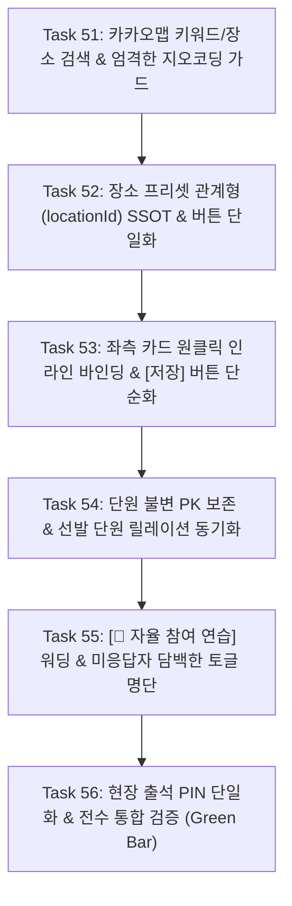

# Moonchoir Rollbook — Phase 4.8: 관계형 데이터, 카카오맵 장소 검색 및 실전 UX 전면 개편 계획서

> **문서 ID**: `08_relational_data_kakao_places_and_ux_overhaul.md`  
> **생성일자**: 2026-10-17  
> **상태**: 승인 대기 / 실행 예정  
> **관련 문서**: [docs/PRD.md](../PRD.md), [docs/DATA_SCHEMA.md](../DATA_SCHEMA.md), [docs/tasks.md](../tasks.md), [AGENTS.md](../../AGENTS.md)

---

## 1. 개요 및 배경 (Context)

배포된 웹앱을 대상으로 실전 사용자 테스트(시나리오 2, 3, 4)를 진행한 결과, 다음과 같은 9가지 핵심 결함 및 UX 괴리가 발견되었습니다:

1. **지오코딩 실패 시 조용한 명동(37.5665, 126.9780) 고착**:
   - 기존 OpenStreetMap Nominatim 엔진이 한국 주소("인천 연수구 한나루로 158번길 31") 질의 시 빈 결과(`[]`)를 반환.
   - 코드가 실패를 조용히 넘기며 명동 좌표를 유지하여, 사용자가 실제 위치에서 인증해도 "27km 밖(100m 이상 밖)"으로 실패함.
2. **장소 프리셋의 비관계형 스냅샷 복사**:
   - 일정 생성 시 위경도/반경을 스냅샷으로 복사하여, 프리셋의 주소나 반경을 수정해도 기존 일정들에 반영되지 않음.
3. **단원 명부의 시스템적 강제 합병 위험 및 릴레이션 누수**:
   - 동명이인이나 복수 계정을 시스템이 임의로 합치려 할 경우 영구 데이터 오염 발생 위험.
   - 구글 시트 쉼표 문자열(`targetMemberIds`) 직렬화/역직렬화 오류로 선발 단원 선택이 풀림.
4. **마스터-디테일 분리감**:
   - 좌측 일정 카드를 눌러도 우측 폼이 반응하지 않고 작은 [수정] 버튼만 반응함.
5. **장소 등록 버튼 중복**:
   - 프리셋 탭 상단, 탭 전환 버튼, 드롭다운 옵션에 3중 중복 존재.
6. **비대상 단원의 홈 화면 혼선 & 어려운 엔지니어링 용어**:
   - '출석 통계 모수 제외' 같은 어려운 용어로 소외감 유발.
   - 누가 아직 투표 안 했는지(미응답자) 확인 불가.
7. **상설 QR 화면에 과거 일정 꼬리표 노출**:
   - 마스터 QR 아래에 엉뚱한 과거 일정 `(경찰의날 녹음)` PIN이 붙어 혼선 초래.

본 계획서는 이를 근본적으로 해결하기 위해 **카카오맵 Places/Geocoder API 연동, 관계형 외래키(SSOT) 정립, 단원 불변 식별자 보존, 온화한 워딩 및 담백한 미응답자 토글 명단 UI**를 구현하는 체계를 수립합니다.

---

## 2. 6대 PIV 개발 과제 (Tasks 51 ~ 56)



### Task 51: 카카오맵 키워드/장소 검색 & 주소 지오코딩 및 엄격한 좌표 검증 (Strict Geocoding Guard)
- **목표**: 
  - 카카오맵 JavaScript SDK(`1465ed6063afca1d3ea91711cbdeb84a`)를 안전하게 로드하고, 키워드 검색(`Places`)과 도로명 주소 검색(`Geocoder`)을 제공.
  - 지오코딩 실패 시 절대로 명동 좌표를 기본값으로 쓰지 않고, 저장을 차단하며 명확한 안내 모달을 띄움.
  - `[📍 내 현재 위치로 설정]` 브라우저 GPS 원터치 버튼을 지원하여 현장에서 즉시 오차 5m 이내 좌표 획득.
- **수정 파일**:
  - `src/components/LocationPickerMap.tsx`
  - `src/types/rollbook.ts`
- **검증 기준**:
  - "서해문화회관", "예술의전당", "인천 연수구 한나루로 158번길 31" 검색 시 카카오 API를 통해 정확한 위경도가 반환됨.
  - 좌표 미확보 상태에서는 저장 버튼 비활성화 또는 경고 팝업 표시.

### Task 52: 장소 프리셋 관계형 단일 진실 공급원(SSOT) 및 중복 버튼 제거
- **목표**:
  - 연습 장소 선택 방식을 복잡한 2분할 탭(`PRESET` vs `DIRECT`)에서 **단일 드롭다운 + `[+ 새 장소 등록]` 단일 버튼**으로 일원화.
  - `Schedule`은 자체 좌표 스냅샷 대신 `locationId` 외래키를 통해 `LocationPreset`의 최신 좌표와 반경을 동적으로 참조.
  - 프리셋의 반경이나 주소를 수정하면 기존 및 미래의 모든 해당 일정이 즉시 최신 정보로 출석 판정되도록 보장.
- **수정 파일**:
  - `src/components/AdminDashboard.tsx`
  - `src/services/sheets.ts`
  - `src/utils/geo.ts`
- **검증 기준**:
  - 프리셋 반경을 100m에서 200m로 바꾸면, 해당 장소를 쓰는 기존 일정의 출석 인정 반경이 즉시 200m로 판정됨.

### Task 53: 대시보드 Master-Detail 카드 클릭 즉시 바인딩 & 간결한 `[저장]` 버튼
- **목표**:
  - 좌측 일정 카드의 작은 `[수정]` 버튼을 없애고, **카드/목록 행 전체 클릭 시 즉시 우측 폼에 인라인 바인딩**.
  - 선택된 카드에 선명한 활성 테두리(Active Ring) 표시.
  - 우측 폼 하단 제출 버튼을 장황한 문구 대신 담백하게 **`[저장]`** (신규 시 `[새 일정 등록]`)으로 변경.
  - 상단에 명확한 `[+ 새 일정 추가]` 버튼으로 신규 작성 모드 전환.
- **수정 파일**:
  - `src/components/AdminDashboard.tsx`
- **검증 기준**:
  - 좌측 아무 카드나 클릭 시 우측 폼의 제목, 날짜, 시간, 장소, 대상자가 즉시 채워지고 수정 후 `[저장]` 클릭 시 즉시 반영됨.

### Task 54: 단원 명부 불변 식별자(PK) 유지 & 선발 단원 릴레이션 동기화
- **목표**:
  - 시스템 임의 자동 병합(Auto-merge) 완전 금지. `Member.id`를 변경 불가능한 고유 PK로 영구 보존.
  - 동명이인이나 중복 의심 계정이 발견될 경우 관리자 페이지 상단에 **단순 검토 알림 배너**만 노출.
  - 선발 단원 지정 리스트에 `이재연 (테너 · 1234)`, `이재연 (베이스 · 5678)`처럼 파트와 뒷자리 4자리를 병기하여 정확한 식별자 매칭 지원.
  - 구글 시트 저장 및 불러오기 시 `targetMemberIds` CSV 문자열 ↔ 배열 변환 완벽 보장.
- **수정 파일**:
  - `src/services/sheets.ts`
  - `src/components/AdminDashboard.tsx`
  - `src/utils/attendanceStats.ts`
- **검증 기준**:
  - 선발 단원을 지정하고 저장한 뒤 다시 일정을 불러와도 선택 상태가 100% 온전히 유지됨.

### Task 55: 부드러운 워딩(`[🌿 자율 참여 연습]`) & 담백한 미응답자 토글 명단 UI
- **목표**:
  - 비대상 단원의 홈 화면에서 "출석 통계 모수" 등 난해한 개발 용어 전면 제거.
  - 배지: **`[🌿 자율 참여 연습]`**, 안내 문구: **"공식 필참 일정이 아닙니다. 참관이나 개인 연습으로 자유롭게 참여하실 수 있습니다."**
  - 버튼: **`[개인 연습으로 참여 투표]`** / **`[자율 출석 체크]`**.
  - 일정 카드 하단에 모노톤 회색 배경의 담백한 토글 명단 구현:
    - 기본: `참석 N명 · 불참 N명 · 미응답 N명 ▼`
    - 클릭 시 펼침: 연한 회색 박스에 참석자, 불참자(사유), 미응답자 텍스트 나열.
- **수정 파일**:
  - `src/components/HomeView.tsx`
  - `src/index.css`
- **검증 기준**:
  - 비대상자가 로그인했을 때 소외감 없이 자율 연습 안내가 뜨며, 미응답자 명단 토글이 군더더기 없이 작동함.

### Task 56: 현장 출석 PIN 단일화 & 전수 통합 검증 (Green Bar)
- **목표**:
  - 상설 QR 서브탭에서 과거 일정 명칭(`(경찰의날 녹음)`) 꼬리표를 완전히 제거.
  - **`🔑 당일 현장 출석 PIN: [ 5 0 2 7 ]  [🔄 PIN 재발급]`** 단일 블록으로 간결화.
  - `npm run typecheck`, `npm run lint`, `npm test`, `npm run build` 전수 통과 확인 및 `DEV_LOG.md` 갱신.
- **수정 파일**:
  - `src/components/AdminDashboard.tsx`
  - `docs/DEV_LOG.md`
  - `docs/tasks.md`
- **검증 기준**:
  - 전체 단위 테스트 및 빌드가 0 error로 통과하고 GitHub Pages에 안전하게 배포 준비 완료.

---

## 3. 검증 프로토콜 (Deterministic Verification)

각 태스크 완료 시마다 AGENTS.md에 규정된 센서를 반드시 실행하여 Green Bar를 유지합니다:
```bash
npm run typecheck
npm run lint
npm test
npm run build
```
모든 검증이 완료된 후 변경사항을 커밋하고 문서 버전을 동기화합니다.
