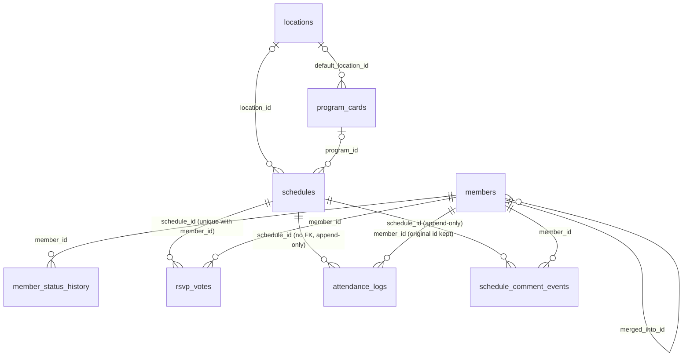
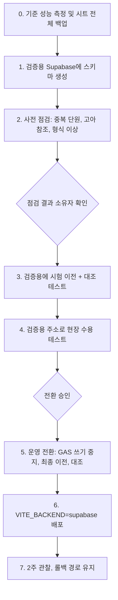

# 15. Google Sheets → Supabase 전환 계획서 (테이블 매핑 · 전환 설계 · 테스트 계획)

> **작성일**: 2026-11-18 (2026-11-19 사용자 검토 및 합의 갱신)
> **상태**: 1차 요구사항 합의 완료 (D1 테이블 매핑 및 불변식 승인, 레거시 1인1기기 액션 폐기, 관리자 로고 3초 이스터에그 및 기본값 1234 제거 합의)
> **운영 현황 확인**: 2026-11-19 기준 실제 운영 단원 24명, 일정 25회차(10/22~11/17) 라이브 데이터 운영 중 확인됨
> **관련 문서**: [AGENTS.md](../../AGENTS.md) · [구조 복구 기록](../ARCHITECTURE_RECOVERY.md) · [구조 복구 로드맵](10_architecture_recovery_roadmap.md) · [네이티브 앱 전환 ADR](12_native_app_transition_and_qr_deeplink_considerations.md)
> **전제(소유자 확정)**: 스토어 등록 없음, 웹앱(PWA) 유지, 무료 티어만 사용. 전환의 1차 목적은 **반응 속도 개선**.

---

## 0. 한 줄 요약

화면과 계산 엔진은 그대로 두고, `SheetsService`가 서버와 주고받는 **통신 부분만** Google Apps Script(GAS)에서 Supabase(PostgreSQL)로 바꾼다. 9개 시트 탭은 9개 테이블로 1:1 옮기고, 지금 GAS가 지키는 규칙(중복 가입 차단, 출석 재시도 중복 방지, 현장 PIN 검증, 원천 로그 수정 금지)은 데이터베이스 함수로 옮겨 서버에서 지킨다.

---

## 1. 현재 구조 사실 확인 (코드 근거)

### 1.1 왜 느린가: 확인된 원인
| 원인 | 근거 | 영향 |
| :--- | :--- | :--- |
| 매 조회마다 9개 탭 전체를 읽음 | `google-apps-script.js` `doGet` (L130~200): 단원·일정·투표·출석로그·장소·이력·카드·댓글·설정을 매번 `readSheetData`로 전부 읽고 RSVP 중복 제거까지 서버에서 수행 | 데이터가 쌓일수록 선형으로 느려짐 |
| 모든 쓰기가 하나의 전역 락을 기다림 | `doPost` L225~229: `LockService.getScriptLock()` + `waitLock(15000)` | 연습 시작 직전 여러 명이 동시에 QR을 찍으면 **한 줄로 줄 서서** 처리됨 (최대 15초 대기) |
| 쓰기 후 전체 스냅샷 재조회 | `sheets.ts` `scheduleRefreshAfterWrite` → `fetchRemoteData` | 출석 1건 저장에도 9개 탭 전체를 다시 받음 |
| GAS 콜드 스타트 | Apps Script 실행 환경 특성 | 한동안 안 쓰다 첫 요청 시 수 초 지연 |

> [!NOTE]
> 정확한 단계별 시간은 `getPerformanceMetrics`가 Apps Script 실행 로그에 남기는 JSON(`membersReadMs`, `logsReadMs` …)으로 확인할 수 있다. 전환 전 기준값(Baseline)을 먼저 기록한다(§7.5).

### 1.2 서버 통신 경계
- 화면 24개 파일이 `sheetsService` 싱글턴을 사용한다(`App.tsx`, `HomeView.tsx`, `QRScannerModal.tsx`, `BindingModal.tsx`, 관리자 탭들, `useScheduleAdmin`, `useAttendanceAdmin`, `auth.ts` 등).
- 실제 네트워크 호출은 `sheets.ts`의 두 지점에만 있다:
  - 읽기: `requestRemoteSnapshot()` → GAS `doGet` (전체 스냅샷)
  - 쓰기: `sendToGoogleSheet()` / `postToGoogleSheet()` → GAS `doPost` (`action` + `payload`)
- 응답 해석은 `sheetsParser.ts`, 로컬 캐시는 `sheetsStorage.ts`로 이미 분리돼 있다.
- **결론**: 교체 범위를 "읽기 1개 + 쓰기 1개 통로"로 좁힐 수 있다. 화면 코드는 원칙적으로 수정하지 않는다.

### 1.3 GAS 쓰기 액션 목록 (실사용 26개 이식 대상, 2개 레거시 폐기)
- **폐기 확정 (2개)**: `BIND_DEVICE`, `UNBIND_DEVICE` (1인 1기기 락 영구 폐기 합의에 따라 Supabase 이식 제외)
- **이식 대상 (26개)**:
  - 인증: `VERIFY_ADMIN_PIN`, `VERIFY_ON_SITE_PIN`
  - 출석: `RECORD_ATTENDANCE`(=`SUBMIT_CHECKIN`), `CLEAR_ATTENDANCE`
  - 댓글: `ADD_COMMENT`, `EDIT_COMMENT`, `DELETE_COMMENT`
  - 투표: `SUBMIT_RSVP`, `CANCEL_RSVP`
  - 단원: `REGISTER_AND_BIND_MEMBER`, `BIND_EXISTING_MEMBER`, `REGISTER_MEMBER`, `UPDATE_MEMBER`, `ADD_MEMBER_HISTORY`(단원 이력 및 온보딩/후속가입용), `DELETE_MEMBER`, `MERGE_MEMBERS`
  - 일정: `CREATE_SCHEDULE`(=`REGISTER_SCHEDULE`), `UPDATE_SCHEDULE`, `DELETE_SCHEDULE`, `BATCH_DELETE_SCHEDULES`, `BATCH_UPDATE_SCHEDULES`
  - 장소·카드·설정: `SAVE_LOCATION`(=`REGISTER_LOCATION`), `DELETE_LOCATION`, `SAVE_PROGRAM_CARD`, `DELETE_PROGRAM_CARD`, `SAVE_CONFIG`

### 1.4 현재 서버가 지키지 않는 규칙 (전환 시 함께 보강 가능)
- **RSVP 1시간 전 마감**은 클라이언트(`timeWindow.ts`의 `isRsvpOpenForSchedule`)에서만 검사한다. GAS `SUBMIT_RSVP`에는 마감 검사가 없다.
- **원천 로그 수정 금지**는 코드 규칙일 뿐 시트가 막아주지 않는다(시트에서 손으로 지울 수 있음).
- **민감 정보 노출**: `doGet`이 전체 전화번호, `boundDeviceId`, `adminPin`이 들어 있는 설정을 누구에게나 돌려준다(Task 76, 시제품 단계 위험으로 수용됨).

---

## 2. 테이블 매핑 (9개 탭 → 9개 테이블)

### 2.1 설계 원칙
1. **ID는 지금 문자열 그대로** (`mem_...`, `series_...`). UUID로 바꾸지 않는다. 바꾸면 기존 로그의 `memberId`/`scheduleId` 연결이 끊긴다.
2. **분류값에 고정 목록 제약(enum/CHECK)을 걸지 않는다.** 파트·단원 상태·일정 구분·출결 상태는 `text`. (AGENTS.md "동적 메타데이터 보존")
3. **시각 문자열은 원문 보존.** 지금 기록은 KST `YYYY-MM-DD HH:mm:ss` 문자열이고, 과거 행에는 `...Z` 형식도 섞여 있다. 원문은 `text`로 그대로 옮기고, 서버가 받은 시각은 별도 `received_at timestamptz`로 추가한다. (구조 복구 기록: "시도 시각과 저장 확정 시각 모두 보존" 결정과 일치)
4. **원천 로그 2종(`출석원천로그`, `일정댓글`)은 DB가 수정·삭제를 거부**하도록 만든다(트리거 + 권한 회수).
5. **외래키(FK)는 "깨진 과거 데이터를 막지 않는" 수준으로만** 건다. 시트에는 FK 검사가 없었으므로 고아 데이터(지워진 일정을 가리키는 로그 등)가 있을 수 있다. 원천 로그 테이블에는 FK를 걸지 않고, 이전 시 고아 행 개수를 보고서로 남긴다(§5.3).
6. **컬럼 이름**: DB는 `snake_case`, 앱은 지금의 `camelCase`. 변환은 새 백엔드 어댑터 한 곳에서만 한다.

### 2.2 매핑표

#### ① `단원명부` → `members`
| 시트 헤더 | 컬럼 | 타입 | 비고 |
| :--- | :--- | :--- | :--- |
| id | id | text PK | |
| name | name | text not null | |
| part | part | text | 자유 문자열 |
| phoneLast4 | phone_last4 | text | **text 필수**(앞자리 0 보존, 현재 시트에서 가장 많이 깨지던 부분) |
| phone | phone | text | 전체 번호. 공개 조회에서 제외(§4) |
| role | role | text | `MEMBER`/`ADMIN`/`GUEST` |
| status | status | text | `ACTIVE`/`INACTIVE`/`MERGED`/`DELETED` |
| joinedAt | joined_at | text | 원문 보존 (YYYY-MM-DD) |
| memberStatus | member_status | text | 자유 문자열 |
| note | note | text | |
| boundDeviceId | bound_device_id | text | 참고용 메타데이터(현재 접근 차단에 쓰지 않음) |
| boundDeviceAt | bound_device_at | text | |
| mergedIntoId | merged_into_id | text | `members.id` 참조(자기 참조), FK 없이 검증 함수로 확인 |
| — | created_at / updated_at | timestamptz | 신규, 서버 자동 |

- 고유 제약: `(정규화 이름, 정규화 전체 전화번호)`에 대해 `status in ('ACTIVE','INACTIVE')`인 행만 부분 유니크 인덱스. → **GAS 락 안의 중복 검사를 DB가 대신 보장**. 단, 기존 데이터에 이미 중복이 있으면 인덱스 생성이 실패하므로 이전 전 점검 필수(§5.3).

#### ② `단원변경로그` → `member_status_history`
| 시트 헤더 | 컬럼 | 타입 |
| :--- | :--- | :--- |
| id | id | text PK |
| memberId | member_id | text (index) |
| name | name | text (작성 당시 이름 스냅샷) |
| status / part | status / part | text |
| startDate / endDate | start_date / end_date | text (YYYY-MM-DD, `2999-12-31` 무기한 유지) |
| reason | reason | text |
| createdAt | created_at | text 원문 + `received_at timestamptz` |

#### ③ `일정카드` → `program_cards`
`id` PK, `title`, `description`, `category`, `default_location_id`, `default_start_time`, `default_end_time`, `is_archived boolean default false`, `created_at`(원문 text), `target_audience_type`, `target_parts text[]`, `target_member_ids text[]`.

#### ④ `장소정보` → `locations`
`id` PK, `name`, `address`, `detail_address`, `entrance_note`, `latitude double precision`, `longitude double precision`, `radius_meters integer`, `is_default boolean`.

#### ⑤ `일정캘린더` → `schedules`
| 시트 헤더 | 컬럼 | 타입 | 비고 |
| :--- | :--- | :--- | :--- |
| id | id | text PK | |
| title, date, startTime, endTime | title, date, start_time, end_time | text | 날짜/시간 원문 유지. `date`에 인덱스 |
| locationName, locationId | location_name, location_id | text | |
| latitude, longitude, radiusMeters | latitude, longitude, radius_meters | numeric | 앱 타입의 `targetLat/targetLon` 변환은 기존 파서 규칙 재사용 |
| category | category | text | |
| checkInPin | check_in_pin | text | **보존만** (현재 무시되는 레거시 값) |
| description | description | text | |
| programId | program_id | text | |
| seriesId, seriesIndex, seriesTotal | series_id, series_index, series_total | text / integer | |
| isArchived, isCancelled | is_archived, is_cancelled | boolean | |
| targetAudienceType | target_audience_type | text | |
| targetParts, targetMemberIds | target_parts, target_member_ids | text[] | 시트에서는 쉼표 구분 문자열 → 배열 변환 |
| visibility | visibility | text | 빈 값 = `ALL` 해석 유지 |

> 앱 타입 `Schedule`에는 `detailAddress`, `entranceNote`, `recurrenceRule`도 있으나 **시트 헤더에는 없다**(장소 프리셋에서 화면용으로 채워지는 값으로 추정). 이전 시 새 컬럼을 만들지 않고 현재 동작을 유지한다. 구현 단계에서 사실 확인 후 기록 갱신.

#### ⑥ `사전투표_RSVP` → `rsvp_votes`
`id` PK, `schedule_id`, `member_id`, `member_name`, `part`, `status`, `reason`, `timestamp`(원문 text), `received_at`.
- **유니크 `(schedule_id, member_id)`** — 지금 GAS가 조회할 때마다 하던 중복 제거를 DB가 저장 시점에 보장. 이전 시 기존 중복은 GAS와 같은 규칙(타임스탬프가 가장 늦은 것, 같으면 마지막 행)으로 1건만 남기고, **버린 행은 별도 보고서 파일로 백업**.
- 현재 응답만 유지(이력 없음)라는 확정 정책 그대로.

#### ⑦ `출석원천로그` → `attendance_logs` (Append-Only)
| 시트 헤더 | 컬럼 | 타입 |
| :--- | :--- | :--- |
| id | id | text PK (재시도 멱등성 키) |
| timestamp | timestamp | text 원문 (KST 또는 과거 `Z` 형식 그대로) |
| scheduleId, memberId | schedule_id, member_id | text (index, FK 없음) |
| memberName, part | member_name, part | text (당시 스냅샷) |
| authMethod | auth_method | text |
| isVerifiedLocation | is_verified_location | boolean |
| adminNote | admin_note | text (`[ATTENDANCE_CLEARED]` 등 표식 포함) |
| distanceMeters | distance_meters | numeric |
| deviceId | device_id | text |
| — | **seq** | bigint identity (신규) |
| — | received_at | timestamptz default now() (신규) |

> [!IMPORTANT]
> 지금 출석 판정 엔진은 **시트 행 순서(추가된 순서)**로 "가장 마지막 조치"를 정한다(구조 복구 기록 3장: 타임스탬프가 아니라 append 순서). DB는 행 순서를 보장하지 않으므로, 이전 시 시트의 행 번호를 `seq`에 그대로 넣고 이후엔 자동 증가시킨다. 조회는 항상 `order by seq`. **이걸 빠뜨리면 출석 초기화/수동 인정 결과가 뒤바뀐다.**

- `UPDATE`/`DELETE`는 트리거로 거부, 앱 역할에서는 권한 자체를 회수.

#### ⑧ `일정댓글` → `schedule_comment_events` (Append-Only)
`id` PK, `schedule_id`, `member_id`, `member_name`, `part`, `action`(`CREATE`/`EDIT`/`DELETE`, text), `target_id`, `text`, `timestamp`(원문), `device_id`, `seq bigint identity`, `received_at`. 출석 로그와 같은 수정 금지 규칙.

#### ⑨ `환경설정` → `app_config` + `app_secrets`
- `app_config(key text PK, value text, description text)` — 지금 Key-Value 구조 그대로. 공개 조회 가능.
- `app_secrets(key text PK, value text)` — `adminPin`, `activeOnSitePin`, `masterQrToken`만 분리. **공개 조회 불가**, 검증 함수(`verify_admin_pin` 등)만 내부에서 읽음.
- `sheetsWebAppUrl`은 전환 후 의미가 없으므로 보존만 하고 사용 중지.

> [!WARNING]
> 비밀값 분리는 화면 동작에 영향이 있을 수 있다. 현재 `getActiveOnSitePin()`처럼 클라이언트가 설정에서 PIN을 직접 읽는 곳이 있으면(관리자 화면의 PIN 표시 등) 관리자 확인 후 받아오는 함수로 바꿔야 한다. 구현 1단계에서 사용처를 전수 조사한다.

### 2.3 관계도 (전환 후)

출석률·뱃지·출결 판정은 지금처럼 **테이블이 아니라 클라이언트 계산 결과**(`attendanceStats.ts`)로 유지한다.

---

## 3. 전환 설계

### 3.1 목표 구조
```text
화면 24개 (변경 없음)
   ↓
SheetsService (상태·캐시·동기화 알림 그대로)
   ↓
RemoteBackend 인터페이스  ← 신규 (fetchSnapshot / call(action, payload))
   ├─ GasBackend      (현재 코드 이동, 롤백용으로 당분간 유지)
   └─ SupabaseBackend (신규: 9개 테이블 병렬 조회 + DB 함수 호출)
   ↓
Supabase PostgreSQL (테이블 9+1, DB 함수, 권한 정책)
```
- **액션 이름과 응답 형식(`{ success, ... }`)을 그대로 유지**한다. `SupabaseBackend.call('RECORD_ATTENDANCE', payload)`가 DB 함수 `record_attendance(...)`를 부르고 GAS와 같은 모양의 결과를 돌려준다. 그래서 `SheetsService`와 화면, 기존 테스트가 거의 바뀌지 않는다.
- 백엔드 선택은 빌드 환경변수(`VITE_BACKEND=gas|supabase`)로 한다. 롤백 = 값 바꿔 재배포.

### 3.2 읽기: 1단계는 "스냅샷 방식 유지", 2단계에서 최적화
- **1단계(전환 직후)**: 지금처럼 앱 시작 시 전체를 받되, 9개 테이블을 **동시에** 조회한다. GAS의 순차 읽기 + 콜드 스타트가 사라지는 것만으로 체감 개선이 가장 크다. 계산 엔진 입력이 그대로라 위험이 가장 낮다.
- **2단계(안정화 후, 선택)**: 쓰기 후 전체 재조회 대신 바뀐 테이블만 재조회, 출석로그·댓글은 `seq` 이후분만 증분 조회. 필요 시 Supabase Realtime으로 관리자 화면 자동 갱신.
- 성능 목표는 §7.5에서 측정값으로 확정한다(추정치로 약속하지 않음).

### 3.3 쓰기: DB 함수(RPC)로만 쓴다
앱이 테이블에 직접 `insert/update` 하지 않고, **GAS 액션 1개 = DB 함수 1개**로 옮긴다. 각 함수는 하나의 트랜잭션이라 GAS의 "전역 락 안에서 검사 후 쓰기"를 대체하며, 서로 다른 단원의 출석은 줄 서지 않고 동시에 처리된다.

| 규칙 | 지금 (GAS) | 전환 후 (DB) |
| :--- | :--- | :--- |
| 출석 재시도 중복 방지 | 락 안에서 id 존재 확인 | `id` PK + `insert ... on conflict (id) do nothing` → 이미 있으면 "이미 저장됨" 응답 |
| 현장 PIN 검증 | 락 안에서 설정 읽어 비교 | `record_attendance`가 `app_secrets`의 현재 PIN과 비교 |
| 중복 가입 차단 | 락 안에서 이름+전체번호 검사 | 부분 유니크 인덱스 + 함수 내 검사(동시 가입도 DB가 차단) |
| 가입+기기연결 원자성 | 한 락 안에서 처리 | 한 함수(트랜잭션) 안에서 처리 |
| RSVP 마감 | **클라이언트만** | 함수에서 서버 시각(KST) 기준 검사 추가, 관리자 경로는 예외 (§6 결정 D5) |
| 원천 로그 수정 금지 | 코드 관례 | 트리거로 거부 |
| 단원 병합 | 로그 id 불변, `mergedIntoId` 설정 | 같은 규칙, 함수 1개 트랜잭션 |
| 단원 삭제 | 기록 없는 경우만 물리 삭제, MERGED 보호 | 같은 규칙을 함수에서 검사 |

### 3.4 권한·보안 (지금보다 나빠지지 않게, 일부 개선)
- 회원 로그인(Supabase Auth)은 **도입하지 않는다**. 지금과 같은 "브라우저 프로필 + 전화번호 확인" 방식 유지 → 화면 흐름 변화 없음.
- 공개 키(anon key)는 앱에 들어가므로 비밀이 아니다. 따라서:
  - 테이블 직접 쓰기 권한은 **전부 회수**, 쓰기는 DB 함수로만.
  - 공개 조회는 `members_public` 뷰(전체 전화번호 제외)와 나머지 테이블. `app_secrets`는 조회 불가.
- **남는 위험(현재와 동일, 수용 상태 유지)**: 누구나 함수를 직접 호출할 수 있으므로, 다른 사람 ID로 투표/댓글을 넣는 것을 서버가 완전히 막지는 못한다. Task 76(서버 측 인증)은 여전히 정식 운영 전 과제로 남는다.
- 관리자 기능 함수(일정 수정, 병합 등)는 관리자 PIN 확인을 함수 인자로 받게 할지 결정 필요(§6 결정 D6). 지금 GAS는 서버 검사 없이 받는다.

### 3.5 무료 티어 제약 (반드시 알고 시작)
| 항목 | 내용 | 대응 |
| :--- | :--- | :--- |
| **7일 미사용 시 프로젝트 일시정지** | 무료 프로젝트는 일정 기간 요청이 없으면 정지되고, 대시보드에서 수동 재개해야 한다 | 주 1회 이상 연습이면 평소엔 문제 없음. **방학·휴식기**가 걱정되면 하루 1회 가벼운 조회를 보내는 무료 예약 작업(GitHub Actions) 추가 검토 |
| DB 500MB | 문자열 위주 출결 데이터로는 수년치도 여유 | 음원/악보 파일은 DB가 아니라 Storage(1GB)로 별도 계획 |
| 프로젝트 2개 | 운영(prod) + 검증(staging) 정확히 2개 | 검증용 프로젝트를 테스트에 사용(§7) |
| 자동 백업 없음(무료) | 무료 플랜은 관리형 백업 미제공 | 주 1회 데이터 내보내기 스크립트(CSV/JSON)를 저장소 밖에 보관, 또는 Google 시트로 읽기 전용 내보내기 |

> [!CAUTION]
> 무료 플랜 세부 조건은 바뀔 수 있다. 착수 직전 Supabase 공식 요금 페이지에서 정지 조건·용량을 다시 확인하고 이 표를 갱신한다.

### 3.6 Google 시트는 어떻게 되나
- 전환 순간 시트는 **읽기 전용 보관본**이 된다(GAS 쓰기 중지). 탭·헤더는 지우지 않는다(AGENTS.md NEVER 규칙).
- 지금 임원진이 시트를 직접 열어 보는 습관이 있다면, 전환 후 확인 수단을 정해야 한다: (a) Supabase 대시보드 표 편집기(계정 필요), (b) 관리자 화면 기능, (c) DB → 시트 정기 내보내기. (§6 결정 D4)

---

## 4. 코드 변경 범위 (예상)
| 파일 | 변경 | 비고 |
| :--- | :--- | :--- |
| `src/services/backend/types.ts` | 신규 | `RemoteBackend` 인터페이스 |
| `src/services/backend/gasBackend.ts` | 신규 | `sheets.ts`의 기존 fetch/post 코드를 **이동만** |
| `src/services/backend/supabaseBackend.ts` | 신규 | 스냅샷 병렬 조회, 액션→함수 매핑, snake↔camel 변환 |
| `src/services/sheets.ts` | 소폭 수정 | `requestRemoteSnapshot` / `postToGoogleSheet`가 백엔드 인터페이스를 호출하도록 |
| `src/services/sheetsParser.ts` | 최소 수정 | 배열·불리언·숫자 해석이 이미 정규화돼 오는 경우 처리 |
| `supabase/migrations/*.sql` | 신규 | 테이블, 인덱스, 트리거, 권한, 함수 30개 |
| `scripts/migrate-sheets-to-supabase.ts` | 신규 | 1회성 이전 + 대조 보고서 |
| 화면 컴포넌트 | **원칙적으로 없음** | 비밀값 분리 영향 지점만 예외(§2.2 ⑨) |
| `AGENTS.md` | 규칙 갱신 | "시트 통신은 `services/sheets.ts`로만" → "원격 통신은 `services/` 백엔드 어댑터로만" (승인 필요) |

---

## 5. 데이터 이전 절차

### 5.1 순서


### 5.2 이전 스크립트 원칙
- 시트 데이터는 **현재 GAS `doGet` 응답(JSON)** 을 그대로 받아 입력으로 쓴다. 앱이 실제로 보는 것과 같은 데이터에서 출발하기 위함.
- 행 순서를 `seq`로 보존(출석로그·댓글).
- 값은 **바꾸지 않고 옮긴다**. 형식 정규화(예: `Z` 시각을 KST로)는 하지 않는다. 해석은 지금처럼 앱의 파서가 한다.
- 다시 실행해도 결과가 같아야 한다(대상 테이블 비우고 재적재 방식, 검증용에서만 반복).

### 5.3 사전 점검 보고서 (이전 전에 소유자에게 보여줄 것)
- 같은 이름+전체번호인 활성 단원 쌍 (있으면 유니크 인덱스 생성 실패 → 병합 먼저)
- RSVP `(일정, 단원)` 중복 행과 남길 행/버릴 행 목록
- 존재하지 않는 일정·단원을 가리키는 출석로그·투표·댓글 수 (삭제하지 않고 그대로 이전)
- `mergedIntoId`가 가리키는 단원이 없는 경우, 병합 순환
- 전화번호 앞자리 0이 사라진 행(숫자로 저장된 흔적)
- 빈 `id` 행

---

## 6. 결정 사항 및 사용자 합의 현황 (2026-11-19 갱신)

| # | 항목 | 결정 내용 |
| :--- | :--- | :--- |
| **D1** | 테이블 매핑 및 불변식 승인 | **승인 완료**. 9개 테이블 1:1 매핑, Event Sourcing Append-Only 원천로그 구조 및 동적 메타데이터 보존 승인. |
| **D2** | `@supabase/supabase-js` vs 직접 `fetch` | **직접 `fetch`(REST/RPC) 우선**. 추가 번들 없이 경량 유지. |
| **D3** | AGENTS.md 통신 경계 문구 수정 | **승인 완료**. "시트 통신"에서 "서비스 계층 원격 백엔드 어댑터"로 범위 확장. |
| **D4** | 임원진 데이터 확인 수단 | Supabase 대시보드 사용 + **구글 시트 자동 내보내기(서비스 계정)** 백로그 등록. |
| **D5** | RSVP 마감 서버 강제 | **승인**. 시작 1시간 전 마감 서버 함수에서 검증 (관리자 예외). |
| **D6** | 관리자 PIN 이스터에그 및 기본값 제거 | **승인 완료**. 관리자 헤더 로고 3초 이상 롱클릭 시 마스터 PIN 입력 모달 오픈. 코드 내 `1234` 기본값 완전 제거. |
| **D7** | 전환 시점 | 연습 없는 평일 야간, 30분 이내 (작업 전 공지). |
| **D8** | 무료 티어 휴식기 정지 방지 | GitHub Actions 주 단위 데이터 백업 내보내기 호출로 해결. |
| **N1** | 개인 PIN 도입 및 권한 분리 | **전환 완료 후 Phase 1.5로 진행**. 개인 PIN은 단방향 해시 저장(관리자도 열람 불가), 출결/투표 등 활동 데이터는 원천로그로 투명하게 기록. |
| **N2** | 공개 투표 현황 가림 여부 | **현행 유지(보류)**. 추후 별도 논의. |
| **N3** | 1인 1기기 폐기 | **폐기 확정**. `BIND_DEVICE`, `UNBIND_DEVICE` 삭제. |
| **N4** | 악보 / 음원 뷰어 | **구글 드라이브 PDF 미리보기 임베드 + 유튜브 인앱 플레이어** 우선. 오디오 추출 등은 별도 미디어 계획 수립. |

---

## 7. 테스트 계획

### 7.1 원칙
- **전환 전후 "같은 입력 → 같은 출석 결과"** 가 최상위 합격 조건이다. 빠른데 숫자가 다르면 실패.
- 모든 단계 종료 시 `npm run typecheck`, `npm run lint`, `npm test` 통과(현재 기준 299개).
- 실제 운영 DB에서는 테스트하지 않는다. 검증용 Supabase 프로젝트를 쓴다.

### 7.2 테스트 계층

| 층 | 무엇을 | 어떻게 | 언제 실행 |
| :--- | :--- | :--- | :--- |
| L1 기존 단위 테스트 | 계산 엔진, 화면, `SheetsService` 동작 | 기존 299개 그대로. 백엔드는 모의 객체 | 매 커밋 |
| L2 백엔드 계약 테스트 | GAS/Supabase 어댑터가 **같은 액션에 같은 모양의 응답**을 주는가 | 하나의 테스트 표(액션×입력×기대응답)를 두 어댑터에 똑같이 돌림. `fetch`는 모의 | 매 커밋 |
| L3 DB 규칙 테스트 | DB 함수·트리거·권한이 규칙을 지키는가 | 검증용 프로젝트에 SQL/스크립트로 실행 (아래 표) | 스키마 변경 시, 전환 전 |
| L4 이전 대조 테스트 | 옮긴 데이터가 시트와 같은가 | 이전 스크립트가 자동 보고서 생성 (§7.4) | 시험 이전마다, 운영 전환 직후 |
| L5 성능 측정 | 실제로 빨라졌는가 | 같은 기기·네트워크에서 전후 측정 (§7.5) | 전환 전후 |
| L6 현장 수용 테스트 | 실제 휴대폰에서 흐름이 되는가 | 체크리스트 수동 확인 (§7.6) | 운영 전환 전 1회, 직후 1회 |
| L7 롤백 훈련 | 문제가 나면 되돌릴 수 있는가 | 검증용에서 `VITE_BACKEND=gas`로 되돌려 봄 (§7.7) | 운영 전환 전 1회 |

### 7.3 L3 DB 규칙 테스트 시나리오 (WHEN / THEN)

**출석**
1. WHEN 새 id로 출석 기록 THEN 1행 추가, `{ success: true }`.
2. WHEN 같은 id로 다시 기록(응답 유실 후 재시도 상황) THEN 행 수 그대로, "이미 저장됨" 응답.
3. WHEN 서로 다른 단원 20명이 동시에 기록 THEN 20행 모두 저장, 실패 0건, 중복 0건.
4. WHEN 현장 PIN 방식으로 이전 PIN 사용 THEN 거부, 행 추가 없음. 현재 PIN이면 성공.
5. WHEN 출석로그 행을 `update` 또는 `delete` 시도 THEN DB가 거부.
6. WHEN 출석 초기화 THEN 기존 행은 그대로, 초기화 표식 행이 **새로** 추가되고 `seq`가 더 큼.

**단원**
7. WHEN 같은 이름+전체번호로 동시에 2번 가입 THEN 정확히 1명만 생성, 나머지는 중복 응답.
8. WHEN 이름만 같고 번호가 다른 가입 THEN 생성됨(자동 병합 없음).
9. WHEN 기존 단원 연결 시 전체번호 불일치 THEN 거부. 앞자리 0 차이(`0101234...` vs `101234...`)는 지금 규칙대로 같은 번호로 판정.
10. WHEN 단원 병합 THEN 병합된 행은 `MERGED` + `merged_into_id` 설정, 해당 단원의 출석로그 `member_id`는 **하나도 바뀌지 않음**.
11. WHEN 기록이 있거나 `MERGED`이거나 다른 단원의 병합 대상인 단원 삭제 시도 THEN 거부.

**투표**
12. WHEN 같은 단원이 같은 일정에 두 번 투표 THEN 1행만 남고 최신 값.
13. WHEN 시작 1시간 전 이후 일반 단원 투표(D5 승인 시) THEN 거부. 관리자 경로는 허용.
14. WHEN 투표 취소 THEN 행 삭제(현재 정책: 이력 없음).

**댓글**
15. WHEN 작성·수정·삭제 THEN 각각 새 이벤트 행만 추가, 기존 행 불변. 화면 투영 결과는 지금과 동일.

**권한**
16. WHEN 공개 키로 `members`의 `phone` 또는 `app_secrets` 조회 THEN 거부(또는 빈 결과).
17. WHEN 공개 키로 아무 테이블에 직접 `insert/update/delete` THEN 거부. 함수 호출로만 가능.

**분류값**
18. WHEN 파트 `"객원(바리톤)"`, 상태 `"기타(직접입력)"` 같은 새 문자열 저장 THEN 그대로 저장·조회.

### 7.4 L4 이전 대조 보고서 (자동, 전부 일치해야 합격)
1. **행 수**: 9개 탭 각각 시트 vs 테이블 (RSVP는 "중복 제거 후" 기준, 버린 행 수 별도 표기).
2. **ID 집합**: 각 테이블의 id 목록이 정확히 같음(빠짐·추가 0).
3. **필드 값**: 모든 행의 모든 필드를 앱 타입으로 해석한 결과 비교(파서 통과 후 deep-equal). 특히 전화번호 앞자리 0, 빈 값, 불리언, 배열.
4. **행 순서**: 출석로그·댓글의 `seq` 순서 = 시트 행 순서.
5. **출석 결과 동일성 (가장 중요)**: 시트 스냅샷과 Supabase 스냅샷 각각으로
   - 모든 단원 × 전체 기간 `calculateCumulativeAttendance` 결과(출석/지각/사유/결석/출석률/뱃지)
   - 모든 일정의 `reconcileAttendance` 결과(단원별 최종 상태)
   - 관리자 매트릭스 셀 표시값(`matrixCell.ts`)
   를 계산해 **완전히 같아야** 한다. 하나라도 다르면 전환 중단, 원인 기록.

### 7.5 L5 성능 측정
| 지표 | 측정 방법 | 기록 |
| :--- | :--- | :--- |
| 앱 첫 데이터 표시까지 | 동일 휴대폰, LTE/와이파이 각각 5회, 중간값·최댓값 | 전환 전 / 후 |
| 전체 스냅샷 응답 시간 | 브라우저 개발자 도구 네트워크 탭 | 전 / 후 |
| QR 출석 → "출석 완료" 표시까지 | 5회 | 전 / 후 |
| 동시 20건 출석 처리 완료 시간 | 검증용에서 스크립트로 | 전(GAS) / 후 |
| 투표 저장 → 화면 반영 | 5회 | 전 / 후 |

합격 기준은 **전환 전 측정값을 본 뒤** 소유자와 숫자로 정한다(예: "출석 완료 표시 중간값이 지금의 절반 이하").

### 7.6 L6 현장 수용 체크리스트 (아이폰 Safari·홈화면 앱, 안드로이드 Chrome·홈화면 앱 각 1대)
- [ ] 앱 열기 → 홈에 오늘/다음 일정이 보임
- [ ] 신규 가입 → 즉시 내 정보 표시
- [ ] 기존 단원 연결(전체번호 확인)
- [ ] QR 출석(위치 통과) → 완료 표시 → 관리자 매트릭스에 반영
- [ ] 현장 PIN 출석
- [ ] 같은 출석 재시도 시 "이미 저장됨"
- [ ] 투표 / 변경 / 취소, 마감 후 차단
- [ ] 댓글 작성·수정·삭제
- [ ] 관리자: 일정 생성·수정·일괄 수정·삭제, 카드 연결, 장소 저장
- [ ] 관리자: 수동 출석 인정·초기화, 단원 병합
- [ ] 관리자: 현장 PIN 교체 후 이전 PIN 거부
- [ ] 네트워크 끊고 출석 시도 → "출석 실패" 안내, 완료로 표시되지 않음 (확정 정책)
- [ ] 내 출석률·뱃지가 전환 전 화면과 같음

### 7.7 L7 롤백 훈련
1. 검증용에서 Supabase로 운영하며 출석·투표 몇 건 기록.
2. `VITE_BACKEND=gas`로 재배포 → 앱이 시트 데이터로 정상 동작하는지 확인.
3. **주의**: 롤백하면 Supabase에만 쓰인 신규 기록은 시트에 없다. 운영 롤백 시에는 그 사이 기록을 시트로 되돌려 넣는 역이전 스크립트가 필요하다 → 전환 후 2주 관찰 기간 동안만 이 스크립트를 유지하고, 이후 GAS 경로 제거.

---

## 8. 단계별 일정과 통과 기준

| 단계 | 내용 | 통과 기준 | 상태 |
| :--- | :--- | :--- | :--- |
| P0 | 결정 D1~D3, D5~D7 승인 · 기준 성능 측정 · 시트 백업 | 승인 기록 반영 완료 | **완료** |
| P1 | `RemoteBackend` 인터페이스 도입, GAS 코드 이동(동작 변화 없음) | 기존 299개 테스트 + L2(GAS 쪽) 통과, 운영 동작 동일 | **완료** (303개 테스트 통과) |
| P2 | Supabase 스키마·트리거·권한·RPC 함수 작성 | L3 18개 시나리오 통과 | **완료** (10개 테이블 + RLS + 26개 RPC 생성) |
| P3 | `SupabaseBackend` 구현 | L2(Supabase 쪽) 통과 | **완료** (308개 테스트 통과) |
| P4 | 데이터 이전 스크립트 + 사전 점검 및 정합성 대조 보고서 | L4 100% 일치 | **완료** (단원 24명, 일정 25회, 로그 175건, 출석 통계 100% 일치 검증) |
| P5 | 통합 현장 테스트 + 롤백 훈련 | L5 측정, L6 체크리스트, L7 완료 | **진행 준비 완료** |
| P6 | 운영 전환 배포 (`VITE_BACKEND=supabase`) | 전환 직후 L4 재실행 일치, L6 축약판 통과 | 대기 |
| P7 | 2주 관찰 후 GAS 경로·역이전 스크립트 제거 | 관찰 기간 데이터 이상 0건 | 대기 |

각 단계는 이전 단계 통과 전 시작하지 않는다. P1은 운영에 영향 없는 순수 구조 정리라 가장 먼저 안전하게 할 수 있다.

---

## 9. 이번 계획에서 하지 않는 것 (Out of Scope)
- 회원 로그인(Supabase Auth) 도입, Task 76 서버 인증 완성
- 푸시 알림, 앱 스토어 배포
- 출석 결과 UI 개선, 댓글 진입점 확대, 레벨업/뱃지 단계 안내 (별도 계획)
- 파트별 음원 플레이어, 악보 뷰어 (별도 계획, Supabase Storage 사용 예정)
- 출석률 계산 규칙 변경

## 10. 남은 확인 사항
- `Schedule.detailAddress` / `entranceNote` / `recurrenceRule`이 시트 헤더에 없는 이유와 실제 출처(구현 P1에서 확인).
- 클라이언트가 설정에서 비밀값(PIN 등)을 직접 읽는 사용처 전수 조사(P1).
- 현재 운영 시트의 실제 행 수와 중복·고아 데이터 현황(P4 보고서로 확인, 아직 감사되지 않음).
